# 股票秘诀之《独孤九剑》

> **所谓进场容易，出场难。你可以随意进场，但你不能随意的出场。**
>
> **炒股，你不仅仅要学会如何抓住时机赚钱，更重要的是学会放手！**

会玩的人叫做投资，不会玩的人叫消费。克服贪婪心理，**学会空仓和忍耐**，这个心态是你走向炒股高手的必经之路。

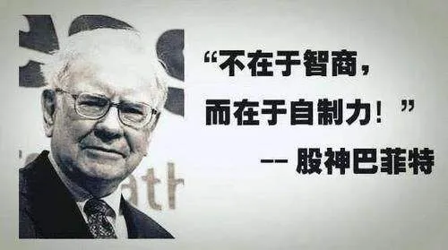

保持良好的耐心，才能在时机出现的时候更好的抓住，获得丰厚的回报。

**独孤九剑**口诀：【归妹趋无妄、无妄趋同人、同人趋大有、甲转丙】

**讲究料敌先机，是招式求变的极至，以无招胜有招。**

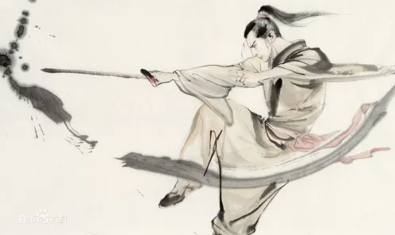

今日就跟大家分享一下非常有效的秘诀，不仅仅可用于股市，亦可以用于其他用K线做价格指标的产品，相信当你学会后，一定会避开很多亏损的股票。

## 第一式：总诀式

**绿荫丛中一线红，抓紧买入莫放松。**

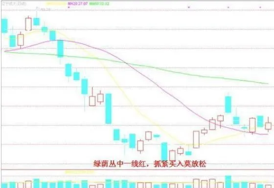

这口诀是说，当一只股票连续多日向下回调，呈现出一片绿色时，如果有一天你发现K线当日可能会收阳星，或者是小阳线时，我们不必去分析原因，不管是主力震仓、吸货、还是放量出货，我们都要尽管杀入，次日一般都会出现长阳线反弹的。

## 第二式：破剑式

**平静水面一波高，当心后面大波涛**

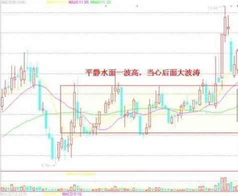

这句口诀说的是当一只股票在底部横盘了很长的时间，其连续多日的分时线呈现出十分平缓的形态，就像是下倾的缓坡或者是平静的水面，当有一天水面突然涌起一波高的波浪，之后又不能再次回到原来的水平面时，往往后面会来一股更加惊人的大波涛。

## 第三式：破刀式

**套牢补仓求保本，奢求盈利实为贪**

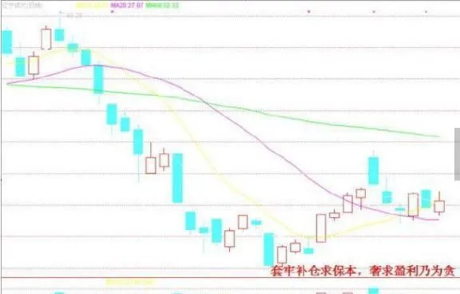

这句口诀说是投资者不要过于贪心，当股票被套的时候，很多股民的操作方法就是低位补仓，但是我们要认识到当你补仓之前你就已经错过一次了，我们要明白我们这次补仓的目标是为了回本，当反弹不亏时，我们就应该及时的卖出，而很多股民都是看见股价涨起来了，就舍不得卖出，结果就是又跌了回去，再次重仓被套。

## 第四式：破枪式

**不冲高不卖，不跳水不买，横盘时不交易**

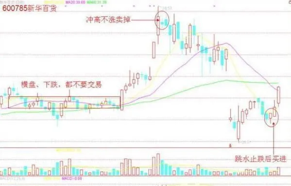

此口诀呢，一语道破天机，这是最基本、最简单的道理。如果不懂此诀，交易万次，亦不过是股市中的盲人瞎马，最终难免一死。我们在摸盘前必默念一遍，牢记于心。前两句呢，比较好理解，后一句"横盘不交易"是权证操作时应该格外注意的，横盘时交易，一旦发生反向变盘，你必然会去止损或者是去追涨，这两者都是不可取的。

## 第五式：破鞭式

**大涨之后必回调，K线多日画三角。**

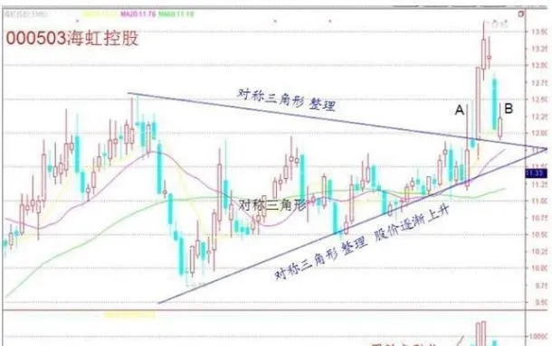

这句口诀说的是，股票在大涨之后必然会出现回调，但怎样调整呢？一般首次下调的幅度特别的大，一般会调到5天线，或者是涨幅的一半多一点的位置，然后会再次上冲，但此高点会低于前期高点，而在第二次下调的低点，因为均线的上行，也是不会低于第一个回调的低点，这样，几天的K线就会构成一个明显的三角形收敛形态，三角形的尖端有时会落在正中间，有时会是向上的好像上升旗形；有时是向下的，呈现上降楔形。

## 第六式：破索式

**买阴不买阳，卖阳不卖阴，逆市而动，方为英雄**

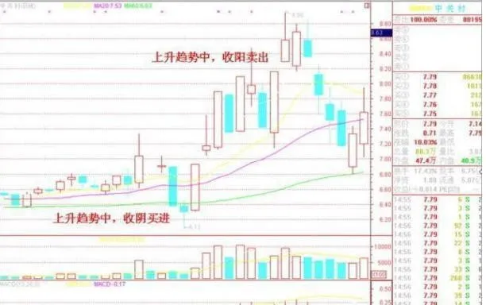

这一口诀说的是逆市而动的道理，即，买时，要选则K线收阴线时买；卖时，要选则K线收阳线时卖。

## 第七式：破掌式

**首日长阳慎持仓，次日震荡做差忙**

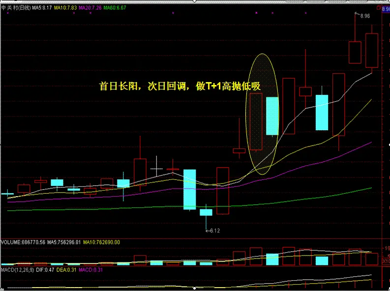

本诀的前半句是说首日长阳线收盘时是否持仓应该谨慎对待。这在诀十四、十五中已经详细说明了。后半句说次日的走势将会是大幅震荡，操作上应该以做差为上策，次日早盘继续冲高则卖出，早盘大幅回调，则坚定买入做差。

## 第八式：破箭式

**小阳携量往上排，暴发长阳还没来**

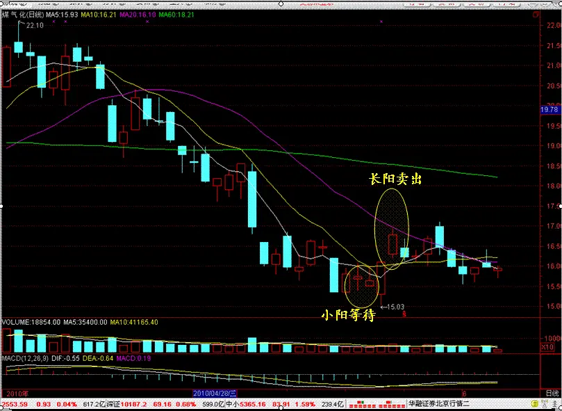

这诀描绘的是一种十分常见的股票走势形态。即K线图呈现为有成交量的多个小阳线不断缓慢向上攀升，每个阳线实体均不大。排推到一定高度，或特定的技术关口时，主力会突然发力，向上暴发式上涨，一般会拉出两三个较长的阳线，然后再震荡回调。操作上，见小阳推升时应耐心等待，在长阳暴发上升时卖出。

## 第九式：破气式

**一根巨阳头顶光，尾市抢盘我清仓**

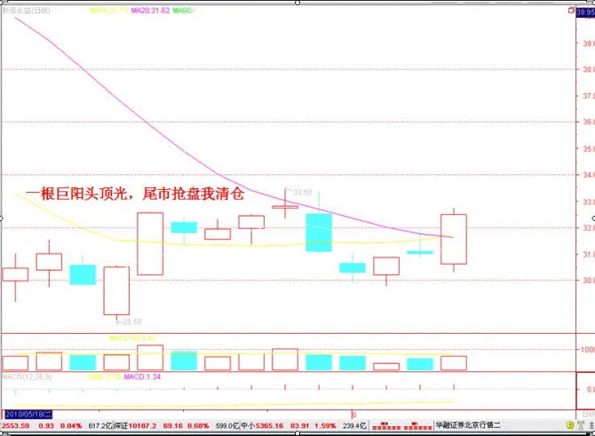

由于大家接连发现了底部的大阳线启动和不断地追进，权证的涨幅会高达十几、二十几个点，以至于翻番。**如果直到收盘时仍在抢盘**，K线将收出一个光头的特大阳线，那我则在收盘的一瞬全部清仓。因为次日往往大幅低开，或者高开后迅速下跌，将无法保住昨日的收益。

## 结语

任何事物的运动都有运行的规律，这个规律不容违背，违背就要吃苦头，甚至碰得头破血流。股市也一样，股价上涨必须有经济基夲面支撑才是可靠的。

可股市中，不少股民明知道股价缺乏经济基本面支撑，仍抱着侥幸心理，跟着庄家恶炒，结果充当了炮灰。在股市趋势下行时，很多股民不顺势而为，而是跟市场较劲，抱着股票不卖，结果越套越深，亏损累累。

股市是虚拟经济，但跟实体经济的道理是一样的。在实体经济中，假如有人投资几十万开了一家餐厅，每月亏损几万，不用3个月，投资者就会认赔出局，关门了事了。在股票市场中，遇到同样情况的股民往往不这样做，而是抱股死守。

世间的道理往往是越简单明了越实用。股票只有低买高卖才有利润，跟经商的道理一样。这样浅显的道理谁都懂，但要做到很难。
希望我的经验分享可以帮助到大家能够"笑傲江湖"。

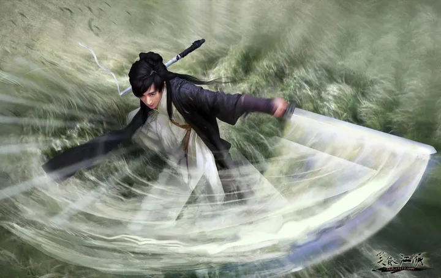

---

> 🏷️ 本文属《投资知识库 · 02-交易心理与悟道》，重排于 2026-11。
