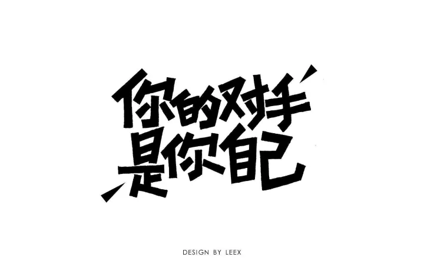
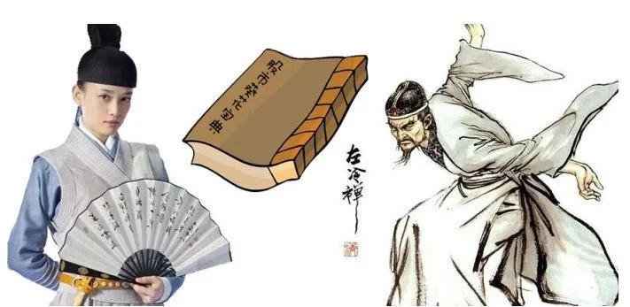
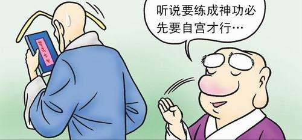
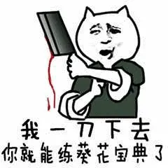

# 股票秘籍之《葵花宝典》

> **真正的葵花宝典，是向内心求得，是向市场求证求得，不是向他人求得，我带你寻找真正意义上的武林秘笈。**

> **股市是一个人的战争，你的对手永远是你自己，只有不断突破自我，才能不断进步。**

## 一、葵花宝典的来历

**《葵花宝典》是金庸武侠小说《笑傲江湖》中的武功秘籍，此功以"快"为主，令对手看不出破绽，没有还击的机会。抑或是快到就算被对手看出招式中的破绽，对方也来不及反击，破绽一闪即逝。**

**欲练神功，引刀自宫。**若不自宫，功起热生。热从身起，身燃而生。由下窜上，燥乱不定。即便热止，身伤不止。自宫以后，真气自生。汇入丹田，无有制碍。气生之法，思色是苦。厌苦舍离，以达性静。性静以后，手若拈花。气绕任脉诸穴，方汇丹田。气成之后，人若新生，妙及无比。再配性淡之食草。如木耳、草菇、冬瓜、薯类等，练药而食。此功一成，出手如雷。招式何用？随手一招，敌不及防，即是杀招。

《葵花宝典》有一句耳熟能详的口诀，就是欲练此功，必先自宫。说的就是**斩断躁动，让性子静下来**。与我们征战股市是一个道理，我们要学会取其精华，去其糟粕。

**思想决定行为，行为形成习惯，习惯决定性格，性格决定命运。**

股市亏损只是果，反思结果并不能避免亏损。我们一定要找到因，也就是找到操作的原始动机。然后将错过的斩断，以后不会再犯。

**三岁看到老，人这一辈子，秉性难移，是什么样的人就有什么样的生活。**

所以，性格塑造是童年、少年、青年最大的事情，知识不懂可以学，生意不会做可以教。**唯独性格，心态，这些东西，很难改变。积极向上，乐观，有恒心，坚韧不拔，包容，博爱，这些品质不仅是事业成功的关键，也是快乐生活的必备。**

## 二、五条操作原则

**一，震荡市或主流板块不明确时，可以采取隔日交易模式，主流板块确定后，龙头要捂。**

只做龙头不是蜻蜓点水，而是锁定龙头最大利润化。就比如昨日（2020年4月29日）的行情，沪指暴力V型反转，龙头股大资金流入。

数据显示，昨日主力资金净流入规模居前的十只股票分别是立讯精密、五粮液、中国平安、宁德时代、北大荒、通威股份、中信证券、万科A、紫光国微、兆易创新，主力资金分别净流入6.83亿元、5.21亿元、5.11亿元、4.35亿元、4.08亿元、3.75亿元、3.27亿元、3.17亿元、2.94亿元、2.92亿元。此外，格力电器、华天科技等8只股票主力资金净流入规模超过2亿元。可以看到，主力资金净流入金额居前的股票多为各行业龙头。

**二，有新题材，坚决抛弃旧题材；没有新题材，老热点就继续。**

只有新题材，才有凝聚市场里最敏锐、最犀利的那股资金。这股资金，以亿为单位。所到之处，只有涨停。只要能跟上这股资金，想不赚钱都难。

**三，模式不同的人，尽量少交流。**交流多了，容易受影响。想法越少越好，模式越简单越好。

只和市场对话，用心感受市场的资金氛围，多思考大资金和大众资金的心态变化。牛市里，多一份耐心，把握住主线不放手。

独立思考，独立操作是股市第一生存法则。不要咨询任何其他人，出手前做好各种情况的应对策略。投资重在研究公司，投机重在研究市场，无论投资还是投机，都需要独立思考，独立决策。成熟的投资客，根本无需与他人交流。不预测，只跟随，只和市场对话。

**四，只做龙头，只做主升，只做惯性。**不做反抽，不做波动，屌丝才爱逆袭。

没有主升的龙头，就守候；有，就一击，这个是执行力。是不是真龙头，这个考验的是理解力。能不打板就不打板，能不追高就不追高。守着核心品种或在主流板块里换白马最有效率。

**五，勿心存侥幸心理。**

这是许多股民遍及都存在的一种心态，当自己持有的股票跌落的时分，当趋势开端向坏的时分，总是抱着幸运的心思，以为股价很快还能再涨回来，关于一些负面音讯也会自动去淡化，而且下意识的给出合理的解说，自己诈骗自己。

这一点在股价跌落到止损位上的时分尤为显着，履行力差的股民，尽管设置了止损位，炒股心态可是当股价跌到止损位上该止损时，往往幸运的人为这次跌落仅仅一个意外，股价运转方向不会有什么大问题，这次就不止损了，成果股价跌跌不休，比及他意识到过错的时分，现已被深度套牢了。

## 三、结语

炒股票决定你输赢的不是你有多少资金，也不是你懂不懂技术指标，而是**心态的大比拼**。

股市承载着千万人的梦想，这些人很多都是社会的底层，没有门路，没有资金，没有出路。炒股就是他们的中国梦。

资金门槛低，幻想不多的资金以此出人头地，衣锦还乡，过着富人一样的生活。但现实是残酷的。20余年来，千千万万对股票一无所知的投资者纷纷涌进市场，成为一茬又一茬被割的韭菜，他们的付出是巨大的，他们对股市的贡献也是巨大的；

无论你是何种原因，进入了这个市场，你就得对自己每一次的决定负责。这既说明了市场的残酷性，更说明了市场的风险所在。

**这就是市场，一个残酷而充满矛盾的地方，回头看看，真不知道自己得到了什么，在大盘和个股的涨跌中沉浮，像一根无依的稻草，在风浪中努力寻求生的机会。希望我的经验分享可以帮助到大家。**

---

> 🏷️ 本文属《投资知识库 · 02-交易心理与悟道》，重排于 2026-11。
