# 股票秘诀之《降龙十八掌》

股票市场，一个博弈场，也是江湖。股市里只有不断进化，才能不被淘汰。让我们以此自勉。笔者总结出一些经验分享，希望可以助大家行走江湖时，能有一技之长！

以下十八种K线技术形态，不仅仅局限于股市，同样可以用于交易的"贵金属、原油"等！

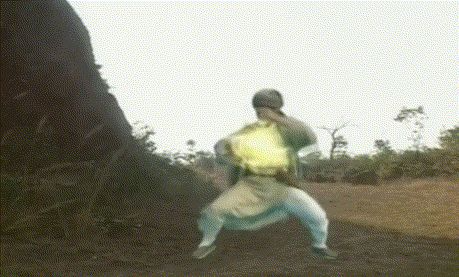

> **降龙十八掌**讲究刚柔并济，当刚则刚，当柔则柔，轻重刚柔随心所欲，刚劲柔劲混而为一，劲力忽强忽弱，忽吞忽吐，从至刚之中生出至柔，天下阳刚第一，掌法之妙，天下无双，招招须用真力，说是外门武学中的巅峰绝诣，动作虽似简单无奇，但掌掌现神龙，招招威力无穷，招式简明而劲力精深的武功，精要之处，全在运劲发力，全凭劲强力猛取胜，当真是无坚不摧、无固不破，虽招数有限，但每出一掌均有龙吟虎啸之势、每出一招均具绝大的威力。

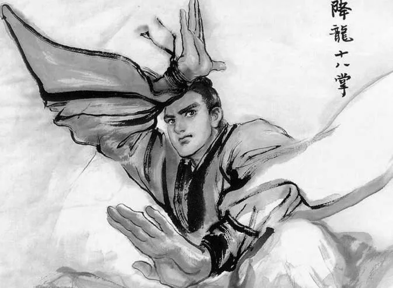

*图：降龙十八掌买入与卖出分类（示意）*

<svg xmlns="http://www.w3.org/2000/svg" viewBox="0 0 720 150" font-family="'Microsoft YaHei','PingFang SC',sans-serif">
  <defs>
    <marker id="arw187" markerWidth="8" markerHeight="8" refX="7" refY="3" orient="auto">
      <path d="M0,0 L7,3 L0,6 Z" fill="#94a3b8"/>
    </marker>
  </defs>
  <rect x="30" y="24" width="320" height="46" rx="8" fill="#f0fdf4" stroke="#16a34a" stroke-width="1.5"/>
  <text x="190" y="47" text-anchor="middle" font-size="15" font-weight="bold" fill="#1e293b">买入时机 · 第一式~第十式</text>
  <text x="190" y="66" text-anchor="middle" font-size="11" fill="#475569">见龙在田 → 突如其来（十个买进信号）</text>
  <rect x="370" y="24" width="320" height="46" rx="8" fill="#fef2f2" stroke="#dc2626" stroke-width="1.5"/>
  <text x="530" y="47" text-anchor="middle" font-size="15" font-weight="bold" fill="#1e293b">卖出时机 · 第十一式~第十八式</text>
  <text x="530" y="66" text-anchor="middle" font-size="11" fill="#475569">双龙取水 → 亢龙有悔（八个卖出信号）</text>
  <line x1="190" y1="82" x2="530" y2="82" stroke="#94a3b8" stroke-width="1.5"/>
  <text x="360" y="115" text-anchor="middle" font-size="13" fill="#1e293b">先守后攻：买点看均线与形态，卖点看趋势与量能</text>
</svg>

## 一、买入时机（第一式~第十式）

### 第一式：见龙在田

特点：转守为攻的一招，可拆解敌人擒拿，顺势反攻，使出又重又快的拍击。

**根据大盘分时图的波动来把握短线买卖点。**作为短线或超短线投资者而言，分析当日大盘分时图的波动规律尤其重要。

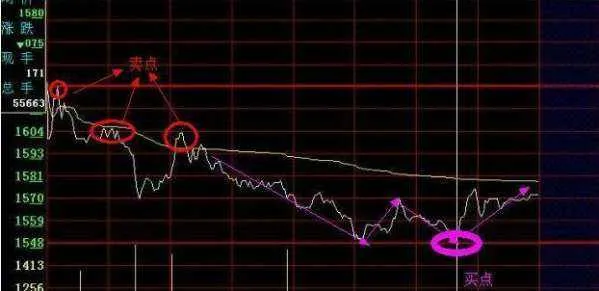

### 第二式：飞龙在天

特点：腾跃半空，居高向下轰击，威力奇大的一式，由上而下给予敌人痛击。

**根据大盘日K线波动把握波段买卖点。**在大盘的日K线上，根据高点相连或低点相连画出其上升压力趋势线和支撑趋势线。一旦大盘的日线波动触及上升压力线，我们则考虑波段卖出，而一旦大盘的日线波动触及支撑线，则考虑波段买进，而止损则是在市场有效跌破支撑线后止损。

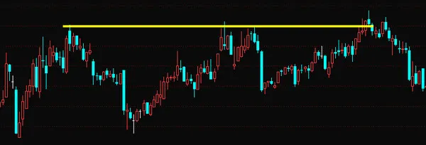

### 第三式：鸿渐于陆

特点：此招在于一个巧字，藏巧于拙，乃退敌之招式，运掌使敌人难以埋身。

**根据大盘周K线的波动来把握中长线买卖点。**当10周线上穿金叉20周线的时候，则是中长线买进的时候，而当10周线死叉20周线的时候，则是中长线坚决卖出的时候。

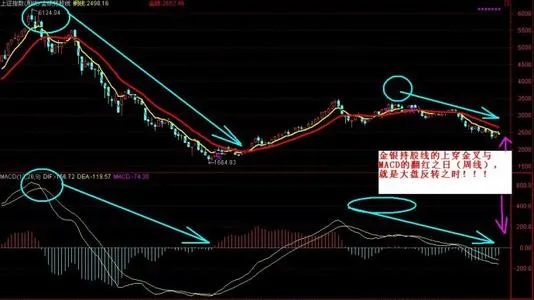

### 第四式：龙跃在渊

特点：此招关键在于虚实配合，快速准确。

**平均线由下降逐渐走平，且有向上抬头的迹象，而股价自均线的下方向上突破平均线时是买进信号**。均线系统由下降转为水平不是一朝一夕可以形成，需要很长时间。随着时间的推移，在这一价位区的换手越来越多。此时股价一旦向上穿越均线系统，对于在低位买入者来讲突然获利丰厚，必然会造成低位买进的投资人大量获利抛售。只要股价可以高位站稳，成交量放出巨量加以配合，就说明必然有巨大资金介入了。因为没有大资金的介入，股价是无法有效突破均线系统的。既然有大资金介入，后市上涨就是很正常了，所以作为买进信号。

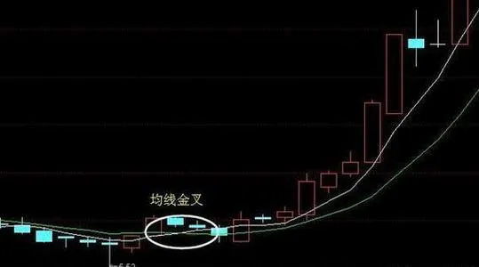

### 第五式：羝羊触蕃

特点：意欲以掌力内功加上全身的体重，以快速的步伐，让敌人避无可避，其姿态就如一只受到刺激的羊一样，不顾一切地想冲出栅栏，威力相当惊人。

**股价趋势走在均线之上，股价突然下跌，没跌破移动平均线，又再度上升，是买进信号。**均线所代表的是平均成本，那么股价跌到均线即止跌反涨，说明抛压是因为获利丰厚导致，一旦股价跌至均线，投资人利润减少，卖压就迅速降低，并很快又继续回升，表明市场气氛良好，股价很快会再创新高，因此为买入信号。

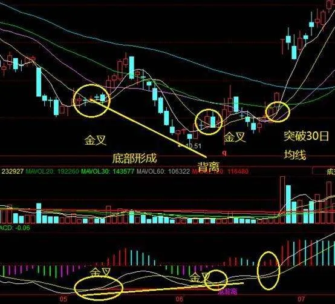

### 第六式：潜龙勿用

特点：右推左钩，是一种左右夹击的攻招，关键是让人无处可避，且顺势出掌力道倍增。

**股价跌至平均移动线下方，而平均移动线短期内仍为继续上升趋势，不久股价又回到均线上方，是买进信号。**性质基本与上一招相似，只是下跌的力度较大。

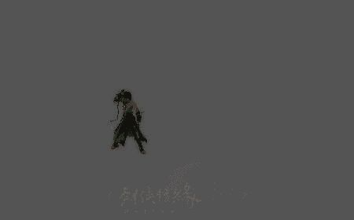

### 第七式：利涉大川

特点：若敌人先手近身抢攻无法躲避，则可以不退反进，返身击打敌人中路腰部或背部。

**股价趋势走在平均线之下，突然出现暴跌，距离平均线非常远，再快速靠近均线，亦为买进时机。**股价的暴跌，会造成投资人突然亏损极为严重，严重的亏损会使投资人无法下决心割肉卖出手中持股，而产生强烈的观望情绪，致使很轻微的买气，很容易迅速将股价推高，因此为买入信号。

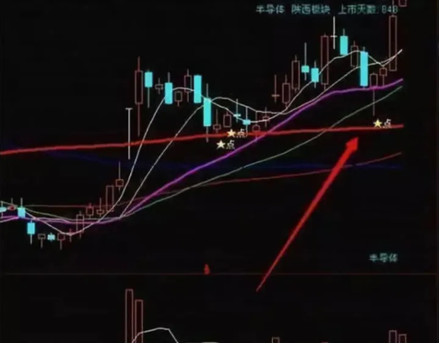

### 第八式：神龙摆尾

特点：降龙十八掌最后的救命绝招，在最危险的时候使出。任何有生命的东西在他有生存受到威胁时所生成而出的反应力道，自是非同小可。

**筑底调整充分的股票，买进时机到来！**股票在较低价位盘整时间越久，越容易突破。看均线，中短期均线走平，粘合，成交量不出现大起大落，或者持续萎缩，可视为筑底。底部形态以圆弧底为最扎实。

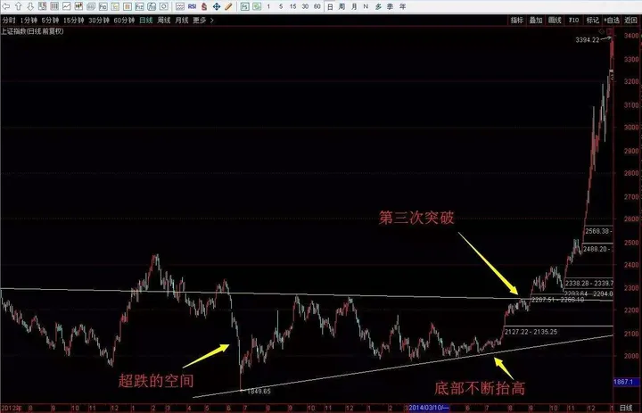

### 第九式：密云不雨

特点：以一敌百的招数，与密云不雨、损则有孚互补长短。关键在于攻守兼备，势沉力猛。

**放量突破的股票，买进时机到来！**筑底完成后，股票将选择向上或向下突破，为了提高资金效率，应选择那些开始突破的股票跟进。在盘整时，量能逐渐萎缩，某日如突然放出大量上涨（量越大越好），即视为开始突破，如出现跳空缺口，封涨停板，则此票后市可期。

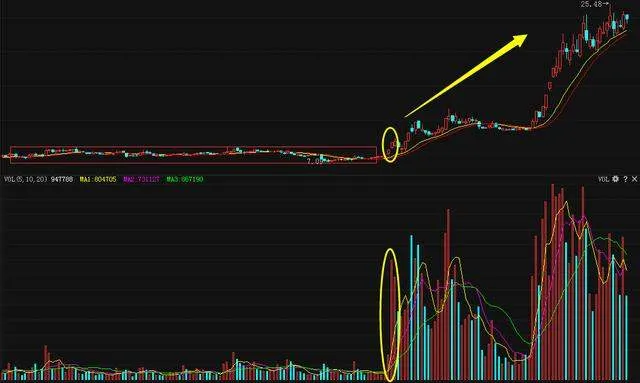

### 第十式：突如其来

特点：遇强敌，必先压其势，后压其招。此招关键在于对"势"的理解，不懂得夺"势"就不能发挥降龙掌法的真正威力。

**短期均线上穿中长期均线；MACD线出现上穿；KDJ三线出现交叉，J线上穿KD线。等等。即所谓出现"金叉"，为买入时机。此时机应当与上述几个时机相结合应用。**

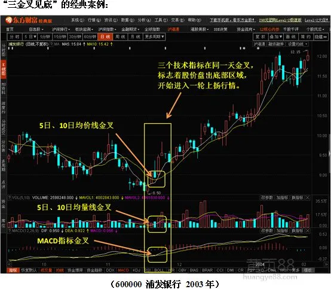

## 二、卖出时机（第十一式~第十八式）

### 第十一式：双龙取水

特点：以退为进的招数。与飞龙在天相反，此招关键是先卸掉敌人力道，再反侧击之。

股价走在平均线上方，突然暴涨，距离均线越来越远，为卖出时机。股价向上大幅暴涨之后，投资人不论在短期买进还是中长期买进的都突然获利丰厚，极易引起大量获利回吐，造成股价迅速下跌，因此为卖出信号。

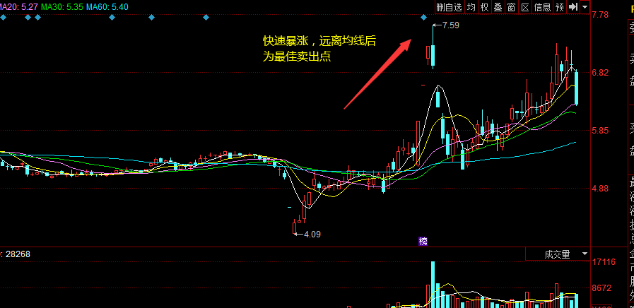

### 第十二式：鱼跃于渊

**特点：**这一招是用于狭小空间的防身之术，它或为缓冲高手绵密不绝的攻势之用。此招可直接用于避敌，也可作为降龙掌法任何一招的后招，降龙十八掌不是能发不能收的，任何时候都进退自如。

**均线从上升趋势逐渐转为水平，且有向下跌的倾向，当股价从平均线上方向下突破平均线时，为卖出信号。**均线上升趋势逐渐转变为盘局，不是一朝一夕的事，大量筹码在这一价位换手，是大多数投资人的平均持仓成本区域。**此时股价一旦下跌，导致所有在这一价位的买入者，全部被套牢。**出于对亏损的恐惧，任何一次股价回升至这一价位区，都会因解套压力而迫使股价再次下跌，因此为卖出信号。

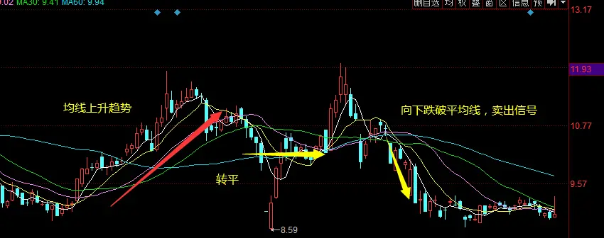

### 第十三式：震惊百里

特点："气出于己，震慑于物，物慑于势而见于百里者，大惊。"

**股价趋势在均线之下，回升时未超越平均线，再度下跌，为卖出讯号。**股价仍然涨过平均线上方，但平均线继续下跌，不久股价又回到均线的下方，为卖出信号。

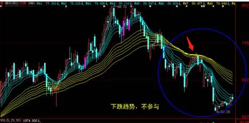

### 第十四式：损则有孚

**特点：**以一敌百的招数，与密云不雨、损则有孚互补长短。关键在于后手反攻，借力打力。

**大盘行情形成大头部时，坚决清仓全部卖出。**上证指数或深综合指数大幅上扬后，形成中期大头部时，是卖出股票的关键时刻。不少市场评论认为抛开指数炒个股，这种提法不科学。只关注个股走势是只见树木不见森林。根据历史统计资料显示：大盘形成大头部下跌，竟有90%～95%以上的个股形成大头部下跌。大盘形成大底部时，有80%—90%以上的个股形成大底部。大盘与个股的联动性相当强，少数个股在主力介入操控下逆市上扬，这仅仅是少数、个别现象。

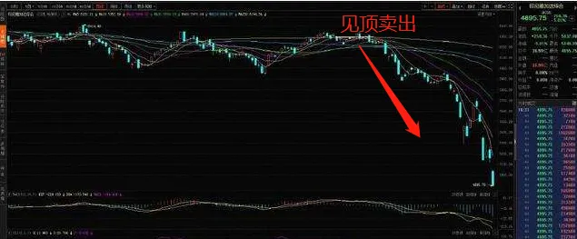

### 第十五式：时乘六龙

**特点：**以一敌百的招数，与密云不雨、损则有孚互补长短。关键在于先手抢攻，掌风破敌。

**大幅上升后，成交量大幅放大，卖出股票。**当股价大幅上扬之后，持股者普遍获利，一旦某天该股大幅上扬过程中出现卖单很大、很多，特别是主动性抛盘很大，反映主力、大户纷纷抛售，这是卖出的强烈信号。尽管此时买入的投资者仍多，买入仍踊跃，这很容易迷惑看盘经验差的投资者，有时甚至做出换庄的误判，其实主力是把筹码集中抛出，没有大主力愿在高价区来收集筹码，来实现少数投资者期盼的"换庄"目的。

### 第十六式：龙战于野

**特点：**若敌人近身，可拆此招为三式，先分别护住上中下三路，同时用掌力击打敌人手腕，逼敌人撤招。

**上升较大空间后，日K线出现十字星或长上影线的倒锤形阳线或阴线时，卖出股票。**上升一段时间后，日K线出现十字星，反映买方与卖方力量相当，局面将由买方市场转为卖方市场，高位出现十字星犹如开车遇到十字路口的红灯，反映市场将发生转折。

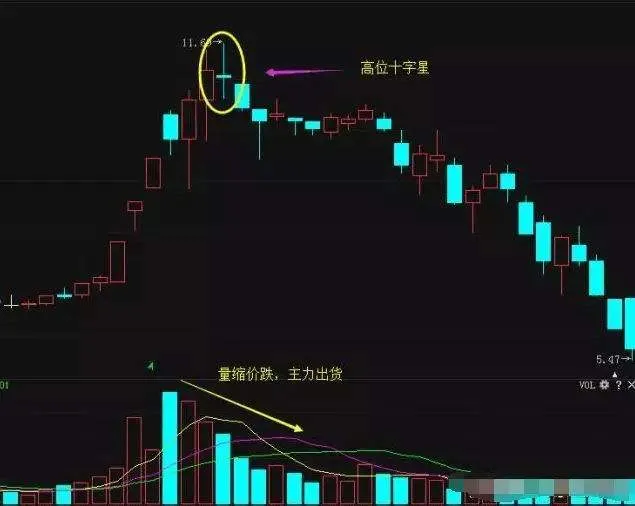

### 第十七式：履霜冰至

特点：快慢结合，降龙十八掌中最阴柔的招数。

**股价大幅上扬后，除权日前后是卖股票的关键时机。**上市公司年终或中期实施送配方案，股价大幅上扬后，股权登记日前后或除权日前后，往往形成冲高出货的行情，一旦该日抛售股票连续出现十几万股的市况，应果断卖出，反映主力出货，不宜久持该股。

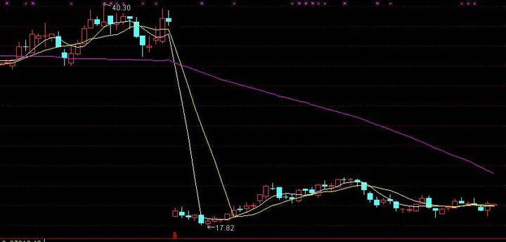

### 第十八式：亢龙有悔

特点：降龙掌是至刚的掌法，至刚则至猛，而刚到极处反而至柔。亢龙有悔的"悔"字，便是让入门者知道，降龙掌法不是一味刚猛，更不是可发不可收的蛮招。

**股价大幅上扬后公布市场早已预期的利好消息是卖出的关键。**也就是说利好消息的公布，是在股价大涨之后公布，这时市场预期其实已经达到，抓紧时间卖出。新手看到好消息来了马上进场，其实不知不觉间已经成为了接盘侠。

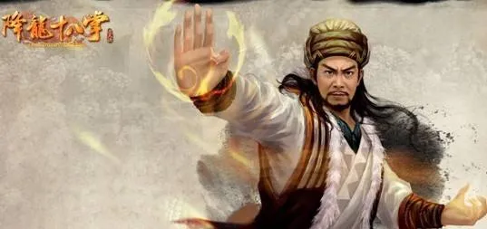

## 结语

股市实战投机有很多能够成功的方法，凡是能在股市长期生存长期成功的交易者，必定有一套属于自己的高胜率实战交易方法。

股市如战场，风险变幻莫测，要想在股市中长久生存下来，就必然需要练就一身过硬的本领，否则迟早会被股市的旋涡吞噬。

**市场是完全按照自然法则在生长，当你掌握了其中的奥秘，你会深深的被自然法则感动。**

---

> 🏷️ 本文属《投资知识库 · 02-交易心理与悟道》，重排于 2026-11。
