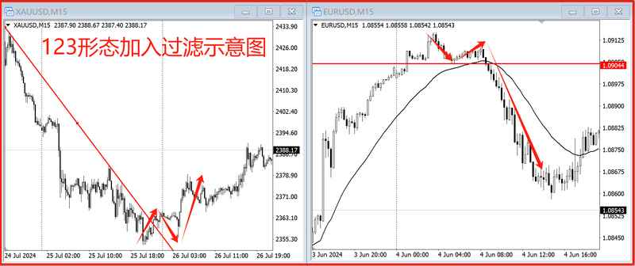
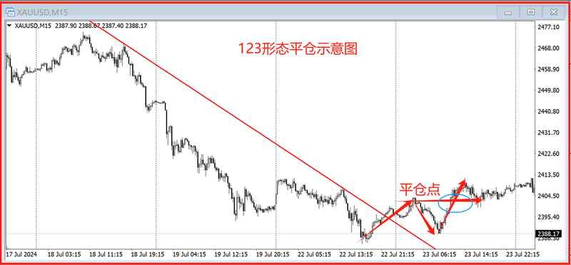
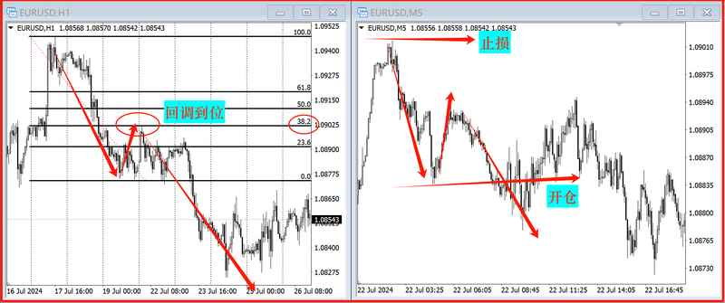
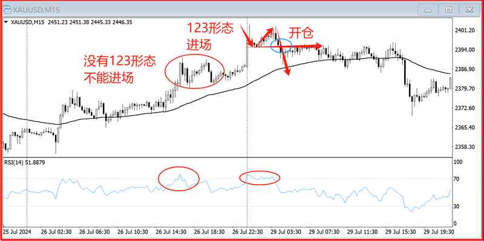

# 交易制胜密码：简单有效的1-2-3法则

## 1-2-3法则的反转结构

**顶部反转：**

## 1. 价格创新高（Point 1）

## 2. 价格回调，形成次要低点（Point 2）

3. 价格再次上升，但未能创新高（Point 3）
4. 价格跌破次要低点（Point 2）= 趋势反转确认

**底部反转：**

## 1. 价格创新低（Point 1）

## 2. 价格反弹，形成次要高点（Point 2）

3. 价格再次下跌，但未能创新低（Point 3）
4. 价格突破次要高点（Point 2）= 趋势反转确认

到这里大家应该就会有种恍然大悟的感觉，其实123形态就是在顶部或底部的一个涨跌涨，跌涨跌的结构。

<svg xmlns="http://www.w3.org/2000/svg" viewBox="0 0 660 430" font-family="'Microsoft YaHei','PingFang SC',sans-serif">
  <defs>
    <marker id="ar1" markerWidth="9" markerHeight="9" refX="8" refY="4.5" orient="auto">
      <path d="M0,0 L9,4.5 L0,9 z" fill="#64748b"/>
    </marker>
  </defs>
  <text x="330" y="30" text-anchor="middle" font-size="16" font-weight="bold" fill="#1e293b">1-2-3法则：反转结构与用法</text>
  <rect x="30" y="52" width="280" height="34" rx="8" fill="#fef3c7" stroke="#d97706" stroke-width="1.5"/>
  <text x="170" y="74" text-anchor="middle" font-size="13" fill="#1e293b">顶部反转（趋势转跌）</text>
  <rect x="350" y="52" width="280" height="34" rx="8" fill="#ecfdf5" stroke="#16a34a" stroke-width="1.5"/>
  <text x="490" y="74" text-anchor="middle" font-size="13" fill="#1e293b">底部反转（趋势转涨）</text>
  <rect x="40" y="100" width="260" height="40" rx="6" fill="#fef3c7" stroke="#d97706" stroke-width="1.2"/>
  <text x="170" y="125" text-anchor="middle" font-size="13" fill="#1e293b">① 价格创新高</text>
  <line x1="170" y1="140" x2="170" y2="152" stroke="#64748b" stroke-width="1.5" marker-end="url(#ar1)"/>
  <rect x="40" y="154" width="260" height="40" rx="6" fill="#fef3c7" stroke="#d97706" stroke-width="1.2"/>
  <text x="170" y="179" text-anchor="middle" font-size="13" fill="#1e293b">② 回调形成次要低点</text>
  <line x1="170" y1="194" x2="170" y2="206" stroke="#64748b" stroke-width="1.5" marker-end="url(#ar1)"/>
  <rect x="40" y="208" width="260" height="40" rx="6" fill="#fef3c7" stroke="#d97706" stroke-width="1.2"/>
  <text x="170" y="233" text-anchor="middle" font-size="13" fill="#1e293b">③ 再次上升未创新高</text>
  <line x1="170" y1="248" x2="170" y2="260" stroke="#64748b" stroke-width="1.5" marker-end="url(#ar1)"/>
  <rect x="40" y="262" width="260" height="40" rx="6" fill="#fef3c7" stroke="#d97706" stroke-width="1.2"/>
  <text x="170" y="287" text-anchor="middle" font-size="13" fill="#1e293b">④ 跌破次要低点＝反转确认</text>
  <rect x="360" y="100" width="260" height="40" rx="6" fill="#ecfdf5" stroke="#16a34a" stroke-width="1.2"/>
  <text x="490" y="125" text-anchor="middle" font-size="13" fill="#1e293b">① 价格创新低</text>
  <line x1="490" y1="140" x2="490" y2="152" stroke="#64748b" stroke-width="1.5" marker-end="url(#ar1)"/>
  <rect x="360" y="154" width="260" height="40" rx="6" fill="#ecfdf5" stroke="#16a34a" stroke-width="1.2"/>
  <text x="490" y="179" text-anchor="middle" font-size="13" fill="#1e293b">② 反弹形成次要高点</text>
  <line x1="490" y1="194" x2="490" y2="206" stroke="#64748b" stroke-width="1.5" marker-end="url(#ar1)"/>
  <rect x="360" y="208" width="260" height="40" rx="6" fill="#ecfdf5" stroke="#16a34a" stroke-width="1.2"/>
  <text x="490" y="233" text-anchor="middle" font-size="13" fill="#1e293b">③ 再次下跌未创新低</text>
  <line x1="490" y1="248" x2="490" y2="260" stroke="#64748b" stroke-width="1.5" marker-end="url(#ar1)"/>
  <rect x="360" y="262" width="260" height="40" rx="6" fill="#ecfdf5" stroke="#16a34a" stroke-width="1.2"/>
  <text x="490" y="287" text-anchor="middle" font-size="13" fill="#1e293b">④ 突破次要高点＝反转确认</text>
  <text x="330" y="334" text-anchor="middle" font-size="13" font-weight="bold" fill="#475569">四种实战应用</text>
  <rect x="25" y="348" width="145" height="56" rx="6" fill="#eff6ff" stroke="#2563eb" stroke-width="1.2"/>
  <text x="97" y="371" text-anchor="middle" font-size="13" fill="#1e293b">确认趋势</text>
  <text x="97" y="393" text-anchor="middle" font-size="13" fill="#475569">顺势操作</text>
  <rect x="180" y="348" width="145" height="56" rx="6" fill="#eff6ff" stroke="#2563eb" stroke-width="1.2"/>
  <text x="252" y="371" text-anchor="middle" font-size="13" fill="#1e293b">平仓减仓</text>
  <text x="252" y="393" text-anchor="middle" font-size="13" fill="#475569">保护利润</text>
  <rect x="335" y="348" width="145" height="56" rx="6" fill="#eff6ff" stroke="#2563eb" stroke-width="1.2"/>
  <text x="407" y="371" text-anchor="middle" font-size="13" fill="#1e293b">进场标准</text>
  <text x="407" y="393" text-anchor="middle" font-size="13" fill="#475569">破位开仓</text>
  <rect x="490" y="348" width="145" height="56" rx="6" fill="#eff6ff" stroke="#2563eb" stroke-width="1.2"/>
  <text x="562" y="371" text-anchor="middle" font-size="13" fill="#1e293b">结合RSI</text>
  <text x="562" y="393" text-anchor="middle" font-size="13" fill="#475569">过滤信号</text>
</svg>

*图：1-2-3法则顶部/底部反转结构与用法示意（依正文整理）*

而它之所以可以作为确认趋势反转去使用，也是源自道氏理论中趋势反转的概念：行情在上涨的过程中，不再创出高点，回调的时候跌破了前期回调的低点，打破趋势的定义“不断抬高的高点和回调不破低点”，所以出现反向123形态可以理解趋势反转了。

**123法则的形态并不复杂，重点是在实战中的应用，所以接下来我就讲解4种123法则的实战应用方法。**

## 1-2-3法则的实战应用

> 123形态要结合趋势线（或均线）共振过滤，破位之后再确认反转，稳定性才够。

在维克多·斯波朗迪123形态的使用逻辑中，加入了趋势线作为一个共振的指标，要求行情破位的趋势再形成123形态，才能作为确认反转的标准。

这样做的目的是因为123形态是走势的基本形态，在图表上很常见，如果不加入其他的指标做一下过滤，稳定性会比较差。

如果不能熟练地使用趋势线，也可以添加一条或两条均线同123形态共振来确认，同样可以达到提高稳定性的效果。

**大家看下方的示意图。**

图中左侧行情上破了下降趋势线之后，又形成了123的反转形态，行情反转向上。右侧行情在顶部，形成了向下的123形态，破位的同时也下破了均线，行情反转向下。

### 用法一：确认趋势

确认趋势是交易的第一步，确认趋势之后，就可以进行顺势的操作了。

上面我们所讲的123形态形成的基本逻辑，就能发现123形态同双顶双底形态，以及头肩形态相同，都是反转形态，其中行情反转破位的点是行情从点3的位置启动，突破点2的破位点。

在连接一段多头或空头走势之后，出现了反向的123形态，可以理解趋势已经反转。

连续的多头趋势后，出现空头的123形态后，确认趋势要下跌。

连续的空头趋势后，出现多头的123形态后，确认趋势要上涨。

这里我就不给大家再上图片了，上面的图片中两种情况，分别是123确认行情由空转多和由多转空的示意图。

这里再次提醒一下大家：**只有一段趋势之后连接的反向123形态才具有反转的意义。**

### 用法二：作为平仓或者减仓的信号

**作为平仓的信号有两个原因。**

首先：123形态是顶底反转的形态，在趋势性的交易策略中，跟踪趋势平仓的原则就是行情走出反向的形态平仓，123形态恰好符合。

其次：相比较而言，123形态出现的频率更高，因为123形态是趋势的基本规律演变而来的，很多时候行情反转并不一定会出现双顶双底或是头肩形态，但是出现反向123形态的概率是很大的，普遍存在才能做到及时平仓。

所以趋势交易中，一直持仓等待走势出现反向123形态就将订单平仓。

**大家看下方的示意图。**

图中是黄金15分钟的k线图。

在一波连续的大空间下跌之后，行情在底部形成了反向的123形态，在价格突破2401的平仓点之后，将订单平仓。

还可以将123形态作为减仓的信号，还是上面黄金的例子，行情在低位走出反向123形态以后，只是减仓一部分，剩余的订单继续持仓，博取更大的利润。

**甚至有交易者，将不同周期的123反向结构作为减仓平仓的标准。**

比如小时图进场以后，首先是5分钟形成反向123平仓30%，接着等15分钟形成反向123再平仓30%，剩余的持仓，等到小时级别出现反向123全部平仓。

用123形态减仓，减仓的信号是动态的，更加客观灵活，对于保护利润，稳定交易心态都有很大帮助。

### 用法三：进场标准

123形态是一种破位的形态，破位通常都是行情启动的信号，再加上123形态出现的频率高，所以123形态可以作为订单进场的信号。

123形态的破位点很容易识别，点位清晰明确，实战中可行性非常高。

**大家看下方的示意图。**

图中是欧元兑美元的k线图，左侧是1小时，右侧是5分钟。

左侧1小时向下走完第1浪之后展开回调，测试到黄金分割38.20%位置，行情遇到阻力之后，此时观察5分钟的形态，当出现了空头的123形态破位后进场，止损放在点1，也就是形态的高点。

之后行情继续震荡，但没有再次突破高点，经过两天连续震荡之后，终于向下破位。

有的朋友应该注意到了，这里我使用的是5分钟的k线进场，而不是在1小时级别，因为123形态的整个结构需要很多根k线组成，作为进场信号如果直接使用1小时级别k线，出现的信号就会滞后，而且止损的空间很大，实战中的灵活性太差，尤其是做波段交易或者是短线交易，尽量使用小级别的形态进场。

### 用法四：同RSI指标结合

**RSI超买超卖有两个比较明显的缺陷。**

1. 超买超卖指向一个区域，行情不断上涨的过程中，RSI进入超买的区域，k线图上对应的也是一个区域，到底该在什么位置进场呢？

2. 在连续的单边行情中，RSI指标钝化比较严重，例如行情不停上涨的过程中，RSI指标会不断地超买，回归，再超买，再回归。这时候如果没有合理的交易信号筛选，会出现比较严重的连续止损。

实战中可以使用123法则作为交易信号，可以在超买超卖的区域中更精准地进场，也可以在RSI指标钝化失效的时候，筛选掉一部分错误的信号，提高交易的成功率。

**大家看下方的示意图。**

图中是黄金1小时级别的k线，在行情从2355~2403的一波上涨趋势中，行情在2390附近形成了顶部超买，此时行情是有回调或下跌预期的，但是k线图上没有形成向下的123形态，没有进场信号，之后行情继续上涨，就规避了一次错误的交易。

当行情测试到2403之后，RSI再次超买，而且很长的一段时间里，一直维持在70上方超买的区域，还是等形成123形态之后再进场。行情经过整理形成123的结构，在2394的位置破位进场后，行情下跌。

这里是在1小时级别的k线图中，用本级别的123形态进场开仓，所以出场的时候也要在本级别k线图上才可以，才能有合理的利润空间。

**123法则是我目前用下来觉得非常好用的一款技术标准，还可以跟其他的技术指标结合，创造出更实用的打法，我们可以把它学精学透，交易一定会有所进步。**

---

> 🏷️ 本文属《投资知识库 · 03-交易系统与实战战法》，重排于 2026-11。
