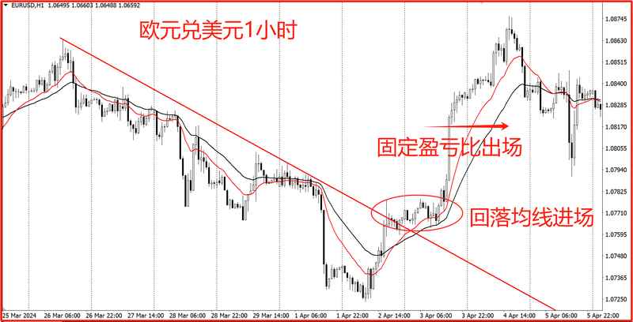

# 能不能详细谈谈您的交易逻辑？

我的交易逻辑主要分为两个方面，一个是交易的盈利逻辑，一个是交易的技术逻辑。

通俗一点讲就是：**你准备在交易中怎么赚钱，赚哪种钱？你要通过什么样的技术手段去实现赚钱的目的，做趋势？震荡？还是反转？**

我这个人讲不来太玄乎的东西，就直接讲实际点的理念和案例。

## 一、你准备在交易中怎么赚钱，赚哪种钱？

> 交易中追求的盈利越高，需要承担的风险也会越高，没有低风险换高盈利的事情。

大家在交易中的逻辑理念都不太一样，比如有的是高风险爱好者，希望通过高杠杆的交易来赚快钱，赚大钱，希望可以翻N倍，所以他们的交易逻辑就是追求暴利的逻辑。

也有人更喜欢风险可控，盈利合理的交易，不喜欢追求暴利，一年有个百分之30%到50%到利润就很满足（我就是这种）。

还有人是风险厌恶者，讨厌亏损带来的痛苦，希望自己的交易可以稳中再稳，盈利低一点没关系，比如一些股票市场中做长线的价值投资者，一年有个8%到10%的盈利率就非常满足。

我们不评价这三种盈利逻辑的对错，各有各的优势和劣势，也适合不同的人群，但我们只要牢牢记住一个点：**交易中追求的盈利越高，需要承担的风险也会越高，没有低风险换高盈利的事情，随着盈利的提高，交易的难度也会加大，稳定性也会变差，这是我们必须面对的现实。**

所以选择哪种盈利的逻辑，就得剖析自我，可以接受什么样的风险，可以承担什么样的后果。这就像打游戏之前对自我有个清晰认知，不要选择超过自己能力范围之外的难度，否则就很难通关。

风险越高，利润越高的交易，就越要求强大的内心，超乎常人的定力，高超的交易技术，完美的交易计划，以及可能爆仓的风险，稍有不慎就是难以挽回的亏损。

而风险可控的交易更适合我们绝大多数人，虽然盈利没有那么高，也没有以小搏大的巨大刺激感，但交易中的心态更加平和，交易的行为也没那么容易走形，对技术的要求和自己的反应能力要求也没那么高，一切虽然普普通通，但钱能稳稳拿到手，所以选择一个适合自己的交易逻辑太重要了，永远不要高估自己。

**我选择的是第二种风险可控，盈利合理的盈利逻辑。**

因为我早年间有过追求暴利的经历，有过高杠杆高仓位交易，产生严重亏损的阶段。我对高暴利这种东西看得太透了，这么多年下来，对当年的经历还是心有余悸。也沉淀了这么多年，我也深知自己就是个普通人，普通人就不要去做神仙才能做到的事情，做自己力所能及之事就好。

我成不了交易的大神，我对自己的心理掌控能力不高，技术能力也不是大神级别的，我能够稳稳当当地赚到我能赚得到的钱，已经非常幸运，无需再去追求高杠杆高暴利。

能把“风险可控，盈利合理”的模式做好，就已经很满足了。

大家可以评估一下自己的风险承受能力，心理承受能力，技术学习能力，选择最适合自己的盈利逻辑。

*图：三种盈利逻辑与风险承担对比（示意）*

<svg xmlns="http://www.w3.org/2000/svg" viewBox="0 0 720 260" font-family="'Microsoft YaHei','PingFang SC',sans-serif">
  <text x="360" y="32" text-anchor="middle" font-size="16" font-weight="bold" fill="#1e293b">三种盈利逻辑：盈利越高，风险与难度越高</text>
  <rect x="20" y="60" width="220" height="130" rx="8" fill="#fef2f2" stroke="#dc2626" stroke-width="1.5"/>
  <text x="130" y="88" text-anchor="middle" font-size="14" font-weight="bold" fill="#1e293b">追求暴利</text>
  <text x="130" y="116" text-anchor="middle" font-size="13" fill="#475569">高杠杆赚快钱，希望翻N倍</text>
  <text x="130" y="140" text-anchor="middle" font-size="13" fill="#475569">难度加大，稳定性变差</text>
  <text x="130" y="164" text-anchor="middle" font-size="13" fill="#475569">稍有不慎难以挽回</text>
  <rect x="250" y="60" width="220" height="130" rx="8" fill="#f0fdf4" stroke="#16a34a" stroke-width="2"/>
  <text x="360" y="88" text-anchor="middle" font-size="14" font-weight="bold" fill="#1e293b">风险可控、盈利合理</text>
  <text x="360" y="116" text-anchor="middle" font-size="13" fill="#475569">一年 30%~50% 即满足</text>
  <text x="360" y="140" text-anchor="middle" font-size="13" fill="#475569">心态平和，行为不走形</text>
  <text x="360" y="164" text-anchor="middle" font-size="13" fill="#16a34a">★ 作者选择的模式</text>
  <rect x="480" y="60" width="220" height="130" rx="8" fill="#eff6ff" stroke="#2563eb" stroke-width="1.5"/>
  <text x="590" y="88" text-anchor="middle" font-size="14" font-weight="bold" fill="#1e293b">稳中再稳（价值投资）</text>
  <text x="590" y="116" text-anchor="middle" font-size="13" fill="#475569">一年 8%~10% 即满足</text>
  <text x="590" y="140" text-anchor="middle" font-size="13" fill="#475569">盈利低一点没关系</text>
  <text x="590" y="164" text-anchor="middle" font-size="13" fill="#475569">厌恶亏损带来的痛苦</text>
  <text x="360" y="226" text-anchor="middle" font-size="13" fill="#475569">先剖析自我能接受什么风险，再选盈利逻辑——永远不要高估自己</text>
</svg>

## 二、你要通过什么样的技术手段去实现赚钱的目的，做趋势？震荡？还是反转？

> 确定了盈利的逻辑，就算是找到了自己的目标，而技术手段就是通往目的地的交通工具。

确定了盈利的逻辑，就算是找到了自己的目标，而技术手段就是通往目的地的交通工具。

**技术手段你要搞清楚下面三个点：**

1. 你要做哪种**技术类型**？做趋势，做震荡，还是做行情的顶底反转？
2. 你要使用哪些**指标**来做交易？

比如均线，MACD，KDJ，RSI，黄金分割线等等，选择自己最熟悉的，使用最喜欢的指标来组建交易系统就可以。
3. **周期的选择**。

是短期趋势还是长期趋势，1小时的震荡还是4小时的震荡，日线的顶底反转还是周线图的顶底反转？

**我交易的技术逻辑是，1小时级别的顺势波段行情，使用均线指标。**

用图片给大家简单演示一下我技术逻辑的模板。

图中是欧元兑美元1小时级别的k线图，行情经过连续的下跌之后，开始展开多头走势，两条均线金叉之后，行情上破了下降趋势线，确认趋势反转。

进行多头反转之后，等待k线回落均线的支撑，形成反转的k线形态之后进场，止损设置在回调的低点，设置固定的盈亏比出场。

先确认行情反转多头之后再进场，属于顺势；每次止盈采用固定盈亏比，属于波段交易。

这就是我交易技术逻辑的模版，大家可以作为参考，但要用到实盘中，一定要做大量的复盘完善细节之后再用。

---

> 🏷️ 本文属《投资知识库 · 03-交易系统与实战战法》，重排于 2026-11。
