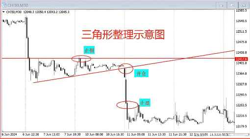

# 为什么行情总是不断诱空和诱多？

## 诱多诱空是必然存在且不可改变的

> 诱多诱空就像现实世界中的谎言一样，有其存在的必然性，不可能被消除。

行情诱多诱空在交易的世界里是很正常的事情，我们都会遇到。之所以对诱多诱空感到难受，就是因为我们开始做交易了，账户中有盈亏了，诱多诱空直接影响到了我们的切身利益，所以对之深恶痛绝，对真突破爱意满满，但这样的情感特别不可取，会直接影响到我们对行情的客观判断。

我们这么思考，我们的现实世界可以没有谎言吗？或者你是否从来都没撒过谎？诱多诱空就像现实世界中的谎言一样，有其存在的必然性，不可能被消除，我们去问一个人为什么要撒谎，理由总是千奇百怪的，各不相同，这就像交易世界的诱多诱空一样，总有各种各样的理由，你追究不完的，诱多诱空存在的理由也不应该成为我们关注的焦点。

我们换个角度思考，如果多头突破都不是诱多，都是真突破，那么我们每单都能盈利，那大家都可以摸到这个规律。当交易世界的规律是完全固定的时候，所有人都赚钱，没有人亏钱，大家都做多，没人做空，那多单也没办法成交了，这个交易世界也就不存在了。

**所以诱多诱空跟我们现实世界的白天黑夜一样，是必然存在且不可改变的，我们只要知道这个事实就好了，不需要去追究它存在的原因。**

## 那么如果行情中有假突破，我们该如何盈利呢？

> 行情不可能一直诱多诱空，也会有真突破的时候，我们只要抓住真突破就可以做到盈利。

行情不可能一直诱多诱空，也会有真突破的时候，那么我们只要抓住真突破就可以做到盈利，该怎么做呢？

1：选择一种交易的模式或是突破的形态，比如选择三角形整理突破。

2：制定一个交易这种形态的标准，比如三角形整理形态要求40根k线以上，行情破位进场，止损在低点，设置3:1的盈亏比等等。

**下面的图片就是这个形态的示意图，大家作为参考。**

图中是A50指数30分钟的k线图，行情从12585展开下跌之后，进入横向整理的三角形结构，整理的k线数量超过40根以后，图表上画线标注出三角形，行情下破之后进场做空，止损在上方的高点，设置3:1的盈亏比。

3：按照这个标准去复盘，统计这种三角形整理在过往行情中诱多诱空有多少？真突破有多少？3:1的盈亏比能不能赚钱？4:1盈亏比能不能赚的更多？通过盈亏比来弥补诱多诱空的亏损。

就算假突破更多有70%，真突破只有30%，3:1的盈亏比，总体也还有20%的盈利优势，因此就算有诱多诱空也能赚到钱。

4：复盘确定了标准是有效之后，开始模拟盘交易，模拟盘成功后，再开始小资金的实盘，当心态适应了小资金的变化之后，再慢慢扩大仓位。

这就像很多朋友学习技术指标，非常纠结这个指标是怎么计算出来的，一定要搞清楚它的逻辑公式，结果等自己琢磨出来，发现更懵了，这是因为我们的需求是知道怎么使用一个指标去做到盈利，而不是去追究这个指标的生产过程，方向就歪了。

我们平时用电脑去工作，我们也不会去纠结这个电脑是怎么发明出来的，用了多少零件，整个运算过程是怎么样的，为什么可以上网，其逻辑是什么？这些问题我们平时想都不会想，只想着怎么用电脑提高自己的生产力，这是同样的道理。

既然知道诱多诱空是必然存在的，那么我们要做的就是和它和平共处，从技术上制定应对诱多诱空的标准，从心理上接受诱多诱空的可能，不会因为诱多诱空扰乱情绪，影响心态，保持理性，知行合一，做到盈利，这才是我们应该做的。

*图：应对假突破、抓住真突破的实战四步（示意）*

<svg xmlns="http://www.w3.org/2000/svg" viewBox="0 0 720 195" font-family="'Microsoft YaHei','PingFang SC',sans-serif">
  <defs>
    <marker id="arw" markerWidth="8" markerHeight="8" refX="7" refY="3" orient="auto">
      <path d="M0,0 L7,3 L0,6 Z" fill="#94a3b8"/>
    </marker>
  </defs>
  <text x="360" y="30" text-anchor="middle" font-size="16" font-weight="bold" fill="#1e293b">应对假突破、抓住真突破的实战四步</text>
  <rect x="11" y="56" width="158" height="84" rx="8" fill="#eff6ff" stroke="#2563eb" stroke-width="1.5"/>
  <text x="90" y="80" text-anchor="middle" font-size="13" font-weight="bold" fill="#1e293b">① 选定形态</text>
  <text x="90" y="103" text-anchor="middle" font-size="13" fill="#475569">交易模式或突破形态</text>
  <text x="90" y="123" text-anchor="middle" font-size="13" fill="#475569">如三角形整理突破</text>
  <line x1="171" y1="98" x2="189" y2="98" stroke="#94a3b8" stroke-width="1.5" marker-end="url(#arw)"/>
  <rect x="191" y="56" width="158" height="84" rx="8" fill="#eff6ff" stroke="#2563eb" stroke-width="1.5"/>
  <text x="270" y="80" text-anchor="middle" font-size="13" font-weight="bold" fill="#1e293b">② 制定标准</text>
  <text x="270" y="103" text-anchor="middle" font-size="13" fill="#475569">40根K线以上破位进场</text>
  <text x="270" y="123" text-anchor="middle" font-size="13" fill="#475569">止损低点，3:1盈亏比</text>
  <line x1="351" y1="98" x2="369" y2="98" stroke="#94a3b8" stroke-width="1.5" marker-end="url(#arw)"/>
  <rect x="371" y="56" width="158" height="84" rx="8" fill="#eff6ff" stroke="#2563eb" stroke-width="1.5"/>
  <text x="450" y="80" text-anchor="middle" font-size="13" font-weight="bold" fill="#1e293b">③ 复盘统计</text>
  <text x="450" y="103" text-anchor="middle" font-size="13" fill="#475569">统计真假突破比例</text>
  <text x="450" y="123" text-anchor="middle" font-size="13" fill="#475569">验证盈亏比能否盈利</text>
  <line x1="531" y1="98" x2="549" y2="98" stroke="#94a3b8" stroke-width="1.5" marker-end="url(#arw)"/>
  <rect x="551" y="56" width="158" height="84" rx="8" fill="#f0fdf4" stroke="#16a34a" stroke-width="1.5"/>
  <text x="630" y="80" text-anchor="middle" font-size="13" font-weight="bold" fill="#1e293b">④ 模拟盘→实盘</text>
  <text x="630" y="103" text-anchor="middle" font-size="13" fill="#475569">小资金适应心态</text>
  <text x="630" y="123" text-anchor="middle" font-size="13" fill="#475569">再慢慢扩大仓位</text>
  <text x="360" y="172" text-anchor="middle" font-size="13" fill="#475569">就算假突破占70%、真突破只有30%，3:1盈亏比总体仍有约20%的盈利优势</text>
</svg>

---

> 🏷️ 本文属《投资知识库 · 03-交易系统与实战战法》，重排于 2026-11。
