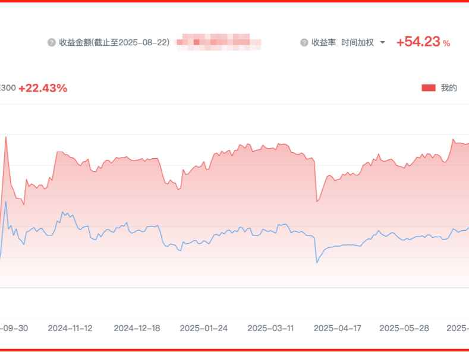
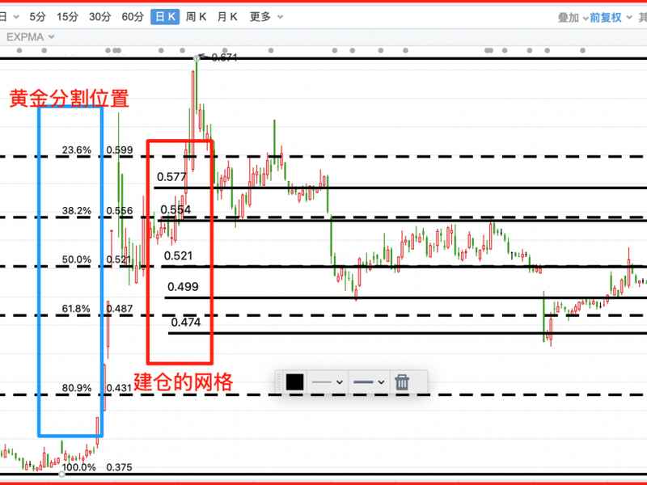
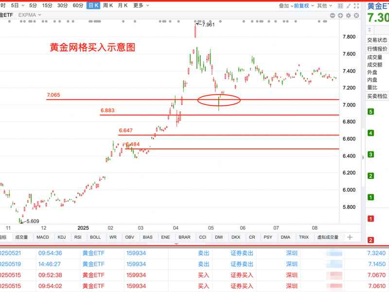

# 一个简单有效的投资策略，胜率超90%

最近股市行情不错，上证指数突破3800点，不少人兴奋得摩拳擦掌，觉得终于轮到自己赚钱了。

但却有人跟我反馈：老师，为啥我在牛市还亏钱了？我是不是个人才？

其实不止你一个人是这样，好些人都是在牛市里亏钱，问题不出在你，也不在市场，而是方法没用对。

**过去几年，我一直在用一个非常笨，非常简单的投资策略，胜率却能稳定在90%以上。**

这个方法不会让你一夜暴富，也不是稳赚不赔的，但是它可以让我在**牛市少亏，熊市少慌，长期下来稳稳跑赢大盘，而且不咋用动脑子。**

今天我就把这个策略完整地分享出来，不藏私，给你们做一个参考。

文章超级干货，建议你们**收藏**阅读，有收获也可以给文章**点个赞**，感谢。

## 一、先来看一下我的股票账户近一年的表现

> 不求一夜暴富，但求长期稳健跑赢大盘。

总的收益率是54%，同期沪深300涨幅是31%，跑赢指数22%。

看到这里，可能很多人会说你这算什么？我随随便便5个涨停都不止50%。

**这么多只股票，你能精准吃到所有涨停吗？**

大盘虽然一直在涨，但是下跌的股票也有，永远都不要高估自己的运气和水平。

当然，不排除少数高手可以一直逃顶抄底，赚到暴利；但也有很多人追涨杀跌，牛市也能亏。

咱们就是走“**稳定派风格**”，**不求一夜暴富，但求长期稳健跑赢大盘。**

接下来我就会具体讲解这个方法的核心逻辑。

## 二、我的交易策略的核心逻辑

> 选择的原则就是：不爆雷，抗跌，能跟住大盘。

### 1. 买什么？

这里我们要考虑一个问题，很多人对个股是研究不透的，因为你要考虑的东西太多，你得研究公司的财务数据，行业环境，经济周期，资金流向，风险评估等等。

**很多人跟风盲买盲卖，才是亏损最大的原因。**

所以这个时候我们可以偷个懒，不去选风险极大的个股，而是选择宽基和大盘股，比如：

- 沪深300ETF、上证50ETF、中证500ETF、行业ETF
- 还有一些大盘股，低概率暴雷，走势跟随大盘
- 少量自己非常熟悉的个股

选择的原则就是：**不爆雷，抗跌，能跟住大盘。**

这样即便是被套以后补仓，也不怕套，也不止损，成功率就至少能达到90%以上。

我交易最多是ETF，只有一支是股票，盈利最多的还是券商和科创板。

我的收益曲线其实和沪深300是非常同步的，这些股票和宽基暴雷的风险几乎没有，分在不同的板块里，当板块轮动的时候，也能有不错的表现。

你们可以不用像我拿这么多，我的资金量会大一点，你们自己**搭配3-4个不同题材板块的ETF，再搭配一支自己非常了解，非常有信心的股票**，就可以了。

### 2. 怎么买？

（1）不要追高，等行情回落一些空间，至少回落日线上涨浪23.6%的位置，开始布局网格买入。

（2）依照黄金分割线+行情的水平支撑压力位共振画好网格线。

（3）可以直接挂在网格线上买，也可以等行情到线以后观察一下k线是不是有止跌信号再买。

**大家看下方的图表。**

大家看到的就是券商ETF的日K线图。

从0.375-0.671这波上涨，连接高点和低点画一个黄金分割线。关注23.6%，38.2%，50%和61.8%，以及最下方80.9%的位置。

在这些位置结合前高前低的支撑，就可以画出网格线，价格到位置可以直接进场，要求高的可以在这些位置再观察一下K线的形态，有反转的可以再买。

### 3. 仓位怎么分？

仓位分配有一个大原则：**分散使用，不要一把梭。**

**第一步：分散到不同股票/宽基。**

比如你打算交易4只股票，就把总资金平均分成4份，每只股票分配25%的仓位。

**第二步：再细分到买入点位。**

拿到某只股票的25%仓位后，再根据划线的网格来分配。

假设从高点到低点画了7条买入线，那就用25%÷7，每条线对应相同的一份仓位，价格到点就买一份。

**第三步：也可以用“金字塔加仓”。**

除了平均分，也可以选择“上小下大”的分配方式。

比如同样是7份，前面几层买少点，越跌越多买，这样既能降低成本，又能在真正的低位拿到更多筹码。

### 4. 怎么卖？

<svg xmlns="http://www.w3.org/2000/svg" viewBox="0 0 620 480" font-family="'Microsoft YaHei','PingFang SC',sans-serif">
  <defs>
    <marker id="ar1" markerWidth="9" markerHeight="9" refX="8" refY="4.5" orient="auto">
      <path d="M0,0 L9,4.5 L0,9 z" fill="#64748b"/>
    </marker>
  </defs>
  <text x="310" y="34" text-anchor="middle" font-size="16" font-weight="bold" fill="#1e293b">网格交易策略四步</text>
  <rect x="110" y="56" width="400" height="58" rx="8" fill="#eff6ff" stroke="#2563eb" stroke-width="1.5"/>
  <text x="310" y="79" text-anchor="middle" font-size="13" fill="#1e293b">① 买什么</text>
  <text x="310" y="101" text-anchor="middle" font-size="13" fill="#475569">宽基ETF＋大盘股＋熟悉个股</text>
  <line x1="310" y1="114" x2="310" y2="134" stroke="#64748b" stroke-width="1.5" marker-end="url(#ar1)"/>
  <rect x="110" y="136" width="400" height="58" rx="8" fill="#eff6ff" stroke="#2563eb" stroke-width="1.5"/>
  <text x="310" y="159" text-anchor="middle" font-size="13" fill="#1e293b">② 怎么买</text>
  <text x="310" y="181" text-anchor="middle" font-size="13" fill="#475569">回落23.6%布局，黄金分割＋支撑压力画网格</text>
  <line x1="310" y1="194" x2="310" y2="214" stroke="#64748b" stroke-width="1.5" marker-end="url(#ar1)"/>
  <rect x="110" y="216" width="400" height="58" rx="8" fill="#fef3c7" stroke="#d97706" stroke-width="1.5"/>
  <text x="310" y="239" text-anchor="middle" font-size="13" fill="#1e293b">③ 仓位分配</text>
  <text x="310" y="261" text-anchor="middle" font-size="13" fill="#475569">分散4份→按网格分份→金字塔上小下大</text>
  <line x1="310" y1="274" x2="310" y2="294" stroke="#64748b" stroke-width="1.5" marker-end="url(#ar1)"/>
  <rect x="110" y="296" width="400" height="58" rx="8" fill="#ecfdf5" stroke="#16a34a" stroke-width="1.5"/>
  <text x="310" y="319" text-anchor="middle" font-size="13" fill="#1e293b">④ 怎么卖</text>
  <text x="310" y="341" text-anchor="middle" font-size="13" fill="#475569">网格卖出或压力位卖出；高位激进低位保守</text>
  <rect x="110" y="392" width="400" height="48" rx="8" fill="#f5f3ff" stroke="#7c3aed" stroke-width="1.5"/>
  <text x="310" y="422" text-anchor="middle" font-size="13" fill="#1e293b">优点：规则清晰心态稳；缺点：牛市可能踏空</text>
</svg>

*图：网格交易策略流程示意（依正文整理）*

**简单版：网格卖出。**

比如你在1元，0.8元，0.6元，0.4元分批买入：

- 1元买的，就在1.2元卖；
- 0.8元买的，就在1元卖；
- 0.6元买的，就在0.8元卖。

如果价格回落到0.8元，再买回来，这样在震荡行情里，就能反复“低买高卖”，不断蚂蚁搬家式地盈利。

**灵活版：看压力位卖出。**

这种方法是看上方的压力位卖出。0.8元买入，在0.8元的上方划一个压力线，到线就卖，这种卖出就是相对动态的。

卖出要把握一个大的原则：在高位的卖出要激进，因为上方空间小；越在低位的时候卖出要保守，因为上方的空间大，拿住了底部的仓位，能够更好地获利。

就像去年9-24的行情，我在低位基本满仓了，行情快速拉起来的时候，卖出就很保守，因为行情启动太快，这样才整体跑赢沪深300。

今年行情慢，一路上涨，我一路卖出，现在只有不到30%的仓位了。

**这种方法还可以用到商品ETF中。**

在股市中，除了股票，指数，还有一些跟踪商品价格的ETF，比如说原油ETF，黄金ETF和白银LOF，豆粕ETF等等，都是跟踪商品价格的。

当商品的价格跌到了一个阶段性的低点，价格有反弹的预期，也可以买这些商品的ETF。

比如说黄金的ETF就在我操作的产品目录里，当黄金的价格出现大幅下跌，有上涨预期的时候。我可能会买黄金的ETF做网格。

**大家看下方的图表。**

图中是黄金ETF网格买入的示意图，下面是我买入和卖出操作的一些信息。

我是结合了黄金现货的走势去进行交易的，当时黄金从3433跌到了3124，下跌了300多美金。回顾历史行情，黄金跌300美金是已经是非常大的行情，后面一定会伴随着非常大的回调，我就分两次买入了黄金的ETF，并在高位逐步卖出。

现在随时也在等黄金走一个大回调，同等逻辑还可以再买入。

## 三、这种交易策略的优缺点

> 规则清晰、心态稳，但赚得没那么多，牛市也可能踏空。

**这种方法非常简单，交易的时候心态稳。**

这种技术方法很简单，用的技术指标也很简单，整体逻辑非常清晰，执行难度也不高，交易小白都可以用。

而且这种策略的规则是非常清晰的，每次买入卖出都有很明确的应对方案，也留出来仓位补仓，即便是被套了，心态也可以做到很稳，对于风险厌恶的人来说非常友好。

**但是这种方法赚得没那么多，在牛市也可能踏空。**

因为资金是分批使用的，每次盈利的空间也很小，像蚂蚁搬家一样在股市里不停交易，整体收益肯定没有某些疯狂的个股来得猛。

因为行情上涨的过程中，我们在不停卖出，就可能导致在牛市中踏空。

但大家也看到我的收益了，在牛市中也可以稳稳赚到一大笔钱，我个人认为是非常满足了。

**同时，这种方法资金量越大，效果越好。**

咱们会发现一个共性，资金量越小的朋友，越喜欢一把梭哈，反而是资金量比较大的人，会更加谨慎一点，这种方法就非常适合。

巴菲特老爷子之所以会长盛不衰，也是因为他骨子里把风险看得比什么都重，咱得学习他这个精神，不要轻易去股市里给人当韭菜。

## 四、说一点我的肺腑之言

> 可以常年盈利的交易者不超过10%，踏踏实实赚一笔能拿得住的钱。

在交易这个行业久了，认识的人也比较多，有些公司的老总会给我看后台客户的交易数据。

我发现可以常年盈利的交易者不超过10%，这是一个很令人痛心的数据。

咱们不要老是去盯着市场里暴富的神话，什么一年翻几十倍，用10万赚到几百万，甚至几千万啥的例子，这不是我们的目标，我们可以羡慕嫉妒恨，但不要作为自己的对标，不然真的结局会很惨痛。

咱们遇到一次大行情不容易，还是踏踏实实地赚一笔咱能拿得住的钱，放下自己深不可测的欲望，反而能得到的更多。

与大家共勉，希望大家在这轮行情中都能赚到钱。

---

> 🏷️ 本文属《投资知识库 · 03-交易系统与实战战法》，重排于 2026-11。
