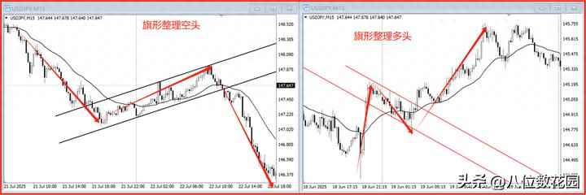
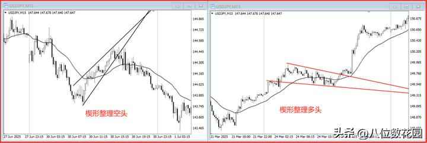
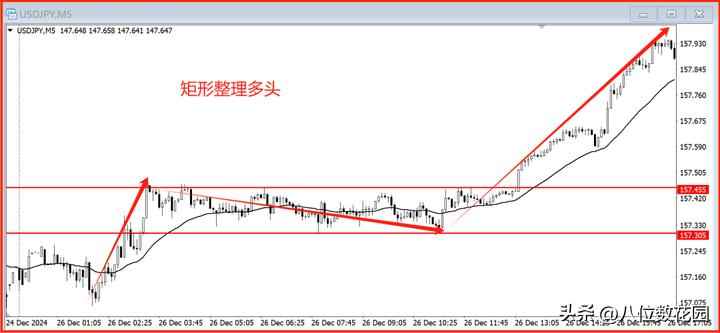
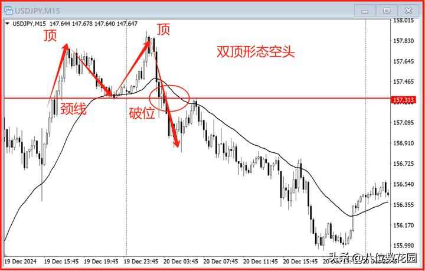
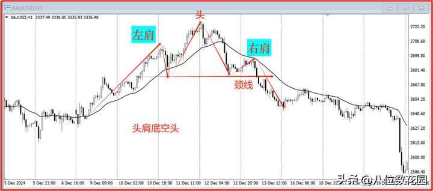
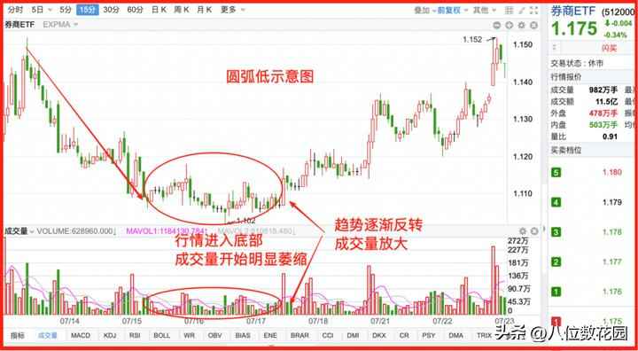
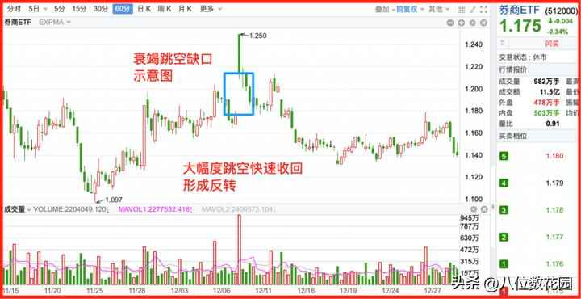
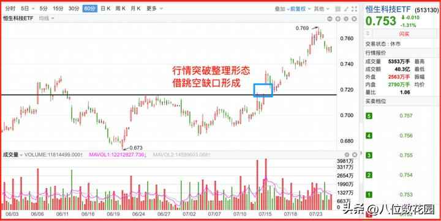

# 每个成功交易者必须掌握的8大图表形态

之前在非洲做生意的时候，那边的人讲的是法语，那个时候我也只会一点蹩脚的英语，每次交流就只能对着别人傻笑，或者瞎比划两句，导致有些生意都搞黄了。

在交易的世界里，k线图表形态就像一个市场语言，可以让我们清晰地了解市场在说什么，尽管我们的交易风格千差万别，但有一个共识始终不变： **价格行为不会说谎，形态胜于千言万语。**

所以作为一个合格的交易者，想到做到盈利，就必须了解“k线到底在说什么”。

今天这篇文章，我将分享 **8个最经典、最实用、最具参考价值的图表形态。**它们不仅高频出现，而且适用于各种交易品种和周期，**掌握它们，你就能在混乱的行情中，看出清晰的机会。**

我们不讲复杂理论，只讲最直接的识别标准和操作逻辑，让你一看就懂，一学就能用。

文章干货满满，建议 **收藏**阅读，有收获也可以给文章**点个赞**，感谢。

## 一、趋势延续类形态（顺势进场）

> 趋势延续类形态就是说：行情走了一波了，要休息一下，休整好了再拉一波行情。

趋势延续类形态就是说：行情走了一波了，我要休息一下，要慢慢整理，休整好了再拉一波行情。

这类形态我接下来会讲解4种。

### 1：上升/下降旗形

**旗形整理的要素：**

- （1）要有一根旗杆，前边走了明显的趋势。
- （2）整理的形态呈倾斜的走势。多头趋势的旗形整理向下走，空头趋势的旗形整理往上走，且整理的上沿和下沿水平。
- （3）成交量配合旗杆的时候放量，整理的阶段缩量再次突破继续放量。

**大家看图片。**

图中是美元兑日元的k线图。

左侧是空头走势的旗形整理，一波下跌之后，行情向上整理，整体形态的上沿和下沿平行，最后顺势下破进场。

右侧是多头走势的旗形整理。快速上涨之后，行情回调整理，回调的上沿和下沿形成平行的结构，最后行情上破做多。

### 2：上升/下降楔形

楔形整理的要素：

- （1）前方要走了明显单边的趋势。
- （2）整理的形态呈倾斜的走势。多头趋势的楔形整理向下走，空头趋势的楔形整理往上走，整理的上下边缘是倾斜的收缩的。
- （3）整理的区间越来越小，动能减弱，等方向突破。

**大家看图片。**

图中美元兑日元k线图。

左侧是空头走势的楔形整理，连续下跌之后，行情向上整理，整理的空间压缩形成向上的楔形，形成突破之后快速下跌。

右侧是多头走势的楔形整理。行情走完上涨第一浪之后回调整理，回调形态的上沿和下沿逐渐收缩，挤压波幅，直到行情破位开始快速上涨。

### 3：整理平台（矩形整理）

整理平台的要素，平台顾名思义，就是整理的整个形态是横着走的，上沿和下沿是平行的，像长方形；长方形被突破之后，趋势延续。

**大家看图片。**

图中美元兑日元k线图。

是一个平台整理向上突破的走势，一波上涨之后，行情就展开了长时间的平台整理，上沿的压力和下沿的支撑是水平的结构，行情强势突破之后，继续多头趋势。

### 4：三角形形态

三角形形态的要素：在一段单边行情之后，上沿压力向下，下沿支撑向上，行情进入收敛的整理，空间逐渐在压缩，形成三角形形态。

三角行形态分3种，对称三角形，上升三角形，下降三角形。

**大家看图片。**

图中分别对称三角形，下降三角形和上升三角形的示意图。

对称三角形，支撑和压力线收敛。

下降三角形，支撑线水平，压力线向下收敛，多发生在多头行情中。

上升三角形，压力线水平，支撑线向上收敛，多发生在空头行情中。

### 四个形态综合整理一下

**四个形态综合整理一下：**

（1）4种形态形成之前，都要有一波单边的上涨或下跌。

（2）这4种形态有啥区别？

- 旗形整理的上下沿是平行的，整体形态是倾斜的。
- 楔形整理上下沿是向同方向收敛的，整个形态也是倾斜的。
- 整理平台上下沿是平行的，整个形态是水平的。
- 三角形整理上沿和下沿是向不同方向收敛的。

这是四者最大的区别。很多人都分不清楔形和三角形，其实区别就在整理的上沿和下沿的两条线的方向。

（3）其他交易中，比如结合成交量，结合技术指标等，都是可行的。

## 二、反转类形态（转势信号）

> 这类形态代表的语言是：行情要停止反转了，如果持仓该平仓了，找机会反向做吧。

这类形态的代表的语言是：行情要停止反转了，如果持仓该平仓了，找机会反向做吧。

### 1：双顶 / 双底

**双顶 / 双底形态的要素：**

- （1）形态之前有单边的行情，在单边后形成双顶或者双底的形态反转。
- （2）形态由3部分组成，顶部有两个高点，分别是左侧的头和右侧的头，连接两个头之间低点做支撑线，是颈线，行情突破颈线确认反转。

**大家看图片。**

行情经过上涨在高位形成双顶形态，形态破位颈线以后展开下跌。

我在图中标注了，两个顶和颈线。

行情破位颈线就可以做空，止损在右侧顶的上方。

### 2：头肩顶/头肩底

**头肩顶/头肩底的形态要素：**

- （1）形态之前要有一波单边的行情，在高位形成头肩顶，低位形成头肩底之后反转。
- （2）形态由4个部分组成。一个最高点为“头”；左肩“头”左侧的低点，右肩“头”右侧的低点，颈线，左肩的低点连接右肩的点形成的支撑/压力线。

行情突破了颈线确认趋势反转。

**大家看图片。**

行情在连续上涨之后，形成了头肩形态并反转，图中我标注了头，左肩，右肩，以及颈线，行情下破了颈线就是开仓的位置，止损可以放在右肩的上方。

### 3：圆弧顶/圆弧底

**圆弧顶 / 圆弧底的形态的要素：**

出现在上涨或者下跌趋势的末端，价格在高位或者低位止跌企稳，逐步形成了一个圆弧形的形状。

形态从形成到反转的过程中，成交量变化明显，需要重点关注，另外这是一种温水煮青蛙的反转形态，走得慢，难识别，但是由于震荡时间长，一但反转得到确认，成功率却很高。

**大家看图片。**

图中是券商ETF日线。

行情从高位1.152下跌，15分钟k线在接近底部的时候，交易量明显萎缩，逐渐形成了圆弧底。

经过底部震荡，行情逐渐反转向上，交易量放大是明显的标准，在交易量放大的阳线收起来以后，就可以进场做多。

## 三、特殊结构类：跳空缺口形态

跳空缺口是指k线的开盘价高于前一根k线的收盘价，中间价格没有成交；向下跳空缺口则是k线的开盘价低于前一根k线的收盘价，中间没有成交。

跳空缺口有两种做常见的方式。

**衰竭缺口，是反转性质的跳空。**

一般出现在趋势尾端，在连续的单边之后，行情跳空加速，表现出行情很强的样子，诱多之后，行情却快速的收回来，动能耗尽，把追高的个人反杀在里面。

**大家看图片。**

图中是券商ETF的k线图，行情从1.097展开上涨，在行情的尾端大幅度跳空高开，但是行情又快速地收回来，收出大阴线，说明行情力竭，反转到来。

**运行缺口，是趋势中继的跳空。**

一般出现在整理形态的支撑或压力位附近，破位时形成了跳空缺口，说明破位的行情非常强烈，破位以后再收出一根大阳线确认是最好，最稳健的。

**大家看图片。**

图中是恒生科技ETF，行情在0.673触底之后，开始上涨，多头一直受到0.720的压力压制，直到行情形成跳空缺口，并且突破0.720的压力，并且收出大阳线确认。

之后行情延续上涨。

## 四、总结一下

今天咱们聊了8种图表的形态。

其中旗形、楔形、三角形、矩形平台：都是趋势中的蓄势阶段，方向待突破确认，就可以跟进开仓。

双顶双底，头肩顶头肩底，圆弧顶圆弧底，都是识别趋势反转的好方法。

双顶双底，头肩顶头肩底关注颈线的破位情况；圆弧顶圆弧底则关注成交量的变化，把握这些关键点就能用好这些形态。

跳空则是价格背后市场情绪变化的信号，连续单边之后的缺口，关注反转信号，整理形态的跳空破位的跳空，都需要后续的k线确认。

这些形态也并不是说你都得全部精通，只要学会其中几种，把它用好用透，就足够交易了。

<svg xmlns="http://www.w3.org/2000/svg" viewBox="0 0 860 500" font-family="'Microsoft YaHei','PingFang SC',sans-serif">
  <defs>
    <marker id="ar1" markerWidth="9" markerHeight="9" refX="8" refY="4.5" orient="auto">
      <path d="M0,0 L9,4.5 L0,9 z" fill="#64748b"/>
    </marker>
  </defs>
  <text x="430" y="34" text-anchor="middle" font-size="16" font-weight="bold" fill="#1e293b">8大图表形态分类</text>
  <rect x="330" y="56" width="200" height="44" rx="8" fill="#eff6ff" stroke="#2563eb" stroke-width="1.5"/>
  <text x="430" y="83" text-anchor="middle" font-size="13" fill="#1e293b">8大图表形态</text>
  <line x1="430" y1="100" x2="160" y2="140" stroke="#64748b" stroke-width="1.5" marker-end="url(#ar1)"/>
  <line x1="430" y1="100" x2="430" y2="140" stroke="#64748b" stroke-width="1.5" marker-end="url(#ar1)"/>
  <line x1="430" y1="100" x2="700" y2="140" stroke="#64748b" stroke-width="1.5" marker-end="url(#ar1)"/>
  <rect x="30" y="142" width="260" height="36" rx="8" fill="#eff6ff" stroke="#2563eb" stroke-width="1.5"/>
  <text x="160" y="165" text-anchor="middle" font-size="13" fill="#1e293b">趋势延续类（顺势进场）</text>
  <rect x="300" y="142" width="260" height="36" rx="8" fill="#fef3c7" stroke="#d97706" stroke-width="1.5"/>
  <text x="430" y="165" text-anchor="middle" font-size="13" fill="#1e293b">反转类（转势信号）</text>
  <rect x="570" y="142" width="260" height="36" rx="8" fill="#f5f3ff" stroke="#7c3aed" stroke-width="1.5"/>
  <text x="700" y="165" text-anchor="middle" font-size="13" fill="#1e293b">特殊结构类（缺口）</text>
  <line x1="160" y1="178" x2="160" y2="339" stroke="#64748b" stroke-width="1.2"/>
  <line x1="430" y1="178" x2="430" y2="295" stroke="#64748b" stroke-width="1.2"/>
  <line x1="700" y1="178" x2="700" y2="251" stroke="#64748b" stroke-width="1.2"/>
  <rect x="40" y="190" width="240" height="34" rx="6" fill="#eff6ff" stroke="#2563eb" stroke-width="1.2"/>
  <text x="160" y="212" text-anchor="middle" font-size="13" fill="#1e293b">上升/下降旗形</text>
  <rect x="40" y="234" width="240" height="34" rx="6" fill="#eff6ff" stroke="#2563eb" stroke-width="1.2"/>
  <text x="160" y="256" text-anchor="middle" font-size="13" fill="#1e293b">上升/下降楔形</text>
  <rect x="40" y="278" width="240" height="34" rx="6" fill="#eff6ff" stroke="#2563eb" stroke-width="1.2"/>
  <text x="160" y="300" text-anchor="middle" font-size="13" fill="#1e293b">整理平台（矩形）</text>
  <rect x="40" y="322" width="240" height="34" rx="6" fill="#eff6ff" stroke="#2563eb" stroke-width="1.2"/>
  <text x="160" y="344" text-anchor="middle" font-size="13" fill="#1e293b">三角形（对称/上升/下降）</text>
  <rect x="310" y="190" width="240" height="34" rx="6" fill="#fef3c7" stroke="#d97706" stroke-width="1.2"/>
  <text x="430" y="212" text-anchor="middle" font-size="13" fill="#1e293b">双顶 / 双底</text>
  <rect x="310" y="234" width="240" height="34" rx="6" fill="#fef3c7" stroke="#d97706" stroke-width="1.2"/>
  <text x="430" y="256" text-anchor="middle" font-size="13" fill="#1e293b">头肩顶 / 头肩底</text>
  <rect x="310" y="278" width="240" height="34" rx="6" fill="#fef3c7" stroke="#d97706" stroke-width="1.2"/>
  <text x="430" y="300" text-anchor="middle" font-size="13" fill="#1e293b">圆弧顶 / 圆弧底</text>
  <rect x="580" y="190" width="240" height="34" rx="6" fill="#f5f3ff" stroke="#7c3aed" stroke-width="1.2"/>
  <text x="700" y="212" text-anchor="middle" font-size="13" fill="#1e293b">衰竭缺口（反转）</text>
  <rect x="580" y="234" width="240" height="34" rx="6" fill="#f5f3ff" stroke="#7c3aed" stroke-width="1.2"/>
  <text x="700" y="256" text-anchor="middle" font-size="13" fill="#1e293b">运行缺口（中继）</text>
  <rect x="30" y="392" width="800" height="72" rx="8" fill="#ecfdf5" stroke="#16a34a" stroke-width="1.5"/>
  <text x="430" y="422" text-anchor="middle" font-size="13" fill="#1e293b">延续类：破位确认后顺势跟进</text>
  <text x="430" y="446" text-anchor="middle" font-size="13" fill="#1e293b">反转类：破颈线确认；圆弧看成交量；缺口需后续K线确认</text>
</svg>

*图：8大图表形态分类示意（依正文整理）*

---

> 🏷️ 本文属《投资知识库 · 03-交易系统与实战战法》，重排于 2026-11。
