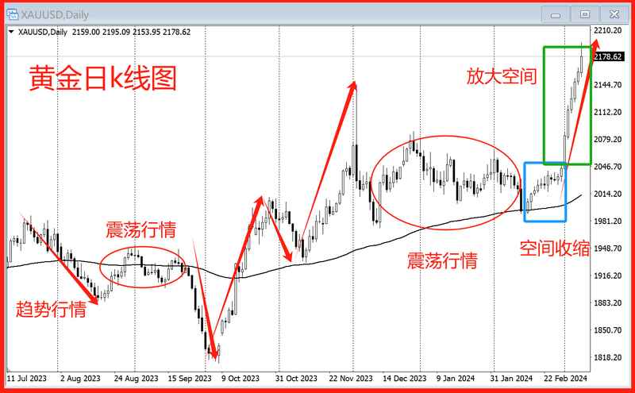

# 明白这些基本逻辑，交易水平直线提升

很多朋友在做交易的时候，脑子都是混沌的。

很多人都觉得，只要自己的交易水平足够高，就一定可以做出盈利，而且是大盈利。

所以大家都在找捷径，不管是跟着别人做也好，找交易中的圣杯也好，兜兜转转到最后，发现自己不但没有走到盈利，反而更加迷茫了。

其实只要你沉下心来去了解一些交易的基本逻辑，交易做起来也没有想象中的那么难，只不过大部分人并没有这个耐心去了解，去学习，急功近利地开始，就只能有悲惨的结果。

所以今天我就**分享8个交易中我认为非常重要的基本逻辑，给大家梳理一下，这些逻辑都是我自己通过大量的亏损经历得出的结论，**相信对你们会有帮助。

文章比较长，建议**收藏**阅读，觉得有收获可以给文章**点个赞，感谢。**

*图：交易中8个重要的基本逻辑（示意）*

<svg xmlns="http://www.w3.org/2000/svg" viewBox="0 0 720 300" font-family="'Microsoft YaHei','PingFang SC',sans-serif">
  <text x="360" y="32" text-anchor="middle" font-size="16" font-weight="bold" fill="#1e293b">交易中8个重要的基本逻辑</text>
  <rect x="5" y="56" width="168" height="76" rx="8" fill="#eff6ff" stroke="#2563eb" stroke-width="1.5"/>
  <text x="89" y="88" text-anchor="middle" font-size="13" font-weight="bold" fill="#1e293b">① 先想明白出场</text>
  <text x="89" y="112" text-anchor="middle" font-size="13" fill="#475569">再进场，不先进场再想出场</text>
  <rect x="187" y="56" width="168" height="76" rx="8" fill="#eff6ff" stroke="#2563eb" stroke-width="1.5"/>
  <text x="271" y="88" text-anchor="middle" font-size="13" font-weight="bold" fill="#1e293b">② 不可能每天盈利</text>
  <text x="271" y="112" text-anchor="middle" font-size="13" fill="#475569">冠军也有回撤周期</text>
  <rect x="369" y="56" width="168" height="76" rx="8" fill="#eff6ff" stroke="#2563eb" stroke-width="1.5"/>
  <text x="453" y="88" text-anchor="middle" font-size="13" font-weight="bold" fill="#1e293b">③ 别只选好接受的</text>
  <text x="453" y="112" text-anchor="middle" font-size="13" fill="#475569">要选对的却难接受的</text>
  <rect x="551" y="56" width="168" height="76" rx="8" fill="#eff6ff" stroke="#2563eb" stroke-width="1.5"/>
  <text x="635" y="88" text-anchor="middle" font-size="13" font-weight="bold" fill="#1e293b">④ 等你的机会</text>
  <text x="635" y="112" text-anchor="middle" font-size="13" fill="#475569">一段行情就足够盈利</text>
  <rect x="5" y="150" width="168" height="76" rx="8" fill="#eff6ff" stroke="#2563eb" stroke-width="1.5"/>
  <text x="89" y="182" text-anchor="middle" font-size="13" font-weight="bold" fill="#1e293b">⑤ 知道鱼的规律</text>
  <text x="89" y="206" text-anchor="middle" font-size="13" fill="#475569">走势规律与品种特性</text>
  <rect x="187" y="150" width="168" height="76" rx="8" fill="#eff6ff" stroke="#2563eb" stroke-width="1.5"/>
  <text x="271" y="182" text-anchor="middle" font-size="13" font-weight="bold" fill="#1e293b">⑥ 没有理想状态</text>
  <text x="271" y="206" text-anchor="middle" font-size="13" fill="#475569">改变对理想交易的定义</text>
  <rect x="369" y="150" width="168" height="76" rx="8" fill="#fef2f2" stroke="#dc2626" stroke-width="1.5"/>
  <text x="453" y="182" text-anchor="middle" font-size="13" font-weight="bold" fill="#1e293b">⑦ 心情不好不做单</text>
  <text x="453" y="206" text-anchor="middle" font-size="13" fill="#475569">避免赌气产生严重亏损</text>
  <rect x="551" y="150" width="168" height="76" rx="8" fill="#f0fdf4" stroke="#16a34a" stroke-width="1.5"/>
  <text x="635" y="182" text-anchor="middle" font-size="13" font-weight="bold" fill="#1e293b">⑧ 回测检验后再实战</text>
  <text x="635" y="206" text-anchor="middle" font-size="13" fill="#475569">补上功课再进实盘</text>
  <text x="360" y="270" text-anchor="middle" font-size="13" fill="#475569">这些逻辑都是作者通过大量的亏损经历得出的结论</text>
</svg>

## 一、先想明白出场，再进场，而不是先进场再想出场

> 先上车后补票，不论从亏损的角度和盈利的角度来看，都是不可行的。

经常有朋友问我：八哥，浮亏了，这个单子该怎么止损？我这个单子该看什么位置止盈？这时候我都会反问：开仓之前你设置的止损位置在哪里？

很多人都是先上车再补票，不管三七二十一，先把单子做上再说，至于止损和止盈，在交易过程中按心情来。

这样开仓无疑风险巨大，进场后如果亏损，因为没有提前准备，人就开始慌，慌乱中可能会拖延止损，小亏拖成大亏。也有可能随便选了一个不合理的止损位，被行情洗出来。

**没有止盈标准的订单，盈利了同样也会出问题。**

因为人的本性里都害怕失去，都喜欢落袋为安的稳定感。所以如果不设置止盈位置，极有可能没到大的止盈点就忍不住平仓了，最后只能错失一大部分利润。

所以先上车后补票，不论从亏损的角度和盈利的角度来看，都是不可行的，都是没有计划的随机交易，极有可能就会放大亏损，缩小盈利，最后亏多盈少。

## 二、交易不可能每天都盈利

> 哪有一个交易每天都能赚到钱？即便是期货大赛的冠军，都有一定时长的回撤周期。

最近有位朋友跟我说，他账户里只有六七百的美金，一天赚了50多美金，就觉得只要“每天能盈利7%，一个月就能赚1万人民币”，问我有没有这个道理。

我曾经也有过这种幻想，特别是在做出盈利的时候，就会核算如果每天都能赚这么多，我多久就能财务自由等等。

但是交易不是上班呀，不可能给你固定的收益，哪有一个交易每天都能赚到钱？即便是期货大赛的冠军，都有一定时长的回撤周期。

而且我们刚开始交易的时候，很容易会遇到新手运，因为没有很严格的交易规则，更不会非常严格地止损，喜欢扛一下单，或者亏损补一下仓，行情总是震荡上涨或震荡下跌，行情一回调，糊里糊涂的就赚钱了。

赚钱之后，就会天然地把这种震荡运行的行情规律，认为是市场运行的真理，觉得以后的行情都会这样走了，就开始肆无忌惮想当然地开平仓了。

结果到后面遇到趋势行情，自己的想法直接失效，当所有钱都蒸发的时候，感觉自己傻眼了。

所以为啥我老是建议新手们多复盘，多做模拟盘，因为当你看着几十年的行情走势在你眼前走过的时候，你对行情的理解就不会那么片面，更不可能产生每天都盈利的想法。

## 三、多数人都会选明知是错，但更让自己容易接受的那个选择，而不是那个对的，却难以接受的选择

> 止损认输是最正确的选择，但也是最难以接受的选择。

大家都知道止损的重要性，当交易中订单达到了止损的条件，止损认输是最正确的选择，但也是最难以接受的选择。所以大家就开始自我说服，在止损和可接受之间，选择了一个妥协的点。

例如做了2手单子，到了止损位，先止损1手，剩下的等等再看。

例如把止损的位置再放宽一点，等等看行情会不会回调。

例如该止损了但选择锁仓，总觉得锁仓还能解开不算亏。但其实锁仓就已经锁定了亏损，而且多付了一个手续费，拿着这个锁仓单，一直糟心，也影响其他的交易。

或者订单盈利了，拿着订单到目标位是最正确的选择，但行情一回调就害怕要反转，此时的做法也是相同的，先平一部分订单获得心理安慰，或者调低止盈目标。

这种状态就是人的理性跟感性碰撞的结果，我们在交易中常讲的要克服人性弱点，也体现在这个方面。

而交易就是自己的欲望与理智之间的博弈，只有理智占上风了，交易才有可能走向盈利。

## 四、最高级的交易，就是等住属于你的那一种机会

> 每一种技术分析体系都只能解读市场中的一小部分机会，而这一小部分机会就足够实现盈利了。

经常有朋友拿着一份交割单问：这个人太厉害， 一波行情从头拿到尾，全抓住，他是怎么做到的？

还有人说，今天3800点的行情只赚一点就止盈了，如果从2160做上到2190了，就赚大了。

其实交易中哪有从头拿到尾这样的事情？比如黄金去年10月份从1809开始上涨，去年涨到2145，算是从头到尾的一段走势，但是现在黄金已经涨到了2193，这样看，2145平仓还是早了。

**金融市场是巨大的，并且有包容性，每一种技术分析体系都只能解读市场中的一小部分机会，而这一小部分机会就足够实现盈利了。**

在我们的交易体系里，拿住了属于我们的那一段行情，抓住了我们交易体系中的头和尾，这就是成功的交易。

大家想想，狮子在草原上捕猎，鳄鱼在水中捕猎，它们各有千秋，都活得很好。但是你让鳄鱼去草原上抓羚羊，它可能就饿死了。

对我们交易者也是一样的道理，最重要的是掌握一种技术分析的体系，选出一种属于自己的交易机会，就足够吃了。

## 五、要捕鱼就要知道鱼的活动规律

> 对自己交易的走势和品种特性规律了解，这是盈利的基础。

大家看下方的图片：

图中是现货黄金的日k线图，在黄金的日k线图上能够发现比较明确的走势规律。

连续的趋势之后，行情就会进入震荡，在持续的震荡之后，又会逐渐酝酿出趋势。

在日k线波动的幅度收缩一段时间（图中蓝色矩形）之后，波幅就会扩大（图中绿色矩形）。这有点像一年四季交替循环，存在一定的规律性。

另外在每天24小时里，也存在空间大小交替的规律。

不同品种的振幅也存在大小不同的规律，像黄金原油这些品种波幅大，日内交易盈利的目标看100点左右是可行的，但欧元兑美元，美元兑瑞朗这些品种波幅小，日内交易也就看50点。

走势规律，品种特性各有不同。实战中要做好某种走势，就要了解这种走势的规律特性，要做好某个品种，也要了解这个品种的属性。

例如上图中黄金的日k线连续收缩了两周，10个交易日之后，走出大空间的概率就特别高，这时候单子就可以留一些，搏一搏趋势。

我记得刚开始交易的那一年，根本没有行情规律的意识，从早到晚在电脑前，不分昼夜地捞鱼。其实在一片没有鱼的河里撒再多的网，也没有用，找到鱼群的位置，每一网都会有所收获。

对自己交易的走势和品种特性规律了解，这是盈利的基础。

## 六、任何交易都没有理想状态

> 所有的交易方式都达不到我们理想的状态，都有遗憾。

曾经跟朋友们讨论一个问题，这世界上有没有成功率100%的交易呢？得出答案，只有像赌场马丁格尔那样的逻辑，才能实现100%的成功，但这种成功有一个前提，就是你要有无限多的钱。

**有了无限多的钱？那还为什么要做交易呢？这本身就是一个悖论。**

趋势交易一定会有利润回吐，震荡交易一定拿不出大的利润，加仓的交易一定会扩大风险，回撤时利润回吐严重。

所有的交易方式都达不到我们理想的状态，都有遗憾。

这是交易的现实无可改变，只有改变我们自己对于理想交易状态的定义。

比如100万在账户里，自己理想的标准是每年赚20万，去生活补贴家庭，如果实现了，这就算达到了理想的状态。

定义自己理想交易的标准，是每个人都要做的，当然也得是一个脚踏实地的，可以实现的目标。千万不能是那种不停翻倍的标准，实现起来的难度太大，长期的结果都不大好。

## 七、心情不好的时候尽量不要做单

> 心情不好时不做，可能会错过一些盈利，但也一定会让你避免赌气产生的严重亏损。

当年选择开始交易，我当时的女朋友并不支持，在她看来这是不务正业，后来亏损之后，她的反对就更加强烈了，我们就经常争执。

每次因为交易吵架，我生气回到书房继续交易，总是会亏损。一开始我以为是吵架带来的坏运气才亏。多年之后，我才知道其实是生气的时候，行情的分析不客观，对风险的理解更激进，等待交易信号和行情的耐心也更差，所以才亏损。

更可怕的是，心情不好的时候把交易变成了赌气，逆势交易，重仓交易，频繁交易，这些导致严重亏损的情况，多数都是在心情不好的时候做出来的。

所以实战中一定要有意地调节情绪，当你感觉比较累，感觉心里很烦躁的时候，特别是刚刚跟谁起了争执之后，最好都不要去做交易。

心情不好时不做，可能会错过一些盈利，但也一定会让你避免赌气产生的严重亏损，肯定是划算的。

## 八、交易技术实战之前，要经过回测的检验有效再实战

> 把该做的功课补上了，再进入实盘不迟。

有一种很匪夷所思的情况，交易者交易一段时间之后，又回过头来问我，交易系统这样止损可以吗？或者只用10和30均线交易可以吗？

很多人拿自己的真金白银，用一套不知道能不能赚钱的交易系统去实盘操作，总是在遇到问题之后，再回过头来思考，比如连续止损了，考虑止损设置得对不对？

**这样做是绝对错误的。**

第一，不知道交易系统能不能赚钱，就拿真金白银去试，可能会造成无谓的亏损。

第二，交易中遇到什么问题，马上回过头来解决问题，有时候会变得短视和不理智，比如刚解决完止损的问题，止盈又出问题了，接着就是开仓的问题，各方面的问题，一直都在发现问题解决问题。

问题不断延伸，钱不断亏损，时间不断浪费，精神不断消耗，最后成了市场长期的亏货。

如果进入了亏损的状态，就停下来想一想，你的交易系统有没有经过测试检验有效？框架知否完善？能不能盈利？回撤如何？资金管理到不到位等等。

**只有搞清楚这些问题，进入实战的时候才不会乱，把该做的功课补上了，再进入实盘不迟，不要等到亏损了再想办法，那想的就不是办法，找的都是乱七八糟的救命稻草，交易就更难了。**

---

> 🏷️ 本文属《投资知识库 · 03-交易系统与实战战法》，重排于 2026-11。
