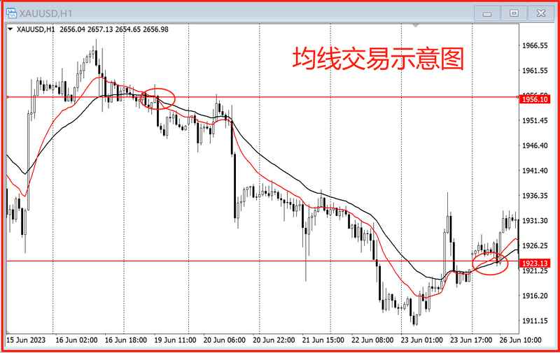
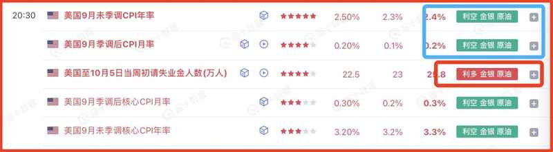
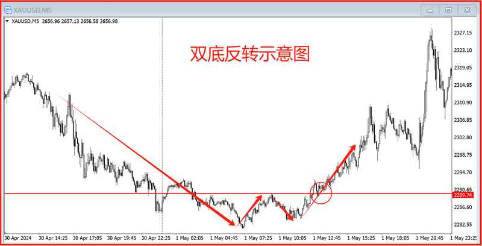

# 别傻了，技术分析没什么用！

做交易十几年来，一直有人频繁问我，技术分析到底有没有用？为什么我做技术老是亏损？技术分析的存在是否就是个谬论？

我在刚开始交易的前三年，也曾狠狠质疑过自己这个问题，我觉得我付出了这么多的精力去学习，但还是找不到一种有效的交易方法，还是赚不到钱，技术分析是不是就是个pi？就是哄我们玩儿的？

但是随着后来学习的深入，加上对复盘的理解，我渐渐明白了技术分析其实是最直接、最简单的东西，因为它就是人性的直接反映。

每一根跳动的k线背后都是我们的人的行为，由于人性的趋同，导致k线呈现一定的规律性，我们要赚钱，就是要抓住这种规律性，比研究其他有的没的来得更加直接快速。

**所以说技术分析没用，我是一万个不同意的，在下面的文章，我也会结合自己的交易经历来分析一下，技术分析的背后到底是什么东西？我们应该怎么利用技术分析去赚钱？**

内容比较多，你们可以先**收藏**再阅读，觉得有收获可以给文章**点个赞**，感谢。

## 一、技术分析一念成魔，一念成佛

> 技术分析不是没用，而是它不存在理想化，不存在完美预测，更不存在交易圣杯。

我在刚开始交易的时候，整个人是有点魔怔的，因为亏怕了，越亏就越想赚回来，就越想快速翻本。

我那个时候都30多岁了，我都不知道自己怎么会有那么大的热情？比高考还要认真地去学习，有时候不光是在书上做笔记，我甚至还会抄书，抄好几遍，直到自己彻底弄懂为止。

但是我当时的思维是彻底错误的，因为接触到了很多交易界的神话，尤其是你身边认识的人，有通过做交易获取大量财富的。就像一个陌生人给你推销一个东西你持怀疑态度，你亲大姨给你推荐一个东西，这杀伤力有多强我们是知道的。

**所以我一直以为，交易是一定能赚到钱的，而且能赚到大钱，而且交易里边一定藏了很多秘密，那些大神能赚到钱，肯定都有自己的法宝。**

所以我在研究技术分析的时候，我不是想着怎么能赚点钱，我是想着怎么能找到一种神奇的指标，能够精准地预测未来的行情走势，让我所向披靡，无往不利。

这样我就不会亏损了，市场就是我的提款机，我到时候整个法拉利开开，去青岛买套别墅住住，每天跟活在白日梦里一样。

**所以我之前一直说，你在交易中的成败，很大概率取决于你进入市场的姿势。**

有时候你的思想是歪的，或者带你进入市场的人心思不正，那么你可能花费很长很长的时间都矫正不过来。

后来就是因为这样的思想让我亏掉了自己所有的身家，也是我对技术分析产生最大质疑的阶段。

就比如有时候我会在网上跟大家讨论均线金叉的问题，我说金叉做多，死叉做空，就会有人说：这东西震荡的时候能亏死你，没鸟用。

这个时候我一般不回复，因为大家在初级阶段就是这样的，看问题一定是看一半的，**如果在震荡行情里会亏损，那在趋势行情里就可以拿住大利润，也可以拿住大部分行情，那我们又该如何评判这个事情呢？**

大家看下面的图片。

图中是黄金小时级别的k线图，上方均线死叉进场，下方均线金叉出场，行情一共下跌了50多美元，能够拿到33美元的利润，拿到了70%的利润，已经算非常好的技术指标了。

我们做交易的时候常常会有这种思想：**一旦一个指标让你亏了钱，这个指标就是垃圾，一点作用都没有，谁跟我提这个指标我就跟谁急！**

我其实完全理解这种想法和行为，因为我也是这么过来的。

**其实技术分析不是没用，而是它不存在理想化，不存在完美预测，更不存在交易圣杯，这是技术分析的现实，接受不了这个现实的，就会觉得它无用。**

**也有人会觉得，基本面分析会比技术分析更好，更容易赚到钱，其实也不然。**

想想咱们做期货和外汇的，如果做基本面，你可能得研究财报，经济数据，CPI，失业率，利率，汇率，供需关系等等，每天都得盯着各种基本面数据看，而且这些信息最好是一手的，没有延迟的，并且在事情发生的当下，你就要做出非常精准的判断，我不知道别人怎么样，但是做到这样对我来说太难了。

大家看下方的图片。

图中是上周四美国公布的经济数据，CPI数据是利空黄金和原油的，而初请失业金的人数又是利多金银和原油的，同一时刻公布的两个数据互相打架了，又看多，又看空，走势也非常特别，黄金先快速下跌了10美元，又反转向上，最后还是走了多头。

**如果是你，你会怎么去判断？我肯定是满头问号的，如果非要进场，肯定又是赌一把。**

所以基本面这东西太笼统，每个人心里也有自己的一杆秤，很难去做出非常精准的判断，杂音太多，要学要关注的东西也太多，不适合我这种不够聪明的人。

## 二、技术分析反而是最简单的，因为它直接反映了我们人在市场里的行为，以及我们的人性走向

> 历史走势一直在不断重复，100年前的人性和现在的人性并没有什么区别。

技术分析其实是更利于实操的，因为我们只需要研究k线，研究技术，研究点位，研究资金管理，可以直接根据k线的规律做出精准的判断，保持交易的一致性就好了。

**比如一个双底破位，我们只要分辨出两个底和颈线，颈线破了，我们就知道该进场了，就这么简单。**

**那这k线这么走的来源依据又是什么？我们凭什么就要在这个标准进场？**

因为历史走势一直在不断重复，如果你看过《股票大作手回忆录》，也复过大几十年的盘，你就会很清楚地明白，100年前的人性和现在的人性并没有什么区别，大家的贪婪和恐惧还是在不断重复。

**就是因为人性的趋同，导致了这种历史走势不断在重复，很多事情的发生也是以周期性往前推进。**

我举个例子，还是讲最常见的双底形态。

这个形态的背后其实就是行情的多空博弈，背后也是我们交易者心态的博弈。

**我们先看一个双底形态反转的示意图，看看我们交易者的心态变化在这个k线图上的体现。**

假设我是一个没有持仓的交易者，在一大段的下跌行情中，我会一直等待一个低位进场抄底。

但是行情一直跌，我只敢观望，还不敢真的动手，直到行情到达一个低位开始反弹了，我就会开始着急，害怕行情一直上涨，我再也没有机会进场了。

这时候行情又开始下跌，直到跌到了跟第一个低点差不多的位置，我就默认它跌到这就会反弹了（因为前车之鉴），所以我会赶紧在这个低点进场。

**这就是大部分行情很容易出现双底双顶形态的原因，因为大家都是这么想的。**

进场之后，由于大家对行情的期待很高，大家都想抄底，资金流入的也多，所以双底之后大概率会有一波大的上涨。

*图：双底形态背后的交易者心态变化（示意）*

<svg xmlns="http://www.w3.org/2000/svg" viewBox="0 0 720 365" font-family="'Microsoft YaHei','PingFang SC',sans-serif">
  <defs>
    <marker id="arw" markerWidth="8" markerHeight="8" refX="7" refY="3" orient="auto">
      <path d="M0,0 L7,3 L0,6 Z" fill="#94a3b8"/>
    </marker>
  </defs>
  <text x="360" y="30" text-anchor="middle" font-size="16" font-weight="bold" fill="#1e293b">双底形态背后的交易者心态变化</text>
  <rect x="210" y="50" width="300" height="44" rx="8" fill="#eff6ff" stroke="#2563eb" stroke-width="1.5"/>
  <text x="360" y="77" text-anchor="middle" font-size="13" fill="#1e293b">① 大段下跌行情：空仓者只敢观望</text>
  <line x1="360" y1="94" x2="360" y2="106" stroke="#94a3b8" stroke-width="1.5" marker-end="url(#arw)"/>
  <rect x="210" y="108" width="300" height="44" rx="8" fill="#fef3c7" stroke="#d97706" stroke-width="1.5"/>
  <text x="360" y="135" text-anchor="middle" font-size="13" fill="#1e293b">② 行情反弹：害怕没机会进场，开始着急</text>
  <line x1="360" y1="152" x2="360" y2="164" stroke="#94a3b8" stroke-width="1.5" marker-end="url(#arw)"/>
  <rect x="210" y="166" width="300" height="44" rx="8" fill="#fef3c7" stroke="#d97706" stroke-width="1.5"/>
  <text x="360" y="193" text-anchor="middle" font-size="13" fill="#1e293b">③ 回落到前低附近：赶紧进场抄底</text>
  <line x1="360" y1="210" x2="360" y2="222" stroke="#94a3b8" stroke-width="1.5" marker-end="url(#arw)"/>
  <rect x="210" y="224" width="300" height="44" rx="8" fill="#eff6ff" stroke="#2563eb" stroke-width="1.5"/>
  <text x="360" y="251" text-anchor="middle" font-size="13" fill="#1e293b">④ 大家都想抄底：资金集中流入</text>
  <line x1="360" y1="268" x2="360" y2="280" stroke="#94a3b8" stroke-width="1.5" marker-end="url(#arw)"/>
  <rect x="210" y="282" width="300" height="44" rx="8" fill="#f0fdf4" stroke="#16a34a" stroke-width="1.5"/>
  <text x="360" y="309" text-anchor="middle" font-size="13" fill="#1e293b">⑤ 双底确认：大概率一波大的上涨</text>
  <text x="360" y="352" text-anchor="middle" font-size="13" fill="#475569">因为大家都是这么想的——人性的趋同让双底双顶形态不断重复</text>
</svg>

**这就是一个技术形态背后的人性规律。**

其他顶底的反转形态，中继整理的形态，也是类似的规律，都是由人性和情绪推动的，看多了，研究多了，就很容易明白。

而且我做过多品种的大几十年的复盘，手动复盘多了，你就会明显感觉到，这些形态在历史行情中不断重复，可能会有一些细微的变化，但大体的思路是一致的，这就是我们要找的规律。

## 三、与其说我们在研究技术，不如说我们在研究人，研究人性背后的规律

> 人性的力量是巨大的，是不可更改的，人性推动了交易的行为。

很多朋友都看过《天道》，有这样一段情节，韩楚风和其他两个副总裁竞争总裁的位置，丁元英给他意见：退一步，让两个总裁之间的矛盾上升为主要矛盾，让他们内斗，两败俱伤，韩楚风才有机会。

韩楚风问丁元英：那他们要是不内耗呢？

丁元英说：这是文化属性，不以他们的意志为转移。

《三国演义》32回中也有一段类似的内容，曹操和袁绍在冀州对峙，期间袁绍死了，曹操兵同袁尚，袁谭两兄弟对峙，连日攻打不下。

**郭嘉进曰：“袁氏废长立幼，而兄弟之间，权力相并，各自树党，急之则相救，缓之则相争；不如举兵南向荆州，征讨刘表，以候袁氏兄弟之变；变成而后击之，可一举而定也。”**

看过三国演义的朋友都知道，之后两兄弟手足相残，全部被曹操灭了。

你说两兄弟坐下来商量一下，分一分老爹的地盘，做一对好兄弟行不行？真不行，人性不允许，必须干死对方，自己才有活路。

**说这些是想告诉大家，人性的力量是巨大的，是不可更改的，人性推动了交易的行为，我们交易者的很多交易行为是不受控制的，是本能反应。**

很多人在交易几年之后，都会开始研究哲学和人性，有的人觉得装X，其实一点也不。因为走势的规律性是由人性推动的，我们研究明白人性的弱点，就能明白大家在交易中的行为，也就更能理解走势的规律。

**这段时间黄金的大涨，包括股市突然之间的暴涨，明明是很大的单边行情，还是很多人被套，有些人不理解。**

有个哥们是这么跟我说的：我也知道黄金是多头，但涨这么多了，总要回调一下吧？

于是他开始做空，结果被套，被套之后又不甘心止损，觉得涨得更高，他继续做空，价格更好，结果一路涨一路空，被套死。

**大家在市场里都会觉得自己是“大聪明”，都会有侥幸心理，都会有不理智的时候，如果意识不到改不了，那遇到一个单边行情就被激发出来了。这次亏了下次还会有人做，一直重复，源源不断。**

另外每次一个整理形态有了假突破之后，再反向突破，都会走出很大很快的行情，这是为啥？知道答案的朋友可以在评论区说说。

其实这都是我们的人性推动着情绪往前走，让我们不自觉地做出很多不理智的交易行为，看过《乌合之众》的朋友也明白，大家都喜欢往一个方向凑，同一环境下也容易养出同一批性格的人，这也决定了技术分析的规律一直有效。

**如果人性的规律不变，那我们在实战中应该怎样去做呢？**

## 四、看懂规律背后的逻辑，利用人性规律逆向思考，追求概率的优势

> 好的技术分析也一定是有所取，有所不取，一定是克制的，不是贪婪无度的。

既然人性是有规律可循的，那我们就可以逆向而行，甚至利用人性规律来赚取利润。

**比如人性上会有哪些缺点？这些缺点我们是否可以逆向而行？**

就像大家都爱找神奇的指标，那我们就理智看待指标，用指标创造自己的交易标准，接受指标的所有优点与缺点，用好即可。

很多人都希望交易能带自己一夜暴富，永远不亏钱，那我们就不打扰他们的白日梦，我们自己慢慢建仓，叠加复利，用自己的交易策略稳稳赚钱，接受亏损，也接受盈利，追求稳定长久的利润。

还有人接受不了假突破，觉得假突破就是祸害，遇到的时候愤愤不平，甚至破口大骂。我们就可以反向思考，专门找这种假突破之后的反向行情做交易，就像丁元英给的建议，让别人先上，别人受伤了亏损了，我们再一举歼灭，把慌乱留给别人，把胜利留给自己。

**聪明的商人永远只赚取有限的利润，因为暴利是难以长久的。**

**好的技术分析也一定是有所取，有所不取，一定是克制的，不是贪婪无度的。**

---

> 🏷️ 本文属《投资知识库 · 03-交易系统与实战战法》，重排于 2026-11。
