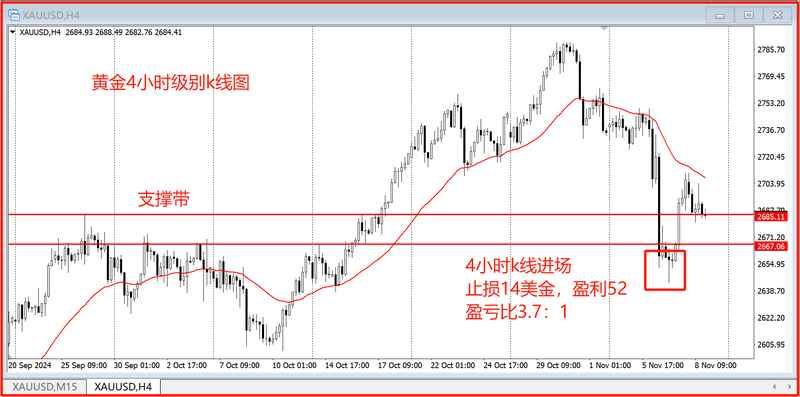
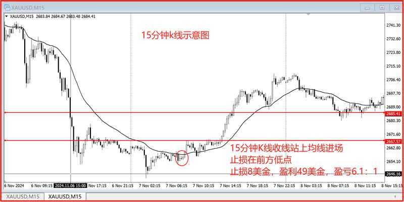
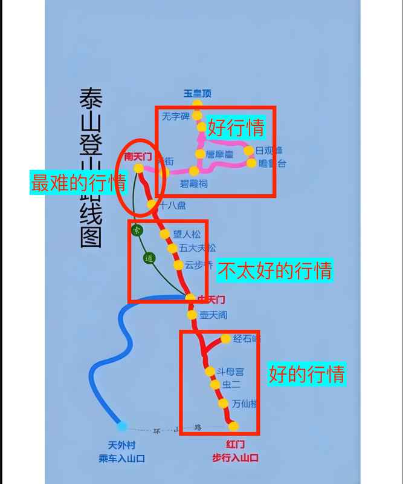
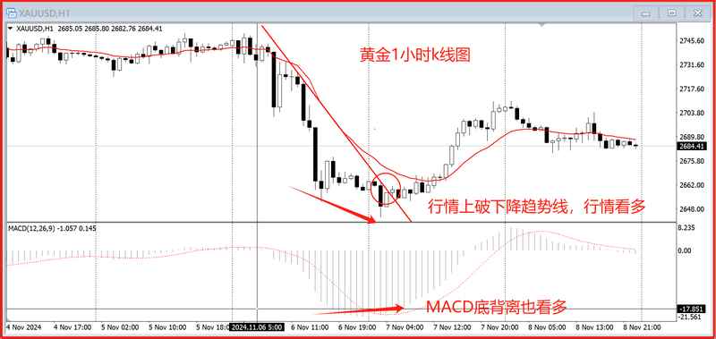
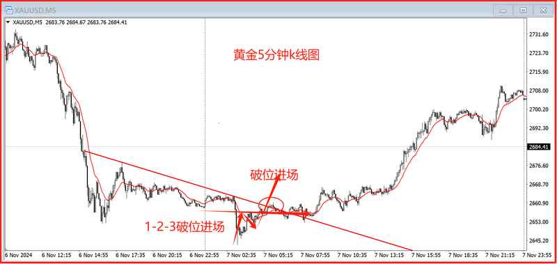
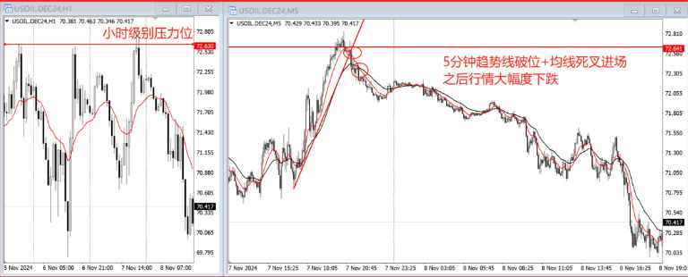

# 我的盈利秘诀：大周期找方向，小周期找点位！

我们交易圈里很流行一种交易玩法，就是“看大做小”，在大周期里找方向，在小周期里找点位。

这么做的意义是，可以放大盈亏比，赚到更多的利润，也可以提高资金的利用率，一举多得。

**所以基本上每个精通技术分析的交易者都会这招，我直接讲一个案例，大家就明白了。**

上面这个图是黄金4小时级别的k线图。

经过了一波大幅的上涨，不断创出新高后，在2789附近反转向下，又借着美国大选的数据快速下跌。

4小时图上我们可以明显看到2685~2667之间有重要的支撑，行情从2789跌下来，到这里已经跌了一百二三十美金，行情有反转向上的预期，就可以考虑进场做多。

如果在4小时以反转的k线形态进场，止损14美金，到达上方的高点盈利是52美金，盈亏比是3.7:1。

3.7:1已经算是一个还不错的盈亏比。

**我们再看换到15分钟进场。大家看下方的图片。**

图中是黄金15分钟的k线图，行情测试到2685~2667之间的支撑后，关注15分钟k线的形态，当k线收线站上EMA30均线以后进场做多（也是15分钟1-2-3破位点），止损在前方的低点。

止损8美金，行情到高点，盈利49美金，盈亏比是6.1:1。

在这个位置如果是用以损定量的方式交易，单次止损1000美金计算。

在4小时级别止损1000美金，盈利是3700美金。

在15分钟级别止损，也是1000美金，盈利是6100美金。

**这就能看出看大做小交易的优势，止损相同的情况下，盈亏比扩大了近一倍。**

再对比一下两笔交易止损的空间，大级别进场止损14美金，小级别进场止损8美金。

如果你是一个激进的交易者，非常看好这次交易机会，想上一个重仓。

比如账户是1万美金，大级别止损14美金，上1手就算比较重了，小级别止损8美金，咬咬牙上到2手，盈利就是5200美元和9800美元的区别。

**直接翻了将近1倍！这就是看大做小的威力。**

这时大级别交易账户本金是15200，小级别交易账户的本金是19800，小级别交易账户积累了大盈利，在下一笔交易的时候，就可以通过复利上更重的仓位，盈利的效果就能继续翻倍。

**从这里我们就可以看出，看大做小的资金利用率变高了，利润也变大了，所谓“有钱不挣王八蛋”，这么好的方法我一定要让你们都学会！**

接下来我就会直接讲看大做小怎么操作，文章的最后我也会给一种看大做小的技术方法，非常实用。

文章超级干货，建议**收藏**阅读，有收获记得给文章**点个赞**。

## 一、什么是看大？什么是做小？大小周期怎么搭配？

> 在大周期找一个方向，在小周期找一个方法进场。

很多人会把看大做小说得很复杂，其实就一句话：

**在大周期找一个方向，在小周期找一个方法进场。**

大周期的方向趋势明确，行情的空间大；小周期进场信号的止损空间小，“小止损+大盈利”，这就是我们梦寐以求的交易。

**其实做交易跟爬山很类似，就像我经常去爬的泰山。**

我们很清楚，我们爬山的目的就是爬到山顶，但是路程中一定会遇到缓坡和陡坡，爬山的难度系数是不一样的。

缓坡就犹如好的行情，我们可以加点速度，冲冲利润。而陡坡我们就得放慢速度，积蓄力量，才能冲下一段缓坡。

如果一开始不管缓坡陡坡都把能量全部释放，那你可能就没力气爬到山顶了。

**所以在交易中，好行情我们就冲冲利润，不太好的行情我们就不犯错，严格控制亏损就行，因为我们的最终目的是到达山顶，不是在半山腰哭泣！**

**怎么看大周期？**

看大周期就是为了确定方向，用技术标准确定方向的方法有很多，重点是要选择自己最熟悉的指标，做自己最熟悉的那类行情，做最有把握的大周期。

**我给大家举个例子，还是上周黄金下跌的走势。**

**图中是黄金1小时级别的k线图，以小时级别为大级别进行讲解。**

黄金从2745下跌到2642，下跌结束之后，行情展开横向的整理，画一条下降趋势线， K线站上趋势线，就可以看1小时级别是多头了。

也可以用下方的MACD背离。行情创出2642的低点的时候，MACD能量柱却在往上收，这是底背离，行情也有反转的预期，也看多。

再保守一点，也可以把趋势线和背离共振来确认行情看多。

**是不是超级简单？你用均线也行，用布林也行，用RSI也行，用形态破位也行，只要能看明白方向的技术方法都可以。**

**怎么做小周期？**

做小周期就是订单从小周期进场，找一个小周期开仓的技术标准。

还是相同的道理，每个人都可以根据自己所掌握的指标，自己习惯的技术标准，选一个符合自己小级别的开仓方法。

**还用上面的黄金例子做讲解，大家看下方图片。**

图中是黄金5分钟的k线图，行情跌到底部，大级别级别确认看多之后，我们在5分钟选择进场。

**图片中标注了两种进场方式：**

第一种方式：5分钟k线上破了下降趋势线，做多。

第二种方式：5分钟的结构形成了一个向上的123形态破位，做多。

其实方法很多，5分钟的均线交叉可以进场，5分钟的底部背离可以进场，也可以多标准共振，比如5分钟趋势线上破加均线金叉共振进场。

**那大小周期该怎么搭配？**

上面举的例子中，1小时级别作为大趋势，可以用5分钟进场，那30分钟进场可以不？用1分钟进场可以不？如果大周期看日线，看4小时，这时候小周期该搭配什么级别的k线？

**大家记住了，大周期和小周期之间，一定要有跨度。**

就像你用4倍的放大镜去看一个物体，判断它大概是个什么东西，再用40倍的显微镜去看它的局部，这样结合整体和局部才可以把这个东西彻底搞清楚。

如果你用的是4倍的放大镜和5倍的放大镜同时去看，那么看出来的东西是差不多的，也就失去了研究的意义。

**给大家一组大小周期配合的参数作为参考。**

- （1）短线（波段）交易：大周期看1小时，小周期看5分钟。
- （2）中线交易：大周期看4小时，小周期看15分钟。
- （3）长线交易：大周期看日线，小周期看1小时。
- （4）日内短线交易：大周期看15分钟，小周期看1分钟（这种交易模式比较激进，一定要注意风险）。

<svg xmlns="http://www.w3.org/2000/svg" viewBox="0 0 620 480" font-family="'Microsoft YaHei','PingFang SC',sans-serif">
  <defs>
    <marker id="ar1" markerWidth="9" markerHeight="9" refX="8" refY="4.5" orient="auto">
      <path d="M0,0 L9,4.5 L0,9 z" fill="#64748b"/>
    </marker>
  </defs>
  <text x="310" y="34" text-anchor="middle" font-size="16" font-weight="bold" fill="#1e293b">看大做小交易流程</text>
  <rect x="110" y="56" width="400" height="56" rx="8" fill="#eff6ff" stroke="#2563eb" stroke-width="1.5"/>
  <text x="310" y="78" text-anchor="middle" font-size="13" fill="#1e293b">① 大周期定方向</text>
  <text x="310" y="100" text-anchor="middle" font-size="13" fill="#475569">如1小时：趋势线 / MACD背离</text>
  <line x1="310" y1="112" x2="310" y2="134" stroke="#64748b" stroke-width="1.5" marker-end="url(#ar1)"/>
  <rect x="110" y="136" width="400" height="56" rx="8" fill="#eff6ff" stroke="#2563eb" stroke-width="1.5"/>
  <text x="310" y="158" text-anchor="middle" font-size="13" fill="#1e293b">② 等待行情测试支撑压力位</text>
  <text x="310" y="180" text-anchor="middle" font-size="13" fill="#475569">如2685~2667支撑带</text>
  <line x1="310" y1="192" x2="310" y2="214" stroke="#64748b" stroke-width="1.5" marker-end="url(#ar1)"/>
  <rect x="110" y="216" width="400" height="56" rx="8" fill="#fef3c7" stroke="#d97706" stroke-width="1.5"/>
  <text x="310" y="238" text-anchor="middle" font-size="13" fill="#1e293b">③ 切换小周期找进场信号</text>
  <text x="310" y="260" text-anchor="middle" font-size="13" fill="#475569">5分钟：趋势线上破＋均线死叉共振</text>
  <line x1="310" y1="272" x2="310" y2="294" stroke="#64748b" stroke-width="1.5" marker-end="url(#ar1)"/>
  <rect x="110" y="296" width="400" height="56" rx="8" fill="#ecfdf5" stroke="#16a34a" stroke-width="1.5"/>
  <text x="310" y="318" text-anchor="middle" font-size="13" fill="#1e293b">④ 小止损进场，放大盈亏比</text>
  <text x="310" y="340" text-anchor="middle" font-size="13" fill="#475569">止损设在前方低点</text>
  <rect x="45" y="390" width="250" height="56" rx="8" fill="#fef3c7" stroke="#d97706" stroke-width="1.5"/>
  <text x="170" y="412" text-anchor="middle" font-size="13" fill="#1e293b">4小时进场</text>
  <text x="170" y="434" text-anchor="middle" font-size="13" fill="#475569">止损14 · 盈亏比3.7:1</text>
  <rect x="325" y="390" width="250" height="56" rx="8" fill="#ecfdf5" stroke="#16a34a" stroke-width="1.5"/>
  <text x="450" y="412" text-anchor="middle" font-size="13" fill="#1e293b">15分钟进场</text>
  <text x="450" y="434" text-anchor="middle" font-size="13" fill="#475569">止损8 · 盈亏比6.1:1</text>
  <text x="310" y="424" text-anchor="middle" font-size="13" font-weight="bold" fill="#475569">对比</text>
</svg>

*图：看大做小交易流程与盈亏比对比示意（依正文整理）*

接下来我会直接讲一种看大做小的技术方法，让你们更直接地学懂。

## 二、看大做小的实战方法

> 日内找1小时级别支撑压力位，行情测试到位后，切5分钟找进场信号。

我直接讲一种日内看大做小的交易方法。

日内找到1小时图级别的支撑压力位置，当行情测试到支撑压力位之后，在5分钟级别寻找交易机会进场，大家看下方的图片。

图中是美国原油期货的k线图，左侧是1小时级别的k线图，右侧是5分钟级别的k线图，72.63的高位被连续测试，第3次测试到之后，行情有反转向下的预期，这个时候将k线图切换到5分钟级别，画一条上升趋势线，行情突破了上升趋势线之后，又在下方又形成了两条均线的死叉。

5分钟的两个标准共振，进场做空，止损在上方的高点，之后行情快速下跌。

**为什么我要讲这个方法？**

因为它简单好学，唯一的难点就是在小时图级别的支撑压力位和5分钟级别画趋势线，但这都是熟能生巧的，只要多练习，慢慢就能做好。

这方法执行的难度也很小，没有什么高深的理论。另外短线的交易频率高，持仓的时间短，也符合多数交易者的心理需求。

日内交易选一些波动大的品种，像黄金，原油，镑日等等，早晨开盘之后，在小时图上找好支撑和压力位置。找好就等行情测试到位，测试到位之后，再切换到5分钟级别，出现了趋势线破位和均线的死叉共振进场就可以。

---

> 🏷️ 本文属《投资知识库 · 03-交易系统与实战战法》，重排于 2026-11。
