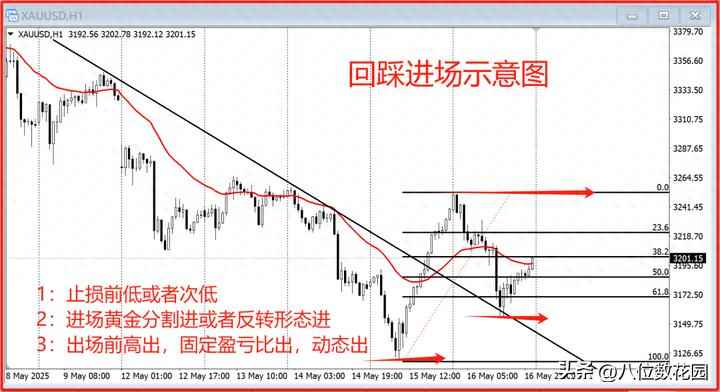

# 自学交易的3条捷径，别再走弯路了！

如果你正在一个人闷头自学交易，我劝你一定要把这篇文章看完。

不是因为我有什么“通天秘籍”，而是因为我知道你现在经历的一切，我都经历过。

你可能刷过很多网站，市面上的交易方法都看了一个遍，收藏了几十种指标和系统，关注了很多老师，买了一堆课，但还是止损拿不住，盈利拿不稳，交易反反复复起不来。

**只有我知道，你不是笨，也不是懒，可能只是方向没有走对。**

我们这些做了十几年的交易老鸟，比交易新手多的，不过就是踩了无数个大坑之后，遗留下来的一点经验罢了。包括哪些东西不用学，怎么学比较快，也就是所谓的交易中的“捷径”，我觉得是可以好好做一下分享的。

今天我就聊一下在**交易的自学中，很关键的3个点**，相信可以帮你们提高学习交易的效率。

文章比较长，建议**收藏**阅读，有收获记得给文章**点个赞**，感谢。

---

<svg xmlns="http://www.w3.org/2000/svg" viewBox="0 0 860 460" font-family="'Microsoft YaHei','PingFang SC',sans-serif">
  <defs>
    <marker id="ar1" markerWidth="9" markerHeight="9" refX="8" refY="4.5" orient="auto">
      <path d="M0,0 L9,4.5 L0,9 z" fill="#64748b"/>
    </marker>
  </defs>
  <text x="430" y="34" text-anchor="middle" font-size="16" font-weight="bold" fill="#1e293b">自学交易的3条捷径</text>
  <rect x="355" y="160" width="150" height="56" rx="8" fill="#eff6ff" stroke="#2563eb" stroke-width="1.5"/>
  <text x="430" y="194" text-anchor="middle" font-size="14" font-weight="bold" fill="#1e293b">3条捷径</text>
  <line x1="355" y1="176" x2="302" y2="100" stroke="#64748b" stroke-width="1.5" marker-end="url(#ar1)"/>
  <line x1="505" y1="176" x2="558" y2="100" stroke="#64748b" stroke-width="1.5" marker-end="url(#ar1)"/>
  <line x1="430" y1="216" x2="430" y2="292" stroke="#64748b" stroke-width="1.5" marker-end="url(#ar1)"/>
  <rect x="30" y="60" width="270" height="72" rx="8" fill="#eff6ff" stroke="#2563eb" stroke-width="1.5"/>
  <text x="165" y="88" text-anchor="middle" font-size="13" fill="#1e293b">捷径1：只跟普通人学</text>
  <text x="165" y="112" text-anchor="middle" font-size="13" fill="#475569">懂交易的普通人，不学神话</text>
  <rect x="560" y="60" width="270" height="72" rx="8" fill="#fef3c7" stroke="#d97706" stroke-width="1.5"/>
  <text x="695" y="88" text-anchor="middle" font-size="13" fill="#1e293b">捷径2：只学一套逻辑</text>
  <text x="695" y="112" text-anchor="middle" font-size="13" fill="#475569">跑通它，70分武器够用</text>
  <rect x="295" y="294" width="270" height="72" rx="8" fill="#f5f3ff" stroke="#7c3aed" stroke-width="1.5"/>
  <text x="430" y="322" text-anchor="middle" font-size="13" fill="#1e293b">捷径3：复盘只总结一件事</text>
  <text x="430" y="346" text-anchor="middle" font-size="13" fill="#475569">每次只测一个变量</text>
  <rect x="180" y="386" width="500" height="48" rx="8" fill="#ecfdf5" stroke="#16a34a" stroke-width="1.5"/>
  <text x="430" y="416" text-anchor="middle" font-size="13" fill="#1e293b">选定一条路，走穿它；盘感从高质量复盘中来</text>
</svg>

## 第1条捷径：只跟“懂交易的普通人”学习，而不是“神话人物”

> 你应该学谁？普通人。

很多人刚入行学交易的时候，就沉迷看那些“翻几百倍”，“几万做到几亿”的神话故事。经常把傅海棠，林广袤，利弗莫尔这些大牛的名号挂在嘴边，连办公桌背景都换成了他们的交易语录。**但其实这不是在学习交易，这是在做梦。**

我以前也接触过这样的人，自己的账户早已亏得面目全非了，却还能在群里谈“道”，讲“势”，讲“大逻辑”。他们想的不是怎么稳定盈利，而是幻想哪天自己也能一单翻仓，一战成名。

可问题是，我们不是他们，因为我们没有他们的时代红利，没有他们的盘感经验，更没有他们那种扛压的心性。就算行情一模一样放你面前，我们也做不出他们的结果。

**你应该学谁？普通人。**

那些真实在市场里混过几年的人，那些能每年稳定盈利的，能管住手，抗住波动，不吹不装的交易者。

比如我一个朋友，原来天天想着打板，抓龙头，忙得热血沸腾，但年年都在亏。后来我把自己的网格交易逻辑跟他说了，他也认真执行了，现在虽然做得慢了，但是这两年收入都非常稳，反而越做越有信心。账户回血了，心态也回来了。

这些人才是我们该学习的对象，执行力强，交易逻辑听得懂，节奏我们能模仿，他们的日子也跟我们差不多，**他们不是神，而是我们身边真实、靠谱、可复制的人**。

就像很多做生意成功的大佬们，他们都喜欢写自传，把自己几十年的经历写得明明白白，但我们现在再去复制，也无法再造出一个神来，因为时代变了，机遇变了，唯一有参考价值的就是他们的精神，交易也是同理。

所以，咱们在交易的路上不要再痴迷神话了，**学会向“普通人里的高手”学习，才是自学者能走得远，活得久的第一步捷径**。

## 第2条捷径：放弃“万能指标”，只学一套逻辑，跑通它

> 你需要做的，是选定一条，走穿它。

大多数交易者，不是死在不努力，而是死在太努力。

你可能每天都在学习，每天都在“优化”。指标一堆堆地试，策略一套套地换，今天觉得均线顺眼，明天又被RSI吸引，后天看MACD背离突然“有感觉”。结果一圈下来，啥都懂点，哪样都没跑通。

这种状态看起来很努力，其实是最危险的。因为你不是在学习，你是在**试图“找到完美的系统”来回避犯错和止损的恐惧**。

我不是说你不能学东西。学当然要学，但你得学得有方向，有选择。交易就像走路，不同的指标、周期、品种、逻辑，就像岔路口，你总在换方向，就永远走不到终点。

**你需要做的，是选定一条，走穿它。** 比如：

- **交易逻辑：** 你是要做猜顶猜低的交易，还是趋势确立的“顺势”交易？
- **交易周期：** 你时间多？就可以做短线，15分钟，5分钟都可以；你上班忙？那就做小时图或日线。
- **技术指标：** 用什么指标？是用均线，MACD，黄金分割，还是趋势线？
- **交易系统逻辑：** 你喜欢看大做小？还是破位进场？还是回调进场？

做交易基本也就这些主要的标准，只要把这些选好了，就可以顺着逻辑深入研究下去，可能期间会遇到一些阻碍，但所有走过的弯路也是修正和打磨的过程。

选定一条路之后，不要东看西看，左顾右盼。你不需要跑赢所有人，只要在一个方向上跑得比大多数人深就够了。

另外切记，**交易系统没有完美的，适合自己才是最重要的**。

**选一个不完美但顺手的系统，跑通它，然后让它变成你手里的“70分武器”，不花哨，但你用得稳，用得熟，用得赢，就OK。** 这是比什么“神级策略”更实用的捷径。

## 第3条捷径：复盘的过程中，每次“只总结一件事”

> 每个阶段就研究一个变量，只解决一个问题。

复盘这件事很多交易者都知道，但真正做好的人并不多。因为多数人做复盘都是草草一看，走个过场，没几天就不耐烦了，最好一两天就能搞定所有变量，导致啥都没复出来。

**复盘的作用是什么呢？**

当我们有了自己交易系统的逻辑框架后，我们会遇到一个非常现实的问题：就是这个交易系统到底能不能赚钱？到底能赚多少钱？能不能执行得下去？遇到不同的行情会不会有什么问题？

这些问题你去问任何人，都没有人能给你答案，只能靠自己去**“试”**出来，而复盘就是测试的最佳捷径。

但很多人复盘是做不好的，所以我就在这里分享我自己做复盘的一个很重要的心得，就是**每次复盘只总结一件事情**。

举个例子，大家看下方的图片。

图中是一个比较经典的反转回踩进场的示意图，在图中可以选择非常多不同的交易标准。

- **进场：** 行情回落的黄金分割支撑位直接进场，或者出现了反转的形态以后再进场，或者是从小级别进场。
- **止损：** 在前低3126附近止损，或者是在形成反转的K线形态的下方止损。
- **出场：** 行情推动起来，在前高3252附近止盈，或者是根据止损空间设定固定盈亏比止盈，或者就等一个空头反转的形态动态止盈。

一个交易系统在同一个时刻，有非常多的问题是需要确认，确认哪种选择更好执行？哪种选择盈利更高？哪种选择连错最少？哪种选择交易频率更适合？等等。

好像有“1万个问题”需要解决，但这些问题肯定是无法同时解决的，所以我们在复盘的时候，**每个阶段就研究一个变量，只解决一个问题**。

比如这次就只研究进场方式。你用相同的逻辑，相同的系统条件，去对比三个不同的进场方式，比如支撑挂单，反转K线确认，小周期结构破位，然后统计哪种方法成功率高，止损更小，出手更顺。

其他条件别动，就测试这个变量。这个搞清楚，再复盘止损的方式，再研究出场等等。

就是这样一个个变量地去测，把所有的最佳结果融合在一起，就可以慢慢得到一个结果最好的交易策略。

这就像大公司里非常流行的一个SOP理论，就是“标准化流程”，**把所有事情拆分开来，一件件地去标准化，优化，这样总体的结果就会提升**，我们也可以运用到交易中。

**另外，永远不要怕“复盘太慢”，或者是“浪费时间”。**

相同的10年行情，你完全可以为了优化开仓标准复盘一遍，为了完善出场再复盘一遍。这样做虽然花时间，但你对走势的理解会变得更深刻，一些关键走势会在你的大脑中留下“图像记忆”。

当你复盘到足够多，足够系统，实战中就会突然有一种熟悉感：这种行情我做过，我见过，我知道它可能怎么走。

**这，就是盘感的开始。**

而这种“熟悉感”，“肌肉记忆”，和“模式识别的能力”，绝不是看两本书，听几节课就能获得的，它只能靠我们用大量的高质量的复盘训练出来。

最终，你会从海量的行情中提炼出一种属于你自己的高胜率形态。当你交易这个形态时，你有心理优势，有经验积累，自然也更容易成功。

**这也是交易高手和普通交易者的本质区别。**

---

> 🏷️ 本文属《投资知识库 · 03-交易系统与实战战法》，重排于 2026-11。
