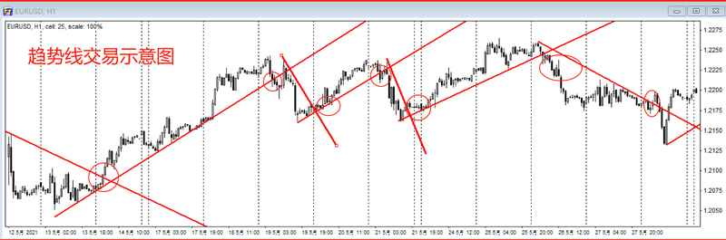
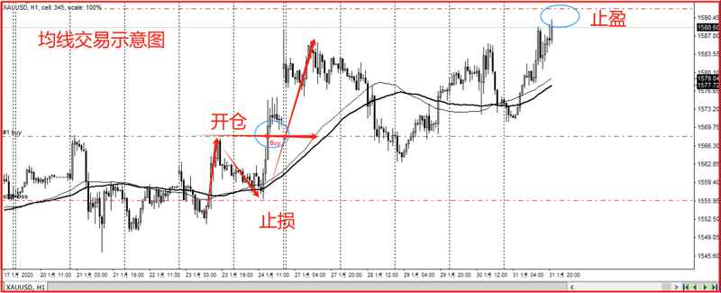
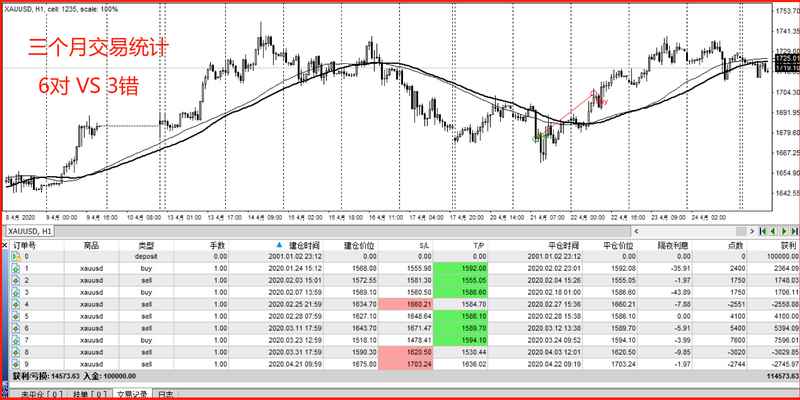
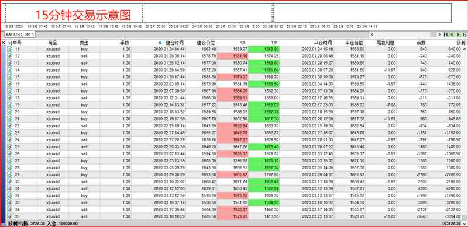

# 交易系统可以有多简单？

刚接触到交易系统这个概念的时候，我第一感觉就是很复杂，因为带了“系统”两个字，听起来就很难。

但真的当我迈出舒适圈，接触并运用了这个东西之后，我发现交易系统无非就是那几样东西，非常简单。

**从实战的角度出发，交易系统就是解决交易中的几个问题：**

- 现在行情的方向是什么？多还是空？
- 在什么地方开仓？
- 开仓后，错了在哪里止损？对了在哪里止盈？
- 一次买多少最合适？

所有交易系统的产生，都是为了解决这4个问题。**接下来我就会讲解3个非常经典的交易系统**，大家一看就知道是怎么回事了。

*图：交易系统4问与三个经典系统示意（依正文整理）*

<svg xmlns="http://www.w3.org/2000/svg" viewBox="0 0 860 400" font-family="'Microsoft YaHei','PingFang SC',sans-serif">
  <text x="430" y="34" text-anchor="middle" font-size="16" font-weight="bold" fill="#1e293b">交易系统要解决的4个问题</text>
  <rect x="25" y="56" width="190" height="48" rx="8" fill="#eff6ff" stroke="#2563eb" stroke-width="1.5"/>
  <text x="120" y="85" text-anchor="middle" font-size="13" fill="#1e293b">现在方向多还是空</text>
  <rect x="240" y="56" width="190" height="48" rx="8" fill="#eff6ff" stroke="#2563eb" stroke-width="1.5"/>
  <text x="335" y="85" text-anchor="middle" font-size="13" fill="#1e293b">在什么地方开仓</text>
  <rect x="455" y="56" width="190" height="48" rx="8" fill="#eff6ff" stroke="#2563eb" stroke-width="1.5"/>
  <text x="550" y="85" text-anchor="middle" font-size="13" fill="#1e293b">错了止损对了止盈</text>
  <rect x="670" y="56" width="190" height="48" rx="8" fill="#eff6ff" stroke="#2563eb" stroke-width="1.5"/>
  <text x="765" y="85" text-anchor="middle" font-size="13" fill="#1e293b">一次买多少合适</text>
  <text x="430" y="152" text-anchor="middle" font-size="13" font-weight="bold" fill="#475569">三个经典交易系统</text>
  <rect x="40" y="170" width="250" height="76" rx="8" fill="#fef3c7" stroke="#d97706" stroke-width="1.5"/>
  <text x="165" y="194" text-anchor="middle" font-size="13" font-weight="bold" fill="#1e293b">利弗莫尔</text>
  <text x="165" y="216" text-anchor="middle" font-size="13" fill="#475569">关键点破位进场</text>
  <text x="165" y="238" text-anchor="middle" font-size="13" fill="#475569">6点转向止损</text>
  <rect x="305" y="170" width="250" height="76" rx="8" fill="#ecfdf5" stroke="#16a34a" stroke-width="1.5"/>
  <text x="430" y="194" text-anchor="middle" font-size="13" font-weight="bold" fill="#1e293b">趋势交易法</text>
  <text x="430" y="216" text-anchor="middle" font-size="13" fill="#475569">趋势线上多下空</text>
  <text x="430" y="238" text-anchor="middle" font-size="13" fill="#475569">订单不离场反手</text>
  <rect x="570" y="170" width="250" height="76" rx="8" fill="#f5f3ff" stroke="#7c3aed" stroke-width="1.5"/>
  <text x="695" y="194" text-anchor="middle" font-size="13" font-weight="bold" fill="#1e293b">三重滤网</text>
  <text x="695" y="216" text-anchor="middle" font-size="13" fill="#475569">大周期定方向</text>
  <text x="695" y="238" text-anchor="middle" font-size="13" fill="#475569">小周期进场</text>
  <rect x="180" y="290" width="500" height="56" rx="8" fill="#ecfdf5" stroke="#16a34a" stroke-width="1.5"/>
  <text x="430" y="312" text-anchor="middle" font-size="13" fill="#1e293b">好系统是自己调出来的：测试→找问题→调整</text>
  <text x="430" y="334" text-anchor="middle" font-size="13" fill="#475569">品种、周期、盈亏比都由复盘数据决定</text>
</svg>

文章很实用，建议**收藏**阅读，觉得有收获可以给文章**点个赞**。

## 一、三个交易系统

### 1. 利弗莫尔的交易系统

**先说利弗莫尔的交易系统。**

利弗莫尔大家都很熟悉，他有一本书叫《股票大作手操盘术》，书中讲了他的交易方法，其实就是一个简单的交易系统，我给大家总结一下。

- 在图表上用黑色墨水记录价格上升，用红色墨水记录行情的下跌，找出行情的趋势方向。
- 找到行情的关键点作为进场点（关键点就是咱们现在所讲的重要支撑压力位）。
- 进场以后，根据6点转向的原则制定止损，会在行情走势走弱时止盈出局。
- 利弗莫尔的仓位使用很激进，而且会在盈利中加仓。

**利弗摩尔的那个年代，技术条件是很有限的，因为还没有那么多的前人铺路，什么都得靠自己琢磨，所以交易系统也相对粗糙。**

他的交易策略主要是对行情数字流进行跟踪分析，据他书中所讲，他自己进行价格的记录统计，发现交易机会。按照我们现在的交易逻辑，这种交易方法就是破位交易。

### 2. 《趋势交易法》的交易系统

**再说《趋势交易法》的交易系统。**

《趋势交易法》中的交易系统也很简单，其中有一个是以趋势线破位，作为多空判断方向的标准。在趋势线上多下空，进行趋势性的交易。

**我们一起来看一下他的交易系统设定：**

- k线上穿趋势线是多头，k线下穿趋势线时做空。
- k线上穿趋势线时做多，k线下穿趋势线是做空。
- 这种操作模式是订单不离场的交易，多单进场的时候空单平仓，此时订单如果是亏损的，就止损平仓，如果订单是盈利的，就止盈平仓。空单进场时候多单平仓，止损止盈也是相同标准。
- 这种交易模式需要使用固定仓位的方法，每次都是固定的手数，例如1手，3手，5手。

**一起来看一下这个方法交易的示意图。**

图中是欧元兑美元1小时级别的k线图，在小时图上画好趋势线，行情上穿趋势线平空单做多，行情下穿趋势线平多单做空。图中的红色圆形中，都是多空转换订单的节点。

**这种交易系统的逻辑也非常简单，就是用趋势线跟踪趋势，解决的也是交易系统最基础的4个问题。**

另外，《海龟交易法则》这本书中讲的趋势跟踪的方法，跟这个方法是有异曲同工之妙的，只是指标不一样，根本逻辑是一样的，都是用均线或者通道线去跟踪趋势。

### 3. 《以交易为生》的三重滤网交易系统

**最后讲一下《以交易为生》中的三重滤网交易系统。**

这本书中的交易系统与其他几个不同的地方，就是使用了多周期，多了一步选周期的操作。

交易者先找一个喜欢的时间周期，可以是大的周线日线，也可以是小的5分钟15分钟，这个周期称为中期时间周期。以此为标准，找一个更大的长期时间周期，和更小的短期时间周期。

在书中，作者一开始是用MACD作为技术标准建立的这个交易系统，但后来又改成EMA均线。

（这里我们可以看到一个点，用什么样的技术指标并不重要，因为只是用来定义标准，也没有所谓绝对神奇的指标）

**我们也一起来看一下这个交易系统的设定：**

- **找方向。** 虽然交易中周期，但作者强调要先观察大周期确认方向，我们可以在大周期观察EMA均线的形态，比如我们使用EMA90和EMA60交叉判断多空。
- **回到中周期，确定在什么位置进场，在什么地方止损。** 假设大周期是多头，在中周期根据EMA90和EMA60的技术标准，选择行情由空转多方向共振之后，等行情回调再进场，止损就在回调的低点。
- **最后进入小周期**，也使用EMA90和EMA60按照技术标准买入，设置好止损，止盈在大周期设置盈利目标位，比如大周期的压力支撑位。
- 这种交易逻辑**看大做小，三周期跨度，止损空间小**，也可以使用固定仓位的交易逻辑，这样在大空间行情中，能发挥更好的盈利效果。

**这市面上交易系统的例子还有很多，虽然定义趋势的标准都不一致，但是解决的都是那4个基本问题。**

所以看到这些例子之后，我们在脑子里就会有一个很清晰的交易系统模型。

### 4. 系统雏形不能直接拿来用，要自己调

**那这些交易系统雏形，是否就可以直接拿来用了呢？**

并不是的。这就像你开一个火锅店，你把四川人能吃的辣度放在广东，那肯定水土不服，生意不好。

如果可以因地制宜，根据自己的特性去调整，那就可以调出一个特色口味，既适应本地，又失原有的精华。

**我觉得好的交易系统不是天上掉下来的，而是自己调出来的。**

交易系统的不同细节在交易过程中，会有完全不同的表现，比如交易频率会不一样，持仓的时间长短不一样，盈亏比不一样，都会给交易者带来完全不同的冲击。

有的人喜欢交易频繁一点，有的人喜欢慢一点，有的人等得了，有的人等不住，每个人性格不同，对应的交易风格也是不同的。

**接下来我就会讲解一下，如何借鉴别人的交易系统，来调试出完全匹配自己的交易系统。**

## 二、如何调试出自己的交易系统

> 好的交易系统不是天上掉下来的，而是自己调出来的。

其实最省力的方式，就是在网上或者书中找到一些交易系统，通过自己的验证和测试，来慢慢调整到匹配自己的状态。

**如果看到一个交易系统，怎么知道这个系统适不适合自己呢？**

很简单，假如你看到一个交易系统，觉得还不错，但是不知道它是不是适合自己，也不知道怎么去了解和修改它，那最简单的方式就是去测试它。

**举个例子。**

我在之前的文章里，曾经讲过一个k线站上均线回落均线不破，行情再次破高之后进场的交易系统，止损在回落的低点，盈亏比设置2:1，我们先用一张图片简单讲解一下这个逻辑。

图中是现货黄金1小时级别的k线图，图中行情站上均线之后回踩均线，形成反转k线之后继续上涨，破位前高开仓，止损设置在回调的低点，设置2:1的盈亏比。经过了4天的震荡上涨，订单在高位止盈。

**交易逻辑知道了，那我们该怎么做呢？找问题，去测试系统，让问题浮出水面，然后去解决问题。**

比如第一个问题是，这个模式能不能赚钱？交易频率怎么样？我们就直接在复盘软件上操作3个月，看看情况。

**下面这张图，是这个交易系统在1小时级别3个月的交易情况。**

交易的效果还不错，3个月9次交易，6对3错，但是3个月9次的交易机会，平均每周不到一次，**这个交易频率偏低了，执行起来挺熬人的**。

当然，要检验一个交易系统更真实的盈利效果，三个月的时间肯定是不够的，这里我只是做一个演示，给大家作参考。

**这里就浮现出这个问题了，交易频率太低，自己交易做起来不得劲，怎么改？**

第一个选择，可以增加一个品种，比如你加上欧元兑美元，理论上交易频率就增加了一倍，3个月18次。如果还觉得少，就再加上英镑兑美元，3个月27次，这样频率就比较高了，执行起来就没有那么熬人了。

这个时候你再把这3个品种都放到复盘软件中，测试一下三个月具体的交易频率，看一下是否跟自己吻合，再继续找其他的问题。

**另外，增加交易频率还可以缩小交易的k线周期，比如将1小时改成15分钟的k线，我们也来看看这么改之后，交易系统的表现。**

图中是15分钟交易的示意图，2:1的盈亏比止盈，也是三个月的交易时间，共交易了26笔，13次正确，13次错误。

这就很清楚了，这个交易频率跟1小时3个品种三个月的交易频率类似。

**这个时候我们心里就清楚了，要么是增加交易品种，要么是缩小交易周期，至于自己怎么选，就看自己的交易习惯了。**

这个时候如果我们想改成3:1的盈亏比止盈，希望持仓的时间长一些，我们也可以看一下这个15分钟3:1盈亏比的结果，16错10对，成功率降低了，盈亏比提高了，交易盈利的结果差不多。

**所以经常有人问我，老师，我应该用什么样的盈亏比？其实这个问题不该问我，应该问你自己。只有自己测试过了，才知道真相是什么，最适合自己的是什么。**

也只有自己这样测试过，经历过，以后自己执行交易系统的时候，才不会患得患失，才不会对未来的结果充满不确定性，充满恐惧感，**这才是自己执行交易系统底气的由来**。

在测试的过程中，你会慢慢了解自己的交易系统，了解自己，也了解行情，数据量越大，你越能看到交易的全貌，等真的看到之后，就不会再害怕了。

如果你还有疑问，比如把60均线改成30，或者90会怎么样，是否会影响到盈利效果？换一种指标会不会效果更好？调整一下止损会不会盈利更高等等，这些问题都可以通过自己去测试去找答案。

当你经历过无数次的测试，无数次的修改，这个交易系统就会被慢慢调整为最适合你的样子，就真正成为了你的东西，帮你披荆斩棘，在交易中杀出一条血路来。你也不再怕自己的交易系统为别人所知，因为别人用起来也未必顺手。

*图：交易系统调试流程（示意）*

<svg xmlns="http://www.w3.org/2000/svg" viewBox="0 0 720 360" font-family="'Microsoft YaHei','PingFang SC',sans-serif">
  <defs>
    <marker id="arw" markerWidth="8" markerHeight="8" refX="7" refY="3" orient="auto">
      <path d="M0,0 L7,3 L0,6 Z" fill="#94a3b8"/>
    </marker>
  </defs>
  <rect x="230" y="20" width="260" height="48" rx="8" fill="#eff6ff" stroke="#2563eb" stroke-width="1.5"/>
  <text x="360" y="49" text-anchor="middle" font-size="14" fill="#1e293b">找到一个觉得不错的交易系统</text>
  <line x1="360" y1="68" x2="360" y2="86" stroke="#94a3b8" stroke-width="1.5" marker-end="url(#arw)"/>
  <rect x="230" y="88" width="260" height="48" rx="8" fill="#eff6ff" stroke="#2563eb" stroke-width="1.5"/>
  <text x="360" y="117" text-anchor="middle" font-size="14" fill="#1e293b">复盘测试：先测3个月看数据</text>
  <line x1="360" y1="136" x2="360" y2="154" stroke="#94a3b8" stroke-width="1.5" marker-end="url(#arw)"/>
  <rect x="230" y="156" width="260" height="48" rx="8" fill="#fffbeb" stroke="#d97706" stroke-width="1.5"/>
  <text x="360" y="185" text-anchor="middle" font-size="14" fill="#1e293b">让问题浮出水面：频率？盈亏比？</text>
  <line x1="360" y1="204" x2="360" y2="222" stroke="#94a3b8" stroke-width="1.5" marker-end="url(#arw)"/>
  <rect x="230" y="224" width="260" height="48" rx="8" fill="#eff6ff" stroke="#2563eb" stroke-width="1.5"/>
  <text x="360" y="243" text-anchor="middle" font-size="14" fill="#1e293b">调整变量</text>
  <text x="360" y="263" text-anchor="middle" font-size="13" fill="#475569">加品种 · 缩周期 · 调盈亏比 · 换指标</text>
  <line x1="360" y1="272" x2="360" y2="290" stroke="#94a3b8" stroke-width="1.5" marker-end="url(#arw)"/>
  <rect x="230" y="292" width="260" height="48" rx="8" fill="#f0fdf4" stroke="#16a34a" stroke-width="1.5"/>
  <text x="360" y="321" text-anchor="middle" font-size="14" fill="#1e293b">再测试，直到匹配自己</text>
  <path d="M490,316 L560,316 L560,180 L494,180" fill="none" stroke="#94a3b8" stroke-width="1.5" marker-end="url(#arw)"/>
  <text x="525" y="252" text-anchor="middle" font-size="13" fill="#475569">循环调试</text>
</svg>

**所以啊，交易系统本身不是一个很复杂的东西，它解决的就是我们交易中会遇到的所有问题，你只要知道了它的基础框架，就可以慢慢测试调整，找到自己专属的交易系统。**

---

> 🏷️ 本文属《投资知识库 · 03-交易系统与实战战法》，重排于 2026-11。
