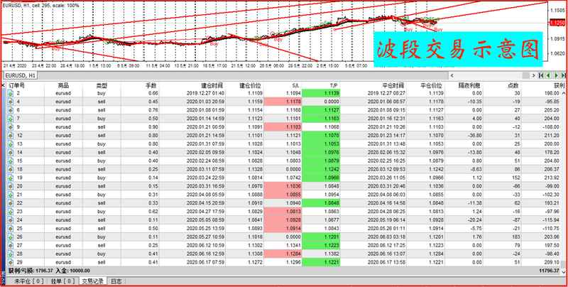
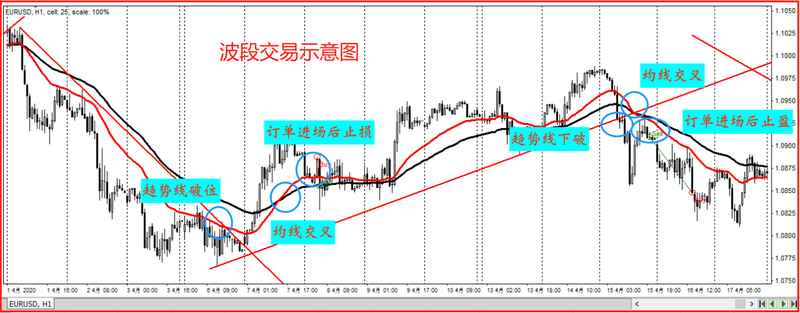
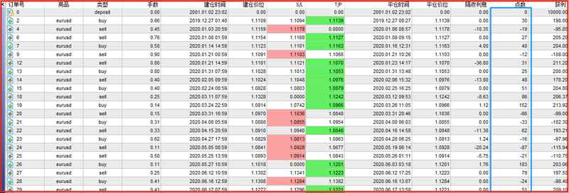
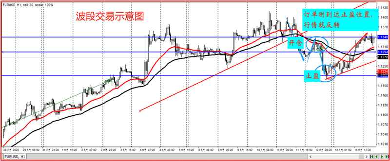

# 波段交易的精髓（实操案例）

**什么是波段交易？我们一起来看一段交易记录。**

图中是欧元兑美元1小时级别的k线图，采用的就是波段交易的方法。

交易时间是6个月，共进行了21次交易，13次盈利，止损8次，初始本金10000，盈利金额为1796，盈利的比例是17%。

这只是一个品种的盈利数据，波段交易通常会交易多个品种，来维持风险与利润之间的平衡，这个波段交易的实操方法我会在接下来的文章里细说。

**我自己做了七八年的波段，今天也绝不藏私，把我对波段的理解和经验全都分享给你们，会把波段交易的特点和实操的精髓都讲明白。**

整篇文章比较长，干货满满，我建议你们**收藏**阅读，以免丢失。如果觉得有收获，可以文章底下给我**点个赞**。

## 1、什么是波段交易？波段交易有什么特点？

波段交易算是一种中期的交易策略，在波动的行情走势中，抓取其中的一段利润来获利。通常持仓周期比较适中，既没有短线那么刺激，也没有长线那么磨人，算是一个比较中庸的交易模式，更贴合我们真实的人性心理。

**我做波段交易也有七八年了，对这种交易类型的特点研究得比较透，也跟大家分享一下，还是用开头的案例来做讲解。**

（备注：不管是做任何一种交易类型，都需要它研究透彻，知己知彼，才能百战不殆）

**特点1：波段交易是获取行情中的一段盈利空间，会主动止盈。**

波段交易多数采用固定盈亏比的交易模式。这个案例中，交易盈亏比是固定的2:1，所有盈利的订单金额都在200左右，所有亏损的订单金额都在100左右。

欧元兑美元小时级别的波段，行情大的时候盈利100点左右，行情小的时候盈利30—40点。

订单一旦平仓，就重新开始等待下一次交易信号的出现。

**特点2：通常使用固定止损金额的资金管理规则。**

图中演示的交易资金管理的规则，使用的是单次固定止损1%的标准。

初始本金是1万元，单次止损的金额就是100。开仓的仓位是根据止损的空间计算得来的。计算公式是：**止损金额/止损空间=仓位**。

大家在图中可以看到，止损空间小时仓位重，图中最大仓位开到0.9手，0.8手，这些订单止损空间只有10个点左右。止损空间大时仓位轻，图中最小仓位开到了0.11，这些订单止损空间达到了80-90点左右。

**特点3：持仓周期不长不短，贴合人性。**

图中是1小时级别的波段交易，持仓周期比较适中。

行情走得比较快的时候，当天就能平仓。交易记录中，有9笔交易是当天平仓的。其他多数订单持仓在1-2天平仓的比较多。

当然也有特殊情况，其中5月5日的那笔空单，持仓到5月19日才止损，这种情况是比较少的。

持仓周期适中，不会让我们在一天之内频繁交易，也不会让我们在等待中丧失执行力，更加贴合我们的人性一些，对整体交易策略的执行是有帮助的。

**特点4：交易结果对错分布比较均匀。**

从交易记录我们可以看出，交易结果对错分布比较均匀，不会出现特别多连续止损的情况，所以波段的交易逻辑还是比较利于执行的。

**特点5：盈亏金额都不大，对心态刺激也小。**

像上面举的这个案例，风险都是量化可控的，每次止损就是100，就算连错10次，也只是亏损1000。

这种亏损的额度对于我们交易者而言，对心灵的冲击可以说是毛毛雨了，交易起来也能更有信心一些。

当然，相对应的盈利也不会特别高，到了止盈位置就平仓，不过积少成多，稳步前进，一年下来利润也是很可观的，重点是可以在这种情况下保持稳定的心态，才有可能真正把钱赚到手。

**特点6：波段交易执行起来比较简单。**

波段交易最好的一点就是，止损的位置明确，止盈的位置也很明确。

订单进场之后，只要挂好止损止盈单，让行情自己奔跑就可以了，基本上都不太用看持仓的订单，非常节省精力。

波段交易是很适合兼职交易者的，尤其是1小时级别以上的波段交易。

像上面所讲的交易方法，半年的时间，一个品种做了21次交易，平均一周一次的频率，就完全不影响工作和生活。

*图：波段交易六大特点（示意）*

<svg xmlns="http://www.w3.org/2000/svg" viewBox="0 0 720 250" font-family="'Microsoft YaHei','PingFang SC',sans-serif">
  <rect x="8" y="24" width="224" height="90" rx="8" fill="#eff6ff" stroke="#2563eb" stroke-width="1.5"/>
  <text x="120" y="52" text-anchor="middle" font-size="14" font-weight="bold" fill="#1e293b">特点1：只取一段盈利</text>
  <text x="120" y="74" text-anchor="middle" font-size="13" fill="#475569">固定盈亏比</text>
  <text x="120" y="94" text-anchor="middle" font-size="13" fill="#475569">主动止盈</text>
  <rect x="248" y="24" width="224" height="90" rx="8" fill="#eff6ff" stroke="#2563eb" stroke-width="1.5"/>
  <text x="360" y="52" text-anchor="middle" font-size="14" font-weight="bold" fill="#1e293b">特点2：固定止损金额</text>
  <text x="360" y="74" text-anchor="middle" font-size="13" fill="#475569">单次止损1%</text>
  <text x="360" y="94" text-anchor="middle" font-size="13" fill="#475569">止损金额/止损空间=仓位</text>
  <rect x="488" y="24" width="224" height="90" rx="8" fill="#eff6ff" stroke="#2563eb" stroke-width="1.5"/>
  <text x="600" y="52" text-anchor="middle" font-size="14" font-weight="bold" fill="#1e293b">特点3：持仓周期适中</text>
  <text x="600" y="74" text-anchor="middle" font-size="13" fill="#475569">当天至1-2天平仓居多</text>
  <text x="600" y="94" text-anchor="middle" font-size="13" fill="#475569">贴合人性利于执行</text>
  <rect x="8" y="138" width="224" height="90" rx="8" fill="#eff6ff" stroke="#2563eb" stroke-width="1.5"/>
  <text x="120" y="166" text-anchor="middle" font-size="14" font-weight="bold" fill="#1e293b">特点4：对错分布均匀</text>
  <text x="120" y="188" text-anchor="middle" font-size="13" fill="#475569">很少出现连续止损</text>
  <rect x="248" y="138" width="224" height="90" rx="8" fill="#fffbeb" stroke="#d97706" stroke-width="1.5"/>
  <text x="360" y="166" text-anchor="middle" font-size="14" font-weight="bold" fill="#1e293b">特点5：盈亏金额都不大</text>
  <text x="360" y="188" text-anchor="middle" font-size="13" fill="#475569">对心态刺激小</text>
  <rect x="488" y="138" width="224" height="90" rx="8" fill="#f0fdf4" stroke="#16a34a" stroke-width="1.5"/>
  <text x="600" y="166" text-anchor="middle" font-size="14" font-weight="bold" fill="#1e293b">特点6：执行简单</text>
  <text x="600" y="188" text-anchor="middle" font-size="13" fill="#475569">挂好止损止盈单</text>
  <text x="600" y="208" text-anchor="middle" font-size="13" fill="#475569">适合兼职交易者</text>
</svg>

**讲完波段交易的特点之后，我就来讲解一下具体的实操方案，大家可以继续往下看。**

## 2、波段交易的具体实操方法

**我还是会以开头的交易记录为案例，讲解这种波段交易的实操方案。**

这个案例使用的指标有两条均线，参数分别是EMA60和EMA30，另外还有趋势线和k线的反转形态。

- 要求两条均线交叉+趋势线的破位判断方向。均线金叉+突破了下降趋势线，判断方向为多头。均线死叉+突破了上升趋势线，判断趋势为空头。
- 确立方向后，行情回落到均线附近，形成反转的k线形态，进场做多。
- 止损设置在反转形态的高低点，止盈设置止损空间的两倍。

**大家看一张图片。**

**图中是波段交易的示意图，是欧元兑美元1小时级别的k线。**

图中左侧，在一波下跌趋势中，两条均线向下发散，连接从高点到低点的下降趋势线，行情的尾端价格突破下降趋势线之后，两条均线形成金叉，确认趋势为多头。

行情回落测试到均线后，形成反转的k线形态，进场做多之后，订单被止损。

图中右侧，一波上涨趋势，两条均线一直向上发散，连接从低点到高点的上升趋势线，行情从高位回落下破了上升趋势线，同时两条均线也形成了死叉，确认趋势为空头，行情向上测试均线，形成反转k线形态，空单进场，行情下跌，订单止盈。

**注意：**一定要选择行情在均线上方或下方运行了一段时间周期后，再画趋势线，这样在均线频繁交叉的震荡行情里，可以规避假信号。

每次确认趋势行情回落，均线出现反转形态，就做一次，不论这笔订单是对还是错，后续行情继续整理，出现形态不再进场，这样也可以将行情回落均线，进入震荡的连续止损规避掉。

**这个策略整体是偏保守的，不论是确认方向还是进场，都经过了各种过滤，因此交易频率比较低。**

大家也可以根据自己具体的情况来制定标准，如果你觉得交易频率太低，等的时间太久，可以放宽一下条件，增加交易频率。

*图：波段交易实操三步示意（依正文整理）*

<svg xmlns="http://www.w3.org/2000/svg" viewBox="0 0 620 400" font-family="'Microsoft YaHei','PingFang SC',sans-serif">
  <defs>
    <marker id="ar1" markerWidth="9" markerHeight="9" refX="8" refY="4.5" orient="auto">
      <path d="M0,0 L9,4.5 L0,9 z" fill="#64748b"/>
    </marker>
  </defs>
  <text x="310" y="34" text-anchor="middle" font-size="16" font-weight="bold" fill="#1e293b">波段交易实操三步</text>
  <rect x="110" y="56" width="400" height="52" rx="8" fill="#eff6ff" stroke="#2563eb" stroke-width="1.5"/>
  <text x="310" y="78" text-anchor="middle" font-size="13" fill="#1e293b">① 判断方向</text>
  <text x="310" y="98" text-anchor="middle" font-size="13" fill="#475569">均线交叉＋趋势线破位共振</text>
  <line x1="310" y1="108" x2="310" y2="132" stroke="#64748b" stroke-width="1.5" marker-end="url(#ar1)"/>
  <rect x="110" y="138" width="400" height="52" rx="8" fill="#eff6ff" stroke="#2563eb" stroke-width="1.5"/>
  <text x="310" y="160" text-anchor="middle" font-size="13" fill="#1e293b">② 等待回调进场</text>
  <text x="310" y="180" text-anchor="middle" font-size="13" fill="#475569">回落至均线，出现反转K线形态</text>
  <line x1="310" y1="190" x2="310" y2="214" stroke="#64748b" stroke-width="1.5" marker-end="url(#ar1)"/>
  <rect x="110" y="220" width="400" height="52" rx="8" fill="#ecfdf5" stroke="#16a34a" stroke-width="1.5"/>
  <text x="310" y="242" text-anchor="middle" font-size="13" fill="#1e293b">③ 设止损止盈</text>
  <text x="310" y="262" text-anchor="middle" font-size="13" fill="#475569">止损在形态高低点，止盈2倍盈亏比</text>
  <rect x="110" y="310" width="400" height="48" rx="8" fill="#fef3c7" stroke="#d97706" stroke-width="1.5"/>
  <text x="310" y="340" text-anchor="middle" font-size="13" fill="#1e293b">偏保守，多重过滤，交易频率较低</text>
</svg>

**具体的实操方法讲完了，我们再来聊一聊波段交易会遇到的几个实战问题。**

## 3、波段交易会遇到的实战问题

**问题1：如果盈亏比变成1:1，或是3:1可以吗？**

这个问题咱们直接用数据说话。

如果把盈亏比改成1:1，这21笔交易的结果，15对，6错，交易的成功率略微有所提高，但盈利情况下降，盈利率9%。

因为我们筛选的都是大行情之后的反转，而且筛选了一些震荡行情，反转后，由于惯性作用，会有一定的空间，1:1的盈亏比浪费空间，效果不理想。

如果改成3:1交易，结果是10对11错，成功率降得更低，盈利率19%，同2:1盈亏比的盈利率基本接近相差不大，改成3:1也是可行，有优势，但也不多。

再激进改成4:1，21笔交易的结果是，8对13错，盈利率也是19%。

**通过这些数据对比，这个交易系统除了1:1对交易结果影响比较大之外，其他2:1，3:1，4:1，最终的盈利结果差距都并不大。**

**这里说两个问题：**

- 这样的数据也再次验证了，**一套交易系统在其他条件都不变的情况下，成功率和盈亏比是负相关的**。
- 最终盈利的结果相差不大，但是4:1的盈亏比，交易中连错的次数更多，就上面的例子中，后期有11笔连续的交易，9次错，2次对，连错很多，执行难度也就变大了，所以**在盈利结果相差不大的情况下，不要把盈亏比放得这么大**，更有利于交易。

**注意一下：**因为时间有限，我只统计了这21笔交易的结果，也只是为了打个样，这并不代表所有交易系统都是这样的。如果你们要验证自己的交易系统，一定要做更多的数据统计，至少100次以上。

**问题2：如果不使用固定盈亏比，还有什么止盈的方式吗？**

当然也有，例如以支撑压力位止盈，多单可以选择前高的压力位置止盈，空单可以选择前低的支撑位置止盈。

但判断前高前低的支撑和压力，对交易技术和交易经验的要求更高，这样操作盈亏比也会更大，所以执行的难度会增加，自己心里可以衡量一下。

**问题3：如果仓位加重可以吗？**

加重仓位可行，但不要加得太重，上面的例子中，使用的是本金1%的比例，计算仓位可以增加到1.5%或2%。

增加仓位实战之前，一定要对回撤有心理预期，知道可能会遇到连续止损，别亏损之后慌了手脚就行。

总体仓位变大，盈利的金额会增加，但心理压力也会更大，**无论如何，心态不能被击垮，否则就功亏一篑了**。

强调一下，尤其大盈亏比的交易模式，成功率降低，连错次数增加，这时候如果仓位又变重了，心理的压力成倍增加，可能会击溃交易信心，一定一定要注意。

**问题4：如果不是固定止损金额的资金管理规则，改成固定仓位行吗？**

固定仓位就是每次交易开仓都是固定的手数，例如每次开仓都是固定0.3，0.5。

**还是拿数据来说话，大家先看图片。**

在交易记录里，有一栏记录着每一笔订单盈亏点数的变化（图中蓝色方框中的数据）。我把所有盈亏的点数相加，得出的数值是650点+。

如果1万美金每次0.3手开仓，盈利的金额也是1800左右，盈利率也在18%上下。

这种交易系统使用固定仓位交易，要注意一个问题，**在止损空间大的交易机会中，订单止损金额会很大**，例如交易记录有一次交易机会，止损了87个点，0.3手开，止损250元，金额就比较大了。

因此使用固定仓位交易，仓位不能上得太重，否则心里压力也会变大，执行会有难度。

**问题5：波段交易会错过大趋势行情怎么办？**

咱们在文章的一开始就讲了，波段交易就是获取行情的一段盈利空间，订单会主动止盈，也就没有办法抓到大趋势的行情，**这是它的特征，也是它的缺点**。

但任何事情都有两面性，在震荡行情里，它的这个缺点反而成为了它的优点，大家看一张图片。

图中是一笔波段交易的示意图。

空单进场之后，行情下跌，刚刚达到2:1的止盈位置，订单止盈后，行情就反转向上了，而且再次破高。

这笔订单因为是波段的交易方法，使用2:1的止盈能盈利出局，如果采用趋势性的交易逻辑去出场，这个订单就止损了。

**在这里我们就可以看到波段交易的优势。**

任何的交易逻辑都有它的优点和缺点，我们在享受它的优点带来的盈利，也就必须接受它可能带来的风险，这是一个取舍问题。

今天我们以一个案例为出发点，把波段的方方面面都讲得比较清楚了，也给了大家一个解决交易问题的思路。你们在自己的交易中，要多记录多分析多测试，才能慢慢找到自己交易的节奏，找到最适合自己的模式。

---

> 🏷️ 本文属《投资知识库 · 03-交易系统与实战战法》，重排于 2026-11。
