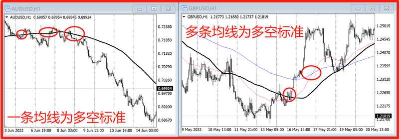
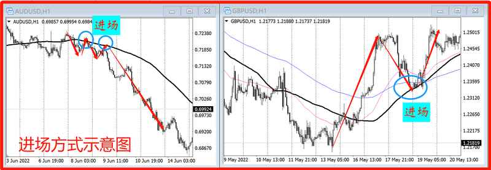
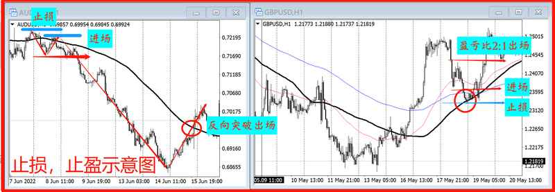
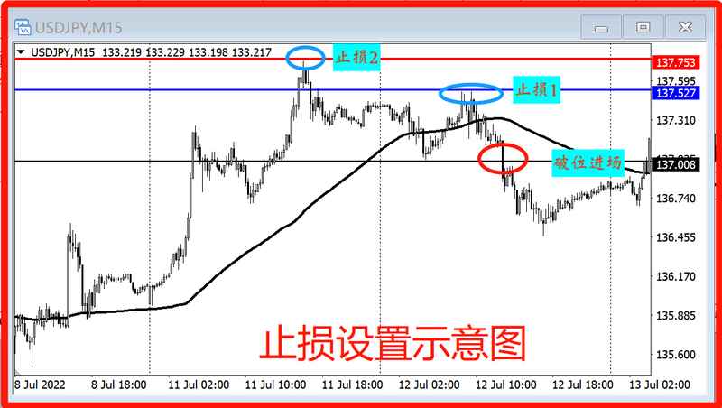
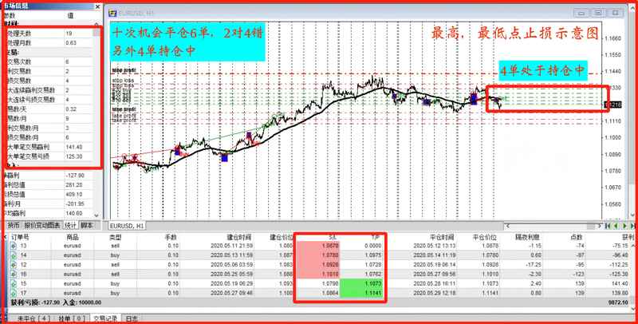
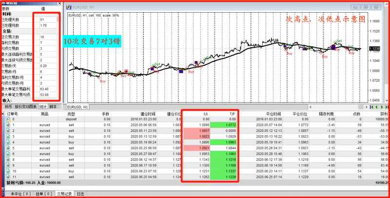
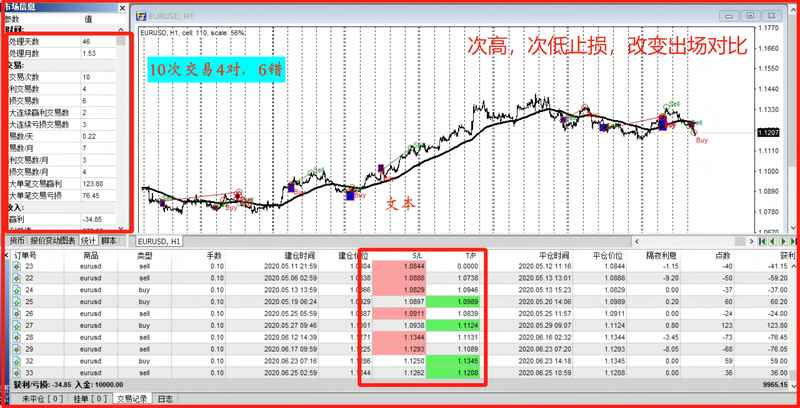

# 如何从0到1组建一套交易系统？

很多人对交易系统都是懵圈的，都只是有一个模糊大概的了解，但真正让你亲手组建一个交易系统，大家都觉得无从下手。

而且我发现很多朋友都只是有一个很简易的交易策略，就直接上真金白银进入实战了，当你拿着一个不完整的策略入场的时候，亏损是一件非常自然的事情。

所以今天我就直接上干到一滴水都挤不出来的干货吧，直接教大家怎么组建自己的交易系统，真的是毫无保留了，就希望大家能在交易这条路上少踩坑。

文章比较长，建议大家**收藏**阅读，如果觉得有收获可以给文章**点个赞**，感谢。

## 1、指标的选择

我写过非常多讲解技术指标的文章，把我觉得比较好用的所有指标都做了单独的讲解，你们可以去文章汇总里找来看。

**关于指标的学习和选择有一个总的原则：不要求高数量，要求高质量。**

组成交易系统并不需要特别多的指标，**3~5个指标就足够了**，再简单一些的交易系统，甚至2~3个指标就够。

指标数量如果太多，你在交易实战的时候就会明显感觉到吃力，因为判断的标准太复杂了，容易做错或者错过行情。

虽然对指标的数量要求不高，但是对指标的质量要求高。这里就要求你对几种指标进行深度学习，比如指标的特性，适合哪种行情，了解它们的优缺点，跟它们进行深度磨合。

这里我又要啰嗦一句：**所有的指标都是不完美的**，遇到不同的行情都会有其优点和缺点，而且往往优点越大，反映在另一个面的缺点也会越大。所以指标的使用在于它的平衡，享受指标优点带来的盈利，同时一定也要接受指标缺点带来的亏损。

**至于选指标的标准，**我不建议大家去选择一些很新奇，或者觉得很神奇的指标，选择几个看得顺眼的就行，市面上很常见很普通的指标，都可以用来组建一套交易系统。

## 2、交易系统的基本规则

**第一：判断方向**

我们先选择3-5种指标，例如最常见的均线，MACD，布林等等，我们现在就要用这些指标来判断应该做多，做空，还是等待。

我们来举一个比较简单的例子，比如我们设定一个规则，用一条均线来判断多空，例如用EMA90作为多空的分水岭，k线在EMA90上方为多，k线在EMA90下方为空。

如果再设置得复杂一点就是，k线在EMA90上方，再要求EMA60和EMA180金叉以后为多，k线EMA90下方，EMA60和EMA180死叉以后为空，那么这个时候我们就有了多空的标准。

**大家看一下示意图：**

图中左侧是一条均线判断多空的示意图，右侧是多条均线判断多空的示意图。**很明显地看到，左侧的方法偏激进，右侧的方法偏保守。**

选择激进还是保守的方法，我们在接下来的文章中还会继续谈到，这里大家先了解一下。

这只是我举的一个例子，大家可以用自己熟悉的指标来制定交易规则，比如用布林来判断多空，用MACD来判断多空，用趋势线来判断多空等等。

一旦有了判断多空的标准之后，我们再遇到崭新的行情，就不会疑惑到底是做多还是做空，也不会尝试去预测未来，一切都跟着指标给的方向走。

**这里有一个容易被忽视的点，**一旦我们开始用指标来判断方向的时候，有时候行情会出现不符合我们确认趋势的标准，这个时候行情对我们来说就是**无方向，需要等待**，这是交易的常态，也就是经常说的“等方向确立”。

**第二：进场的规则**

方向确立之后，并不代表马上就要进场，因为交易还要考虑止损的空间，资金管理以及盈亏比。

所以多数交易系统在确立了方向之后，我们就要制定进场的规则，才能找到进场的点位。就好比草原上的狮子，在锁定了自己的目标之后，等待目标慢慢走进自己的伏击范围，再一击致命。

还是上面均线的例子，不论是一条均线确认方向，或多条均线确认方向，我们的进场规则都可以设定为，等k线回落EMA120，获得支撑或者压力作用之后进场。

**大家看一下示意图，我做了简单的标注：**

图中左侧，价格下穿均线之后回测均线，有两次进场的机会。右侧价格上穿均线，并形成交叉之后，大幅地回踩到均线支撑进场。

具体开仓的方法，实战中有非常多的选择，可以是价格测试到均线直接进场，这样比较激进。

保守一点，可以选择测试到均线后，有一个反转k线进场，或者是小级别一个反转的结构进场，再或者是行情突破前期的低点进场等等，可以根据自己的性格来选择激进一点还是保守一点的进场方式。

这些规则都可以由我们自己来制定，规则的有效性和盈利能力，到最后还是要通过复盘来测试调整，我在文章的后续中会和大家说。

**第三：止损止盈的设置**

止损跟止盈的设置相对固定，标准很简单。进场之后，我们第一件要做的事情就是设置止损，最常用的就是以技术位的高低点为标准。

比如上面的例子中，反转k线进场，可以在k线的高低点止损（次高，次低点），也可以在反转k线之前的高低点止损（最高，最低点）。

止盈的设置基本有两种类型。一种是**固定的盈亏比**，按照止损空间的倍数止盈，例如止损空间50点，止盈空间是100点，这就是2:1的盈亏比，以此类推。

另一种是**不固定的盈亏比**，通常是用技术指标跟随趋势。

**大家看示意图，我简单地给大家做标注：**

图中左侧，行情下破低点进场，上方两条蓝色的线是两种可以作为止损的标准：“次高点和最高点”。

次高点止损小，偏激进，最高点止损大，偏保守。图中左侧止盈的标准不是固定盈亏比，下方行情反向击穿90均线出场。

右侧反转形态进场之后，止损设置在反转形态的前方低点，盈亏比固定设置2:1。

我只是讲了一些基础的使用方法和例子，除了上面的方法，大家可以动动脑筋，用自己学到的技术方法来制定自己的标准，我之前的文章中也写了大量的技术技巧，你们只要找到一种能够熟练使用的就可以。

**有几个注意点说一下：**

- 设置交易系统就像搭积木一样，不同的积木搭出来的房子不同，但我们最终的目的是盈利，跟这个房子好不好看没有关系，所以**尽可能制定简单好执行的策略，不要追求复杂与浮夸**。
- 不论是判断方向，进场的方式，以及止损止盈的设置，都有激进和保守的选项，大家可以根据自己的性格特点来制定交易规则，不同的交易规则也决定了你交易系统的风格。

## 3、进入复盘阶段

基本的交易规则设置完毕后，我们就要进入交易系统最关键的环节，也是今天最重点的内容，就是**复盘**。

很多人的交易系统失败，就是败在了没有好好做复盘，**没有经过测试和修改的交易系统，是没有实战意义的**。

每天都有很多人问我关于技术方面的问题，包括这种进场方式行不行，这个参数行不行，这个指标好不好用等等。我们在制定交易规则的时候也发现，你根本不知道你的交易规则是否能盈利，也不知道哪个交易策略是最好的，很多人就是困在这些问题里面根本出不来。

**所以接下来讲的内容就是解决这些问题。**

上面所讲的三个交易系统的点并不难，把技术指标学习好，把各项标准制定好，基本上就完成了交易系统的1/3，因为我们接着还要做大量的复盘工作，要去验证和对比每项参数的盈利效果，这样我们才能知道哪个是能盈利的，哪个才是最好的。

**我举几个例子说明一下。**

先以不同的止损为例。实战中很多交易者会纠结，到底止损设置到什么位置最好，接下来解决这个问题。

以EMA90均线为例子，价格下穿90为空，空确立后回调下破进场。上穿90为多，多确立后回调上破进场。一种止损的方式是行情的次高低点，一种止损的方式是行情的最高低点。

**大家看一张示意图：**

图中有两种止损的方式，止损1是设置在回调的次高点止损，止损2是设置在行情的最高点。多头也是相同的逻辑，我这边就先不画图例了。

**第一个例子：**

标准明确后，我们就要在同一段行情里，用复盘软件来测试对比这两种止损的方式，看一下它们的盈亏情况。

**第一种次高次低点止损交易的结果如下，大家看示意图：**

图中一共交易了51天，做了10笔交易，其中7次是对的，3次是错的，每笔交易是固定0.1手开仓，总体的结果是盈利190美元。

**第二种最高最低点止损交易的结果如下，大家看示意图：**

图中交易的时间也是51天，有6单平仓，4错2对，已经平仓的订单亏损127美金，另外还有4个订单持仓没有到达平仓的点位，还在持仓中（止损的空间比较大，止盈的空间也相对比较大，订单平仓的时间跟第一种止损方式会不一样），每笔都是0.1手开仓。

**注意：**

我只是举例告诉大家复盘统计怎么做，10次的复盘数据量太少，并不能完全代表这两种不同止损方式的优劣。要真正对比这两种方式的优劣，**至少要做100次以上的复盘**，而且不同的品种表现也会不一样，甚至要做多品种，每个品种100次以上的复盘。

如果将两种方式各进行300次，甚至500次以上的复盘，把数据拿出来做对比，就知道哪种方式表现更好。

这里我说的表现更好，不仅仅指成功率高，盈利率高，也包括对比哪种方式的连错率低，账户回撤小，风险更小。另外我们也可以对比持仓周期的长短，选择更加适合自己的。

**除了盈亏的结果不同，通过上面复盘，我们还能得出一些其他信息：**

- 两种方式订单持仓的时间周期不一样，**小止损的持仓周期短，大止损的持仓周期长**。
- 两种方式都使用固定0.1手开仓，但大止损的方式单次止损和止盈的空间都大，出现连错的时候，账户整体的回撤幅度就更大。也就是说，第二种方式的风险更大，当然盈利也可能更高。
- 两种方式小时级别，51天交易了10次，平均5天有一次交易机会。复盘统计的数量越多，总结出的信息越多，对交易帮助就越大。

**第二个例子：**

对比完不同止损的交易结果，我们继续对比一下不同的止盈。

用上面次高点和次低点设置止损的交易方式为参照，在其他条件不变的情况下，把止盈放大一倍为2:1，还是这10次交易，我们来对比不同盈亏比的成功率。

**第一种用之前的数据作为参考。大家看图片：**

图中一共交易了10笔，盈亏比1:1的情况下，其中7次是对的，3次是错的，成功率70%。

**换一张图片，大家看新的数据：**

图中依然是相同的10次交易，其他条件不变，盈亏比2:1的情况下，4对6错，成功率40%。

在这10笔交易中，1:1的盈亏比更有优势。但还是同样的道理，10个数据不具备统计意义，只是给大家简单举个例子，要更确切的答案一定是经过100+次以上的数据统计，才能知道哪种止盈方式更有优势。

除了盈亏的数据，我们还能知道2:1的盈亏比，相较1:1的盈亏比，持仓的周期更长，如果你是一个性格比较慢，有耐心的人，选择2:1的盈亏比就比较好；如果你是个急脾气，想快速地知道交易结果，就更倾向于选择1:1的盈亏比。

经过大量的复盘，我们还能知道不同盈亏比的出场方式的成功率，盈利率，连错的情况，衰败的情况，交易的频率等等，对比之后就知道该怎么做选择。

说到这里大家应该思路都很清晰了，**复盘可以几乎解决我们所有交易中的问题**。

例如：上面用的是EMA90，如果你在纠结EMA90，EMA60，EMA120，EMA180哪个更好？用相同的一段行情，更换均线的参数进行复盘，将这4条均线交易的结果进行对比，就知道哪个更好，哪个更适合自己，其他的指标选参数也是相同的道理。

例如：周期是选择15分钟，1小时，4小时，还是日线？在指标和进出场规则相同的情况下，对比不同周期的交易频率，盈利的情况，盈利的周期，选出最适合自己的。

再例如：自己已经有交易系统了，但是交易的频率比较高，要加入技术指标过滤来降低频率，加入哪个指标？过滤后的结果会不会改变？这些都可以通过复盘来验证某个交易策略的有效性。

**所以我们所有在交易中的疑问，都可以通过复盘来得到答案，人性会撒谎，但是数据不会。**

## 4、关于复盘的几个问题

**（1）进行复盘的交易系统，必须标准明确，做到绝对分类。**

我们在制定交易规则的时候就要注意这点，绝不能在实战交易的时候，还需要主观去判断行情，那么有系统跟没有系统就没差别了。

一旦每次判断的标准出现偏差，交易就失去了一致性，统计出来的交易结果也没有任何意义了。

所以**标准明确，十个人做都能做出同样结果的规则，才是一个好规则**。

**（2）复盘统计的过程，是非常繁琐枯燥的。**

我之前也提到过，拥有一个交易策略很简单，但是要去验证它，修改它，是一件很考验耐心的事情，很多人也就是倒在了这一步。

也有很多人跟我说过，没有执行力，对自己的交易策略没有信心，其实就是因为你复盘做得不够，不知道自己交易系统的盈利能力，自然会对未知产生恐惧，更别提信心了。

当你把你自己的交易系统在历史行情中复盘10年，虽然有时候最多可以连错10次20次，但每年的交易结果都是赚钱的，那以后遇到的连错对你来说就是小场面了，**这就是建立交易系统信心的过程**。

复盘的过程非常枯燥，需要细心和耐心，但比起在交易中亏损得痛苦不堪，这点苦累还是值得受的。

**（3）最好是用复盘软件做测试和统计。**

如果你更有耐心，我觉得用模拟盘做测试也可以，只不过时间线会拉得很长。我自己是用复盘软件做的测试，可能几个月就可以把你所有在交易中的疑惑都解决掉。

经常有人问我两个指标怎么选？同一个指标的不同参数怎么选？交易的周期怎选？我交易11年了，根据我的经验，我能判断交易系统的逻辑是否正确，交易系统的细节是否完善，但具体到不同指标，不同参数会有怎么样的盈利表现，这些细节的数据我也是需要通过复盘才能知道。

所以复盘非常重要，这就是一个交易系统大概的建立过程，大家可以通过这篇文章来找到自己交易系统的正确答案。

*图：交易系统组建四步流程示意（依正文整理）*

<svg xmlns="http://www.w3.org/2000/svg" viewBox="0 0 620 520" font-family="'Microsoft YaHei','PingFang SC',sans-serif">
  <defs>
    <marker id="ar1" markerWidth="9" markerHeight="9" refX="8" refY="4.5" orient="auto">
      <path d="M0,0 L9,4.5 L0,9 z" fill="#64748b"/>
    </marker>
  </defs>
  <text x="310" y="34" text-anchor="middle" font-size="16" font-weight="bold" fill="#1e293b">从0到1组建交易系统</text>
  <rect x="140" y="56" width="340" height="46" rx="8" fill="#eff6ff" stroke="#2563eb" stroke-width="1.5"/>
  <text x="310" y="84" text-anchor="middle" font-size="13" fill="#1e293b">① 指标的选择（3~5个，重质量）</text>
  <line x1="310" y1="102" x2="310" y2="124" stroke="#64748b" stroke-width="1.5" marker-end="url(#ar1)"/>
  <rect x="70" y="126" width="480" height="132" rx="8" fill="#ffffff" stroke="#2563eb" stroke-width="1.5"/>
  <text x="310" y="152" text-anchor="middle" font-size="13" font-weight="bold" fill="#1e293b">② 交易系统的基本规则</text>
  <rect x="90" y="170" width="136" height="48" rx="6" fill="#eff6ff" stroke="#2563eb" stroke-width="1.2"/>
  <text x="158" y="199" text-anchor="middle" font-size="13" fill="#1e293b">判断方向</text>
  <line x1="226" y1="194" x2="242" y2="194" stroke="#64748b" stroke-width="1.5" marker-end="url(#ar1)"/>
  <rect x="242" y="170" width="136" height="48" rx="6" fill="#eff6ff" stroke="#2563eb" stroke-width="1.2"/>
  <text x="310" y="199" text-anchor="middle" font-size="13" fill="#1e293b">进场规则</text>
  <line x1="378" y1="194" x2="394" y2="194" stroke="#64748b" stroke-width="1.5" marker-end="url(#ar1)"/>
  <rect x="394" y="170" width="136" height="48" rx="6" fill="#eff6ff" stroke="#2563eb" stroke-width="1.2"/>
  <text x="462" y="199" text-anchor="middle" font-size="13" fill="#1e293b">止损止盈设置</text>
  <line x1="310" y1="258" x2="310" y2="280" stroke="#64748b" stroke-width="1.5" marker-end="url(#ar1)"/>
  <rect x="70" y="282" width="480" height="60" rx="8" fill="#fef3c7" stroke="#d97706" stroke-width="1.5"/>
  <text x="310" y="308" text-anchor="middle" font-size="13" fill="#1e293b">③ 复盘验证（100次以上统计）</text>
  <text x="310" y="330" text-anchor="middle" font-size="13" fill="#1e293b">对比不同止损、止盈、参数、周期</text>
  <line x1="310" y1="342" x2="310" y2="364" stroke="#64748b" stroke-width="1.5" marker-end="url(#ar1)"/>
  <rect x="170" y="366" width="280" height="46" rx="8" fill="#ecfdf5" stroke="#16a34a" stroke-width="1.5"/>
  <text x="310" y="394" text-anchor="middle" font-size="13" fill="#1e293b">④ 实盘执行：标准明确</text>
  <rect x="110" y="440" width="400" height="56" rx="8" fill="#f5f3ff" stroke="#7c3aed" stroke-width="1.5"/>
  <text x="310" y="462" text-anchor="middle" font-size="13" fill="#1e293b">复盘繁琐枯燥，需细心耐心</text>
  <text x="310" y="484" text-anchor="middle" font-size="13" fill="#475569">人性会撒谎，数据不会</text>
</svg>

---

> 🏷️ 本文属《投资知识库 · 03-交易系统与实战战法》，重排于 2026-11。
