# 30个交易中的专业术语（行业黑话）

很多朋友做交易的时候，对我阐述的一些行业术语表示一头雾水，比如“放量上涨”，“超跌反弹”，“箱体震荡”等等，这就非常影响我们学习的效率了。

所以今天我就写这么一篇文章，**把我在交易中常见常用的一些术语，用最清晰易懂的方式给大家说明白（顺便也分享一些我在各项走势中的交易小经验）。**

大家学习完这些术语，就可以用更专业的角度去分析和学习交易，在跟别人交流的过程中，也可以彰显我们自己的专业性。

我整理了30个术语，每个都比较简短，你们可以先收藏，再利用自己的碎片化时间来阅读和记忆。

如果你觉得有收获，可以给文章**点个赞**，感谢。

## 1、冲高回落

冲高回落是指行情急速上涨，但价格不能维持在高位，价格回落。

“冲高”二字代表行情上涨的速度比较快，幅度比较大，但回落的速度相对慢，甚至是震荡地回落。

在k线上显示的形态就是，一根引线很长的阳线，引线同k线实体的长度比例达到至少1:1。

**大家看示意图。**

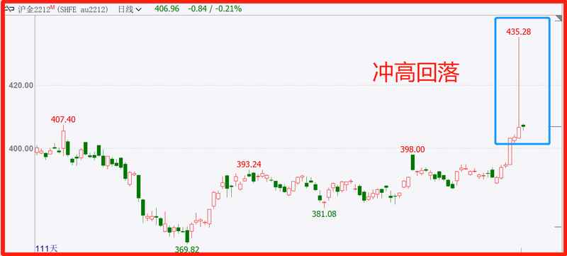

图中是上海黄金2212合约的日线k线图，受美国CPI数据影响，黄金开盘大涨，快速地冲高，随后回落收出长上引线的阳线。

## 2、触底反弹

触底反弹在基本面的定义是，形容经济低迷已经到了极限，开始出现反弹，经济好转。

在技术面是形容，行情经过大幅度的下跌，测试到下方重要的支撑位置后，没有再向下跌的空间了，行情由空转多，开始向上反弹上涨。

**大家看示意图。**

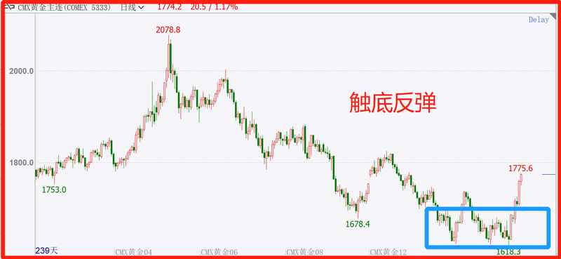

图中是黄金现货的日线图，自今年3月份行情从2078展开下跌以来，已经在1618附近的支撑带连续测试，行情不能突破，代表行情触底，第三次测试支撑后，从11月4日开始展开反弹。

## 3、放量上涨和放量下跌

放量上涨是指行情在不断上涨的同时，交易量在增加，交易量大于平时的交易量，通常上涨的速度比较快。

在股市中，一般发生在行情的初级阶段。因为股价处于低位时，上方有很多套牢盘的散户，散户能量有限，是主力低位拉升的时候，才会伴随着交易量放大。

放量下跌是放量上涨的镜像走势，下跌的动能比较大，速度比较快，成交量放大。尤其是市场出现利空，或不理智的抛售行为时，行情会放量下跌。

在金融市场中，通常下跌速度比上涨的速度更快。

## 4、震荡上涨和震荡下跌

震荡上涨在k线图形上的表现就是，行情以波浪的形态不断上涨，高点越来越高，波浪回调的高点也越来越高。

震荡上涨是一种比较健康的上涨走势，行情经过震荡回落，积蓄力量后持续冲高。

而且**震荡上涨更利于交易**，交易者可以在行情回落的拐点进场，这个位置止损的空间很小，行情再次启动以后，盈亏比非常好。

震荡下跌是震荡上涨的镜像，两者的走势特点是完全相同的。

**大家看示意图。**

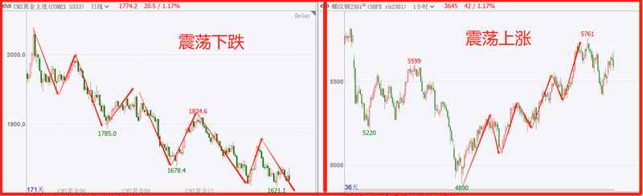

图中左侧，行情以波浪的形态震荡下跌，每次创出低点后，都会有一波向上的回调，回调结束之后，再次展开下跌。

图中右侧，行情以波浪的形态震荡上涨，每次创出高点之后，都会有一波向下的回调，回调结束之后，再次上涨。

## 5、单边上涨和单边下跌

单边上涨是另外一种上涨的k线形态。是指上涨过程中，行情一直维持上涨的走势没有回调，或者回调非常小，走势比较快。

注意：**这样的形态并不好交易**，因为没有整理，不太容易找到进场的技术位。类似的行情通常在一段冲高出货的走势后结束，而且容易形成v型反转的走势。

单边下跌是单边上涨的镜像，它们的特点完全相同。

**大家看示意图。**

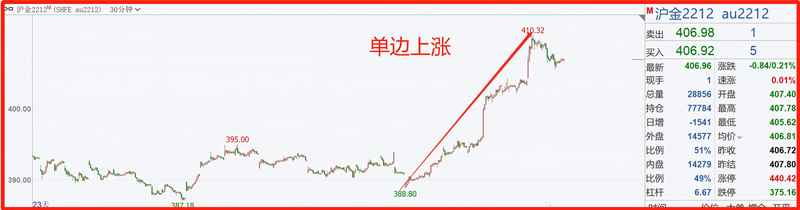

图中是上海黄金期货一波单边上涨的走势，行情启动多头之后，持续地上涨，上涨过程只有非常小的整理形态，在高位快速冲高后，行情开始企稳回落。

## 6、超买超卖

**超买有两层意思：**

（1）基本面：是指商品的价格上涨到超出了基本面应该有的价格水平，价格很容易出现下跌。

（2）技术面：是指行情经过大幅度快速的上涨之后，技术指标已经严重钝化，行情有见顶转空的可能，常用KDJ，MACD等指标来判断技术面上的超买。

因此**超买是指行情有由多转空的预期**。

超卖是超买的镜像，也有基本面和技术面两层意思，也可以使用KDJ和MACD等指标来判断，**超卖有行情由空转多的预期**。

**大家看示意图。**

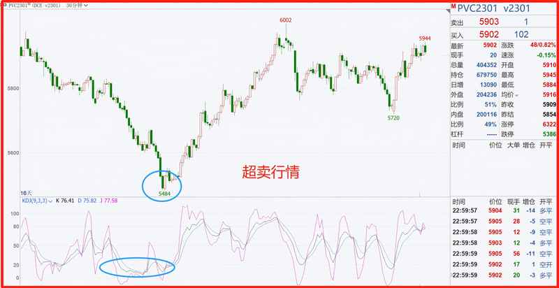

图中是超卖行情的示意图。在一波连续的下跌，空头已经运行了很大空间之后，KDJ的三条线长期处于0~20的超卖区域，行情有反转的可能，此时再结合k线图上的反转k线形态进场做多（k线图上的向上吞没形态）。

**注意**一定要在大空间的单边行情之后，再考虑使用超买超卖的技术分析进行交易。震荡行情中，KDJ这类指标也会进入超买超卖区域，但空间小，不适合做超买超卖的交易。

## 7、冲高出货

冲高出货的形态跟冲高回落的形态非常相似。但冲高出货的前提是，之前延续一波非常大的连续上涨的走势。

因为行情走得足够远，多头已经积攒了足够的利润，主力在一波快速拉高之后平仓，将追高的散户套在高位，通常伴随着交易量的放大。

冲高出货的形态在图表上很常见，一波大涨之后，行情在高位形成波幅明显变大的反转k线形态。

**大家看示意图。**

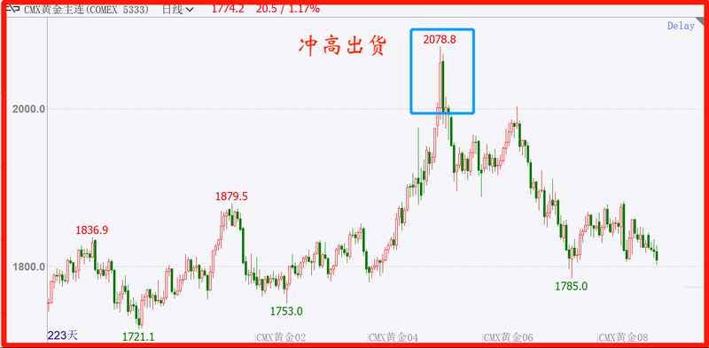

图中是现货黄金日线图，今年3月份受俄乌冲突刺激，黄金展开多头趋势，在趋势的尾端出现了波幅空间大，波动速度快的吞没k线形态，这是标准的冲高出货的走势，随后黄金进入震荡下跌。

## 8、阴跌，阴涨

阴跌也被称为盘跌，下跌的趋势中，每根k线的空间都很小，中间也会出现小阳线的回调，成交量会收缩。

阴跌的走势虽然趋势走得很连贯，但并不好交易，因为回调行情都很小，很难找到合理的进场点和止损点。

**阴跌还有一个比较大的问题：止损。**

因为每个k线的空间都很小，账户的浮亏在逐渐变大，而且也会遇到小行情的回调，阴跌被套，交易者更容易产生侥幸心理，不愿意止损。

**因此有这样一句话形容阴跌：阴跌如钝刀。**

在阴跌的走势中不能逆势接单，应该在走出底部之后，行情走出深回调再进场。

阴涨是阴跌的镜象，这里就不详细说了。

**大家看示意图。**

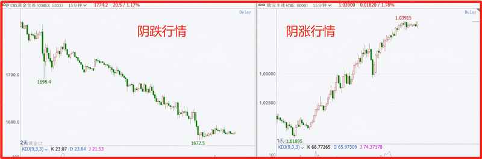

图中左侧是阴跌的行情走势，小k线连续下跌。图中右侧是阴涨的行情，小k线盘整上涨。

## 9、超跌反弹

超跌反弹是指行情经过了长期，并且大幅度的连续的下跌行情，空头力量已经变弱，各种技术指标已经严重超卖，行情止跌反弹，修复指标。往往**超跌反弹的空间不会太大，行情进入震荡的概率更高**。

实战中可以参考超买超卖的指标，作为确认行情是否已经超跌，超跌之后交易反弹，行情需要同其他的技术指标共振。

## 10、窄幅震荡和宽幅震荡

窄幅震荡是指行情进入震荡走势中，但震荡的幅度比较小，此时多空力量比较均衡，使行情维持在一个相对较窄的区间，成交量会缩小。**窄幅震荡顺势破位之后，会走出快速的比较大的行情**。

宽幅震荡是指行情进入震荡走势中，震荡的幅度比较大，此时多空力量在一个比较宽的区间互相争夺，形成宽幅的震荡。**宽幅震荡由于振幅空间比较大，适合做高抛低吸的震荡交易**。

## 11、箱体震荡

箱体震荡是震荡行情的一种形态，跟矩形整理非常相似，是指行情在一个区间震荡，形成非常有规律的高低点，实战中以箱体的高低点进行高抛低吸的交易。

**大家看下方的示意图。**

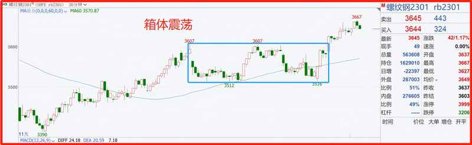

图中一波上涨走势结束之后，行情展开了横向的箱体震荡，价格形成非常有规律的高低点。

实战中要注意，由于走势的随机性，箱体震荡可能会出现一些高低点的偏移，但这不影响交易。

## 12、爆仓

爆仓是指在有杠杆的金融市场，由于交易中加入了杠杆，行情波动，账户产生的亏损大于交易者账户中的保证金，交易者账户中的订单被交易所强行平仓，账户被强平后，就被称为爆仓。

**爆仓并不完全是人们理解的账户中的钱全部亏光。**

通常交易所会在交易者保证金不足的情况下，开始强平订单（并非是账户净值为0，或为负的情况下才开始强平），订单强平之后，账户中还会剩余少量的保证金。

最近的新闻，某币价格大跌，24小时数字货币市场有10万投资者爆仓，所以投资需谨慎。

## 13、多空双杀

多空双杀是指在一段走势，行情上下快速大幅波动。

快速大幅上涨，打掉空头的止损，杀了空头。又快速大幅下跌，打掉多头的止损，又杀了多头，在这样的走势中，多空都不能赚到钱。

**几个注意点：**

- 多空双杀通常会向上向下各打掉技术位，把多单和空单的止损都打掉。
- 多空双杀通常在基本面发生变化，或经济数据公布时出现得比较多。
- **多空双杀之后，往往会走出比较明显的单边趋势**。

## 14、强势破位

强势破位是指行情走势在突破技术位的时候，破位的速度比较快，破位之后，运行的空间比较大，破位坚决，通常也会伴随着交易量放大。

**强势破位之后，行情走出趋势的概率更高。**

**大家看示意图。**

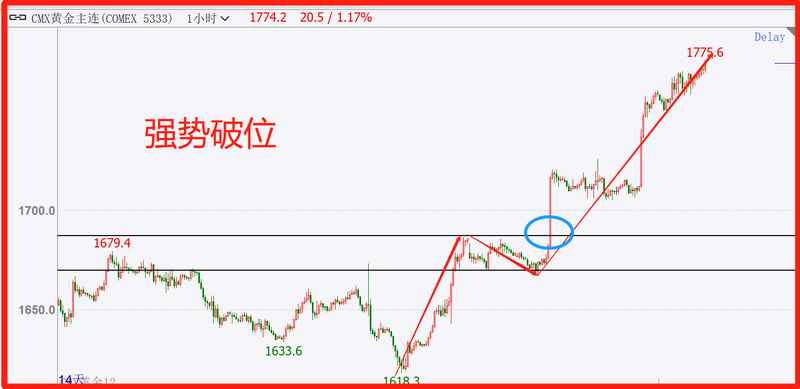

图中是现货黄金1小时级别的k线图。黄金触底反弹之后，快速地上涨，测试到1679附近的压力，在压力附近形成窄幅的整理，随后行情强势破位，破位k线的波幅大，速度快，破位之后，行情延续多头。

## 15、破位回踩

破位回踩是指价格突破了某一个重要的支撑或压力位置，例如技术上的支撑压力位，颈线，重要的均线等等，破位之后行情确认了方向，行情短暂回落调整，积蓄力量再次启动。

**大家看示意图。**

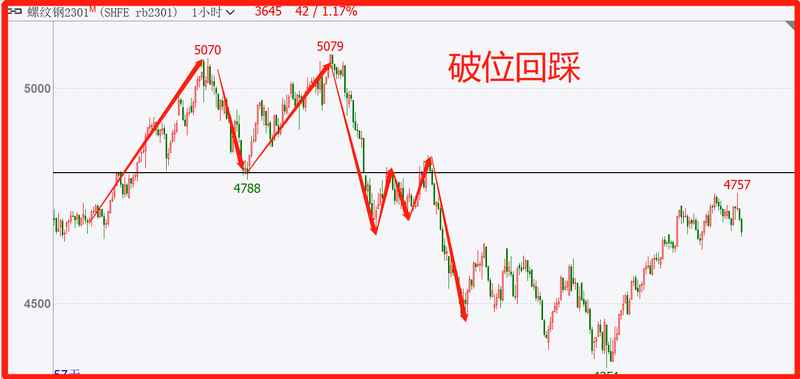

图中是一个双顶形态的破位，破位之后，行情经过回踩颈线确认之后，再次启动空头。

## 16、金针探底

金针探底指的是一种k线的形态，有两个条件：

（1）在连续下跌的行情达到相对底部的时候。

（2）行情开盘后先继续下跌，却不能维持空头趋势，最后形成了长下引线小实体的k线形态。

**金针探底是一种反转k线形态，行情有反转的预期了。**

**大家看示意图。**

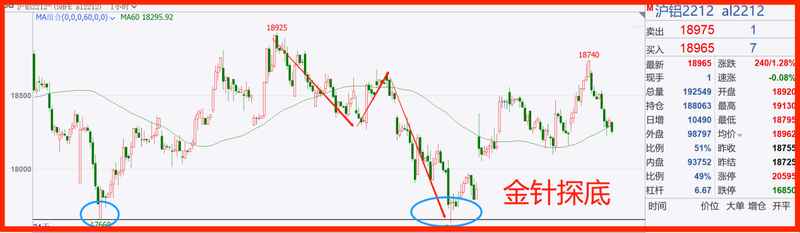

图中行情第二次测试到17660的支撑，形成了长下引线的金针探底形态，随后行情企稳，反转向上。

## 17、高开高走（低开低走），高开低走（低开高走）

高开高走是指行情当日开盘的价格，高于昨日的收盘价，形成了一个向上的跳空缺口，随后行情延续多头，大幅上涨（低开低走是高开高走的镜像）。

高开低走也是指行情当日开盘的价格，高于昨日的收盘价，形成了一个向上的跳空缺口，但开盘之后，行情没有延续，反而是回落走空（低开高走是高开低走的镜像）。

**大家看示意图。**

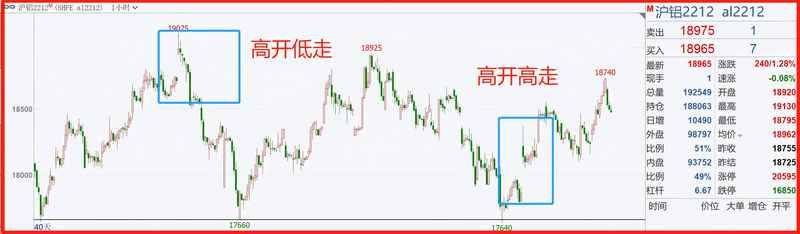

图中左侧是高开低走，行情高开之后，快速冲高回落，走出一波连续的下跌趋势。图中右侧是高开高走，行情高开之后，经过简单的震荡整理，继续走高。

## 18、盈冲亏缩

盈冲亏缩是一种资金管理的方式。

**盈冲**是指，当账户出现盈利的时候，根据盈利的比例，在下一次开仓时加大仓位。

**亏缩**是指，当账户出现了亏损，根据亏损的比例，在下一次开仓时缩小仓位。

这样操作在账户盈利时追加仓位，可以获得更大的盈利。账户出现亏损时降低仓位比例，可以控制回撤。

## 19、筑底

筑底是指行情经过了一波大跌后，行情达到了底部，开始形成了底部震荡的格局，经过底部震荡，逐渐确认反转的过程被称为筑底。

行情走出筑底的震荡，价格就有了反转的预期，**行情突破了筑底的震荡区间，确认反转**。

## 20、洗盘

洗盘是主力炒作行情的一种手段。通过洗盘的手段，让原本持仓的散户慌乱地平仓，失去筹码，清理掉市场中多余的订单，为拉升行情做准备，同时又可以让被洗掉的散户在高位接盘，达到牟取暴利的目的。

**洗盘的手段包括：**打压股价，宽幅震荡，假突破，诱多诱空等。

## 21、追涨杀跌

追涨杀跌有两种含义。

一种是**贬义**的，是指交易者毫无方向，毫无规则地跟随行情，看到行情上涨了就慌忙地买入，看到行情下跌了又恐惧地卖出，像无头苍蝇一样来回交易。

一种是**中性**的，是指根据交易规则和交易计划，发现行情上涨，追进去做多，发现行情下跌就做空。是一种顺势的交易逻辑，当然交易的前提是有明确清晰的标准和计划。

## 22、高抛低吸

高抛低吸是一种震荡交易的基本逻辑，在行情震荡区间的低位买入，行情震荡到震荡区间的高位时卖出，赚取震荡区间的价格差利润。

**大家看示意图。**

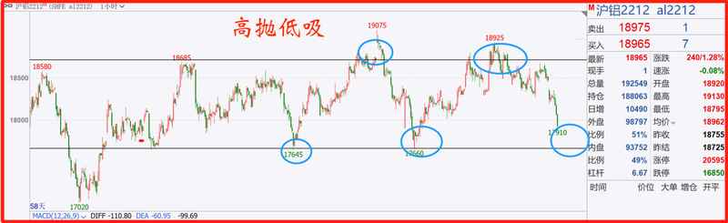

图中在行情震荡的区间，选择高低点进行低位买入，高位卖出的高抛低吸的操作。

**注意：**尽量在宽幅震荡的行情里进行高抛低吸，空间大，盈利的空间更理想。

## 23、诱多诱空

诱多诱空是主力洗盘的一种手段，通常行情都走得比较快。

诱多的时候，行情向上突破上方的压力，引诱交易者多单进场，随后又快速地收回来，行情转空头，将交易者的订单套牢，产生亏损。

**诱空是诱多的镜像，看下方的示意图。**

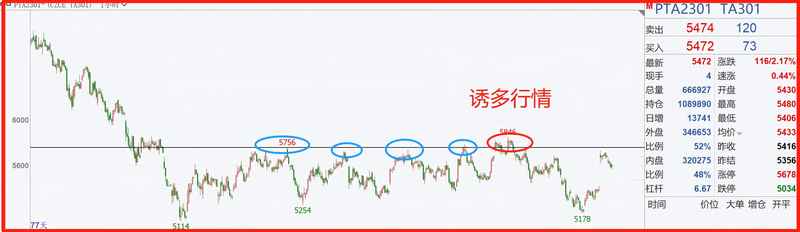

图中行情连续4次测试上方的压力，在第5次测试时，行情突破了压力，之后展开震荡，在形成反转k线形态后开始下跌，形成假突破。

## 24、颈线

颈线通常是指，顶底形态多空的分界线。例如双顶双底形态和头肩形态的颈线。

底部形态连接形态上方的压力点形成颈线，行情向上突破颈线确认多头，顶部形态连接形态下方的支撑点形成颈线，向下突破颈线确认空头。

- 颈线有时是水平的，有时是倾斜的。
- **颈线突破之后，经常有回踩的行情，回踩颈线进场是盈亏比最好的进场方式**。

**大家看示意图。**

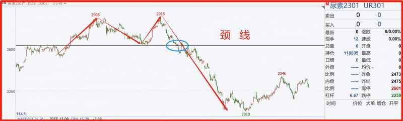

图中双顶形态破位之后，行情经过原地的横向整理，回踩颈线确立，继续展开空头。

## 25、分批建仓

**分批建仓是一种开仓买入的仓位管理的方法，主要有两种方式：**

（1）行情到达了入场的区域，例如行情进入筑底区域，需要开仓，但又无法找到准确的点位，就将订单分批次买入，这样可以获得比较好的持仓均价。

（2）试单。例如趋势交易尝试买入第1个订单，第1个订单盈利后，证明方向正确，再次顺势加单。

分批建仓时，可以每次都均分使用相同的仓位，也可以根据交易系统的规则，每次开仓使用不同的仓位。

## 26、抄底逃顶

**逃顶：是一种平仓的操作。**

是指交易者在行情进入高位，出现顶部形态的时候，在行情反转之前，或者在确认反转时，平仓锁定利润。

**抄底：是一种开仓的操作。**

行情进入底部之后买入，这里就可以使用分批建仓的交易策略，抄底之后行情反转上涨，之后在顶部平仓获利。

逃顶抄底的交易，是需要结合技术指标，以及交易者的判断进行操作。

**但大家注意，**实战中能抄底在最低，逃顶在最高的可能性很低，不要过于完美主义。

## 27、飘单

飘单是指，交易者持有的订单处于亏损的状态，没有设置止损，也不会主动止损，任由单子飘着，怀有侥幸的心理，等待行情反转，期望订单能够扭亏为盈。

**这是非常坏的交易习惯，飘单的危害有两个：**

- 遇到单边行情，飘单会形成严重的亏损。
- 长期飘单，也会对交易者产生心理压力，单子长期处于亏损，不知道将来会是什么样的结局，会造成焦虑情绪，也会影响正常的交易。

**因此正确的做法是严格止损，拒绝飘单。**

## 28、跳水行情

跳水行情是指在行情运行中，价格突然急剧下跌，类似跳水一样，直线地下跌，并且下跌的速度非常快，经常让交易者反应不及，被套在行情里。

发生跳水行情，通常是因为基本面发生大的利空因素导致。

**大家看示意图。**

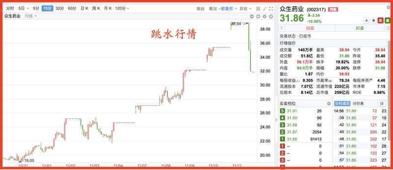

图中是众生医药上周五的一波下跌，上午行情跳空，高开涨停，下午突然之间向下跳水，快速下跌，并触及跌停。

## 29、成交量

成交量通常指金融市场的合约，在某一个单位时间内的交易量，例如沪深两市的日成交量，例如期货合约的成交量。

日常所讲的成交量是指市场的成交金额。成交量代表了市场的活跃程度和资金规模，成交量越大，市场越活跃，市场的资金规模越大。

**成交量是判断市场走势的一个指标，成交量放大，是股价上涨的一个重要因素。**

## 30、踏空

踏空是指在市场中，因为操作不当错过了盈利。

**有三种情况：**

（1）是指错过一段好行情。交易者因为各种原因看好，但还没有买入股票，股价却已经上涨。或者在期货交易中看准了一段行情，但没有做上订单，错过了收益。

（2）踏空也形容原本持有股票，却因为各种原因卖出股票后，股价却大幅上涨。

（3）满仓踏空。例如股票账户中，满仓持有了某一支股票，这支股票的涨幅非常小，远落后于大盘的上涨幅度，错失了盈利。

---

> 🏷️ 本文属《投资知识库 · 03-交易系统与实战战法》，重排于 2026-11。
