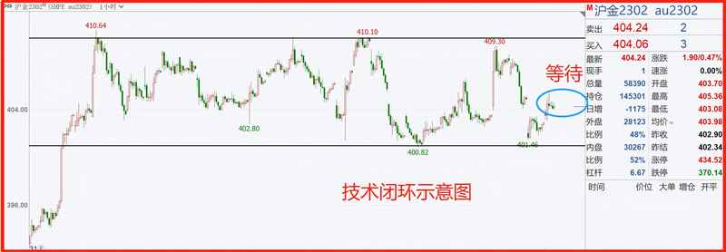
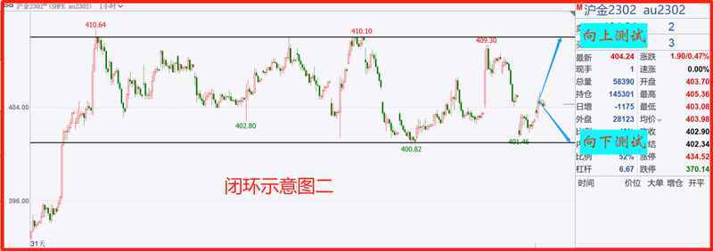
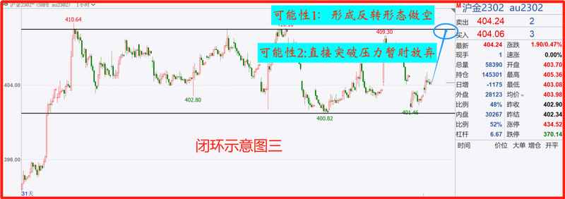
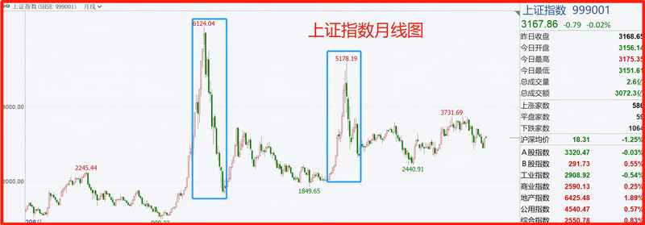
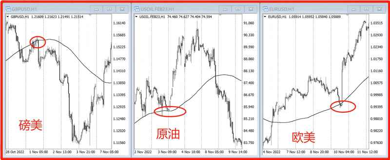

# 交易中的闭环有多重要？

**我发现很多朋友喜欢问我类似的问题，比如：**

- 你是怎么确认你的买点的？怎么才能买在最高点？
- 你的仓位怎么设置的？该怎么加仓？
- 我总是看对了行情却拿不住，错失一大笔利润，到底该什么时候止盈？

……

这些问题都是非常碎片化的问题，单纯回答其中任何一个都是没有什么意义的，**因为交易就是一个闭环，你只考虑细节不考虑全局是没有意义的**。

交易市场中有三大闭环，一个是**人性的闭环**，一个是**走势的闭环**，一个是**交易技术的闭环**。

今天的文章，**我就来详细聊一下这三个闭环，以及如何让闭环之间打好配合，创造属于我们自己的盈利优势**。

文章比较长，建议大家**收藏**阅读，如果觉得有收获可以在文章底下**点个赞**，感谢。

## 1、什么是交易中的闭环？

**企业管理中有一个很重要的概念，就是SOP**，是词组Standard Operating Procedure的大写字母缩写，意思就是标准化流程。

我们将某一事件中的关键控制点进行拆解、细化，最终做成一个标准化流程，用于指导自己日常的工作，保证工作方向不跑偏，也可以保证工作效率。

在现实生活中，我见过很多思维有全局观的人，都拥有这种拆解事物，并将其标准化的能力，这也是做大生意很重要的一个模块。

那么在交易中也是一样的，**我们很多做交易的人都是“身在此山中”的状态，非常在意眼前的每一笔盈亏利益，从而放弃了更高的全局视角**，才会像闯迷宫一样，不知道自己对还是错，不知道为什么亏损，也不知道接下来应该做些什么。

**我们把交易当作一项工作，交易中的闭环就是我们的工作流程**，我们该做什么，每一步该怎么推进，结果如果是A，我们该怎么做，如果是B，我们该怎么做，我们最终的结果目标是什么等等，往复循环。

在一个合格的交易闭环中，我们是一定不会感到疑惑的，我们会很明确自己接下来要做的事情，也会很明确自己的交易结果，顶多有一些容错的出入，但总体结果大差不差，这就是一个合理的闭环。

## 2、交易的闭环有多重要？

> 在一个合格的交易闭环中，我们是一定不会感到疑惑的。

**第一：交易的闭环可以提高我们的交易效率。**

交易技术上的闭环就很像工业生产中的流水线，美国福特汽车公司发明了世界第一条汽车装配流水线，产品的质量和产量都大幅提高，为生产效率带来革命性的提升。

这是一个很简单的道理，在企业中制定这些标准的人都是领导，执行的人都是小员工，你是更想拥有领导的视角，还是小员工的视角？

我们一旦完成交易中的闭环，基本上就拥有了自己的交易流水线，我们的交易被分割成不同的步骤，可以及时排查问题，进行优化，我们的错误率会降低，交易操作的质量提升，提高了盈利的稳定性。

**第二：形成方法上的闭环，可以减少我们交易中的主观思维，增加我们的心理优势。**

如果没有闭环，我们每次做交易都会靠猜，未来走势如何？接下来怎么做？啥时候进场出场？我会不会亏？等等。

这样每次做交易都很费心费力，临时做出的决定又会很受主观情绪的影响，到时候交易的结果一定是非常不稳定的。

如果我们形成了交易技术上的闭环，所有的交易动作都是有定式，有依据的，下一步该做什么，亏了怎么办，盈利了怎么办，久而久之，我们的心态就会变得很稳，就像流水线中的工人一样，知道只要自己按部就班地去操作，结果就一定是稳定的。

**交易中唯一不变的就是人性，良好的情绪状态可以帮助我们在交易中获取极大的优势。**

**第三：形成了闭环后，我们就有了交易标准，标准的有效性就可以被检验。**

再说得高大上一点，其实这个形成闭环的过程就是量化。当你把所有的交易动作都量化后，有了同样的标准，那么交易结果就可以被统计，我们也可以检验这套交易标准的有效性。

这个时候就可以用到一些工具，比如复盘软件，交易软件中的模拟盘等等。如果你的操作是随机的，无序的，那么即使用上复盘软件，你的交易结果统计也是没有意义的。

**当检验过自己的交易闭环，你不仅可以在检验基础上进行优化，还会对自己的交易策略产生信心，更加坚定地执行，就会形成一个盈利的闭环。**

*图：交易三大闭环与价值（示意）*

<svg xmlns="http://www.w3.org/2000/svg" viewBox="0 0 860 470" font-family="'Microsoft YaHei','PingFang SC',sans-serif">
  <defs>
    <marker id="ar1" markerWidth="9" markerHeight="9" refX="8" refY="4.5" orient="auto">
      <path d="M0,0 L9,4.5 L0,9 z" fill="#64748b"/>
    </marker>
  </defs>
  <text x="430" y="34" text-anchor="middle" font-size="16" font-weight="bold" fill="#1e293b">交易三大闭环与价值</text>
  <rect x="345" y="170" width="170" height="56" rx="8" fill="#eff6ff" stroke="#2563eb" stroke-width="1.5"/>
  <text x="430" y="204" text-anchor="middle" font-size="14" font-weight="bold" fill="#1e293b">交易闭环</text>
  <line x1="345" y1="198" x2="282" y2="94" stroke="#64748b" stroke-width="1.5" marker-end="url(#ar1)"/>
  <line x1="345" y1="198" x2="282" y2="198" stroke="#64748b" stroke-width="1.5" marker-end="url(#ar1)"/>
  <line x1="345" y1="198" x2="282" y2="302" stroke="#64748b" stroke-width="1.5" marker-end="url(#ar1)"/>
  <line x1="515" y1="198" x2="578" y2="94" stroke="#64748b" stroke-width="1.5" marker-end="url(#ar1)"/>
  <line x1="515" y1="198" x2="578" y2="198" stroke="#64748b" stroke-width="1.5" marker-end="url(#ar1)"/>
  <line x1="515" y1="198" x2="578" y2="302" stroke="#64748b" stroke-width="1.5" marker-end="url(#ar1)"/>
  <rect x="30" y="60" width="250" height="64" rx="8" fill="#eff6ff" stroke="#2563eb" stroke-width="1.5"/>
  <text x="155" y="86" text-anchor="middle" font-size="13" fill="#1e293b">人性的闭环</text>
  <text x="155" y="108" text-anchor="middle" font-size="13" fill="#475569">贪婪与恐惧交替</text>
  <rect x="30" y="166" width="250" height="64" rx="8" fill="#fef3c7" stroke="#d97706" stroke-width="1.5"/>
  <text x="155" y="192" text-anchor="middle" font-size="13" fill="#1e293b">走势的闭环</text>
  <text x="155" y="214" text-anchor="middle" font-size="13" fill="#475569">牛市与熊市轮转</text>
  <rect x="30" y="272" width="250" height="64" rx="8" fill="#f5f3ff" stroke="#7c3aed" stroke-width="1.5"/>
  <text x="155" y="298" text-anchor="middle" font-size="13" fill="#1e293b">技术的闭环</text>
  <text x="155" y="320" text-anchor="middle" font-size="13" fill="#475569">多空·进出场·加减仓</text>
  <rect x="580" y="60" width="250" height="64" rx="8" fill="#ecfdf5" stroke="#16a34a" stroke-width="1.5"/>
  <text x="705" y="86" text-anchor="middle" font-size="13" fill="#1e293b">提高交易效率</text>
  <text x="705" y="108" text-anchor="middle" font-size="13" fill="#475569">像流水线一样排查优化</text>
  <rect x="580" y="166" width="250" height="64" rx="8" fill="#ecfdf5" stroke="#16a34a" stroke-width="1.5"/>
  <text x="705" y="192" text-anchor="middle" font-size="13" fill="#1e293b">减少主观思维</text>
  <text x="705" y="214" text-anchor="middle" font-size="13" fill="#475569">有定式，心态更稳</text>
  <rect x="580" y="272" width="250" height="64" rx="8" fill="#ecfdf5" stroke="#16a34a" stroke-width="1.5"/>
  <text x="705" y="298" text-anchor="middle" font-size="13" fill="#1e293b">标准可被检验</text>
  <text x="705" y="320" text-anchor="middle" font-size="13" fill="#475569">复盘统计后优化</text>
  <rect x="180" y="380" width="500" height="62" rx="8" fill="#fef2f2" stroke="#dc2626" stroke-width="1.5"/>
  <text x="430" y="405" text-anchor="middle" font-size="13" fill="#1e293b">人性闭环：以贪婪开始，以恐惧结束，进入下一个循环</text>
  <text x="430" y="428" text-anchor="middle" font-size="13" fill="#475569">在人性闭环上建立技术闭环，捕捉属于自己的行情</text>
</svg>

## 3、交易技术的闭环

**第一：多空交替的闭环。**

当下该做多还是做空？还是暂时等待？

第一，要对方向产生非此即彼的判断标准。第二，方向转换时，能够清晰明确地做出判断。**做多做空和暂时等待的三种状态，能够快速地衔接交替，形成闭环**。

**第二：进场出场的闭环。**

实战中多空确定之后，订单进场出场，要形成开仓平仓的闭环，但其中有非常多的细节。

- 订单进场之后，止损在什么位置？止盈在什么位置？
- 如果订单止损单，多空方向没有改变，如何重新开仓？重新开仓之后，如何设置止损跟止盈？
- 订单止盈之后，多空方向还没有改变，是否要重新开仓？重新开仓之后，如何设置止损跟止盈？
- 加减仓的闭环，持仓在什么位置加仓，加仓单该如何设置止损跟止盈？

这所有的细节都形成闭环，一步挨着一步，**很多交易者都有持仓的焦虑，拿不住订单，就是因为没有明确的闭环**。

*图：交易技术闭环循环（示意）*

<svg xmlns="http://www.w3.org/2000/svg" viewBox="0 0 720 230" font-family="'Microsoft YaHei','PingFang SC',sans-serif">
  <defs>
    <marker id="arw" markerWidth="8" markerHeight="8" refX="7" refY="3" orient="auto">
      <path d="M0,0 L7,3 L0,6 Z" fill="#94a3b8"/>
    </marker>
  </defs>
  <rect x="20" y="30" width="200" height="52" rx="8" fill="#eff6ff" stroke="#2563eb" stroke-width="1.5"/>
  <text x="120" y="61" text-anchor="middle" font-size="14" fill="#1e293b">判断多空：多 / 空 / 等待</text>
  <line x1="222" y1="56" x2="256" y2="56" stroke="#94a3b8" stroke-width="1.5" marker-end="url(#arw)"/>
  <rect x="260" y="30" width="200" height="52" rx="8" fill="#eff6ff" stroke="#2563eb" stroke-width="1.5"/>
  <text x="360" y="61" text-anchor="middle" font-size="14" fill="#1e293b">进场开仓</text>
  <line x1="462" y1="56" x2="496" y2="56" stroke="#94a3b8" stroke-width="1.5" marker-end="url(#arw)"/>
  <rect x="500" y="30" width="200" height="52" rx="8" fill="#eff6ff" stroke="#2563eb" stroke-width="1.5"/>
  <text x="600" y="61" text-anchor="middle" font-size="14" fill="#1e293b">设置止损止盈（加减仓）</text>
  <path d="M600,82 L600,166 L504,166" fill="none" stroke="#94a3b8" stroke-width="1.5" marker-end="url(#arw)"/>
  <rect x="220" y="140" width="280" height="52" rx="8" fill="#fffbeb" stroke="#d97706" stroke-width="1.5"/>
  <text x="360" y="171" text-anchor="middle" font-size="14" fill="#1e293b">订单结束：止损 / 止盈</text>
  <line x1="360" y1="138" x2="360" y2="86" stroke="#94a3b8" stroke-width="1.5" marker-end="url(#arw)"/>
  <text x="372" y="116" text-anchor="start" font-size="13" fill="#475569">方向未变，重新开仓</text>
  <path d="M218,166 L80,166 L80,56 L16,56" fill="none" stroke="#94a3b8" stroke-width="1.5" marker-end="url(#arw)"/>
  <text x="90" y="125" text-anchor="start" font-size="13" fill="#475569">方向改变，重新判断</text>
</svg>

**形成闭环后的表现：**

任何时候一张图表在眼前，你都知道接下来该怎么做，也知道处于闭环的哪个环节。

比如面前就是走势图，你可以马上判断出当下的走势符合交易闭环流程中的哪一步，也知道该进行哪种操作，时间久了，你甚至都不需要再去找指标做分析，**流程中的每一个标准都刻在你的肌肉记忆里了**。

**在成熟的交易闭环里，我们都会变成一个合格的流水线执行者。**

我下面会给大家举几个简单的例子，方便你们理解。

假设我们是一个震荡类型的交易逻辑，并且建立了技术上的闭环。

**大家看下方的图片。**

图中是上海黄金2302合约小时图级别的k线。图表上形成了400~410的区间整理，交易的逻辑是高抛低吸，在下方400的位置附近做多，在上方410的位置多单平仓，反手做空。

上海黄金2302收盘在404.2，如果我们没有持仓，当下就不能进行任何的操作，需要等待。

接下来行情走势有两种可能性，向上测试410，或者向下再次测试400。

**大家看下方的示意图。**

由于走势的随机性，现在行情向下或向上都有可能，当下我们的选择是等待，但行情如果向上到了410的位置，或者向下测试到400的位置，我们知道该如何操作。

**大家继续看图片。**

假设行情向上运行，测试到前方410的压力，这时行情走势有两种操作的可能性。

- **可能性1**：形成反转的形态，根据交易规则做空。
- **可能性2**：行情直接突破了压力位，暂时放弃做空的交易计划，继续等待行情形成新的震荡区间。

**上面的例子只是一个简单的交易模型，实战中闭环会更加复杂。**

## 4、人性与走势的闭环

**人性是推动行情形成一个规律性闭环的原动力。**

巴菲特曾经讲过：别人贪婪我恐惧，别人恐惧我贪婪，其实恐惧和贪婪这两种人性的特征也是在一个闭环中。

**大家看一张图片。**

图中是上证指数的月线图。蓝色矩形中的两次牛熊转换的走势非常像，这就是贪婪和恐惧的心理闭环转换的结果。

在牛市的行情里，贪婪心推动了股价，全部是大阳线的上涨。行情到达顶点，出现了反转k线后，恐惧的情绪被放大，行情又大k线地快速下跌，形成走势闭环的交替。

在大跌之后的震荡行情里，市场的情绪在不停酝酿，交易者对牛市的预期越来越强，更多潜在的贪婪之心蠢蠢欲动，行情慢慢启动，酝酿另一波牛市。

**但结果一定是以贪婪开始，以恐惧结束，进入另一个循环。**

金融市场里的行情波动，都是被人性推动的闭环规律，只是人性的规律没有四季变化规律那么强，那么好抓取。

作为一名成熟的交易者，懂人性是最基本的事情，在人性的闭环基础上，建立技术方法的闭环，才可以更大程度上地捕捉属于自己的行情。

**正如利弗莫尔所讲：华尔街没有新鲜事。人性不变，走势的趋势和震荡交替的逻辑闭环会一直运行，技术方法的闭环也就可以一直运行。**

因此**人性是行情走势的原动力**。

**懂人性闭环的规律性，再用技术闭环去捕捉行情。**

我们可以把行情走势理解成一条流水线，它是以固定的运行规律在推进的，但这个规律太大，细节太多，我们不可能全都吃得下。

所以我们要做的事情，就是在这条流水线中，找到我们可以做的事，也就是**找到一段符合我们交易规则的，稳定的，固定的，有概率的行情**。

**举例给大家讲一下，大家看下方的图片。**

图中分别是镑美，原油，欧美1小时级别的k线图。以均线120为支撑压力位置，图中是行情测试120均线后形成反转的走势。

行情围绕120均线形成多空转变，在不同的品种上，会形成很类似的有一定规律性的走势，这就是流水线中相对确定的，有概率性的一段。

之所以我讲概率性，是因为并非每次行情测试到120均线都会反转，也有很多不反转的走势，但这没有关系，如果订单进场不反转，我们止损就好了。

**反转的时候拿住大的盈利，不反转的时候及时止损，长期来看，盈利能大于亏损，这就是成功的交易。**

很简单的道理，种田的农民，年景好赚的多，年景不好赚的少，或者是亏损，长期来看，种田是正收益的，能够养活妻儿老小，这个田就能一直种下去。

我们的交易也是类似的情形，在闭环不停交替运作的过程中，有的过程会盈利，有的过程会亏损，但长期下来是盈利的就可以。

交易的道理不复杂，也别把交易想得太高大上，我们就把自己想象成那个种田的农民，或者是流水线前的工人，日复一日，年复一年，这样想会坦然很多。

**交易比种田复杂得多，难得多。**

如果说交易像种田，很多种田的农民都能实现温饱，但交易实现盈利的人却很少，这是为什么？

**因为农民和交易者对风险和回报的要求不同，高回报必然高难度。**

农民拿出10w，投资农具，化肥，农药种田，可能只想追求2w的回报。交易者拿出10w交易，却想通过交易追求翻倍，甚至翻几倍的回报。

农民绝对不会想着种一年田就收益翻倍，但绝大多数交易者都是急功近利的。

**钱不会无端就生出来，交易者能获得高收益的前提，一定是承担了高风险，实现了技术上的高难度，承受了心理上的高压力。**想要的更多，就要付出的更多，做到别人做不到的事情，在这个层面上，我们的世界还是讲道理的。

**因此风险和回报也是一个闭环，高风险才可能获得高回报率。**

交易盈利的逻辑闭环不难理解，但技术上的闭环绝不简单，而且追求高回报的话，难度就会更大，大家要有思想准备。

---

> 🏷️ 本文属《投资知识库 · 03-交易系统与实战战法》，重排于 2026-11。
