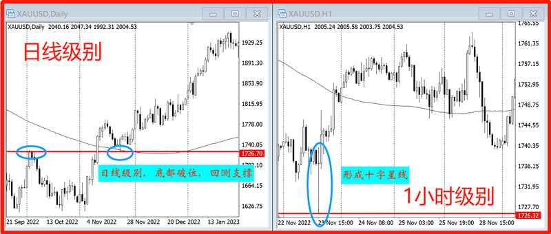
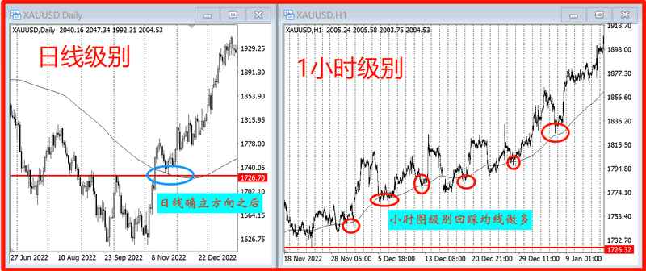
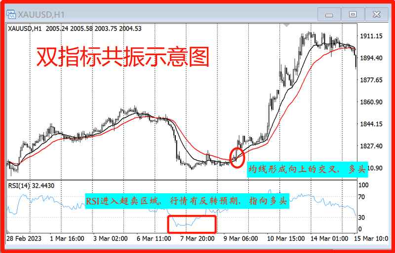
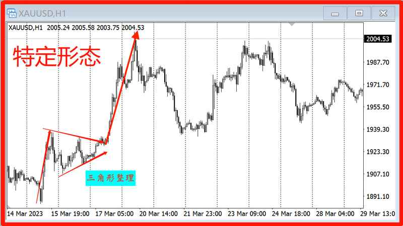
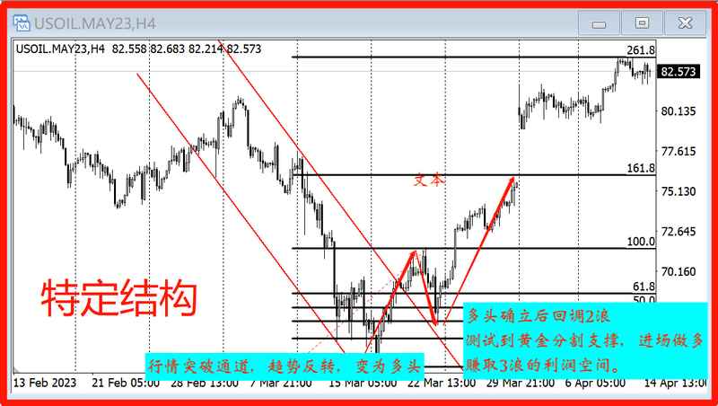
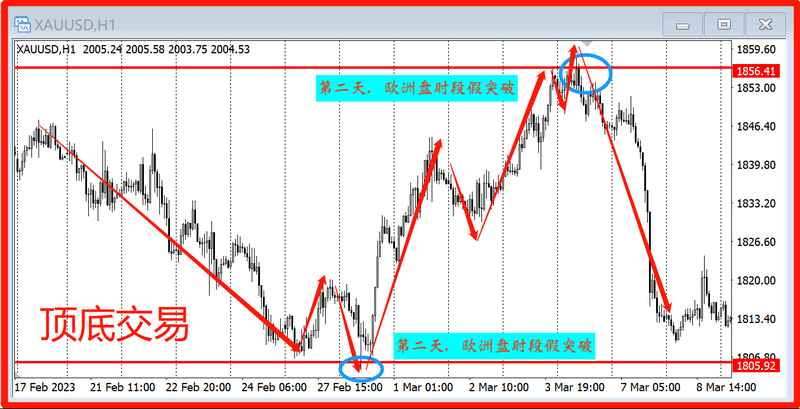

# 分享5个交易的底层逻辑

很多人都知道自己做交易是需要一个交易策略的，或者说要建立一个交易模型。那么交易模型是由什么组成的呢？技术指标，于是很多人就开始学习技术指标。

学完技术指标之后，整个人就懵了，接下来我要干什么？建立交易系统？那用什么逻辑建立交易系统呢？

**所以这个底层逻辑，就是支撑起整套交易系统的灵魂，所有的技术指标也是服务于这套底层逻辑。**

市面上有非常多的交易逻辑，琳琅满目的。早些年我也测试过很多种，发现有的用起来太复杂，有的用到最后是无效的。

所以接下来的文章，我就会分别**详细地讲解5种我觉得非常好用的交易逻辑，算是给大家的交易策略打个底**。

之后你们再结合自己的交易习惯来叠加不同的技术指标和策略，就可以组建完善的交易系统，在市场中捕捉利润了。

内容非常干，建议你们**收藏**阅读，如果觉得有收获，可以给文章**点个赞**，感谢。

*图：5个交易底层逻辑总览（示意）*

<svg xmlns="http://www.w3.org/2000/svg" viewBox="0 0 860 400" font-family="'Microsoft YaHei','PingFang SC',sans-serif">
  <defs>
    <marker id="ar1" markerWidth="9" markerHeight="9" refX="8" refY="4.5" orient="auto">
      <path d="M0,0 L9,4.5 L0,9 z" fill="#64748b"/>
    </marker>
  </defs>
  <text x="430" y="34" text-anchor="middle" font-size="16" font-weight="bold" fill="#1e293b">5个交易底层逻辑</text>
  <rect x="345" y="160" width="170" height="56" rx="8" fill="#eff6ff" stroke="#2563eb" stroke-width="1.5"/>
  <text x="430" y="194" text-anchor="middle" font-size="14" font-weight="bold" fill="#1e293b">交易底层逻辑</text>
  <line x1="345" y1="176" x2="282" y2="94" stroke="#64748b" stroke-width="1.5" marker-end="url(#ar1)"/>
  <line x1="345" y1="188" x2="282" y2="178" stroke="#64748b" stroke-width="1.5" marker-end="url(#ar1)"/>
  <line x1="345" y1="200" x2="282" y2="262" stroke="#64748b" stroke-width="1.5" marker-end="url(#ar1)"/>
  <line x1="515" y1="176" x2="578" y2="94" stroke="#64748b" stroke-width="1.5" marker-end="url(#ar1)"/>
  <line x1="515" y1="188" x2="578" y2="178" stroke="#64748b" stroke-width="1.5" marker-end="url(#ar1)"/>
  <line x1="515" y1="200" x2="578" y2="262" stroke="#64748b" stroke-width="1.5" marker-end="url(#ar1)"/>
  <rect x="30" y="64" width="250" height="56" rx="8" fill="#eff6ff" stroke="#2563eb" stroke-width="1.5"/>
  <text x="155" y="86" text-anchor="middle" font-size="13" fill="#1e293b">逻辑1：看大做小</text>
  <text x="155" y="108" text-anchor="middle" font-size="13" fill="#475569">大周期定方向小周期进场</text>
  <rect x="30" y="150" width="250" height="56" rx="8" fill="#fef3c7" stroke="#d97706" stroke-width="1.5"/>
  <text x="155" y="172" text-anchor="middle" font-size="13" fill="#1e293b">逻辑2：指标共振</text>
  <text x="155" y="194" text-anchor="middle" font-size="13" fill="#475569">两指标同向才进场</text>
  <rect x="30" y="236" width="250" height="56" rx="8" fill="#f5f3ff" stroke="#7c3aed" stroke-width="1.5"/>
  <text x="155" y="258" text-anchor="middle" font-size="13" fill="#1e293b">逻辑3：特定形态</text>
  <text x="155" y="280" text-anchor="middle" font-size="13" fill="#475569">只做研究透的形态</text>
  <rect x="580" y="64" width="250" height="56" rx="8" fill="#ecfdf5" stroke="#16a34a" stroke-width="1.5"/>
  <text x="705" y="86" text-anchor="middle" font-size="13" fill="#1e293b">逻辑4：特定结构</text>
  <text x="705" y="108" text-anchor="middle" font-size="13" fill="#475569">N字·主升回调浪</text>
  <rect x="580" y="150" width="250" height="56" rx="8" fill="#fef2f2" stroke="#dc2626" stroke-width="1.5"/>
  <text x="705" y="172" text-anchor="middle" font-size="13" fill="#1e293b">逻辑5：顶底交易</text>
  <text x="705" y="194" text-anchor="middle" font-size="13" fill="#475569">大趋势后假突破反向</text>
  <rect x="580" y="236" width="250" height="56" rx="8" fill="#eff6ff" stroke="#2563eb" stroke-width="1.2"/>
  <text x="705" y="258" text-anchor="middle" font-size="13" fill="#1e293b">叠加成系统</text>
  <text x="705" y="280" text-anchor="middle" font-size="13" fill="#475569">选一个吃透再叠加策略</text>
</svg>

## 逻辑1：看大做小

看大做小是一种**周期共振**的交易逻辑，是指在大周期确定方向后，从小周期进场。这样做又分两种最常见的方法：

**第一种方法：大周期确定方向后，小周期进场，拿大周期的趋势。**

例如日线的方向确定多头后，从小时图级别进场做多，设置止损，拿着订单等待日线级别的趋势走出来。

这样做的优势是，**小时级别止损空间小，日线级别的方向空间大，订单盈亏比非常好**。

**我用图片给大家做一下讲解。**

**图中左侧是日线级别的k线图，右侧是小时图级别的k线图。**

日线级别形成了双底的破位之后，确认多头趋势，此时在小时图级别，选择机会进场做多，拿大趋势。

之后行情回测双底破位的颈线支撑，测试到支撑后，在小时图级别形成了长下影线的十字星线，行情有反转的可能，此时多单进场，止损设置在十字星线的低点，随后顺着日线级别，长期持有订单。

**第二种方法：大周期确定方向后，在小周期顺着大周期的方向，不停地进行小级别的交易。**

例如日线确定方向为多头后，从小时图级别交易，只做多不做空。小时图级别进场，拿一段盈利就会出场，之后从小时图级别再找机会继续多，直到日线方向反转，停止小级别的交易。

**大家看图。**

**图中的走势同上面图片中，是相同的一段行情，左侧是日线级别k线，右侧是小时图级别k线。**

左侧日线级别，双底破位之后确立了多头，随后将图表切换到1小时级别，当行情从上向下测试到均线，获得支撑之后进场做多，可以用反转k线作为进场的标准。

每次进场之后设置止损，行情向上推动，当k线远离均线，获得一波利润之后就平仓，等待行情再次回落均线，继续进场做多。

往复循环，直至日线级别转向。图中右侧1小时级别红色圆形中，都是可以进场做多，并能盈利的交易机会。

**注意一下：**

- 这两种做法各有利弊，**第一种方法操作起来简单**，一个订单进场后拿到底，不太用去关注行情，是一种长线的交易，但长线持仓对耐心的考验很大。
- **第二种方法操作起来复杂**，需要精力盯盘，但化整为零，每一波操作周期都比较短，是一种波段的交易。

大家根据自己的性格特点，以及交易习惯来做选择。

## 逻辑2：指标共振

指标共振是指**当两个或两个以上的指标，指向相同方向时进场交易**，并且这些指标是在相同的周期里共振。

例如在小时图的级别，当两个指标都指向多头的时候，在图表上选择机会做多。

**用图片给大家做一下讲解。**

**图中是黄金1小时级别的k线图，图表下方有RSI指标，图表上方k线是双均线指标。**

行情经过一波快速下跌之后，RSI指标进入到超卖区域，行情有反转向上的预期，行情指向了多头。同时上方双均线也形成了向上的金叉，可以进场做多，止损设置在行情回调的低点，随后行情大幅上涨。

**注意一下：**

双指标或三指标共振是比较常用的。**三指标以上的共振交易操作起来非常复杂，可执行性就降低了，不建议使用**。

另外，我们也通常将一个震荡指标和一个趋势指标结合起来使用。

## 逻辑3：特定形态

特定形态是指，**交易中只交易某种k线组合形态**，例如矩形整理，三角形整理，旗形整理等等。

**大家看示意图。**

图中是黄金1小时级别的k线图。行情经过第一波的上涨后，形成了收敛的三角形整理形态，整理形态破位后进场，止损设置在前方的拐点，随后行情大幅上涨。

**注意一下：**

如果决定只关注某种形态，就要**把这个形态研究精，研究透**，这样才能了解这个形态的变化特点，才能在实战中非常熟练地识别。

另外，交易市场都是相通的，这种特定形态不管是在股票，期货，外汇，这些市场都是通用的。

这种交易模式也几乎适用于所有的时间周期，如果你觉得单品种特定形态的交易频率比较低，**你可以通过增加品种来提高交易的频率**。

## 逻辑4：特定结构

特定结构是指，**交易中只交易行情的某种形态结构**，例如道氏理论里，N字形的结构，例如波浪理论里，主升浪回调浪的结构。

**大家看示意图，我们以第3浪结构为例讲解。**

图中是原油4小时级别的k线图。行情在大幅下跌后，行情由空转多，走出上涨的第1浪，并突破了下降的通道，确立了反转，此时方向为多头。

第1浪确立后，等待第2浪回调，回调测试到黄金分割50%的位置后进场，止损设置在前方的低点，之后行情3浪启动。

**注意一下：**

跟特定形态一样，确定做某种结构，就**必须把这种结构的细节把握到位，做精做好**。如果觉得交易频率太低，可以通过增加品种来调节频率。

## 逻辑5：顶底交易

顶底交易是指在趋势中抓反转，**通常在一波大幅的上涨或下跌后，根据技术标准识别趋势可能反转的信号进行交易**。

**大家看示意图，我讲一种做顶底反转的技术形态。**

**图中是黄金1小时级别的k线图。**

图中左侧行情经过大幅下跌之后，在2月27日创出新低后展开回调，第二天行情继续下跌，并在欧洲盘时段向下创出新低，但行情快速收回来，形成**假突破诱空**，随后行情反转，走出多头。

图中右侧也是相似的走势，行情先是在前一天创出新高，第二天简单回调之后，在欧洲盘时段向上突破，但快速收回来形成反转k线，走出**诱多形态**，随后行情反转，做空头。

**关键点：**

- 之前有一波大趋势。
- 第一天创出新高或者新低。
- 第二天欧洲盘形成假突破。

这种交易模式，也可以结合重要的支撑压力位置来筛选信号，止损用反转k线的高低点为准，**止损空间很小，行情走出来盈亏比很大**。

**注意一下：**

上面例子中的结构，本质是做一个假突破之后的反向趋势，而且加入了过滤条件，交易盈亏比很好，但是交易频率不高，需要等待，比较考验耐心，也可以通过增加品种来增加交易频率。

5个底层交易逻辑讲完了，当然，交易逻辑还远远不止这5种，但我千挑万选，还是选择了这几个**最常见，执行难度最小的交易逻辑，适合我们绝大多数交易者**。

**另外，这些交易逻辑之间也没有好坏之分，各有千秋，大家选择一个适合自己的，把它研究透彻，就可以在这些交易逻辑之上叠加其他的交易策略，形成自己完整的交易系统，达到盈利。**

---

> 🏷️ 本文属《投资知识库 · 03-交易系统与实战战法》，重排于 2026-11。
