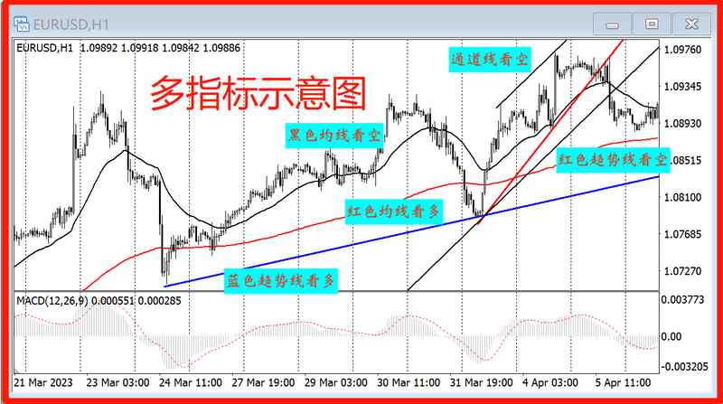
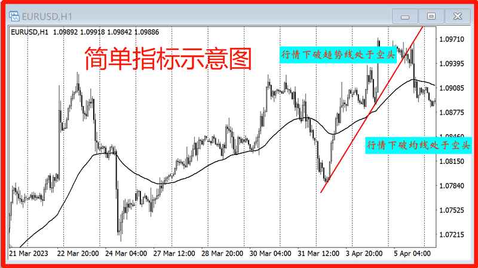
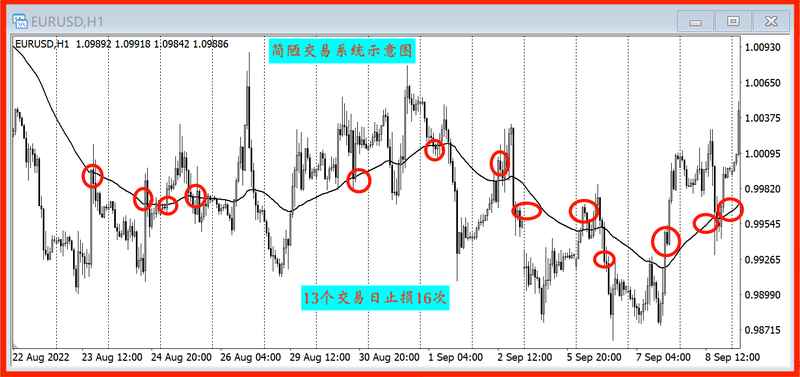

# 为什么交易系统越简单越好？

很多人的一生都是忙碌臃肿的，生活里充斥着各种各样复杂的事情。

就如同交易一样，你曾经可能就是想简单赚点钱，结果走着走着就迷失了，开始追涨杀跌，开始追求捷径，开始研究极为复杂的策略，开始贪婪与暴躁，最终什么都没得到。

**很多人在交易这件事上就是越做越复杂，东西越学越多，技术越研究越执迷，却忘了交易最根本的目的，就是赚钱。**

我早期也陷入过这种思维泥潭，曾经很长一段时间都爬不出来。直到我亏光本金，彻彻底底地洗清自我，才真正有了新的视角，懂得了简单才是真。

有些自己曾经嗤之以鼻的简单的技术方法，反而支撑起了我后来的生计。**今天我就分享一些自己的心路历程，以及一些直观的案例，大家就能很清楚地明白，为什么我们要追求简单的交易系统了。**

建议大家收藏阅读，如果觉得有收获，在文章底下**点个赞**，感谢。

## 1、简单的东西更聚焦，也更利于执行

> 很多人的交易系统效果不好，就是因为不懂取舍，什么都想要，结果把交易系统做得非常复杂。

比如你明明有了一套交易系统，执行下来也是有盈利的，但是有一些行情做不上，特别是一些大行情，于是你抓耳挠腮的，想方设法修改系统参数把大行情做上，结果发现又影响了之前的订单。

缝缝补补好几年下来，系统设置是越来越复杂，但钱是一点没赚到，反而还亏损了很多。

我曾经也非常执迷于寻找一个"完美的交易系统"，可以做上所有的行情，可以快速产生高暴利，最好一点亏损都没有，然而现实啪啪打脸。

**后来我放弃了这种执念，开始连续大量地执行一个简单的交易系统，只做一类行情，结果倒是小有所盈。**

我当时的感觉就像发现了新大陆一样，而且当你只做一类行情的时候，你会发现这类行情产生的变化是相对固定的。

比如你做一个固定的K线组合形态时间久了，就会感觉到，这个形态你见过很多次，虽然不确定这种形态形成之后具体会怎么走，但你能大体知道这种形态形成后的几种变化。

**不要小看这种"盘感"，它可以极大地增强你对交易系统的信心，减少对行情的未知恐惧，潜移默化地提高你的执行力。**

**除了只做一类行情，简单明确的技术标准也很重要。**

很多交易者的技术标准都非常复杂，五花八门的指标，乱七八糟的颜色，各种复杂的趋势线，这样的技术标准遇到了实战，怎么快速判断趋势？怎么做出盈利？

之前就有一个朋友给我分享了他的技术标准，K线的形态结构非常乱，不同的指标之间还打架，我在图上给大家画一下。

图中有通道线，两条趋势线，两条均线，还有MACD，它们分别指向了不同的方向，在这样的图表上，确认方向就是一件令人头皮发麻的事情，更不要说进场和出场。

而且指标给的方向不同，很容易影响交易的执行力。例如持有空单该止损了，看到下方的MACD没有背离，再看K线距离下方蓝色趋势线支撑还有挺大的空间，综合这两点，行情可能还会继续向下回落，那就等等再止损。

结果因为厌恶止损的本能，又不断给自己洗脑，在行情里寻找有利于自己的技术标准，拖延订单止损，最后导致了严重的亏损。

**如果我们的技术标准很简单呢？我用同样的行情优化一下。**

同样一段行情走势，我只保留了一条均线和一条趋势线。在这一段行情里，趋势就非常明确，行情下破了上升通道线，也下破了均线，处于标准的空头走势，这个时候如果持有多单，必须要止损，并寻找机会做空。

**非常简单的技术标准，不存在模棱两可，也不需要纠结，它虽然看起来不高大上，但是它绝对好执行。**

其实这么一对比，选择简单还是复杂，大家自己心里就有数。贪则全无，有舍才有得。

并且当你聚焦在几个指标，几个品种，一类行情的时候，你才能钻得够深，对行情的感知度更高，才更有利于交易。

<svg xmlns="http://www.w3.org/2000/svg" viewBox="0 0 700 420" font-family="'Microsoft YaHei','PingFang SC',sans-serif">
  <text x="350" y="32" text-anchor="middle" font-size="16" font-weight="bold" fill="#1e293b">复杂系统与简单系统对比</text>
  <rect x="40" y="50" width="290" height="34" rx="8" fill="#fef2f2" stroke="#dc2626" stroke-width="1.5"/>
  <text x="185" y="72" text-anchor="middle" font-size="13" fill="#1e293b">复杂的交易系统</text>
  <rect x="370" y="50" width="290" height="34" rx="8" fill="#ecfdf5" stroke="#16a34a" stroke-width="1.5"/>
  <text x="515" y="72" text-anchor="middle" font-size="13" fill="#1e293b">简单的交易系统</text>
  <rect x="40" y="96" width="290" height="44" rx="6" fill="#fef2f2" stroke="#dc2626" stroke-width="1.2"/>
  <text x="185" y="123" text-anchor="middle" font-size="13" fill="#1e293b">什么都想要，指标打架</text>
  <rect x="370" y="96" width="290" height="44" rx="6" fill="#ecfdf5" stroke="#16a34a" stroke-width="1.2"/>
  <text x="515" y="123" text-anchor="middle" font-size="13" fill="#1e293b">只做一类行情</text>
  <rect x="40" y="152" width="290" height="44" rx="6" fill="#fef2f2" stroke="#dc2626" stroke-width="1.2"/>
  <text x="185" y="179" text-anchor="middle" font-size="13" fill="#1e293b">判断纠结，难执行</text>
  <rect x="370" y="152" width="290" height="44" rx="6" fill="#ecfdf5" stroke="#16a34a" stroke-width="1.2"/>
  <text x="515" y="179" text-anchor="middle" font-size="13" fill="#1e293b">标准明确，绝对好执行</text>
  <rect x="40" y="208" width="290" height="44" rx="6" fill="#fef2f2" stroke="#dc2626" stroke-width="1.2"/>
  <text x="185" y="235" text-anchor="middle" font-size="13" fill="#1e293b">缝缝补补，越改越亏</text>
  <rect x="370" y="208" width="290" height="44" rx="6" fill="#ecfdf5" stroke="#16a34a" stroke-width="1.2"/>
  <text x="515" y="235" text-anchor="middle" font-size="13" fill="#1e293b">聚焦几个指标几类品种</text>
  <rect x="40" y="264" width="290" height="44" rx="6" fill="#fef2f2" stroke="#dc2626" stroke-width="1.2"/>
  <text x="185" y="291" text-anchor="middle" font-size="13" fill="#1e293b">执迷"完美的交易系统"</text>
  <rect x="370" y="264" width="290" height="44" rx="6" fill="#ecfdf5" stroke="#16a34a" stroke-width="1.2"/>
  <text x="515" y="291" text-anchor="middle" font-size="13" fill="#1e293b">形成盘感，增强信心</text>
  <rect x="115" y="344" width="470" height="48" rx="8" fill="#eff6ff" stroke="#2563eb" stroke-width="1.5"/>
  <text x="350" y="374" text-anchor="middle" font-size="13" fill="#1e293b">贪则全无，有舍才有得；简单不等于简陋</text>
</svg>

*图：复杂系统与简单系统对比示意（依正文整理）*

## 2、简单，并不等于简陋

> 技术标准必须清晰明确、贴合人性，才是一套合格的交易系统。

大家总说"大道至简"，也觉得用一根裸K就能做出盈利来，是多么值得骄傲的事情。

当然，我不排除有的人确实可以用单根裸K，或极其简易的交易策略就能做出盈利来，但这些策略不适合绝大多数人，就像漏风的房子，你可以修炼自我保证自己不在这座房子里冻到发抖，但我宁愿选择把房子修葺完善，再怡然地生活。

**之前就有一位交易者跟我分享了裸K的交易系统：**

当大K线强势突破支撑位的时候进场，一直持仓直到K线弱势收线时平仓，他问我这样的交易系统可行不？

我只问了几个问题：大K线的标准是什么？强势破位的标准是什么？K线弱势收线的标准又是什么？他答不上来。

我又继续问：那出场的"K线弱势收线"，K线收长上影线的阳线算弱势吗？还是K线一定收阴线才算弱势？或者阴线的实体长度达到一定的比例才算弱势？

他说：那要看具体情况。

**这样的交易系统就相对"简陋"，因为它所有的标准都是模棱两可的，实战的时候需要非常主观的判断**，极有可能因为你当天的心情好坏，直接影响了对走势的判断，这样其实就相当于没有标准了。

**还有一种"简陋"的交易系统：**

**比如一条均线上多下空，K线收线上穿均线做多，K线收线下穿均线做空。**这个交易系统就无敌简单了，而且标准清晰。

但这种交易系统也有问题，因为它没有经过任何的过滤和筛选，会出现多次频繁止损，执行起来很考验人性。

**我举个例子，大家看图。**

**图中的例子就是一条均线，上多下空收线进场的示意图。**

图中红色圆形中分别是开仓和平仓的点位，在13个交易日中，止损至少16次，账户会出现严重的亏损。

16次止损，没有多少人能扛得住，一旦心态崩溃，满盘皆输。

**这种形式上简单，但执行起来难度极大的交易系统，在我看来也是很"简陋"的。**因为需要交易者有强大的心脏，有超出常人的意志力，在执行层面是另外一种复杂。

**所以一套交易系统，技术标准必须清晰明确，执行的时候可以排除主观因素，并且要贴合我们的人性，它才是一套合格的交易系统，才可以到讨论盈利的层面。**

## 3、技成，则道明

> 交易中的大部分心态问题，都是源于技术的不成熟。

很多人把交易看得太复杂了，把自己亏损的原因都归结于心态不好，运气不好，或没找到交易的圣杯。

也有很多人有疑惑，为什么交易总是要上升到"道"的层面，到底是故弄玄虚，还是真的需要？

**其实交易中的大部分心态问题，都是源于技术的不成熟。**

我举个例子，如果你本来的交易系统就很简单，交易标准明确，那又怎么会在实战的时候犹犹豫豫，思路一团浆糊？

如果你已经把交易系统做过大量的复盘和模拟盘，你又怎么会对自己的交易系统没有信心，没有执行力？

复盘是一件极其繁琐，但极其有效的事情，可以测试自己交易系统的盈利能力。如果你已经经历过大量的复盘，又怎会不知道复杂的技术标准执行起来有多难，只有简单的交易系统才是唯一出路？

**因为这些我都经历过，所谓的心态问题，大多都是因为自己在技术上偷了懒。**

后来，我的交易系统就只做简单的矩形整理结构，交易的时候只有一种选择，当下行情符合标准我就做，不符合标准我就看。矩形整理破位走出空间我就盈利，走不出空间我就止损，就是这么简单。

在这种交易模式下，我的内心是非常平静的，心理上的压力也非常小，因为我终于明白了，有些利润属于我，有些利润不属于我，我只要集中注意力赚我该赚的钱就可以了。

**我的交易思路也变得异常清晰简单了。**

金融市场是很复杂的，充满了各色的诱惑，想要的太多，就会出现心态问题。只有净化简化自己的想法，才能真正赚到钱。

当然，赚钱是这个世界上最难的事情，在交易中人性满天飞，赚钱就变得更加艰难。

但如果你有一套简单、好执行、并验证有效的交易系统，可以对你的人性有极大的约束，可以把很多事情变得简单，也会形成一道天然屏障，帮你抵御外界的诱惑。

**有时候思路简单了，贪念放下了，就可以"识得庐山真面目"了。**

---

> 🏷️ 本文属《投资知识库 · 03-交易系统与实战战法》，重排于 2026-11。
