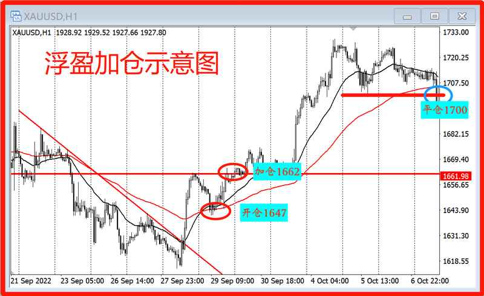
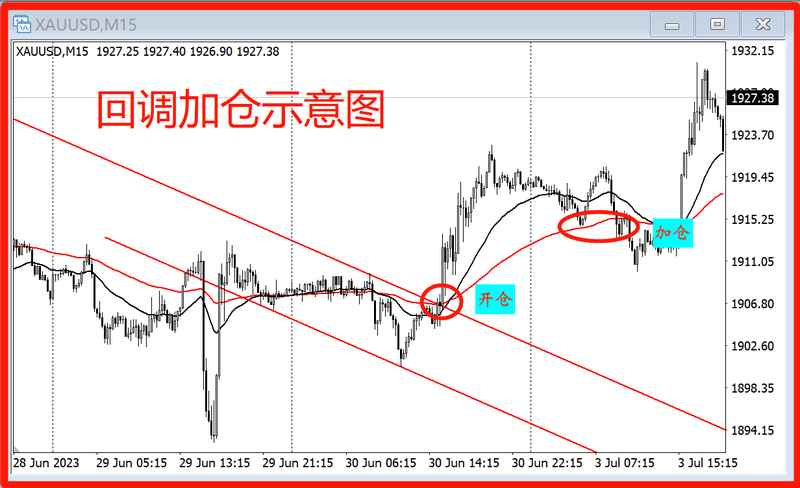

# 为什么很多人都喜欢浮盈加仓，反转了不是浮亏更快？

浮盈加仓是指在一个订单盈利之后，顺势再加一个同方向的订单，这样总的仓位就增加了。假设原来是1手，加仓1手，总仓位就是2手了，如果这个时候出现了反转，因为仓位变重了，浮亏也会变快，相当于把风险放大了一倍。

**市面上也有这样的说法：浮盈加仓，一把亏光。**

但其实风险越高的地方，利润也高，这是成正比的，浮盈加仓做对了也可以大幅度增加我们的利润。

我举个例子，大家看图片。

图中是浮盈加仓的示意图，行情上破了下降趋势线之后，确认了多头。完成第1浪上涨后开始回落，测试到两条均线后企稳，形成反转的K线形态进场做多，此时开仓价为1647。

开仓之后，行情继续向上运行，在突破前高时加仓，加仓价是1662。

加仓之后行情继续向上，在高位形成了顶部的破位后平仓，平仓价是1700。

**我们来算一下。**

- 第一单盈利是1700-1647=53；
- 加仓后，盈利增加了1700-1662=38；
- 原本只有53美金（空间）的盈利，现在成了91美金（53+38），一张加仓单让盈利增加了70%，还是非常可观的。

因此我们应该更客观地看待浮盈加仓，虽然是扩大了风险，但是做对了也会有更高的盈利。

## 实战中该如何加仓？分享我的两个经验

<svg xmlns="http://www.w3.org/2000/svg" viewBox="0 0 860 400" font-family="'Microsoft YaHei','PingFang SC',sans-serif">
  <defs>
    <marker id="ar1" markerWidth="9" markerHeight="9" refX="8" refY="4.5" orient="auto">
      <path d="M0,0 L9,4.5 L0,9 z" fill="#64748b"/>
    </marker>
  </defs>
  <text x="430" y="34" text-anchor="middle" font-size="16" font-weight="bold" fill="#1e293b">浮盈加仓的两种方式</text>
  <rect x="260" y="56" width="340" height="46" rx="8" fill="#eff6ff" stroke="#2563eb" stroke-width="1.5"/>
  <text x="430" y="84" text-anchor="middle" font-size="13" fill="#1e293b">浮盈加仓：盈利后顺势加同向订单</text>
  <line x1="430" y1="102" x2="230" y2="146" stroke="#64748b" stroke-width="1.5" marker-end="url(#ar1)"/>
  <line x1="430" y1="102" x2="630" y2="146" stroke="#64748b" stroke-width="1.5" marker-end="url(#ar1)"/>
  <rect x="30" y="150" width="380" height="124" rx="8" fill="#ecfdf5" stroke="#16a34a" stroke-width="1.5"/>
  <text x="220" y="178" text-anchor="middle" font-size="13" font-weight="bold" fill="#1e293b">方式一：回调加仓（保守）</text>
  <text x="220" y="202" text-anchor="middle" font-size="13" fill="#475569">第1单盈利后，等行情回调再加</text>
  <text x="220" y="224" text-anchor="middle" font-size="13" fill="#475569">加仓位低，浮亏小，易设止损</text>
  <text x="220" y="246" text-anchor="middle" font-size="13" fill="#475569">弊端：行情不回调就错失机会</text>
  <rect x="450" y="150" width="380" height="124" rx="8" fill="#fef3c7" stroke="#d97706" stroke-width="1.5"/>
  <text x="640" y="178" text-anchor="middle" font-size="13" font-weight="bold" fill="#1e293b">方式二：金字塔加仓（折中）</text>
  <text x="640" y="202" text-anchor="middle" font-size="13" fill="#475569">加仓单仓位低于第一单</text>
  <text x="640" y="224" text-anchor="middle" font-size="13" fill="#475569">如10手→8手→6手，逐次递减</text>
  <text x="640" y="246" text-anchor="middle" font-size="13" fill="#475569">底重顶轻，浮亏出现慢，心态稳</text>
  <rect x="180" y="310" width="500" height="48" rx="8" fill="#eff6ff" stroke="#2563eb" stroke-width="1.5"/>
  <text x="430" y="340" text-anchor="middle" font-size="13" fill="#1e293b">加仓做对：盈利从53到91美金，增加70%</text>
</svg>

*图：浮盈加仓两种方式示意（依正文整理）*

### 1：保守一点加仓，等行情回调时再加

> 加仓位低，利润回吐出现浮亏的情况就少，交易压力小。

加仓操作最怕加仓之后行情回调，这样之前的利润就会回吐很快。一旦盈利没了，交易者就会面临比较大的心理压力，持仓变得不坚定了，可能会在压力之下草草平仓，导致交易失败。

因此我们在加仓操作中，可以选择在第1单盈利后的行情回调中加仓，这样行情已经回调了，加仓单在相对的低位，利润回吐出现浮亏的情况就少了。

用图片给大家做一下讲解。

图中行情在底部形成了通道线的破位，在通道线破位点开仓，开仓之后，行情上涨冲高，订单出现了盈利。

冲高时暂时不加仓，等待行情回落，行情回落到1914附近的时候，结合K线形态加仓。此时行情从高位已经回落了80点，加仓之后，虽然行情又继续回落震荡，但加仓的点位已经相对比较低，行情回落出现的浮亏也比较小，咱们的交易压力小，随后行情反转，向上加仓成功。

另外回调加仓相比较在高位加仓，订单进场的价格更有优势，也容易设置止损，行情走出来之后，盈利更大。当然回调加仓也有一个很大的弊端，行情走得快的时候不回调，就会错失加仓的机会，这也是实战中必须要注意的。

### 2：使用金字塔的方式加仓

> 底重顶轻，浮亏出现得比较慢，交易心态更稳定。

金字塔大家都知道，下方大，上方小。顾名思义，金字塔的加仓方式就是加仓单的仓位，低于第一单的仓位。假设第一单开仓是10手，那么金字塔的加仓方式，加仓单就要低于10手。如果有第二次加仓，仓位也要小于第一次加仓的仓位。

比如第一单开10手，第一次加仓加8手，第二次加仓加6手，以此类推。

这样操作，因为底下的仓位重，上面的仓位轻，即便加仓在高位，行情出现了回落，浮亏也会出现得比较慢，交易的心态会更加稳定，利于咱们交易的执行。

当然由于仓位越加越小，整体的仓位少，行情走出来，获利的空间也会小一些。我们可以把金字塔加仓理解成一种折中的加仓操作，让风险和回报处在一种中间地带，风险不会绝对高，利润也不会绝对低，整体更加平衡，执行难度也更小，所以这种加仓方式还是适合绝大多数人的。

---

> 🏷️ 本文属《投资知识库 · 03-交易系统与实战战法》，重排于 2026-11。
