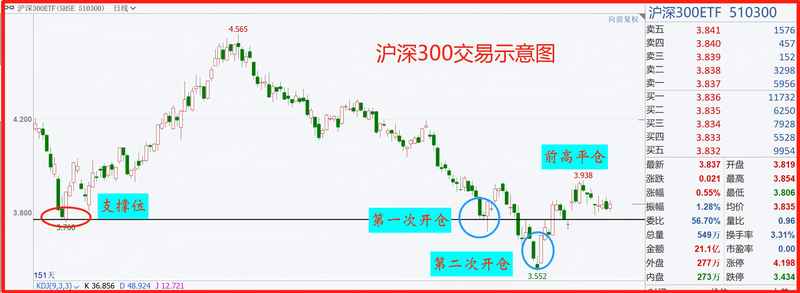
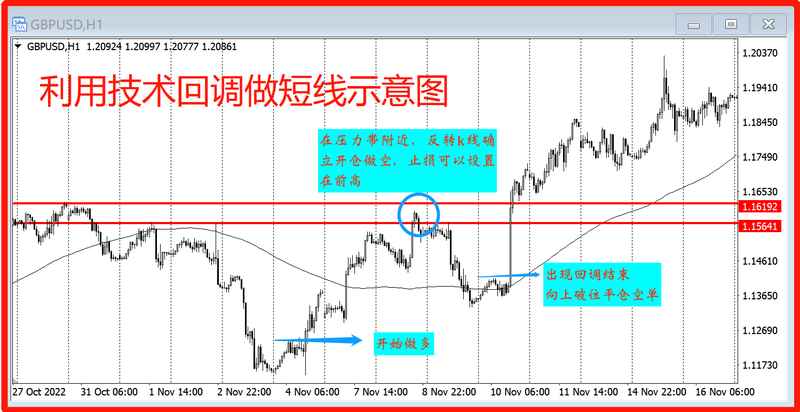
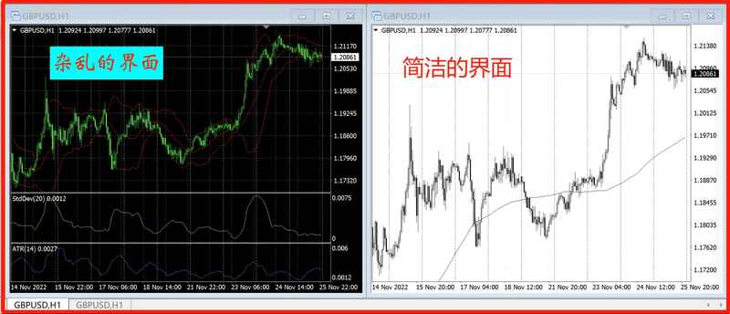

# 9个帮助你实现盈利的操作细节

交易本身不是一件特别难的事，却是一件极度细致的事，所以我说性格严谨认真的人，可能比聪明灵活的人更容易做到盈利。

我也常常跟我团队里的交易员说，做交易必须做到全神贯注，事无巨细，否则一个小小的失误就可能带来惨重的损失，所以团队中的每个人都还算严谨认真。

这几天我回顾了一下自己的交易操作，**分享9个容易被大家忽视掉的操作细节，这些细节也是我日常在坚持做的**，希望能给你们带来帮助。

文章比较长，建议大家收藏阅读，如果觉得有收获可以**给文章点个赞**，感谢。

<svg xmlns="http://www.w3.org/2000/svg" viewBox="0 0 720 380" font-family="'Microsoft YaHei','PingFang SC',sans-serif">
  <text x="360" y="30" text-anchor="middle" font-size="16" font-weight="bold" fill="#1e293b">9个操作细节总览</text>
  <rect x="20" y="50" width="340" height="100" rx="8" fill="#eff6ff" stroke="#2563eb" stroke-width="1.5"/>
  <text x="190" y="76" text-anchor="middle" font-size="14" font-weight="bold" fill="#1e293b">看盘与下单</text>
  <text x="190" y="100" text-anchor="middle" font-size="13" fill="#475569">技巧1：只在行情停盘之后看盘</text>
  <text x="190" y="124" text-anchor="middle" font-size="13" fill="#475569">技巧2：用挂单交易，少用现价单</text>
  <rect x="360" y="50" width="340" height="100" rx="8" fill="#eff6ff" stroke="#2563eb" stroke-width="1.5"/>
  <text x="530" y="76" text-anchor="middle" font-size="14" font-weight="bold" fill="#1e293b">持仓与短线</text>
  <text x="530" y="100" text-anchor="middle" font-size="13" fill="#475569">技巧3：持仓浮盈时，利用技术回调做短线</text>
  <text x="530" y="124" text-anchor="middle" font-size="13" fill="#475569">多空同持有难度，不建议新手操作</text>
  <rect x="20" y="170" width="340" height="130" rx="8" fill="#eff6ff" stroke="#2563eb" stroke-width="1.5"/>
  <text x="190" y="196" text-anchor="middle" font-size="14" font-weight="bold" fill="#1e293b">工具与环境</text>
  <text x="190" y="220" text-anchor="middle" font-size="13" fill="#475569">技巧4：K线界面简洁、色调统一</text>
  <text x="190" y="244" text-anchor="middle" font-size="13" fill="#475569">技巧7：电脑做分析，手机做执行</text>
  <text x="190" y="268" text-anchor="middle" font-size="13" fill="#475569">技巧8：把办公桌收拾整洁</text>
  <rect x="360" y="170" width="340" height="130" rx="8" fill="#eff6ff" stroke="#2563eb" stroke-width="1.5"/>
  <text x="530" y="196" text-anchor="middle" font-size="14" font-weight="bold" fill="#1e293b">心态与独立</text>
  <text x="530" y="220" text-anchor="middle" font-size="13" fill="#475569">技巧5：做一个独立的交易人</text>
  <text x="530" y="244" text-anchor="middle" font-size="13" fill="#475569">技巧6：不要把自己的持仓告诉别人</text>
  <text x="530" y="268" text-anchor="middle" font-size="13" fill="#475569">技巧9：别太把行情当回事</text>
  <rect x="110" y="316" width="500" height="44" rx="8" fill="#f0fdf4" stroke="#16a34a" stroke-width="1.5"/>
  <text x="360" y="344" text-anchor="middle" font-size="13" fill="#1e293b">交易就是一个个小细节组合而成的胜利，把握好每一个细节</text>
</svg>

*图：9个操作细节总览示意（依正文整理）*

## 技巧1：只在行情停盘之后看盘

> 自制力差的人，减少看盘的次数，甚至可以不看盘。

我们很多散户股民都是非职业交易员，没有完善的交易系统，心理状态也不是很稳定，所以很容易受到行情波动的影响。

我们在盯盘的时候，注意力全都集中在行情很小的涨跌上，哪怕是一个小小的回调，我们都会感觉很紧张，这个时候操作就乱来了，原来看好的行情提前平仓了，没研究过的行情一时冲动开仓被套了。

等到停盘之后回头看，感觉自己跟鬼迷心窍一样，交易做得一塌糊涂。

**所以我建议自制力差的人，减少看盘的次数，甚至可以不看盘。**

我自己的习惯是收盘之后再看盘，因为不涉及当下的行情涨跌，不会影响到我的心情，就可以理智地按照交易计划执行。

**举个例子吧。**

比如我在股市中，用网格交易的方法买入沪深300的ETF。

**我设置的开仓条件：**当股价下跌运行到低位，股价测试到支撑+形成反转K线后入场，股价下跌形成新的反转K线后加仓，入场之后，以前高作为盈利的目标位平仓。

**大家看下方的示意图。**

**根据我们的交易计划：**

（1）沪深300指数经过大幅下跌，测试到3.760的支撑位之后，我们开始重点关注行情，10月12日当天收盘形成阳线后，符合了我们开仓的条件，第2天行情低开后，开仓买入。

（2）当天执行交易计划后就不再盯盘，等收盘再看盘，以后每天收盘后观察行情是否到达了加仓，或者平仓的位置。开仓之后，行情小幅整理后又快速下跌。

（3）11月1日收盘后，观察当天形成向上的启明星形态，符合加仓的标准，第2天行情低开后加仓。加仓完毕后，就不在盘中观察价格变化了，依然只在收盘后观察走势。

（4）当11月15日行情测试到3.931的前高后，行情达到了平仓的标准，第2天开盘后平仓。等待行情回落，形成反转的K线再次开仓。

这样每次都是在收盘之后观察分析，第二天执行交易计划，会对心态有很大的帮助，**这个技巧也是我多年实践后的结果，看似普通，却非常好用。**

## 技巧2：用挂单交易，少用现价单

> 挂单交易：一个是减少冲动交易，一个是得到更好的成交价格。

挂单这个操作是我在交易中用得最多的，主要是有两个作用，一个是减少冲动交易，一个是可以得到更好的成交价格。

**当你采用挂单交易，将订单挂好之后，你就不需要一直盯盘了，只需要偶尔检查订单是否成交就可以。**我们在挂单的时候，还可以同时把止损和止盈挂好，这样非常节省精力。

很多人做交易的时候就喜欢一直盯盘，亏一点就哇哇叫，盈利一点又开始紧张害怕回调，每天做交易跟打仗一样，能出一身汗。

在这种精神状态下，是不可能做好交易的。所以我常常说，要与市场保持一定的距离，从物理动作上来说，就是减少盯盘的时间和次数，让自己的心态处于一个平稳的状态，这样更有利于做出客观的判断。

**而且挂单交易通常在行情回调后再进场，这样在实战的过程中，就比现价交易会得到更有优势的进场价。**

不要小瞧挂单进场的价格优势，更好的开仓价。订单就能更快地实现盈利，交易者可以更快地获得心理优势，并且可以扩大盈亏比，对后续的交易执行很有帮助。

虽然这是一个很小很小的细节，但实践多年下来，不可谓不受益，**咱们的成功就是由许多微小的细节堆叠起来的。**

## 技巧3：持仓浮盈时，利用技术回调做短线

> 利用行情技术位的回调，做反向的短线订单。

多数趋势都是以震荡上涨或震荡下跌的方式运行的，震荡回落过程中，持仓盈利会减少，这时候我们的心理压力会很大，会担心行情会不会反转，要不要继续持仓，**这个时候我们就可以利用行情技术位的回调，做反向的短线订单。**

例如持有多单浮盈的时候，在行情的压力位附近，再结合K线的形态做短线的空单。空单进场之后，行情回落，空单产生盈利，多单盈利减少，但总体利润不会缩小很多。行情回落后，在行情二次启动的转折点附近，将空单平仓，继续持有多单。

这样做第一是可以缓解震荡回落时的心理压力，第二是可以提高盈利。

**我用图片给大家做一下讲解：**

图中是英镑兑美元1小时级别的K线图。行情经过大跌后，在底部形成了向上的结构破位，多单进场。

持有多单行情震荡上行，当价格测试到上方1.161附近的压力带，行情有深度回调的预期了，形成反转K线后短线回调的空单进场，止损设置的反转K线的上方。

此时同时持有多空两张订单。行情向下突破展开下跌，此时由于空单实现了盈利，价格的回撤账户的浮盈并没有减少。

行情向下回调企稳后，在形成向上破位形态二次启动时，将空单平仓，继续持有多单。

**注意：**

（1）多空同时操作有一定执行难度，不建议交易的新手进行这样的操作。

（2）不能同时关注太多品种，多空同时操作属于交易中的"细活"，品种太多，很容易在操作中出错。

（3）对技术回调的点位要把握得非常精准，同时回调单的仓位尽量小于之前持仓浮盈的趋势单。

## 技巧4：K线界面设置简洁，色调统一

> 形态的可读性非常影响我们拔刀的速度。

K线图表是我们每天必打交道的一个东西，每天都得看。根据色彩心理学，清晰且温和的色调，可以增加可读性和易读性，增强直观的交互，提高可识别性。

而且如果每天看到的都是清晰明了的色彩，大脑会向我们的内分泌系统发送信号，释放温和情绪的荷尔蒙，这也有利于稳住我们的心态。

**咱们做技术分析的人，每天都要识别大量的形态，所以形态的可读性非常影响我们拔刀的速度。**

下面我举个例子给大家看一下，一个杂乱无章的图表和一个简洁明了的图表，给大家做个对比，你们就明白了。

同样一段行情，图中左边有杂乱的各种K线，色调不分明，看起来眼花缭乱。右边的图形则简单明了，一眼就能看清楚形态，黑色的均线在图表上非常明显，可读性和识别性都很高。

很多人都会忽略图表的设置，每次我一发图大家都会问，你这是什么软件，怎么这么清楚，其实咱们用的都是一个软件，只不过我用点心设置得更清晰一点，我一直有习惯将图表的颜色调成黑白的浅色系，只添加自己常用的指标，你们也可以这么做，非常有效。

## 技巧5：做一个独立的交易人

> 独立完成策略的开发、测试以及调整，最后独立执行。

交易是一件很严肃，很个人的事情。

账户中的钱是我们自己辛辛苦苦赚来的，不是地上捡的，我们要对自己的每一分钱认真负责。

很多人在对一件事情感到不确定的时候，就习惯性地想要求助他人，或者和别人商量，以获得认同感，才能更笃定自己的决策，但这在交易中是一件很忌讳的事情。

因为每个人对方向的判断，开仓平仓的点位，仓位的比例，以及使用的指标、周期都是不同的，都有自己的标准，一旦进行讨论，你人性中的不安全感就会被激发，开始怀疑自己的交易策略，最终在交易当中就会患得患失，造成损失。

**《乌合之众》里有一句话是这么说的，人一到群体中，智商就会严重降低，为了获得认同，个体愿意抛弃是非，用智商去换取那份让人倍感安全的归属感。**

所以咱们在做交易的时候，不要落入这个思维陷阱，尽可能找一个相对安静的环境，可以独立思考，自己独立完成策略的开发，测试，以及调整，最后再独立执行。

至于孤独感肯定是有的，但在赚钱面前，这点微弱的孤独感称不上什么，等你走到真正的盈利就会明白。

## 技巧6：不要把自己的持仓告诉别人

> 一旦发表自己的持仓，就一定会出现赞同或反对的意见，对交易造成影响。

上面也说了，交易者应该是孤独的，要为自己的订单负责。一旦将自己的持仓告诉别人，就很容易会出现一些问题。

**有很多人喜欢对他人的交易指指点点，这是无法改变的人性的劣根性，所以一旦你发表自己的持仓，就一定会出现赞同或反对的意见，就一定会对你的交易造成影响。**

比如你原来是看多的，进场的点位也非常明确了，但是这时候，有100个人告诉你未来一定走空，那么这时候你下单的手还会那么坚定吗？

再比如，你持仓浮盈中，行情反转，本来心情就有点忐忑不安，害怕利润缩水，这个时候有100个人告诉你赶紧平仓，免得一毛钱盈利都没有了，这个时候你可以忍得住不平仓吗？

**而且很多人在持仓方面是有虚荣心的，一是觉得自己错了很丢人，二是觉得自己仓位小了显得穷，所以为了证明自己很牛很厉害，就会造成交易的走形。**

我在网上看到很多人非常高调地公布自己的持仓情况，无一例外都是在一阵高声喧哗之后，突然销声匿迹了。

因为人性就是如此啊，害怕错了被嘲讽，对了就想炫耀，但交易当中众生平等，你不可能一直对，每个人都会错，对错就是概率。

所以经常有人问我：八哥，我这个单子你怎么看？

我通常会说：我不会对你的单笔交易做什么评判，还是得具体看你整体的交易策略，是否已经经过测试完善，被证明是可持续盈利的，如果是，就坚持执行，不需要去问别人。

另外，作为一名有素养的交易者，咱们不要随便点评别人的持仓，我们都没有未卜先知的能力，可能你有时候的一句无心之言会无形中影响到他人的盈亏。

## 技巧7：尽量用电脑做行情分析和制定交易计划

> PC端分析制定计划，手机端执行，将计划和执行分开。

现在大家都喜欢用手机做交易，比较便捷，但如果真的想做好技术分析，电脑是很有必要的。

**电脑端的K线图表更大，更利于分析。**

在K线图表缩放大小级别相同的情况下，PC端可以看到K线数量是手机端的4-5倍，我们可以用更全局的视角进行分析。

在手机端，我们就很容易只观察了一个很小的区域，形成错误的分析。观察的角度越小，格局越小，交易越容易钻牛角尖，做错了还不自知。

**电脑端的软件功能更多。**

比如我们可以并列多个周期的图表进行对比分析，可以快速地切换周期，可以更方便地画线分析，可以更方便地缩放K线的大小，这些功能都有助于进行分析和交易。

**手机端就像人在地面看到的景色，电脑端就像人在楼顶看到的景色，两者还是有非常大的区别。**

当然手机端便携性更高，可以随时随地进行交易。因此这里建议大家用PC端进行行情分析，制定交易计划之后，在手机端进行交易，两者优势互补。

这样做还有一个很大的优点，我们可以将计划和执行分开，在图表上全面冷静客观地分析，在手机上严格地执行，这样也有利于我们执行到位。

## 技巧8：把办公桌收拾整洁

> 安静、干净、没有杂音干扰的环境，帮助你更快进入状态。

我之前在交易室呆过一段时间，当时的交易室里总是烟雾缭绕的，每个人的情绪都很暴躁，桌子上常常堆满了瓶瓶罐罐，各种各样的杂物。

我这个人在做交易时是有一定的仪式感的，桌面上的东西不能太多，最好有纸有笔，再有一杯咖啡或茶，这样不会影响我交易的注意力，也方便我随时记录。

有时也可以放一个解压的小工具在桌面上，当遇到交易不顺的时候，就可以捏一下这个解压工具，提醒自己冷静下来，这是一种很好的心理暗示。

另外，我在交易当中，会把手机放到房间外头，这样整个房间只有安静的电脑和书籍，可以帮助我快速进入冷静的思考模式，不会受到任何干扰。

交易是一件需要高度专注力的事情，所以一张很杂乱桌面，会让你的思绪更加紊乱，情绪更加暴躁，再加上有很多杂音影响你的注意力，交易是很难做好的。

这个点也经常被人忽略，一个安静的、干净的、没有杂音干扰的环境，可以帮助你更加快速地进入状态，非常有助于盈利。

## 技巧9：别太把行情当回事，你越渣它，它越爱你

> 战术上认真对待，战略上藐视敌人。

这跟谈恋爱一样，如果你越像一个舔狗，上赶着追求人家姑娘，却不提高自身的条件，就会让姑娘们越来越厌恶你。

行情也是这样的，如果你不制定自己的交易策略，脑袋一热上赶着交易，行情只会对你冷眼旁观，给你一个大嘴巴子，还收走了你的钱。

**《毛泽东选集》里有一句话：战术上认真对待，战略上藐视敌人。**

咱们最重要的是研究自己的交易策略，而不是把注意力完全集中在行情接下来的走势中。

当你越来越频繁地观察行情变化，以及你当下的持仓盈亏，它就会对你情绪的影响越来越大，甚至可以操控你的情绪。

最近很流行的一个论调叫PUA，我发现很多交易者都是被行情PUA了，不管行情怎么折磨你，虐你，你都还爱它，对它充满期待。

其实没必要这样啊，咱们与行情保持一定的距离，认真研究我们自己的交易策略，制定完善的交易计划，并且严格执行，对于行情的涨跌都冷眼旁观，不受短期盈亏的影响，只看长期的未来，行情也会拿你没办法的。

## 结语：把握好每一个细节

今天就聊这9个技巧，虽然都是一些比较细微的点，但却容易被大家忽略，交易就是一个个小细节组合而成的胜利，我们应该把握好每一个细节。

---

> 🏷️ 本文属《投资知识库 · 03-交易系统与实战战法》，重排于 2026-11。
