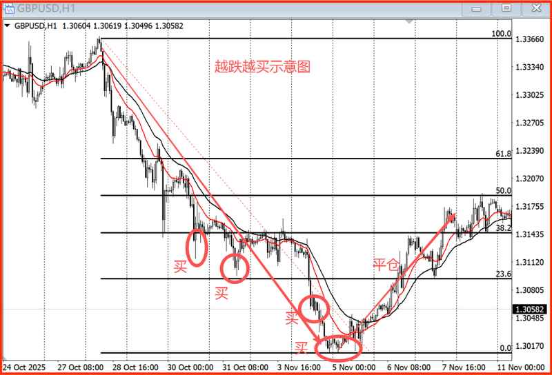
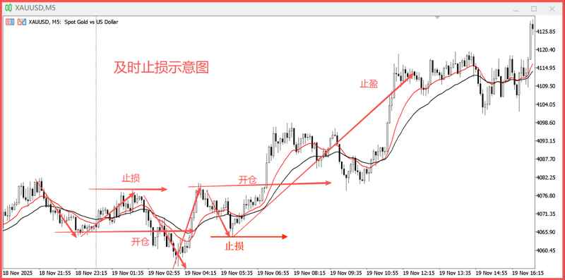
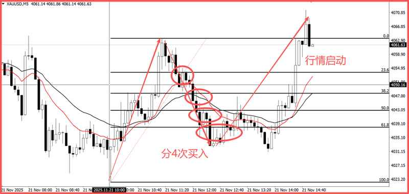
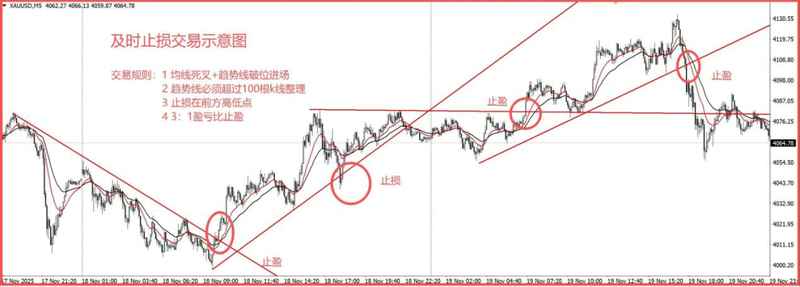

# 应该越跌越买，还是及时止损？

这个问题我曾经也很纠结过。

因为早期我是越跌越买的忠实爱好者，越跌越买可以摊低成本，等反弹，运气好的时候一两笔就能把亏损拉回来。但有时候遇到单边行情，你补得越多，亏得越惨。

后来我就开始执行严格止损和控制仓位，交易结果确实有改善，但是也会遇到被频繁止损的情况，非常影响心情。

再后来我发现，其实不同的市场，不同的行情，可以适配不同的交易方法，它们更像两套思维方式：**一个偏左侧，一个偏右侧，本质没有对错，只有匹配不匹配。**

今天这篇文章，我就把这两种方式拆开讲一讲：**它们的区别在哪里，适合什么行情，遇到不同的走势应该怎么选，怎么用。**

## 1、什么是越跌越买？什么是及时止损？

> 越跌越买摊平成本，及时止损保护本金。

**越跌越买**就是在行情下跌过程中不断加仓，摊平持仓的成本，行情只要反弹一段就能保平甚至盈利平仓。

大家看下方的示意图。

图中是英镑兑美元示意图，行情连续下跌过程中，不断分4次买入，行情回调到黄金分割23.6%的位置，基本就能盈亏持平，再往上38.2%，就能盈利。

越跌越买激进版，后面的买入仓位比上一次重，这样就可以把均价拉得更低，当然产生的浮亏也更大。

**及时止损**是指行情走到了开仓预设的止损位置时，果断地平仓退出，保护本金，控制风险，等待下一次交易机会。

大家看下方的示意图。

图中是黄金5分钟K线图，其中有两次交易机会。

左侧，均线死叉，行情向下破位进场，止损在前方高点，行情向下运行很小空间就反转向上，订单止损。

右侧，行情从底部启动，均线金叉，向上破位进场做多，止损在前方低点，行情上涨到上方止盈。

<svg xmlns="http://www.w3.org/2000/svg" viewBox="0 0 860 490" font-family="'Microsoft YaHei','PingFang SC',sans-serif">
  <text x="430" y="34" text-anchor="middle" font-size="16" font-weight="bold" fill="#1e293b">越跌越买与及时止损对比</text>
  <rect x="30" y="52" width="380" height="36" rx="8" fill="#fef3c7" stroke="#d97706" stroke-width="1.5"/>
  <text x="220" y="76" text-anchor="middle" font-size="13" fill="#1e293b">越跌越买（左侧思维）</text>
  <rect x="450" y="52" width="380" height="36" rx="8" fill="#eff6ff" stroke="#2563eb" stroke-width="1.5"/>
  <text x="640" y="76" text-anchor="middle" font-size="13" fill="#1e293b">及时止损（右侧思维）</text>
  <rect x="30" y="100" width="380" height="64" rx="6" fill="#fef3c7" stroke="#d97706" stroke-width="1.2"/>
  <text x="220" y="126" text-anchor="middle" font-size="13" fill="#1e293b">优势：容错率高</text>
  <text x="220" y="148" text-anchor="middle" font-size="13" fill="#475569">加仓摊低成本，等反弹拉回亏损</text>
  <rect x="450" y="100" width="380" height="64" rx="6" fill="#eff6ff" stroke="#2563eb" stroke-width="1.2"/>
  <text x="640" y="126" text-anchor="middle" font-size="13" fill="#1e293b">优势：风险清晰可控</text>
  <text x="640" y="148" text-anchor="middle" font-size="13" fill="#475569">每笔损失有限，心态干净有纪律</text>
  <rect x="30" y="174" width="380" height="64" rx="6" fill="#fef3c7" stroke="#d97706" stroke-width="1.2"/>
  <text x="220" y="200" text-anchor="middle" font-size="13" fill="#1e293b">问题：单边行情越补越深</text>
  <text x="220" y="222" text-anchor="middle" font-size="13" fill="#475569">仓位越补越重，浮亏迅速失控</text>
  <rect x="450" y="174" width="380" height="64" rx="6" fill="#eff6ff" stroke="#2563eb" stroke-width="1.2"/>
  <text x="640" y="200" text-anchor="middle" font-size="13" fill="#1e293b">问题：震荡易被假突破扫掉</text>
  <text x="640" y="222" text-anchor="middle" font-size="13" fill="#475569">连续止损后开始怀疑系统</text>
  <rect x="30" y="248" width="380" height="64" rx="6" fill="#fef3c7" stroke="#d97706" stroke-width="1.2"/>
  <text x="220" y="274" text-anchor="middle" font-size="13" fill="#1e293b">适合：趋势明确、回调有节奏</text>
  <text x="220" y="296" text-anchor="middle" font-size="13" fill="#475569">无杠杆品种：股票、ETF、网格</text>
  <rect x="450" y="248" width="380" height="64" rx="6" fill="#eff6ff" stroke="#2563eb" stroke-width="1.2"/>
  <text x="640" y="274" text-anchor="middle" font-size="13" fill="#1e293b">适合：方向不明、假突破多</text>
  <text x="640" y="296" text-anchor="middle" font-size="13" fill="#475569">高杠杆市场：外汇、期货</text>
  <rect x="30" y="322" width="380" height="64" rx="6" fill="#fef3c7" stroke="#d97706" stroke-width="1.2"/>
  <text x="220" y="348" text-anchor="middle" font-size="13" fill="#1e293b">前提：趋势没坏</text>
  <text x="220" y="370" text-anchor="middle" font-size="13" fill="#475569">提前想好真反转时的应对方式</text>
  <rect x="450" y="322" width="380" height="64" rx="6" fill="#eff6ff" stroke="#2563eb" stroke-width="1.2"/>
  <text x="640" y="348" text-anchor="middle" font-size="13" fill="#1e293b">前提：有明确的交易规则</text>
  <text x="640" y="370" text-anchor="middle" font-size="13" fill="#475569">止损不是砍亏损，是按系统执行</text>
  <rect x="155" y="416" width="550" height="48" rx="8" fill="#ecfdf5" stroke="#16a34a" stroke-width="1.5"/>
  <text x="430" y="446" text-anchor="middle" font-size="13" fill="#1e293b">趋势清晰就布局，行情混乱就保护</text>
</svg>

*图：越跌越买与及时止损对比示意（依正文整理）*

## 2、两者有什么区别？

> 越跌越买容错率高但单边越补越深；及时止损风险可控但难在执行。

**越跌越买的优势**在于容错率高，第一次买错，可以通过加仓摊低成本，只要等到反弹就有机会把亏损拉回来。同时，也能缓解"买错"的焦虑，让人觉得可控。

**但它的问题也很明显：**一旦遇到单边，仓位越补越重，风险成倍放大，浮亏会迅速失控，尤其在被套时间长时，更容易因为焦虑而乱补仓。

**及时止损的优势**在于风险清晰可控，每笔交易损失有限，心态也更干净，不会因为拖延而越陷越深，长期更容易维持纪律。

**但它的难点在执行：**震荡行情里容易被假突破扫掉，连续止损几次之后，人会开始怀疑系统、怀疑止损点，执行力会受到影响。

## 3、它们分别适应什么样的行情？

> 行情乱的时候止损，行情顺的时候等回调。

**越跌越买适合趋势明确、结构稳定、波动有节奏的行情。**

也就是说，大方向是清晰的，只是价格出现正常回调，这时候成本越摊越低，反弹概率本来就高。

比如标的是股票、ETF这类没有杠杆，波动比较温和的品种，越跌越买会更安全，因为给得起你时间。

**及时止损适合方向不明、震荡频繁、假突破多的行情，尤其是外汇、期货这类高杠杆市场。**

一旦走势不干净，越跌越买会迅速恶化风险，而止损反而能保护你，把亏损限制在最小。简单说：行情乱的时候止损，行情顺的时候等回调。

## 4、两种策略各有优劣，到底该怎么用呢？

> 止损本质不是"砍掉亏损"，而是"按系统执行"。

**（1）趋势明确时的回调进场。**

越跌越买真正能发挥作用的，是趋势结构清晰，波动属于正常回调的时候。

比如上涨一浪走出来后，你在高低点画好黄金分割，将各个关键支撑位置作为分批进场点，等价格回踩到位后布局，随后等待行情重新启动。

**示意图如下：**

图中行情完成1浪上升后，在黄金分割的4个支撑点分批买入，止损统一放在前低，只需要等待下一段趋势延续。这种做法成功率高，但前提非常明确：**必须是趋势没坏。**

如果趋势反转，即便再低的点位也不是"便宜"，补仓会变成风险累积。

因此在用越跌越买之前，一定要提前想好：

**如果行情不是回调，而是真反转，我的应对方式是什么？**

没有这一步，越跌越买迟早会变成"越补越深"。

**（2）股市中的网格交易。**

网格交易是越跌越买在股票市场最经典，也最稳定的运用方式。

没有杠杆，不怕爆仓，加上大盘股与ETF的均值回归特性，本身就适合"越跌越买、越跌越稳"。

这里注意两个关键点就可以：

- **不要追高建网格，最好在相对低位布网。**

  高位建网格，空间有限，风险更大；低位建网格，承受的波动更可控。

- **选稳定标的：大盘股，ETF。**

  不容易退市，不易暴雷，波动节奏可预期，整体最适合长期网格。

网格不是为了博方向，而是利用时间和均值特性赚钱，所以越简单越好。

**及时止损的使用场景更多（适合有稳定交易系统的人）**

及时止损属于右侧思维，它更适合已经有明确交易规则，知道自己在干什么的人。

**因为止损本质不是"砍掉亏损"，而是"按系统执行"。**

系统告诉你结构被破坏，信号无效，那就退出，而不是等、赌、扛。

也正因为它是基于规则的，所以它适用于绝大多数右侧模式，比如日内、波段、趋势都可以。

无论是5分钟还是日线，只要你的进场依据来自结构或信号，而不是感觉，止损就变成了你系统的一部分。

**下面是一个波段交易的示意图：**

利用均线交叉和趋势线破位作为信号（整理结构最好积累100根以上K线），每一次突破或反转确认之后再进场。

如果方向不对，立即按系统的小亏退出，保留下一次机会。

图中一共有4次交易机会，逻辑干净，风险可控，这就是典型的系统化右侧操作。

**及时止损真正的优势在这里：**

它不要求你预测，而要求你执行。

你只要按规则来，亏多少？为什么亏？该不该亏？全是可定义的。**这也是为什么没有系统的人很难真正做好止损，而有系统的人，靠止损反而越来越稳。**

## 写在最后

> 趋势清晰就布局，行情混乱就保护；能补的时候敢补，该走的时候敢走。

越跌越买也好，及时止损也好，它们从来不是"对与错"的问题，而是你面对什么行情，你想承担什么风险，你能否按规则执行的问题。

趋势清晰就布局，行情混乱就保护；能补的时候敢补，该走的时候敢走。

方法不难，难的是别乱切换，别情绪化。能做到这一点，你的交易就已经比大多数人稳得多了。

---

> 🏷️ 本文属《投资知识库 · 03-交易系统与实战战法》，重排于 2026-11。
