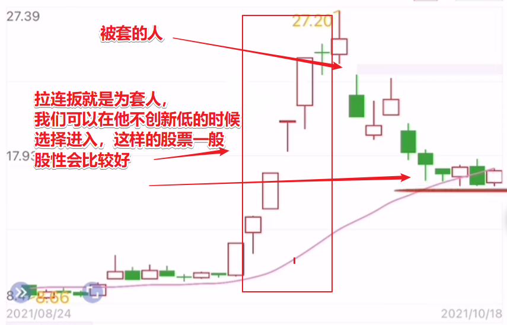
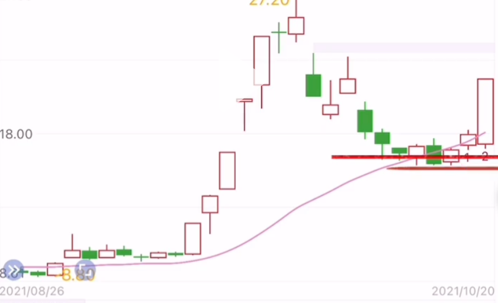
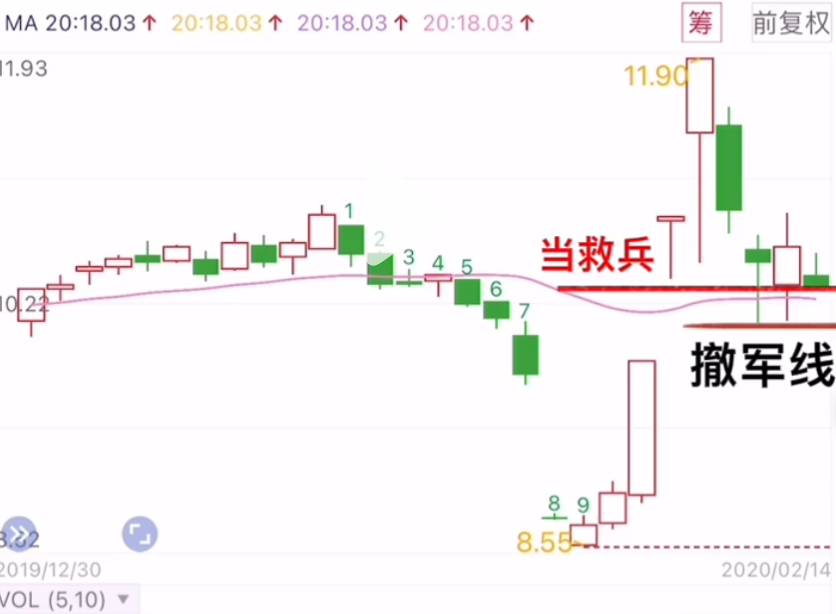
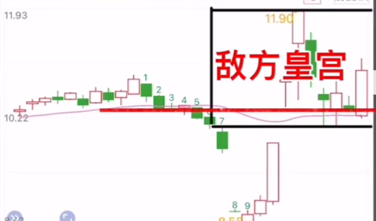

# 看清游资龙短板后的皇宫、后宫、宫外
在游资拉板之后，就是为了套人，我们可以在不创新低之后择机入场

游资龙后动在最危险

- 不要轻易碰3-4版的游资龙，易被深套
- 拉连板就是加速期，就是为了套人。
- 游资龙断板振幅达20-40%莫乱抄底
- 赌总龙头的概率只有百分之一。
- 连板期是多数新手或短线交易者的坟墓。
- 援军战法，务必严守撤军线，侥幸危险!

## 进场要素
- 前期拉连扳之后，大幅回撤
- 接连下跌之后，开始不创新低的时候，选择底部进入，找到止损位
- 跌破止损位出局，必须严格执行

<svg xmlns="http://www.w3.org/2000/svg" viewBox="0 0 620 400" font-family="'Microsoft YaHei','PingFang SC',sans-serif">
  <defs>
    <marker id="ar1" markerWidth="9" markerHeight="9" refX="8" refY="4.5" orient="auto">
      <path d="M0,0 L9,4.5 L0,9 z" fill="#64748b"/>
    </marker>
  </defs>
  <text x="310" y="34" text-anchor="middle" font-size="16" font-weight="bold" fill="#1e293b">援军战法进场三要素</text>
  <rect x="110" y="56" width="400" height="46" rx="8" fill="#eff6ff" stroke="#2563eb" stroke-width="1.5"/>
  <text x="310" y="84" text-anchor="middle" font-size="13" fill="#1e293b">① 前期拉连板之后，大幅回撤</text>
  <line x1="310" y1="102" x2="310" y2="128" stroke="#64748b" stroke-width="1.5" marker-end="url(#ar1)"/>
  <rect x="110" y="132" width="400" height="46" rx="8" fill="#fef3c7" stroke="#d97706" stroke-width="1.5"/>
  <text x="310" y="160" text-anchor="middle" font-size="13" fill="#1e293b">② 不创新低时底部进入，找到止损位</text>
  <line x1="310" y1="178" x2="310" y2="204" stroke="#64748b" stroke-width="1.5" marker-end="url(#ar1)"/>
  <rect x="110" y="208" width="400" height="46" rx="8" fill="#ecfdf5" stroke="#16a34a" stroke-width="1.5"/>
  <text x="310" y="236" text-anchor="middle" font-size="13" fill="#1e293b">③ 跌破止损位出局，严格执行</text>
  <rect x="110" y="290" width="400" height="48" rx="8" fill="#fef2f2" stroke="#dc2626" stroke-width="1.5"/>
  <text x="310" y="320" text-anchor="middle" font-size="13" fill="#1e293b">务必严守撤军线，侥幸危险！</text>
</svg>

*图：援军战法进场三要素示意（依正文整理）*

### 三联版就是诱多，可以止跌之后做救兵

## 皇宫区间的操作

- 这里有一个跳空高开的缺口，找到跳空之后止跌的地位，这就是一个止损线，
- 最高位就是一个压力位，压力位止损位，之间的区间会上下波动，我们把它看作地方的皇宫，如果突破皇宫大概率会被打回
- 我们在可以止损线边缘进入，逢高出货，逢低进场

---
> 🏷️ 本文属《投资知识库 · 03-交易系统与实战战法》，重排于 2026-11。
