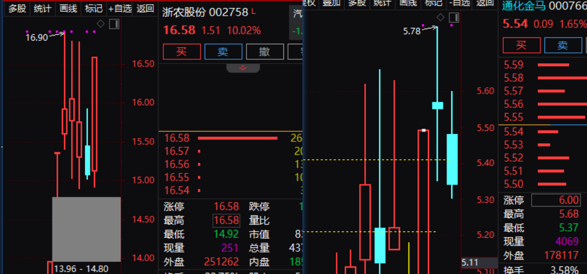
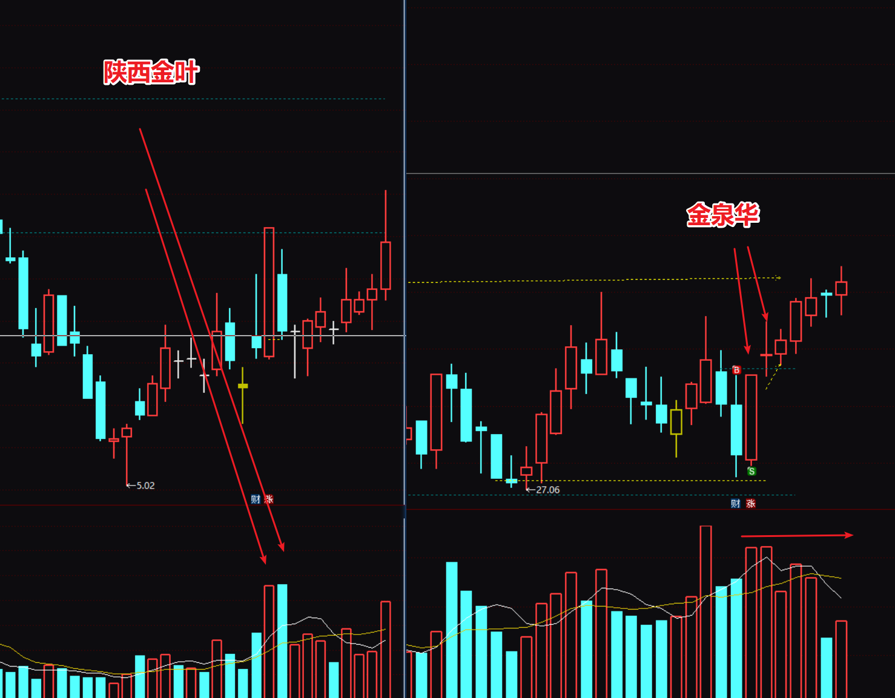
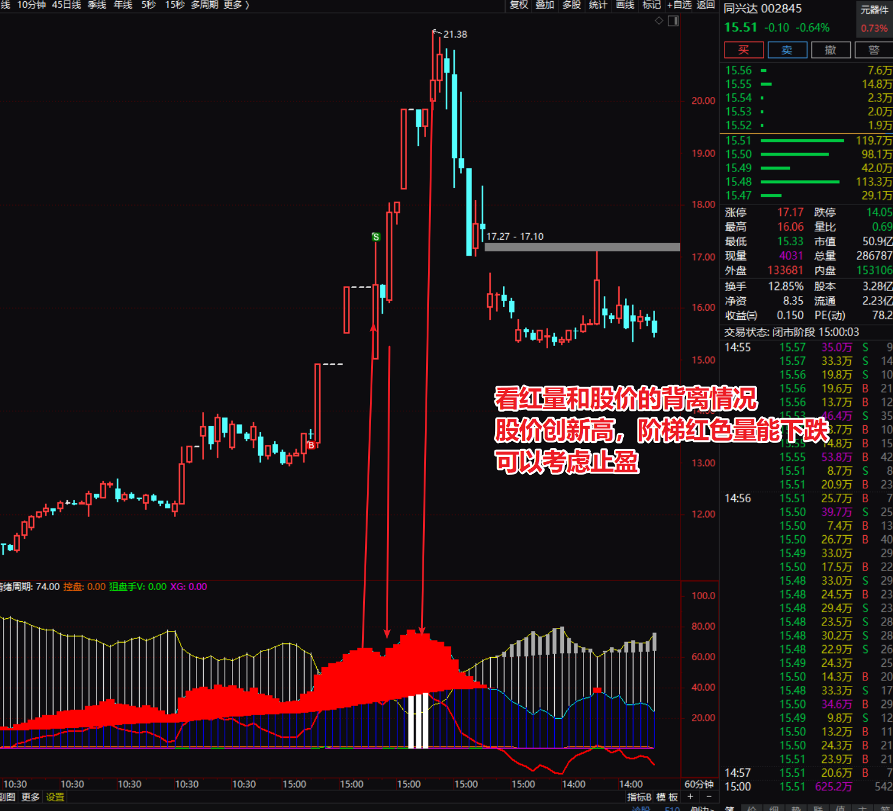
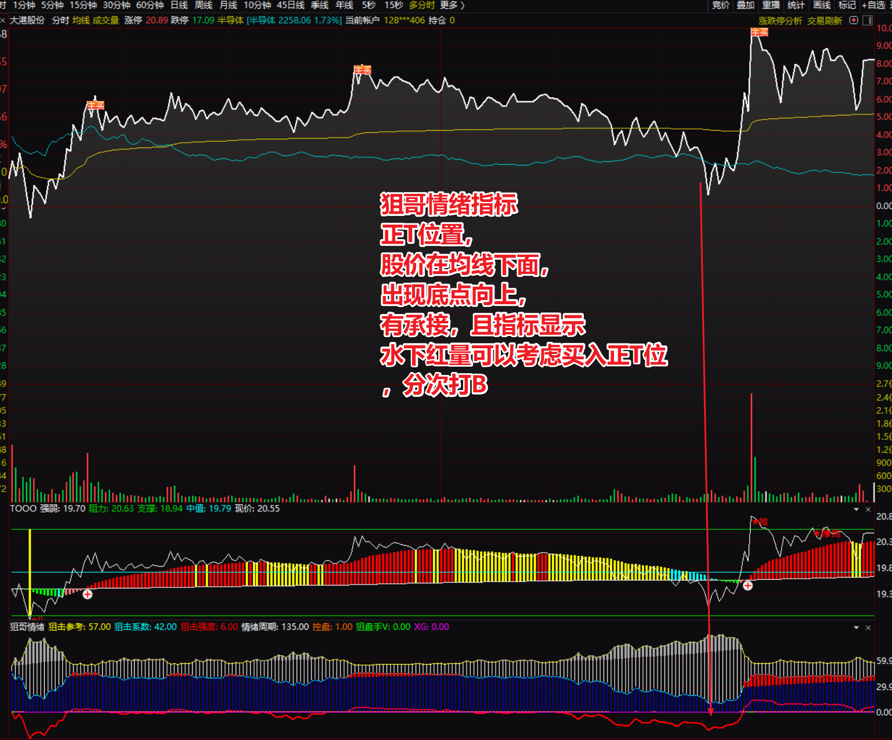
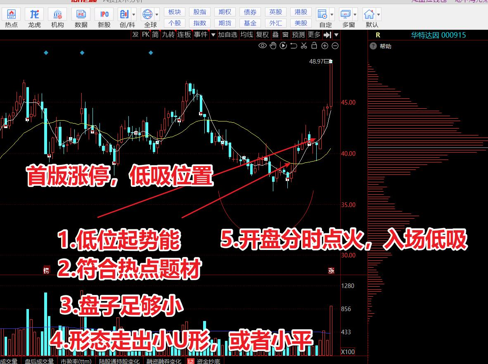

# 柚子手法知识点

## 首版(半路/或潜伏)手法知识点—个人总结（大兵）
股票上涨的唯一原因就是资金的推动，所以我们就需要找到资金认可的票，找到资金的操盘方式，在合适的位置入场,当然在这个市场上什么事情都不是百分百的，我们 要做的只是找到看得懂的，做好计划，多做

### 首版要点

## 1. 符合形态

## 2. 热点题材持续性判断

## 3. 日线量能，分时量能，合适的位置

4. 股价运行在五日均线附近（可以结合同花顺 **牛牛起飞M5/百哥牛牛** 指标，查看当日涨停的均价线是否出现牛牛,当日首版，次日溢价概率更高）

### 潜伏手法：
需要做的就是找到资金操作的痕迹，找好位置低吸挂单进去，找好止损位置。

在涨停后两天找到调整的低点，一般是大阳的顶部，中部，或者大阳突破了前期的压力位/缺口，则在前期的压力转支撑位置低吸进去，详细低吸手法用分时图找正T位的手法，潜伏期间做T正T，潜伏2-5天，跌破前低,则清仓

### 点火追半路：
在符合首版要点的前提之下，我们在资金启动前抓到他，分时点火的时候跟随资金进去做，但是容易遇到崇高回落，进攻买入应该选择保守的方式打B

常用的分多次B，点火的时候追1b,回踩均线的时候打2b 如果突破前高在打3B，如果大单非常坚决，则打入后续的，仓位依次由轻到重，如果冲高回落可以找正T位置打入2B 拉低均价，再尾盘前找机会打入3B 次日大概率可以体面离场

### 低吸手法：
结合boll轨道，在回踩boll中轨缩量收红的，或者打到前期支撑位置后，可以是长阳的底部，压力转支撑的上方，找机会低吸进去

### 常见的首版形态：
- 起势后盘整
    - 长红带量上攻（涨停也算，涨停次日缩量平量的更好），然后缩量盘整2-5天
- 平台突破
    - 容易走出底形，突破后的涨停
- 强势票回调
    - 长红中部/底部（涨停则更加好）强势票回调到长红的中部或者底部，伴随量能的缩减

### 常见胜率较高的形态：
低位其势，头顶三根香，最好突破前期压力位，则看为试盘线，参考浙农股份，

涨停次日缩量平量，这种票会非常安全

## 首版常见识别资金方式
- **游资首版单笔，多比 资金封板 次日 大阳的一半是支撑位**
- **低位首版次日杀人不用怕，短期会给机会解套,不用着急割肉**
    - 参考陕西金叶 20221028
- **低位首版炸板（甚至没有封），次日给溢价或者大利润出逃，票形后期看多，可以先找高点离场后 ，等股价止跌企稳，密切管**
    - 传艺科技 20221018 荣联科技 20221108
- **低位首版炸板未封住，次日杀人，短期有资金自救的行为，可以密切关注，止跌后埋伏，不能全仓，可以分仓做T应对**
    - 参考 亚太股份20221111 新华联 20221109

### 军哥心得
军哥：连扳票防止卖飞的心得，结合狙哥的连扳情绪指标，看红色量的阶梯增长，倘若红量下跌，股价在高位，则可以考虑卖出

军哥：ddx大单网站 http://ddx.gubit.cn/ddx.php?code=002771

军哥：分时查看连扳情绪指标看红色梯量延续情况，高点降低，短期看跌，股价在均线下面，出现红量，可以考虑找承接位置做正T

### 百哥心得
百善孝当先：看到大家都亏钱了不太开心授人以鱼，不如授人以渔，如何绕过庄家的长期洗盘刚起爆冒出头的时候就能锁定她？

百善孝当先：我常用的一点小心得给大家说说吧

百善孝当先：不是，就是一点小总结也是几个月不睡觉慢慢总结出来的，如果能帮到大家也很欣慰 百善孝当先：看票先看她的5日均，均线越翘好，前4日k比较光滑，分时上面看的话就是起势插过涨停均，有大单介入过它后更随介入就行了

百善孝当先：首板今日均线距离昨天收盘价翘的越高今日越有大概率涨停，最好均线角度向上发散，集合高开2个多点的票就看她的均最好高过昨日收盘价势头向上

百善孝当先：以及看分时角度速度和板块空间

百善孝当先：就这些吧目前

#### 王局低吸手法

- 看股价boll+ene找到回踩均线的位置
- 结合ddx ddy 查看资金潜伏情况 ？
- 做好止盈止损

---
> 🏷️ 本文属《投资知识库 · 04-游资与高手实录》，重排于 2026-11。
