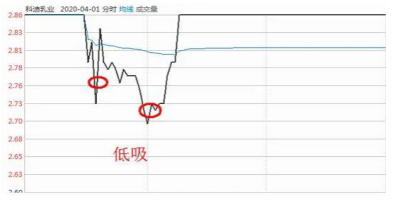
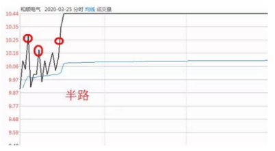
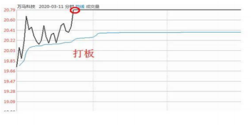

# 小鳄鱼

1. 对不同的行情有不同的手法主要分为，追板，分时点火，低吸潜伏，强势超跌反弹，波段搏主升，空仓
2. 核心还是主要依赖市场的热点题材股票，行情好的时候满仓做，追龙头。行情不好不追高，低吸为主，或者空仓。

熊市中空仓都是正确的，想管住自己的手也不容易，只能做一做超跌，也就是下跌一段时间后，板块再次大幅下挫的情况。技术分析主要用的是k线，成交量，均线和分时图的走势，其他的都不看。

3. 大局观、看指数、看热点、看主流、看个股、看盘口、节奏感、心态、买点的舒适感、通过仓位和交易策略来保持交易的主动性

## 4. **低位二板四种买入方式**

1. **低吸：**指的是首板次日分时图经过调整后刚刚开始拐头向上时买入。这种买入方式对未来的确定性低一些，但由于是在分时调整时买入的，所以买入位置不会太高，即使买错了一般不会出现较大的亏损。

    2. **半路：**指的是首板次日分时图开始向上进攻时买入。

这种买入方式一般不建议初学者尝试，属于三种买入方式中最难的一种。

    3. **打板：**指的是首板次日股价刚刚打板时买入，或者即将打板，还剩最后一档挂单时买入。

这种买入方式对于未来的确定性更高一些，但与之伴随的就是盘中炸板的风险。

    4. **竞价：**指的是集合竞价直接买入。

这种买入方式的优点在于不用为分时的波动而影响心态，从而错失比较有利的买入位置（往往很多机会自己是能够看懂的，就是因为内心的种种顾虑错失机会）。这种买入方式比较适用于盘前功课做得比较充分的投资者。

缺点是无法再根据盘面的情况随机应变了。四种买入方式半路、低吸、打板、竞价都是可行的，这个需要投资者根据具体市场环境决定。如下案例中这位投资者采取灵活分笔买入，收获三连板。

5. 具体细分可以将首板次日开盘情况分为以下几种情况

## 1. 开盘一字涨停板--可放弃

    2. 大幅高开后（7%及以上）缩量秒板--视情况而定

## 3. 大幅高开后（7%及以上）下杀--低吸、打板

## 4. 小幅高开（3%-7%）--低吸、打板、竞价

## 5. 平开、低开等--视情况而定

---
> 🏷️ 本文属《投资知识库 · 04-游资与高手实录》，重排于 2026-11。
