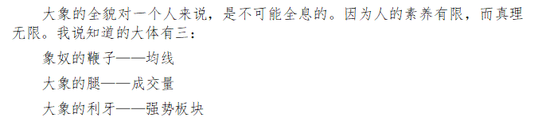

# 赵老哥

1. 不做反抽，不做波动，屌丝才爱逆袭。没有主升的龙头，就守候。有，就一击。

## 2. **交易一定要纯粹。**

做加法容易，做减法难

3. 大象战法
4. 牛市，震荡市，熊市，有不同的战法。大河用网，小河垂钓。不同的环境，不同的渔

## 5. 成交量处于衰减状态下时，即无力难振，不重仓

## 6. 大盘处于5日线下时，绝对不宜重仓

7. 一旦轻仓被套，不可贸然补仓，每轮高点下行通常是20－30％一波段，在拉开空间之后再补仓，不可跌一点补一点，子弹早早打完。

---
> 🏷️ 本文属《投资知识库 · 04-游资与高手实录》，重排于 2026-11。
