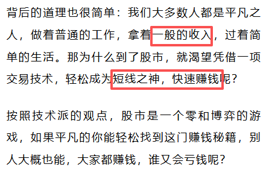

# 中国经济如何发展

## 十五五规划主要解决什么问题

1. AI如何应用到行业中，软件行业应该会发展起来

## 哪些行业可以带来经济发展，哪些行业会成为未来的蓝海

1. 量子计算，脑机接口
2. 新能源
3. 人工智能
4. 生物制造
5. 机器人

## 预计迎来爆发的产业

- 机器人产业（预计规模达 4000 亿）
- 新能源车（占有率将达七成）
- 低空经济（迎来爆发增长）
- 高端医疗市场（规模将达 3000 亿美元）
- 工艺软件产业
- 5G 产业

## 夕阳产业

夕阳产业则包括**房地产、低端制造业和传统煤电行业**。

---
> 🏷️ 本文属《投资知识库 · 05-宏观与行业底层逻辑》，重排于 2026-11。
