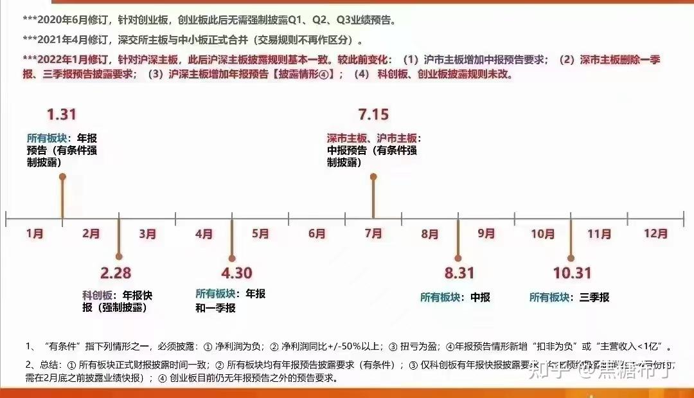

# 财报披露

以下是截至2025年10月的A股上市公司财报、预告、快报发布时间的详细总结，以表格形式呈现：

## A股财报、预告、快报发布时间总表（2025年版）

| **类型** | **主板（沪深）** | **创业板/科创板** | **北交所** |
| --- | --- | --- | --- |
| **年报** | 次年4月30日前披露 | 次年4月30日前披露 | 次年6月30日前披露 |
| **半年报** | 8月31日前披露 | 8月31日前披露 | 8月31日前披露 |
| **一季报** | 4月30日前披露 | 4月30日前披露 | 4月30日前披露 |
| **三季报** | 10月31日前披露 | 10月31日前披露 | 10月31日前披露 |
| **年度业绩预告** | 1月31日前披露（2025年因春节提前至1月27日） | 1月31日前披露（2025年因春节提前至1月27日） | 1月31日前披露 |
| **半年度业绩预告** | 7月15日前披露（触发条件：净利润为负、扭亏为盈、同比±50%以上，且上一年半年度EPS＞0.03元） | 自愿披露（无强制要求） | 自愿披露（无强制要求） |
| **季度业绩预告** | 深主板：4月15日前（一季度）、10月15日前（三季度）披露（触发条件同半年度） | 自愿披露（无强制要求） | 自愿披露（无强制要求） |
| **年度业绩快报** | 若一季报早于年报披露，需在2月底前披露 | 若年报预告在3-4月披露，需在2月底前披露 | 若年报无法在2个月内披露，需在2月底前披露 |
| **半年度/季度快报** | 自愿披露（无强制要求） | 自愿披露（无强制要求） | 自愿披露（无强制要求） |

*图：财报披露关键时间轴（2025年版，示意）*

<svg xmlns="http://www.w3.org/2000/svg" viewBox="0 0 720 230" font-family="'Microsoft YaHei','PingFang SC',sans-serif">
  <text x="360" y="24" text-anchor="middle" font-size="16" font-weight="bold" fill="#1e293b">A股财报披露关键时间轴（2025年版）</text>
  <line x1="40" y1="100" x2="680" y2="100" stroke="#94a3b8" stroke-width="1.5"/>
  <circle cx="60" cy="100" r="5" fill="#d97706"/>
  <circle cx="180" cy="100" r="5" fill="#2563eb"/>
  <circle cx="300" cy="100" r="5" fill="#dc2626"/>
  <circle cx="420" cy="100" r="5" fill="#2563eb"/>
  <circle cx="540" cy="100" r="5" fill="#2563eb"/>
  <circle cx="660" cy="100" r="5" fill="#2563eb"/>
  <text x="60" y="58" text-anchor="middle" font-size="14" font-weight="bold" fill="#1e293b">1月31日</text>
  <text x="60" y="76" text-anchor="middle" font-size="12" fill="#475569">年度业绩预告</text>
  <text x="180" y="124" text-anchor="middle" font-size="14" font-weight="bold" fill="#1e293b">2月底</text>
  <text x="180" y="142" text-anchor="middle" font-size="12" fill="#475569">业绩快报（特定情形）</text>
  <text x="300" y="58" text-anchor="middle" font-size="14" font-weight="bold" fill="#dc2626">4月30日</text>
  <text x="300" y="76" text-anchor="middle" font-size="12" fill="#475569">年报 + 一季报</text>
  <text x="420" y="124" text-anchor="middle" font-size="14" font-weight="bold" fill="#1e293b">7月15日</text>
  <text x="420" y="142" text-anchor="middle" font-size="12" fill="#475569">半年度业绩预告（主板）</text>
  <text x="540" y="58" text-anchor="middle" font-size="14" font-weight="bold" fill="#1e293b">8月31日</text>
  <text x="540" y="76" text-anchor="middle" font-size="12" fill="#475569">半年报</text>
  <text x="660" y="124" text-anchor="middle" font-size="14" font-weight="bold" fill="#1e293b">10月31日</text>
  <text x="660" y="142" text-anchor="middle" font-size="12" fill="#475569">三季报</text>
  <rect x="20" y="175" width="680" height="40" rx="8" fill="#fef2f2" stroke="#dc2626" stroke-width="1.5"/>
  <text x="360" y="200" text-anchor="middle" font-size="13" fill="#1e293b">北交所年报可延至6月30日；逾期未披露可能触发退市风险警示（*ST）或直接退市</text>
</svg>

## 关键规则解析

### 一、财报披露时间

1. **年报**
    - 主板、创业板、科创板需在次年4月30日前披露，北交所延长至6月30日。
    - 若未能按时披露，可能触发退市风险警示（*ST）或直接退市。
2. **半年报**
    - 所有板块均需在8月31日前披露，逾期将面临证监会立案调查及交易所处罚。
3. **季报**
    - 一季报和三季报分别在4月30日和10月31日前披露，未按时披露可能导致股价异常波动。

### 二、业绩预告规则

1. **强制披露情形（年度）**
    - 净利润为负、扭亏为盈、同比±50%以上（主板上一年EPS＞0.05元，创业板/科创板＞0.03元）。
    - 营收扣除后低于3亿元（主板）或1亿元（创业板/科创板）且净利润为负。
    - 期末净资产为负或被实施退市风险警示后的首个会计年度。
2. **豁免条款**
    - 主板：上一年度EPS≤0.05元（年度）或半年度EPS≤0.03元（半年度）可免于披露。
    - 创业板/科创板：无特殊豁免，仅触发条件时强制披露。
3. **修正要求**
    - 实际业绩与预告差异超50%、盈亏方向错误或涉及退市指标变化时，需在1月31日前更正。

### 三、业绩快报规则

1. **强制披露情形**
    - 主板：一季报早于年报披露时，需在2月底前披露快报。
    - 创业板：若年报预告在3-4月披露，需在2月底前披露快报。
    - 北交所：若年报无法在2个月内披露，需在2月底前披露快报。
2. **修正要求**
    - 实际数据与快报差异超20%或盈亏方向变化时，需及时发布修正公告。

### 四、特殊情形处理

1. **节假日调整**
    - 2025年春节假期（1月28日-1月31日）导致年报预告截止日提前至1月27日。
2. **窗口期限制**
    - 董监高在预告/快报公告前5日内不得买卖公司股票。
    - 回购股份、股权激励授予等操作需避开预告/快报窗口期。

## 投资者关注点

1. **风险预警**
    - 关注**1月31日的年报预告**和**4月30日的年报披露**，及时规避净利润为负、净资产为负或营收扣除后不足标的。
    - 北交所公司需额外关注**6月30日的年报披露风险**。
2. **业绩波动**
    - 主板公司若在7月15日前未发布半年度预告，可能预示业绩稳定或基数较小（EPS≤0.03元）。
    - 创业板公司自愿披露的半年度预告可能反映业绩超预期或低于预期，需结合市场预期判断。
3. **信息不对称**
    - 关注**2月底的业绩快报**，尤其是主板公司一季报早于年报披露的情形，可提前获取年度财务数据。
    - 北交所公司若未在2月底前发布快报，可能暗示年报编制存在不确定性。

## 政策导向

1. **注册制深化**
    - 创业板/科创板取消半年度预告强制要求，强化市场化信息披露机制。
    - 北交所与沪深规则接轨，提升信息披露时效性。
2. **退市常态化**
    - 财报披露不及时或虚假记载可能直接触发退市，如**2024年多家公司因未按时披露半年报被强制退市**。
    - 业绩预告修正频繁的公司需警惕财务造假风险。

## 数据影响

- **退市率提升**：2024年因财报披露问题退市公司达**42家**，预计2025年将进一步增加。
- **股价波动**：业绩预告修正公告发布后，公司股价平均单日波动幅度达**±8.2%**。

## 总结

A股财报、预告、快报的发布时间和规则因板块而异，投资者需根据目标公司所属板块，重点关注**关键时间节点和触发条件**，以规避风险并把握投资机会。同时，政策层面持续强化信息披露监管，推动市场向规范化、透明化发展。

---

> 🏷️ 本文属《投资知识库 · 06-选股基金与量化》，重排于 2026-11。
