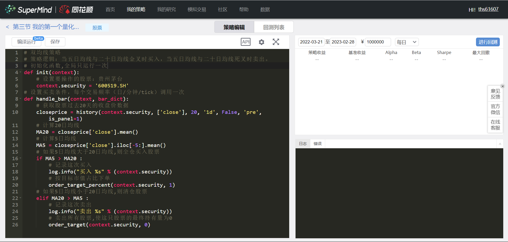
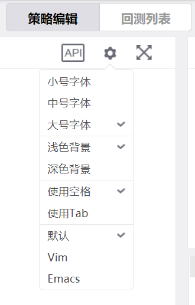
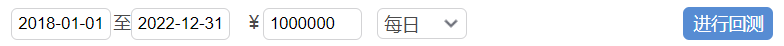
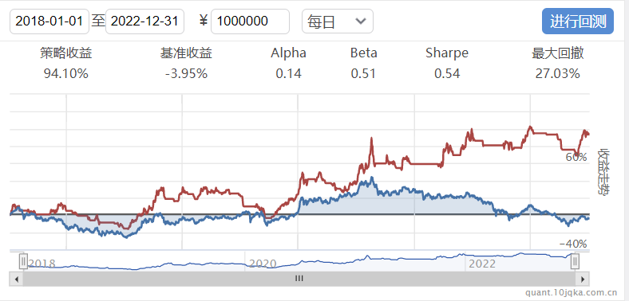
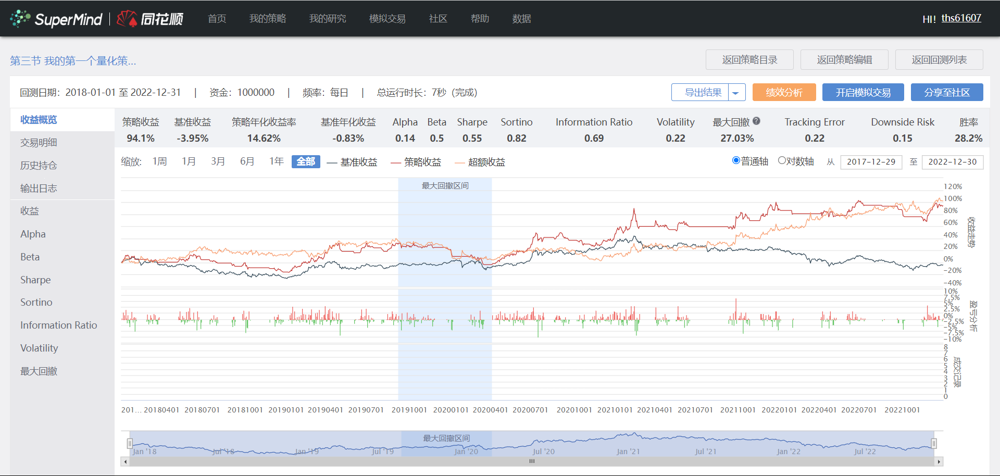
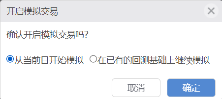
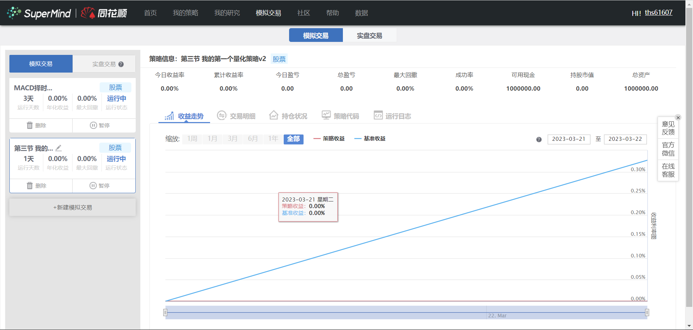
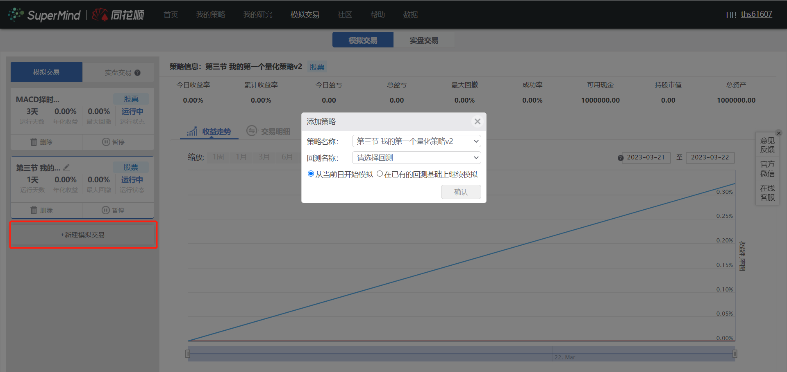

# 编写第一个量化策略

对于大部分人来说，量化交易是非常陌生与神秘的。本节内容将带你开启第一个量化策略！

本节内容摘要：

1. 理解量化策略的基本框架
2. 学会编写一个简单的量化交易策略
3. 学会回测量化交易策略

> 注：本文档源自讲义导出，部分列表文字在原文中即已残缺（仅存首字），重排时按原样保留。

## 一、理解量化策略的基本框架

通常情况下，完整的量化交易策略至少需要确定两件事：

A. **交易标的**，即买什么；

B. **确定交易时机**，即怎么买卖。

让我们来设计一个简单完整的量化交易策略：

- 策略交易标的：贵州茅台；
- 策略交易时机：5日均线与20日均线金叉时，买入；5日均线与20日均线死叉时，卖出。

*图：双均线策略的执行流程（示意）*

<svg xmlns="http://www.w3.org/2000/svg" viewBox="0 0 720 180" font-family="'Microsoft YaHei','PingFang SC',sans-serif">
  <defs>
    <marker id="arw1" markerWidth="8" markerHeight="8" refX="7" refY="3" orient="auto">
      <path d="M0,0 L7,3 L0,6 Z" fill="#94a3b8"/>
    </marker>
  </defs>
  <rect x="25" y="56" width="200" height="56" rx="8" fill="#eff6ff" stroke="#2563eb" stroke-width="1.5"/>
  <text x="125" y="80" text-anchor="middle" font-size="13" fill="#1e293b">获取过去20日收盘价</text>
  <text x="125" y="100" text-anchor="middle" font-size="12" fill="#475569">history(...)</text>
  <line x1="225" y1="84" x2="255" y2="84" stroke="#94a3b8" stroke-width="1.5" marker-end="url(#arw1)"/>
  <rect x="255" y="56" width="200" height="56" rx="8" fill="#eff6ff" stroke="#2563eb" stroke-width="1.5"/>
  <text x="355" y="80" text-anchor="middle" font-size="13" fill="#1e293b">计算 5 日 / 20 日均线</text>
  <text x="355" y="100" text-anchor="middle" font-size="12" fill="#475569">mean() / iloc[-5:]</text>
  <line x1="455" y1="84" x2="485" y2="84" stroke="#94a3b8" stroke-width="1.5" marker-end="url(#arw1)"/>
  <rect x="485" y="56" width="210" height="56" rx="8" fill="#fffbeb" stroke="#d97706" stroke-width="1.5"/>
  <text x="590" y="80" text-anchor="middle" font-size="13" fill="#1e293b">判断均线关系</text>
  <text x="590" y="100" text-anchor="middle" font-size="12" fill="#475569">金叉 / 死叉</text>
  <line x1="590" y1="112" x2="590" y2="132" stroke="#94a3b8" stroke-width="1.5" marker-end="url(#arw1)"/>
  <rect x="230" y="132" width="460" height="40" rx="8" fill="#f0fdf4" stroke="#16a34a" stroke-width="1.5"/>
  <text x="460" y="157" text-anchor="middle" font-size="13" fill="#1e293b">MA5 &gt; MA20 → 买入；MA20 &gt; MA5 且有持仓 → 清仓卖出</text>
</svg>

## 二、学会编写一个简单的量化交易策略

### 第一步：进入策略编译器

打开 SuperMind 量化交易平台，先在上方导航栏点击"我的策略"—"策略编译"，再点击蓝色按钮"+新建策略"，接着点击已创建的策略进入策略编译器页面，如下：



温馨提示："回测列表"下方三个按钮，可以设置编译器字体大小，背景颜色，编译设置，开启全屏编译，查看API文档，如下：



### 第二步：理解量化交易策略框架对应的代码框架

In [ ]:

```plain
def init(context):
    #初始化函数：确定交易标的
def handle_bar(context, bar_dict):    
    #定时运行函数：确定交易时机
```

框架理解：

1. d
2. d
3. “

### 第三步：确定交易标的

确定交易标的：`context.security = '600519.SH'`。

温馨提示：

1. c
2. c

In [ ]:

```plain
def init(context):
    context.security = '600519.SH'#已确定交易标的
def handle_bar(context, bar_dict):   
    #定时运行函数：确定交易时机
```

### 第四步：确定交易时机

确定交易时机，即为：5日均线与20日均线金叉时，买入；5日均线与20日均线死叉时，卖出。

从交易时机出发，我们需要计算交易标的5日和20日均线，那么5、20日均线需要用历史行情数据的收盘价来计算。

整个流程即：获取历史行情20日的收盘价数据———计算5、20日均线———判断5、20日均线，进行买卖交易。

**A. 获取历史行情20日的收盘价数据**

1. 找
2. 填

i. 交易标的，即：获取哪个股票的数据。
ii. 数据字段：['close']收盘价，即：获取哪个数据。
iii. 输入历史长度，即：获取多长时间的数据。
iv. 获取数据的时间步长，即：获取日线级步长数据。
v. 填写是否跳过停牌数据，复权选项，返回数据格式。

最终结果即为：`history(context.security, ['close'], 20, '1d', False, 'pre', is_panel=1)`

3. 将

In [ ]:

```plain
#获取证券过去20日的收盘价数据            
closeprice = history(context.security, ['close'], 20, '1d', False, 'pre', is_panel=1)
```

**B. 计算5、20日均线**

1. 获
2. 选

i. `iloc[:]` 是获取所有数据。
ii. `iloc[:x]` 是从第一个获取到第 x 个，不包括第 x 个。
iii. `iloc[x:y]` 是从第 x 个到第 y 个，包括 x，但不包括 y。
iv. `iloc[-x:]` 获取倒数第 x 个到最后一个数据。

3. 计

In [ ]:

```plain
#计算二十日均线价格            
MA20 = closeprice['close'].mean()
#计算五日均线价格        
MA5 = closeprice['close'].iloc[-5:].mean()
```

**C. 判断5、20日均线，进行买卖交易（买入）**

1. i
2. 当
3. 下

i. 当触发 MA5 大于 MA20 时，我们需要买入股票，这时候我们可以使用 order_target_percent 下单函数，该函数以目标市值占比下单。
ii. 输入下单函数的参数，order_target_percent 函数需要输入两个参数：
1. 下
2. 下
iii. 触发条件后程序提醒，当代码执行完下单函数后，我们用 log.info() 来打印日志，这样我们也可以看到程序下单了。

温馨提示：log.info() 内你可以直接输入中文，例如：`log.info('条件满足！买入贵州茅台啦！')`

In [ ]:

```plain
# 如果5日均线大于20日均线,则全仓买入股票
if MA5 > MA20:            
    # 按目标市值占比下单
    order_target_percent(context.security, 1)
    # 记录这次买入
    log.info("买入 %s" % (context.security))
```

**D. 判断5、20日均线，进行买卖交易（卖出）**

4. 下

i. 当触发 MA5 小于 MA20 时，我们需要卖出股票，这时候我们可以使用 order_target 下单函数，该函数以目标股数下单。
ii. 输入下单函数的参数，order_target 函数需要输入两个参数：
1. 下
2. 下
iii. 触发条件后程序提醒，当代码执行完下单函数后，我们同 log.info() 来打印日志，这样我们也可以看到程序下单了。

In [ ]:

```plain
# 如果5日均线小于20日均线,并且目前有头寸,则清仓股票
elif MA20 > MA5 and context.portfolio.stock_account.market_value > 0:
    # 卖出所有股票,使这只股票的最终持有量为0
    order_target(context.security, 0)
    # 记录这次卖出
    log.info("卖出 %s" % (context.security))
```

**最终结果：**

In [ ]:

```plain
#最终结果：

# 双均线策略
# 策略逻辑：当五日均线与二十日均线金叉时买入，当五日均线与二十日均线死叉时卖出。
# 初始化函数,全局只运行一次
def init(context):
    # 设置要操作的股票：贵州茅台
    context.security = '600519.SH'
# 设置买卖条件，每个交易频率（日/分钟/tick）调用一次
def handle_bar(context, bar_dict):
    # 获取股票过去20天的收盘价数据
    closeprice = history(context.security, ['close'], 20, '1d', False, 'pre', is_panel=1)
    # 计算20日均线
    MA20 = closeprice['close'].mean()
    # 计算5日均线
    MA5 = closeprice['close'].iloc[-5:].mean()
    # 如果5日均线大于20日均线,则全仓买入股票
    if MA5 > MA20 :
        # 按目标市值占比下单
        order_target_percent(context.security, 1)
        # 记录这次买入
        log.info("买入 %s" % (context.security))
    # 如果5日均线小于20日均线,并且目前有头寸,则清仓股票
    elif MA20 > MA5 and context.portfolio.stock_account.market_value > 0:
        # 卖出所有股票,使这只股票的最终持有量为0
        order_target(context.security, 0)
        # 记录这次卖出
        log.info("卖出 %s" % (context.security))
```

## 三、回测量化交易策略

通过以上 4 步，我们已经完成了量化交易策略编写，那么接下来我们需要进行量化交易策略回测。

**A. 首先，我们尝试去跑通整个历史行情，排查代码错误。**

i. 右上角设置回测历史长度，设置资金，设置交易频率。



ii. 点击左上角"编译运行"按钮，右边出现量化交易策略在历史行情中的表现情况



**B. 当量化交易策略能跑通整个历史行情后，我们可以确定该代码正确无误，随后点击右上角蓝色按钮"进行回测"。**

页面跳转至回测页面，在回测详情界面，您可以查看策略收益曲线，风险指标，每日持仓，交易明细，输出日志等信息，如下：



**C. 学会将量化交易策略绑定实盘模拟交易，并实时收到交易策略的买卖信号**

1. 在



2. 至



3. 您



---
> 🏷️ 本文属《投资知识库 · 06-选股基金与量化》，重排于 2026-11。
