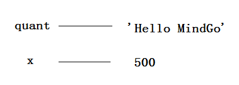

# Python介绍

> 注：本文档源自讲义导出，个别列表文字在原文中即已残缺（仅存首字），重排时按原样保留。

## 一、Python简介

Python是一种计算机程序设计语言。你可能已经听说过很多种流行的编程语言，比如非常难学的C语言，非常流行的Java语言，适合初学者的Basic语言，适合网页编程的JavaScript语言等等。

那Python是一种什么语言？

Python 的创史人 Guido van Rossum，1989年在荷兰创造了python，网络流传是因为他喜欢英国肥皂剧《Monty Python 飞行马戏团》，所以用python来命名。语言分为编译型语言和解释型语言，python 是一门解释型语言，何为解释型语言；

编译型语言：c、c++等 解释型语言有：Python、Php等

以下表格是两类语言的优缺点介绍：

| **语言** | **优点** | **缺点** |
| :--- | :--- | :--- |
| 解释型语言 | 可跨平台、开发效率高 | 运行效率低 |
| 编译型语言 | 依赖编译平台，不能跨平台，开发效率低 | 运行效率高 |

比如，完成同一个任务，C语言要写1000行代码，Java只需要写100行，而Python可能只要20行。

所以Python是一种相当高级的语言。

你也许会问，代码少还不好？代码少的代价是运行速度慢，C程序运行1秒钟，Java程序可能需要2秒，而Python程序可能就需要10秒。

那是不是越低级的程序越难学，越高级的程序越简单？表面上来说，是的，但是，在非常高的抽象计算中，高级的Python程序设计也是非常难学的，所以，高级程序语言不等于简单。

但是，对于初学者和完成普通任务，Python语言是非常简单易用的。连Google都在大规模使用Python，你就不用担心学了会没用。

## 二、第一个Python程序

作为初学者，学习一门新语言，尝试写一个程序，可以快速进入状态，第一个程序叫'Hello MindGo'。在Python中，它是这个样子：

In [10]:

```plain
print('Hello MindGo')
```

```plain
Hello MindGo
```

这是print()语句的一个示例。print并不会真的往纸上打印文字，而是在屏幕上输出值。程序中引号内的内容表示需要输出的内容，而引号在输出结果中并不显示。

print()语句也可以跟上多个字符串，用逗号","隔开，就可以连成一串输出：

In [13]:

```plain
print ('This', 'is', 'an','apple')
```

```plain
This is an apple
```

print()也可以打印整数，或者计算结果：

In [14]:

```plain
print(300)
```

```plain
300
```

In [15]:

```plain
print(100 + 200)
```

```plain
300
```

让我们可以把计算100 + 200的过程和结果都打印出来试试：

In [18]:

```plain
print('100 + 200 =', 100 + 200)
```

```plain
100 + 200 = 300
```

## 三、变量

编程语言最强大的功能之一是操作变量的能力。变量是指向一个值的名称。

赋值语句可以建立新的变量，并给他们赋值：

In [20]:

```plain
quant = 'Hello MindGo'
x = 500
```

这个例子有两个赋值。第一个将字符串'Hello MindGo'赋值给一个叫做quant的变量；第二个将500赋值给x。

他的状态图如下所示：



## 四、两项基本操作

了解下面两个基本操作对后面的学习是有好处的：

1. 基

可以在Python中使用+、-、*、/直接进行四则运算。

In [22]:

```plain
1+3*3
```

Out[22]:

```plain
10
```

2. 导

使用import可以导入模块，导入之后，就可以使用这个模块下面的函数了。

比如导入math模块，然后使用math模块下面的sqrt函数：

In [24]:

```plain
import math
math.sqrt(9)
```

Out[24]:

```plain
3.0
```

这时你可能会有疑问：

"每次引用函数的时候，math这个模块前缀都要带吗？可不可以不带？"

直接输入sqrt(9)是会报错的，好烦人，那么有什么办法可以不用每次都带前缀？

办法是有的，用"from 模块 import 函数"的格式先把函数给"拿"出来。

In [25]:

```plain
from math import sqrt
sqrt(9)
```

Out[25]:

```plain
3.0
```

这样每次使用sqrt函数的时候就不用再加math前缀了。又有了一个问题？

"math模块下面有那么多函数，可不可以写一个语句，然后math下面所有函数都可以直接使用？"

调用了math下面的sqrt函数，写一个from…import…，再调用下面的floor，还要写一个，如此也挺麻烦的，有个办法可以一下把所有函数都给"拿"出来：

In [26]:

```plain
from math import *
print(sqrt(9))
print(floor(32.9))
```

```plain
3.0
32
```

---
> 🏷️ 本文属《投资知识库 · 06-选股基金与量化》，重排于 2026-11。
