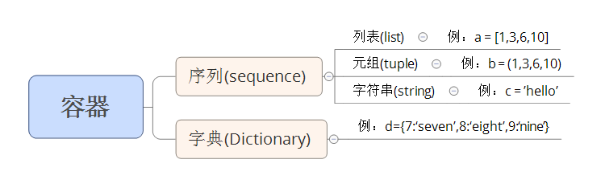
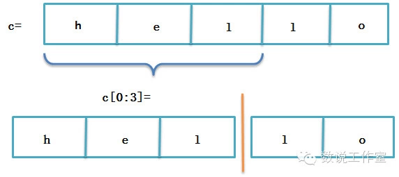
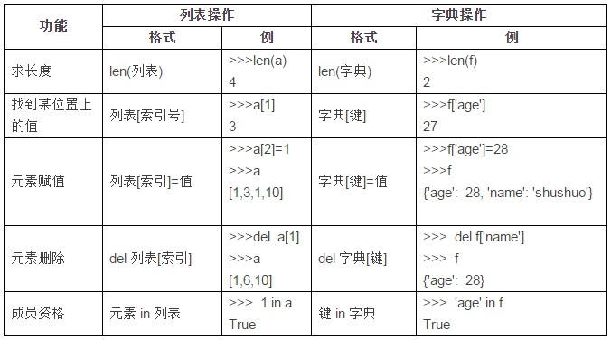

# Python数据类型

## 第二节：数据类型

### 一、什么是数据结构

开始学Python时，经常会被它的数据结构，什么字典、序列、元组等等搞的很混乱，因此有必要梳理清楚**数据结构**的概念。

首先要从**容器**说起，Python中有一种名为容器的数据结构，顾名思义，容器，就是装数据的器具，它主要包括**序列**和**词典**，其中序列又主要包括**列表、元组、字符串**等，如下图：



列表的基本形式比如：[1,3,6,10]或者[‘yes’,’no’,’OK’]

元组的基本形式比如：(1,3,6,10)或者(‘yes’,’no’,’OK’)

字符串的基本形式比如：'Hello '

以上几种属于**序列**，序列中的每一个元素都被分配一个序号——即元素的位置，也称为“索引”，第一个索引，即第一个元素的位置是0，第二个是1，依次类推。**列表和元组的区别主要在于，列表可以修改，而元组不能**（注意列表用中括号而元组用括号）。

序列的这个特点，使得我们可以利用索引来访问序列中的某个或某几个元素，比如：

In [1]:

```plain
a=[1,3,6,10]
a[2]
```

Out[1]:

6

In [2]:

```plain
b=(1,3,6,10)
b[2]
```

Out[2]:

6

In [3]:

```plain
c='hello'
c[0:3]
```

Out[3]:

'hel'

而与序列对应的“**字典**”则不一样，它是一个**无序**的容器：

它的基本形式比如：d={7:‘seven’,8:‘eight’,9:‘nine’}

这是一个“键—值”映射的结构，因此**字典不能通过索引来访问其中的元素，而要根据键来访问**其中的元素：

In [4]:

```plain
d={7:'seven',8:'eight',9:'nine'}
d[8]
```

Out[4]:

'eight'

*图：Python 容器结构——序列与字典（示意）*

<svg xmlns="http://www.w3.org/2000/svg" viewBox="0 0 720 270" font-family="'Microsoft YaHei','PingFang SC',sans-serif">
  <defs>
    <marker id="arw" markerWidth="8" markerHeight="8" refX="7" refY="3" orient="auto">
      <path d="M0,0 L7,3 L0,6 Z" fill="#94a3b8"/>
    </marker>
  </defs>
  <rect x="290" y="16" width="140" height="40" rx="8" fill="#eff6ff" stroke="#2563eb" stroke-width="1.5"/>
  <text x="360" y="41" text-anchor="middle" font-size="14" fill="#1e293b">Python 容器</text>
  <line x1="340" y1="58" x2="240" y2="90" stroke="#94a3b8" stroke-width="1.5" marker-end="url(#arw)"/>
  <line x1="380" y1="58" x2="560" y2="90" stroke="#94a3b8" stroke-width="1.5" marker-end="url(#arw)"/>
  <rect x="125" y="92" width="200" height="40" rx="8" fill="#eff6ff" stroke="#2563eb" stroke-width="1.5"/>
  <text x="225" y="117" text-anchor="middle" font-size="14" fill="#1e293b">序列：有序，按索引访问</text>
  <rect x="470" y="92" width="210" height="40" rx="8" fill="#eff6ff" stroke="#2563eb" stroke-width="1.5"/>
  <text x="575" y="117" text-anchor="middle" font-size="14" fill="#1e293b">字典：无序，按键访问</text>
  <line x1="225" y1="132" x2="95" y2="176" stroke="#94a3b8" stroke-width="1.5" marker-end="url(#arw)"/>
  <line x1="225" y1="132" x2="225" y2="176" stroke="#94a3b8" stroke-width="1.5" marker-end="url(#arw)"/>
  <line x1="225" y1="132" x2="355" y2="176" stroke="#94a3b8" stroke-width="1.5" marker-end="url(#arw)"/>
  <line x1="575" y1="132" x2="575" y2="176" stroke="#94a3b8" stroke-width="1.5" marker-end="url(#arw)"/>
  <rect x="20" y="180" width="150" height="40" rx="8" fill="#eff6ff" stroke="#2563eb" stroke-width="1.5"/>
  <text x="95" y="205" text-anchor="middle" font-size="13" fill="#1e293b">列表 [1,3,6,10]</text>
  <rect x="185" y="180" width="150" height="40" rx="8" fill="#eff6ff" stroke="#2563eb" stroke-width="1.5"/>
  <text x="260" y="205" text-anchor="middle" font-size="13" fill="#1e293b">元组 (1,3,6,10)</text>
  <rect x="350" y="180" width="150" height="40" rx="8" fill="#eff6ff" stroke="#2563eb" stroke-width="1.5"/>
  <text x="425" y="205" text-anchor="middle" font-size="13" fill="#1e293b">字符串 'Hello '</text>
  <rect x="530" y="180" width="170" height="40" rx="8" fill="#eff6ff" stroke="#2563eb" stroke-width="1.5"/>
  <text x="615" y="205" text-anchor="middle" font-size="13" fill="#1e293b">按键访问 d[8]</text>
  <text x="95" y="242" text-anchor="middle" font-size="12" fill="#475569">可修改</text>
  <text x="260" y="242" text-anchor="middle" font-size="12" fill="#475569">不可修改</text>
  <text x="425" y="242" text-anchor="middle" font-size="12" fill="#475569">索引从 0 开始</text>
  <text x="615" y="242" text-anchor="middle" font-size="12" fill="#475569">d[8] → 'eight'</text>
</svg>

### 二、序列的一些通用操作

除了上面说到的索引，列表、元组、字符串等这些序列还有一些共同的操作。

**1.** 序列的最后一个元素的索引，也可以是-1，倒数第二个也可以用-2，依次类推：

In [5]:

```plain
a=[1,3,6,10]
print(a[3])
print(a[-1])
```

```plain
10
10
```

**2.** 使用分片操作来访问一定范围内的元素，它的格式为：

`a[开始索引:结束索引:步长]`

那么访问的是，从开始索引号的那个元素，到结束索引号-1的那个元素，每间隔步长个元素访问一次，步长可以忽略，默认步长为1。

In [ ]:

```plain
c='hello'
c[0:3]
```

这个就好像把一个序列给分成几片几片的，所以叫做“**分片**”。



**3.序列相加**

即两种序列合并在一起，**两种相同类型的序列才能相加**。

In [7]:

```plain
[1,2,3]+[4,5,6]
```

Out[7]:

[1, 2, 3, 4, 5, 6]

In [8]:

```plain
'hello,'+'MindGo'
```

Out[8]:

'hello,MindGo'

**4.成员资格**

为了检查一个值是否在序列中，可以用**in运算符**。

In [10]:

```plain
a='hello'
print('o' in a)
print('t' in a)
```

```plain
True
False
```

### 三、列表操作

以上是序列共有的一些操作，列表也有一些自己独有的操作，这是其他序列所没有的。

**1.List函数**

可以通过list(序列)函数把一个序列转换成一个列表：

In [11]:

```plain
list('hello')
```

Out[11]:

['h', 'e', 'l', 'l', 'o']

**2.元素赋值、删除**

元素删除——del a[索引号]

元素赋值——a[索引号]=值

In [15]:

```plain
a='hello'
b=list(a)
print(b)
```

```plain
['h', 'e', 'l', 'l', 'o']
```

In [16]:

```plain
del b[2]
print(b)
```

```plain
['h', 'e', 'l', 'o']
```

In [17]:

```plain
b[2]='t'
print(b)
```

```plain
['h', 'e', 't', 'o']
```

分片赋值——a[开始索引号:结束索引号]=list(值)

为列表的某一范围内的元素赋值，即在开始索引号到结束索引号-1的区间几个元素赋值，比如，利用上面语句，如何把hello变成heyyo？

In [18]:

```plain
b=list('hello')
print(b)
```

```plain
['h', 'e', 'l', 'l', 'o']
```

In [19]:

```plain
b[2:4]=list('yy')
print(b)
```

```plain
['h', 'e', 'y', 'y', 'o']
```

注意虽然“ll”处于“hello”这个单词的第2、3号索引的位置，但**赋值时是用b[2:4]而不是b[2:3]**，另外注意list()用小括号。

**3.列表方法**

上面说过list函数，函数这个东西在很多语言中都有，比如excel里面的if函数、vlookup函数，SQL里面的count函数，以及各种语言中都有的sqrt函数等等，python中也有很多函数。

Python中的方法，是一个“与某些对象有紧密联系的”函数，所以列表方法，就是属于列表的函数，它可以对列表实现一些比较深入的操作，方法这样调用：**对象.方法(参数)**

那么列表方法的调用就理所当然是：**列表.方法(参数)**

常用的列表方法这么几个，以a=[‘h’,‘e’,‘l’,‘l’,‘o’]为例：

In [20]:

```plain
a=['h','e','l','l','o']
print(a)
```

```plain
['h', 'e', 'l', 'l', 'o']
```

给列表a的n索引位置插入一个元素m: **a.insert(n,m)**

In [22]:

```plain
a.insert(2,'t')
print(a)
```

```plain
['h', 'e', 't', 'l', 'l', 'o']
```

给列表的最后添加元素m: **a.append(m)**

In [23]:

```plain
a.append('q')
print(a)
```

```plain
['h', 'e', 't', 'l', 'l', 'o', 'q']
```

返回a列表中，元素m第一次出现的索引位置: **a.index(m)**

In [24]:

```plain
a.index('e')
```

Out[24]:

1

删除a中的m元素: **a.remove(m)**

In [25]:

```plain
a.remove('e')
print(a)
```

```plain
['h', 't', 'l', 'l', 'o', 'q']
```

将列表a从大到小排列: **a.sort()**

In [26]:

```plain
a.sort()
print(a)
```

```plain
['h', 'l', 'l', 'o', 'q', 't']
```

### 四、字典操作

**1.dict函数**

dict函数可以通过关键字参数来创建字典，格式为：

dict(参数1=值1,参数2=值2, …)={参数1:值1, 参数2=值2, …}

比如，如何创建一个名字name为quanter，年龄age为22的字典？

In [27]:

```plain
dict(name='quanter',age=22)
```

Out[27]:

{'age': 22, 'name': 'quanter'}

**2.** 字典的基本行为与列表在很多地方都相似，下面的例子以序列a=[1,3,6,10]，字典f={‘age’: 27, ‘name’: ‘shushuo’}为例：



---

> 🏷️ 本文属《投资知识库 · 06-选股基金与量化》，重排于 2026-11。
