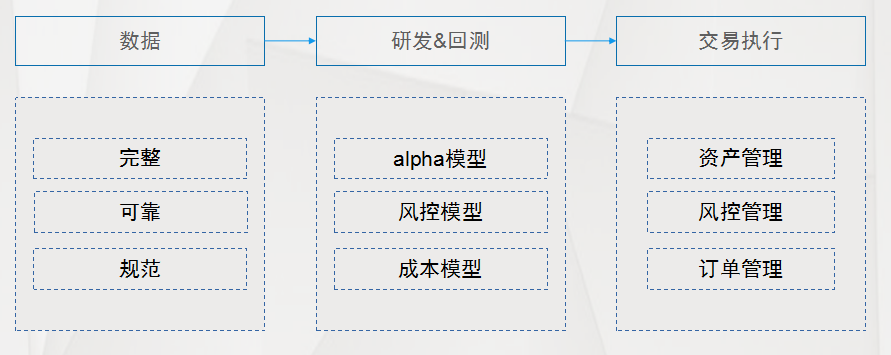

# 量化投资的应用与流程

> 《量化基础知识》第三节

## 量化投资应用

**量化投资一般应用于科学分析、市场监测、交易执行。**

**科学分析**主要运用计算机技术对历史数据进行处理，最终得出一个科学的结论。比如：投资者如果想要知道每股收益这个财务数据是否可以作为投资参考，其可以通过对历史数据进行分析处理，分别买入较高每股收益的股票并持有一段时间和买入较低每股收益的股票并持有一段时间，如果买入较高的每股收益的股票的获利能力远大于买入较低每股收益的股票的获利能力，那么证明了过去一段时间内，股票的每股收益数据确实会影响股价的涨跌，反之，则不然。

**市场监测**主要运用计算机程序，实时对整个市场进行监控，包括个股价格波动、市场消息、突发事件等。目前中国股市的上市公司高达3000多家，如果人为去监测整个市场的动态，其会消耗大量的人力物力，并且最终效果达不到预期，而量化投资的市场监测功能能较好的解决这个问题，通过计算机程序，实时对所有上市股票进行监测。

**交易执行**主要运用计算机程序，完成精确的、及时的交易工作。一般而言，多账户多策略的交易执行需要计算机程序实现。人为无法同时操作多个账户，会导致交易不精确，过于迟缓的情况发生。不仅如此，计算机程序还能实现算法交易，能有效降低交易成本。

*图：量化投资的三大应用场景（示意）*

<svg xmlns="http://www.w3.org/2000/svg" viewBox="0 0 720 210" font-family="'Microsoft YaHei','PingFang SC',sans-serif">
  <defs>
    <marker id="arw" markerWidth="8" markerHeight="8" refX="7" refY="3" orient="auto">
      <path d="M0,0 L7,3 L0,6 Z" fill="#94a3b8"/>
    </marker>
  </defs>
  <rect x="270" y="16" width="180" height="40" rx="8" fill="#eff6ff" stroke="#2563eb" stroke-width="1.5"/>
  <text x="360" y="41" text-anchor="middle" font-size="14" fill="#1e293b">量化投资的应用</text>
  <line x1="320" y1="58" x2="150" y2="100" stroke="#94a3b8" stroke-width="1.5" marker-end="url(#arw)"/>
  <line x1="360" y1="58" x2="360" y2="100" stroke="#94a3b8" stroke-width="1.5" marker-end="url(#arw)"/>
  <line x1="400" y1="58" x2="570" y2="100" stroke="#94a3b8" stroke-width="1.5" marker-end="url(#arw)"/>
  <rect x="30" y="104" width="220" height="44" rx="8" fill="#eff6ff" stroke="#2563eb" stroke-width="1.5"/>
  <text x="140" y="131" text-anchor="middle" font-size="14" fill="#1e293b">科学分析</text>
  <rect x="250" y="104" width="220" height="44" rx="8" fill="#eff6ff" stroke="#2563eb" stroke-width="1.5"/>
  <text x="360" y="131" text-anchor="middle" font-size="14" fill="#1e293b">市场监测</text>
  <rect x="470" y="104" width="220" height="44" rx="8" fill="#f0fdf4" stroke="#16a34a" stroke-width="1.5"/>
  <text x="580" y="131" text-anchor="middle" font-size="14" fill="#1e293b">交易执行</text>
  <text x="140" y="170" text-anchor="middle" font-size="12" fill="#475569">用计算机技术处理历史数据</text>
  <text x="140" y="190" text-anchor="middle" font-size="12" fill="#475569">最终得出一个科学的结论</text>
  <text x="360" y="170" text-anchor="middle" font-size="12" fill="#475569">实时监控个股波动、市场消息</text>
  <text x="360" y="190" text-anchor="middle" font-size="12" fill="#475569">突发事件，覆盖所有上市股票</text>
  <text x="580" y="170" text-anchor="middle" font-size="12" fill="#475569">精确、及时地完成交易工作</text>
  <text x="580" y="190" text-anchor="middle" font-size="12" fill="#475569">算法交易能有效降低交易成本</text>
</svg>

## 量化投资流程

**一般而言，量化投资的流程为：数据—研发&回测—交易执行。**

1. **数据**

2. **研发&回测**

3. **交易执行**

---

> 🏷️ 本文属《投资知识库 · 06-选股基金与量化》，重排于 2026-11。
