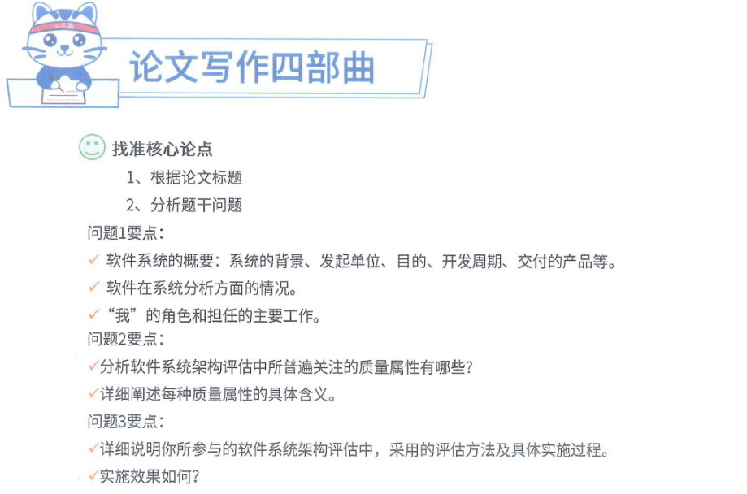
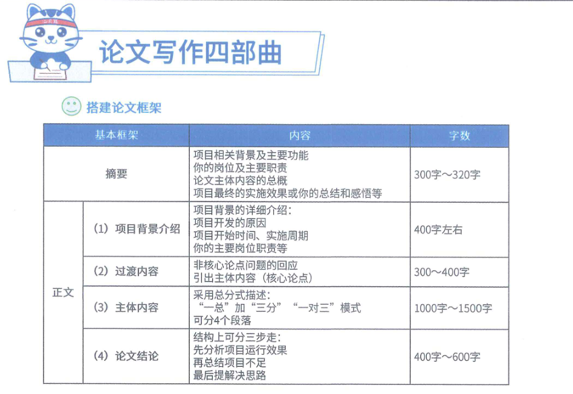
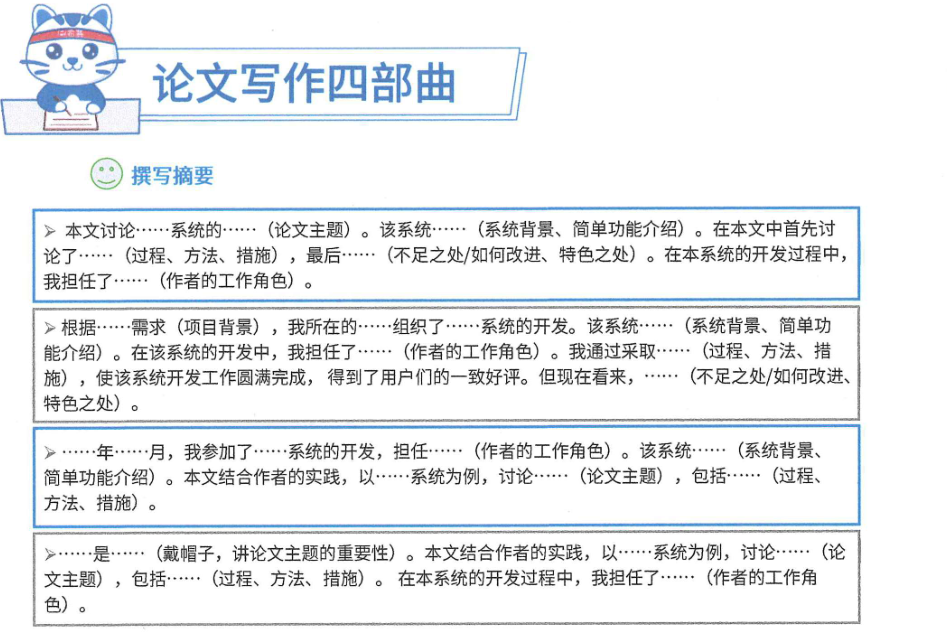
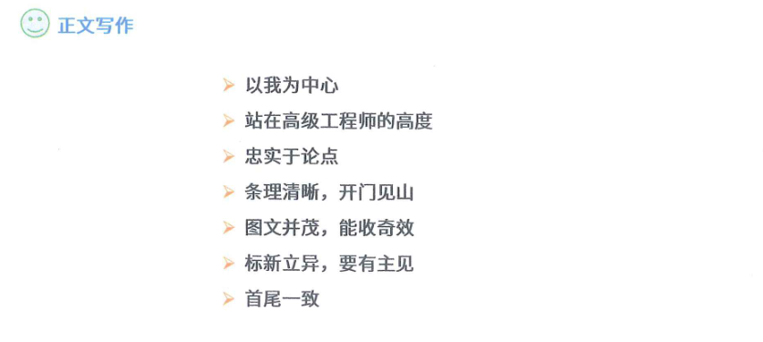
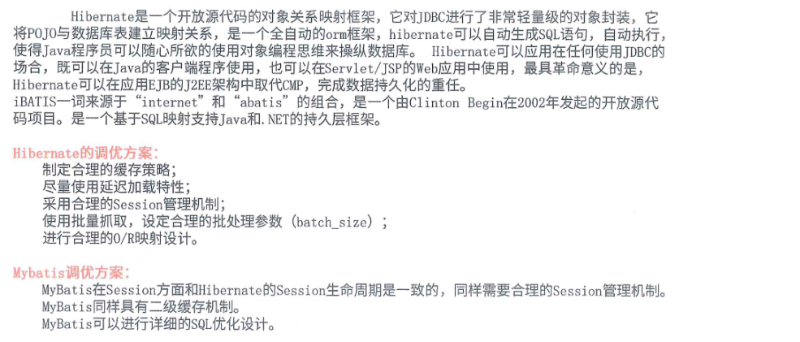
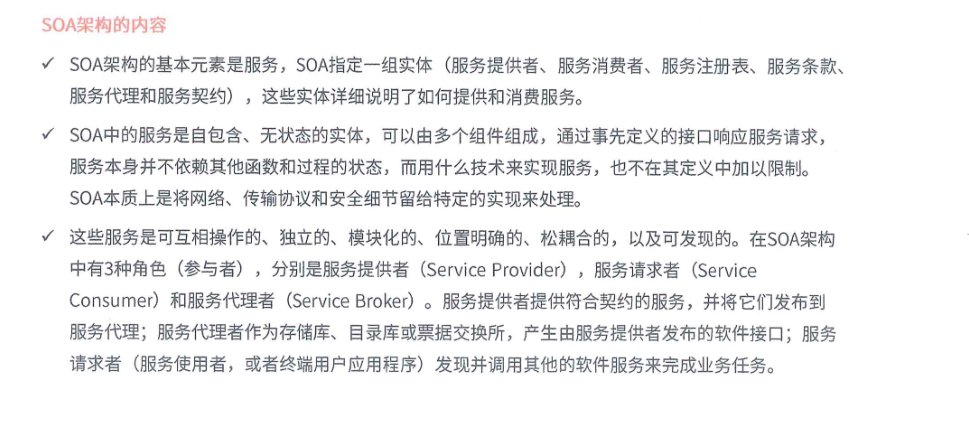
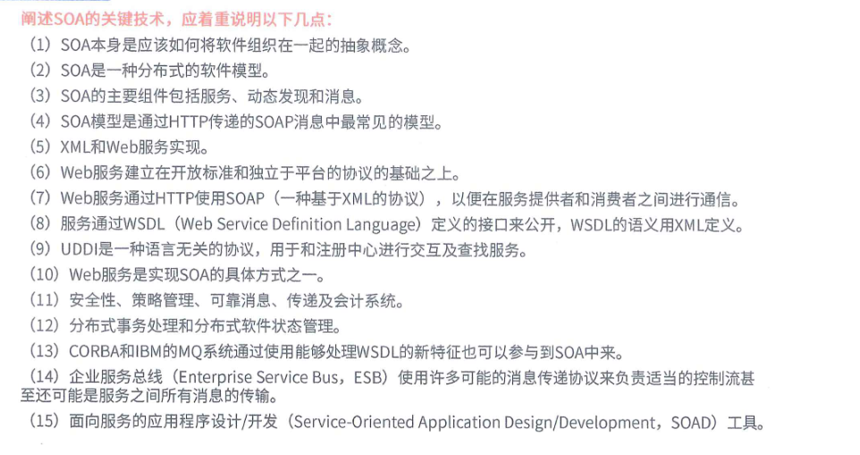
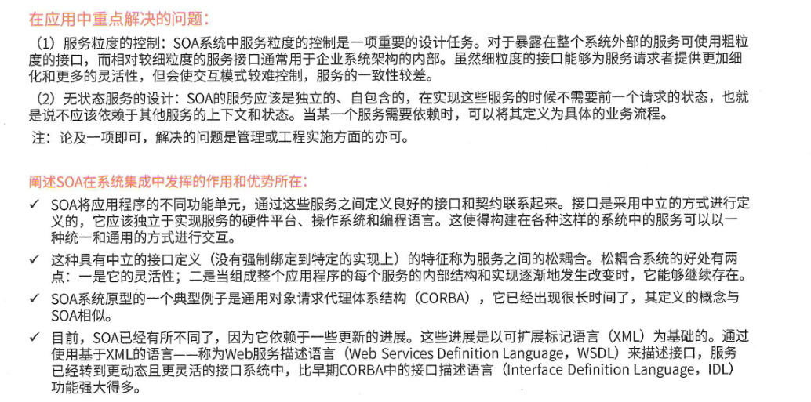

# 架构设计论文写作

系统建模

软件架构设计

系统设计

分布式系统设计

系统可靠性分析与设计

系统安全性和保密性设计

## 数据库设计

## SOA架构服务

<svg xmlns="http://www.w3.org/2000/svg" viewBox="0 0 860 480" font-family="'Microsoft YaHei','PingFang SC',sans-serif">
  <defs>
    <marker id="ar1" markerWidth="9" markerHeight="9" refX="8" refY="4.5" orient="auto">
      <path d="M0,0 L9,4.5 L0,9 z" fill="#64748b"/>
    </marker>
  </defs>
  <text x="430" y="34" text-anchor="middle" font-size="16" font-weight="bold" fill="#1e293b">架构设计论文常见主题</text>
  <rect x="345" y="215" width="170" height="50" rx="8" fill="#eff6ff" stroke="#2563eb" stroke-width="1.5"/>
  <text x="430" y="245" text-anchor="middle" font-size="13" fill="#1e293b">论文写作主题</text>
  <rect x="60" y="70" width="250" height="44" rx="8" fill="#ecfdf5" stroke="#16a34a" stroke-width="1.5"/>
  <text x="185" y="97" text-anchor="middle" font-size="13" fill="#1e293b">系统建模</text>
  <rect x="60" y="165" width="250" height="44" rx="8" fill="#fef3c7" stroke="#d97706" stroke-width="1.5"/>
  <text x="185" y="192" text-anchor="middle" font-size="13" fill="#1e293b">软件架构设计</text>
  <rect x="60" y="260" width="250" height="44" rx="8" fill="#f5f3ff" stroke="#7c3aed" stroke-width="1.5"/>
  <text x="185" y="287" text-anchor="middle" font-size="13" fill="#1e293b">系统设计</text>
  <rect x="60" y="355" width="250" height="44" rx="8" fill="#ecfdf5" stroke="#16a34a" stroke-width="1.5"/>
  <text x="185" y="382" text-anchor="middle" font-size="13" fill="#1e293b">分布式系统设计</text>
  <rect x="550" y="70" width="250" height="44" rx="8" fill="#fef3c7" stroke="#d97706" stroke-width="1.5"/>
  <text x="675" y="97" text-anchor="middle" font-size="13" fill="#1e293b">系统可靠性分析与设计</text>
  <rect x="550" y="165" width="250" height="44" rx="8" fill="#eff6ff" stroke="#2563eb" stroke-width="1.5"/>
  <text x="675" y="192" text-anchor="middle" font-size="13" fill="#1e293b">系统安全性和保密性设计</text>
  <rect x="550" y="260" width="250" height="44" rx="8" fill="#f5f3ff" stroke="#7c3aed" stroke-width="1.5"/>
  <text x="675" y="287" text-anchor="middle" font-size="13" fill="#1e293b">数据库设计</text>
  <rect x="550" y="355" width="250" height="44" rx="8" fill="#ecfdf5" stroke="#16a34a" stroke-width="1.5"/>
  <text x="675" y="382" text-anchor="middle" font-size="13" fill="#1e293b">SOA架构服务</text>
  <line x1="345" y1="228" x2="314" y2="94" stroke="#64748b" stroke-width="1.5" marker-end="url(#ar1)"/>
  <line x1="345" y1="238" x2="314" y2="189" stroke="#64748b" stroke-width="1.5" marker-end="url(#ar1)"/>
  <line x1="345" y1="250" x2="314" y2="283" stroke="#64748b" stroke-width="1.5" marker-end="url(#ar1)"/>
  <line x1="345" y1="260" x2="314" y2="376" stroke="#64748b" stroke-width="1.5" marker-end="url(#ar1)"/>
  <line x1="515" y1="228" x2="546" y2="94" stroke="#64748b" stroke-width="1.5" marker-end="url(#ar1)"/>
  <line x1="515" y1="238" x2="546" y2="189" stroke="#64748b" stroke-width="1.5" marker-end="url(#ar1)"/>
  <line x1="515" y1="250" x2="546" y2="283" stroke="#64748b" stroke-width="1.5" marker-end="url(#ar1)"/>
  <line x1="515" y1="260" x2="546" y2="376" stroke="#64748b" stroke-width="1.5" marker-end="url(#ar1)"/>
</svg>

*图：架构设计论文常见主题导图示意（依考点整理）*
