# 数据库系统

## 体系结构
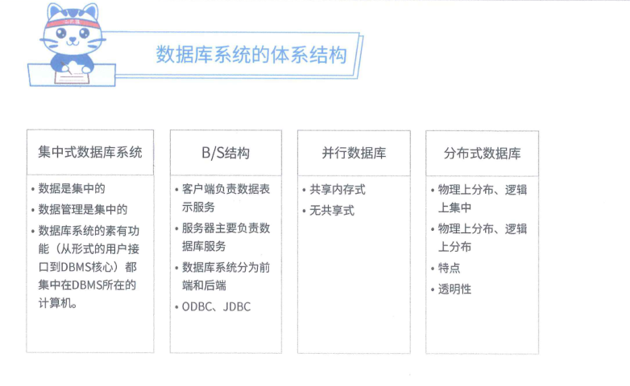

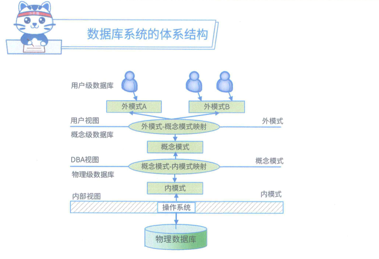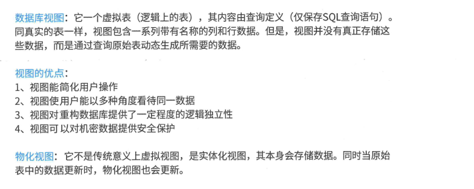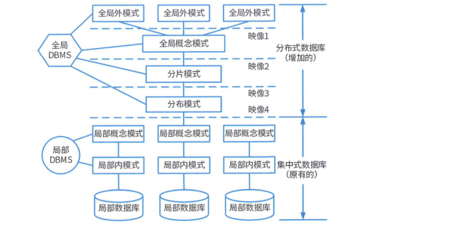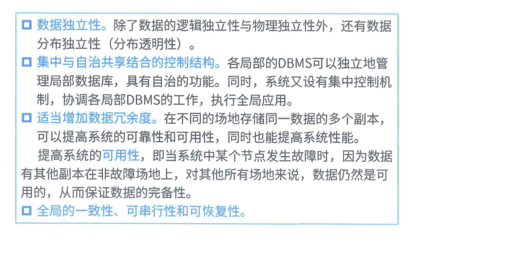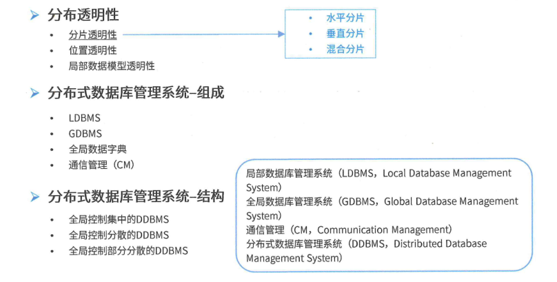

## 数据仓库与数据挖掘
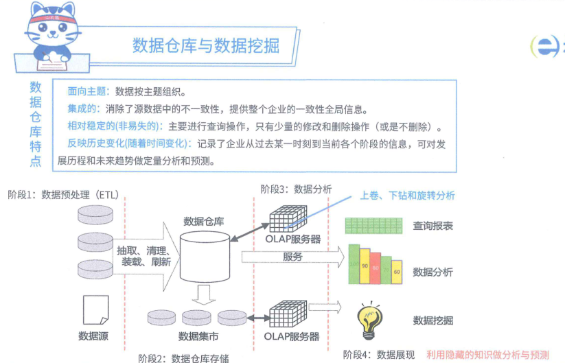

## 数据库设计过程
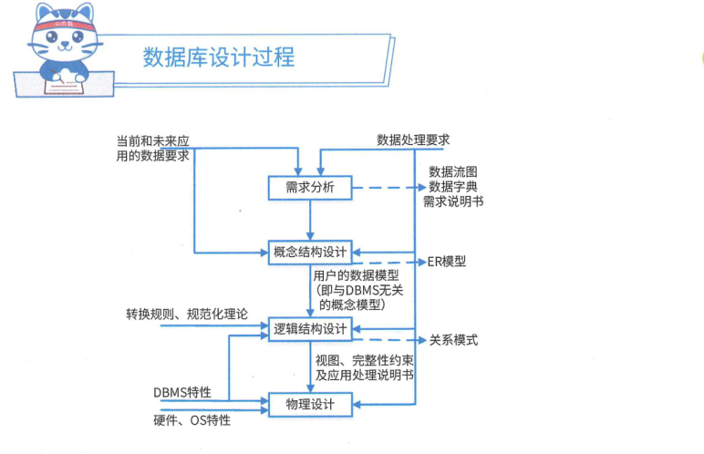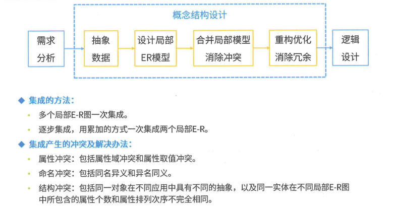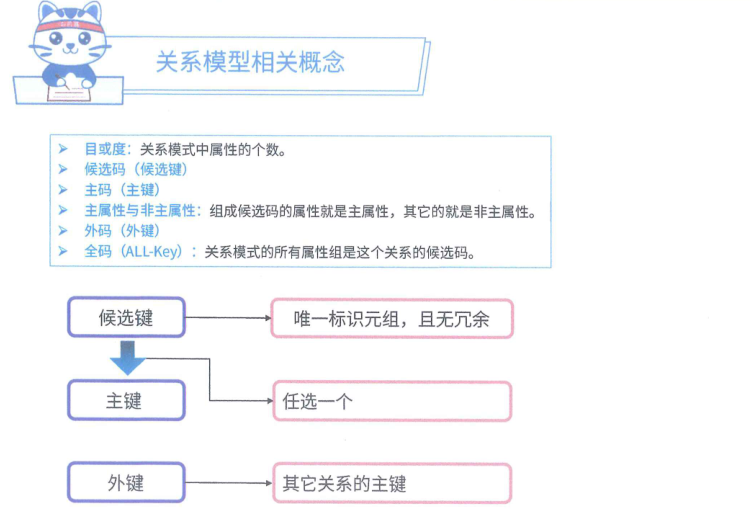

## 规范化理论
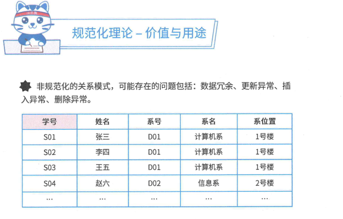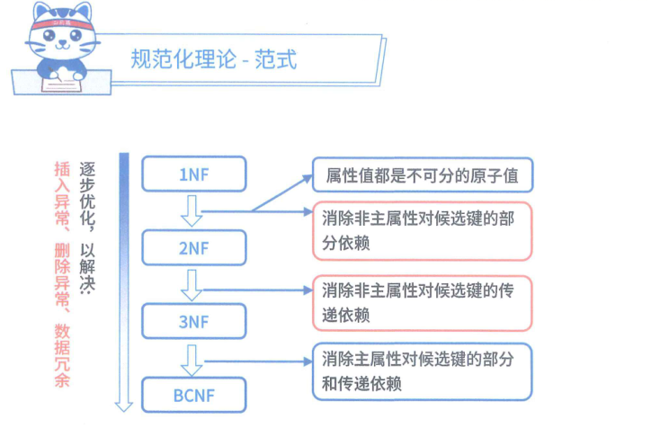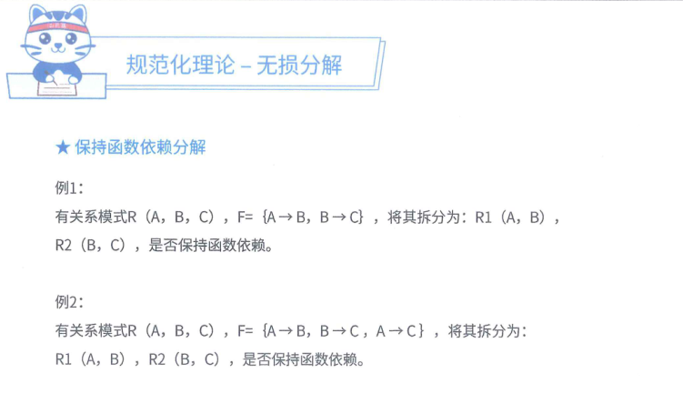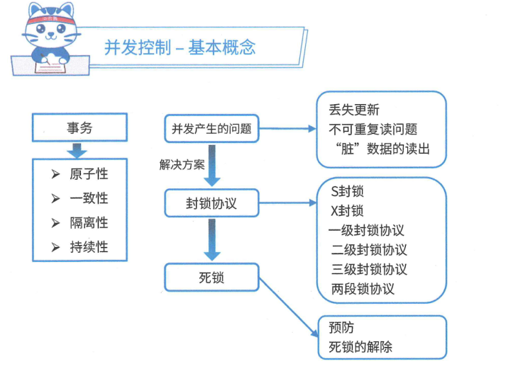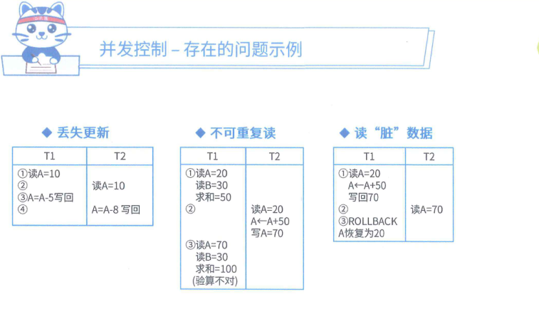

## 数据库安全性
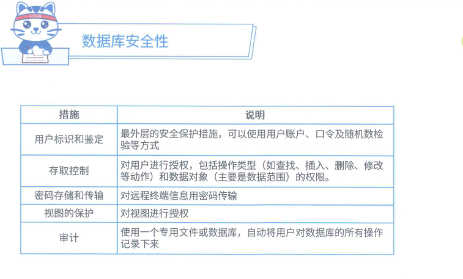

## 数据备份
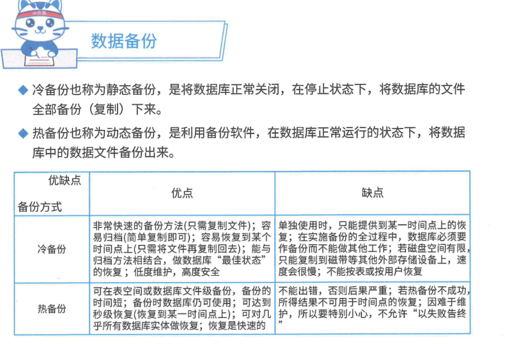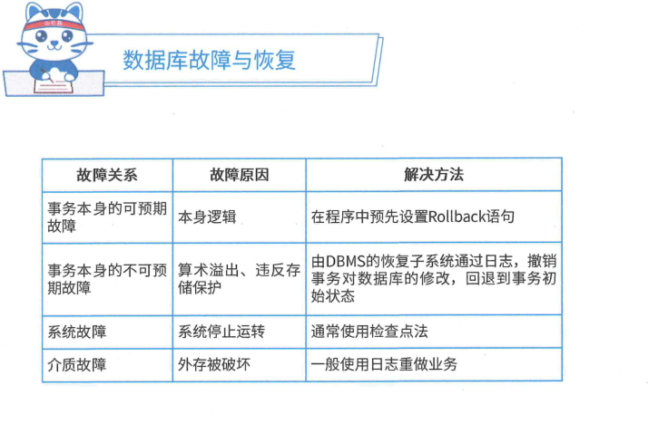

<svg xmlns="http://www.w3.org/2000/svg" viewBox="0 0 820 460" font-family="'Microsoft YaHei','PingFang SC',sans-serif">
  <defs>
    <marker id="ar1" markerWidth="9" markerHeight="9" refX="8" refY="4.5" orient="auto">
      <path d="M0,0 L9,4.5 L0,9 z" fill="#64748b"/>
    </marker>
  </defs>
  <text x="410" y="34" text-anchor="middle" font-size="16" font-weight="bold" fill="#1e293b">数据库系统知识体系</text>
  <rect x="335" y="205" width="150" height="50" rx="8" fill="#eff6ff" stroke="#2563eb" stroke-width="1.5"/>
  <text x="410" y="235" text-anchor="middle" font-size="13" fill="#1e293b">数据库系统</text>
  <rect x="60" y="70" width="170" height="44" rx="8" fill="#ecfdf5" stroke="#16a34a" stroke-width="1.5"/>
  <text x="145" y="97" text-anchor="middle" font-size="13" fill="#1e293b">体系结构</text>
  <rect x="40" y="205" width="210" height="44" rx="8" fill="#fef3c7" stroke="#d97706" stroke-width="1.5"/>
  <text x="145" y="232" text-anchor="middle" font-size="13" fill="#1e293b">数据库设计过程</text>
  <rect x="60" y="340" width="170" height="44" rx="8" fill="#f5f3ff" stroke="#7c3aed" stroke-width="1.5"/>
  <text x="145" y="367" text-anchor="middle" font-size="13" fill="#1e293b">规范化理论</text>
  <rect x="570" y="70" width="210" height="44" rx="8" fill="#fef3c7" stroke="#d97706" stroke-width="1.5"/>
  <text x="675" y="97" text-anchor="middle" font-size="13" fill="#1e293b">数据仓库与数据挖掘</text>
  <rect x="590" y="205" width="170" height="44" rx="8" fill="#ecfdf5" stroke="#16a34a" stroke-width="1.5"/>
  <text x="675" y="232" text-anchor="middle" font-size="13" fill="#1e293b">数据库安全性</text>
  <rect x="590" y="340" width="170" height="44" rx="8" fill="#f5f3ff" stroke="#7c3aed" stroke-width="1.5"/>
  <text x="675" y="367" text-anchor="middle" font-size="13" fill="#1e293b">数据备份</text>
  <line x1="335" y1="218" x2="234" y2="94" stroke="#64748b" stroke-width="1.5" marker-end="url(#ar1)"/>
  <line x1="335" y1="230" x2="254" y2="227" stroke="#64748b" stroke-width="1.5" marker-end="url(#ar1)"/>
  <line x1="335" y1="242" x2="234" y2="360" stroke="#64748b" stroke-width="1.5" marker-end="url(#ar1)"/>
  <line x1="485" y1="218" x2="566" y2="94" stroke="#64748b" stroke-width="1.5" marker-end="url(#ar1)"/>
  <line x1="485" y1="230" x2="586" y2="227" stroke="#64748b" stroke-width="1.5" marker-end="url(#ar1)"/>
  <line x1="485" y1="242" x2="586" y2="360" stroke="#64748b" stroke-width="1.5" marker-end="url(#ar1)"/>
</svg>

*图：数据库系统知识体系导图示意（依考点整理）*
